# De-Broglie-Bohm-Theorie

**Überblick.** Die De-Broglie-Bohm-Theorie beschreibt die Quantenwelt als deterministische Dynamik mit realen Konfigurationen. Für Teilchen ist die Konfiguration die Position, für Felder die Feldkonfiguration, für die Geometrie die Metrik. Die Wellenfunktion wird nicht als Wahrscheinlichkeitswolke gelesen, sondern als Führungsfeld, das die Konfiguration entlang definierter Bahnen leitet. Aus der Zerlegung des Zustands in Amplitude und Phase entstehen zwei Größen: Die Amplitude bestimmt das Quantenpotential, eine zusätzliche nichtklassische Kraft, die Phase bestimmt die Führung, die Geschwindigkeit der Konfiguration. Die Publikation präzisiert dieses Bild an vielen Stellen: Sie unterscheidet die allgemeine Stromform der Führung von der speziellen Phasenform, behandelt Dirac-Felder ohne globale Phase, untersucht verschränkte Zustände mit nichtlokaler Führung, entwickelt Quantenfelder mit Feldkonfiguration und funktionaler Führung, quantisiert die Metrik in der Gravitation mit Quantenbeitrag zu den Einstein-Gleichungen, verfolgt Bohmbahnen durch Schwarzschild-Horizonte und reguläre Black-bounce-Geometrien, berechnet renormierte Quantenfeldquellen exakt und prüft die Grundlagen der Zeit- und Synchronisationswahl. Die Grenzen der verallgemeinerten Gleichung sind benannt: Die Phasenführung ist ein Spezialfall der Stromform, die DeWitt-Metrik ist indefinit, die Dichte der Geometrie ist nicht normalisierbar, und die konditionierte Interpretation ist ein Ausweg, aber nicht eindeutig. Die Theorie ist deterministisch, nichtlokal, im Quantengleichgewicht empirisch äquivalent zur Standard-Quantenmechanik und behandelt Gravitation, schwarze Löcher und Quantenfelder als konkrete Modelle mit klaren Grenzen.

**Zusammenfassung.** Diese Arbeit verbindet die Stromformulierung der De-Broglie-Bohm-Theorie mit expliziten mathematischen und numerischen Prüfungen. Sie konstruiert ein normiertes verschränktes Modell zweier freier massiver Dirac-Teilchen in einer Raumdimension mit zustandsabhängiger Foliation, kausaler Führung, fast sicherer globaler Trajektorienexistenz und Äquivarianz. Ein unabhängiger Lorentzvergleich einschließlich transformierter Impulsintegrale und gesonderter Bahnintegration bestätigt dessen Kovarianz numerisch. Lean verifiziert die endliche Strom-, Lorentz- und Verschränkungsalgebra sowie den Dichtetransport und die lokale CHSH-Schranke in den jeweils angegebenen Geltungsbereichen. Ergänzend werden eine lokale Quanten-Impulsbilanz hergeleitet und freie Gaußpakete sowie ein paraxiales Doppelspaltmodell gegen geschlossene Lösungen geprüft. Ein unabhängiger Python-Vergleich mit den offenen Ereignisdaten des Bell-Experiments von Hensen et al. reproduziert dessen Verletzung der lokalen Schranke. Diese Messung prüft lokale verborgene Variablen gegen nichtlokale Quantenkorrelationen; zwischen Bohmscher Mechanik im Quantengleichgewicht und der zugehörigen Standard-Quantentheorie unterscheidet sie nicht. Ein freies massives Skalarfeld in drei Raumdimensionen ergänzt die Teilchenmodelle: Für einen endlichen Modenregulator werden globale Gaußlösungen, Feldführung und Gleichgewichtstransport hergeleitet, in Lean auf Modenebene verifiziert und unabhängig spektral sowie numerisch geprüft. Eine dreidimensionale Darstellung des räumlich geglätteten Feldes wird durch eine analytische Abschätzung des entfernten Modenanteils abgesichert. Für die Gravitation werden zwei weitere Modelle vollständig ausgewertet: Eine exakte de-Sitter-Feldlösung erlaubt den Vergleich kosmischer und konformer Zeit und zeigt die Kompensation des klassischen Bohm-Quellenrests im Operator-Erwartungswert. Ein quantisiertes Strahlungs-Minisuperspace besitzt einen regulären Bounce mit kausal geodätisch vollständiger effektiver Metrik. Für jede positive Anfangsgröße bleibt die Krümmung endlich; ihre Ensembleerwartungswerte divergieren jedoch im gewählten Gaußzustand. Die Herleitungen werden durch zusätzliche Lean-Beweise, unabhängige Python-Rechnungen und einen symbolischen Tensorvergleich geprüft. Ein anschließend selbstkonsistent rückgekoppeltes endliches Gauß-FLRW-Modell erhält den Friedmann-Constraint und ist für nichtnegative kosmologische Konstante global zukünftig regulär. Seine positive Quelle schließt einen Bounce aus und erzwingt eine vergangene Krümmungssingularität; Kovarianz-, Energievarianz- und unabhängige Integrationsrechnungen bestimmen die Reichweite dieser Kopplung. Ein renormiertes konformes Kontinuumsfeld erweitert die Quellenanalyse: Bei verschwindendem effektivem lokalen Krümmungskoeffizienten bleibt mit positiver Strahlung ein endlicher Krümmungsendpunkt bestehen. Für genau angegebene andere Kopplungen wird dagegen eine glatte, kausal geodätisch vollständige Bounce-Familie einschließlich eines reinen Vakuumfalls konstruiert. Quellenkontinuität und explizite Rückwirkung werden analytisch, numerisch und in zusätzlichen Lean-Modulen geprüft. Die Bohmsche Vakuumführung wird analytisch rekonstruiert und unabhängig symbolisch kontrolliert. Die unterschiedlichen Materiekopplungen und die Grenzen der semiklassischen Aussage sind ausdrücklich festgelegt. Für einen Schwarzschild-Hintergrund werden anschließend die vierdimensionale Spuranomalie und Skalarstreuung, ein eigenständiger zweidimensionaler Stresszustandsvergleich und ein exakt gelöster Bohm-Dirac-Teststrom untersucht. Die Anomalie erzwingt eine Krümmungskorrektur; die berechnete Hawking-Leistung stimmt mit dem veröffentlichten Skalarwert überein. Die Testbahnen überqueren den Horizont regulär und erreichen den vorgegebenen Singularitätsrand in endlicher Zeit, wobei der Wahrscheinlichkeitsabfluss exakt bilanziert wird. Weitere Lean-Sätze und unabhängige Python-Rechnungen prüfen die angegebenen Identitäten und Entwicklungen. Eine anschließend selbstkonsistent gelöste statische Einstein–Polyakov-Quelle ersetzt den Schwarzschild-Horizont durch einen regulären Hals. Für positive Zentralladung und die angegebene Halsfamilie wird eine innere nullartige Krümmungssingularität in endlicher radialer Eigen- und Nullaffindistanz bewiesen. Die vollständigen reduzierten Einstein-Gleichungen werden numerisch gelöst; zusätzliche Lean-Sätze verifizieren Quellen- und Constraint-Erhaltung, Differentialvergleiche sowie die Divergenz der expliziten Krümmungsuntergrenze. Die Polyakov-Näherung und die vollständige vierdimensionale Quantenfeldquelle werden dabei ausdrücklich unterschieden. Eine dilatonabhängige s-Wellen-Erweiterung liefert anschließend eine konservierte Quelle mit radialem Rückstreupotential. Ein eigener Singularitätssatz beweist für ein explizites invariantes Gebiet divergierende Krümmung bei unbegrenztem Flächenradius und endlicher optischer Distanz; ein in der Literatur verwendeter Endpunktansatz bei endlichem Radius wird aus den ursprünglichen Gleichungen ausgeschlossen. Zusätzliche Lean-Beweise, unabhängige Integrationen und ein vollständig festgelegter begrenzter Streutest prüfen diese Aussagen; zwei am inneren Rand quadratintegrierbare Nullmoden belegen die Notwendigkeit einer zusätzlichen Randbedingung des globalen Feldoperators. Eine vierdimensionale ordnungsreduzierte analytische Quelle ergänzt anschließend den Quellenvergleich. Für minimale und konforme Kopplung wird ein endlicher zeitartiger Singularitätsrand außerhalb des klassischen Schwarzschildradius bewiesen und numerisch reproduziert; der reguläre Hals bleibt dabei nicht erhalten. Die exakten höheren Winkelpotentiale und ihre lokalen Randlösungen werden bestimmt, während ein konformes Gegenbeispiel die Grenzen der Quellenapproximation zeigt. Zusätzliche Lean-Beweise sichern die Quellenidentitäten und die bedingten Endpunktgrenzwerte. Die vollständige konforme Spurgleichung schließt diese exakte konforme OR-Innenfamilie für jeden konstanten endlichen Krümmungsquadratparameter aus. Eine unendliche relative vierdimensionale Modensumme auf der minimalen OR-Geometrie quantifiziert zudem den Einfluss zweier innerer Quantendomänen; gemeinsame Spektralrestschranken, unabhängige Python-Rechnungen und weitere Lean-Beweise sichern die endlichen Quellenunterschiede. Diese Ergebnisse bestimmen weder den absoluten vollständigen Tensor noch die Singularitätsstruktur einer neuen selbstkonsistenten Geometrie. Ein massiver Dirac-Testzustand auf Schwarzschild ergänzt schließlich die Teilchenführung um einen echten vierdimensionalen Winkelkanal. Vollständige kausale Raumkurven mit Horizontpassage, eine exakte Quantilbilanz und bedingte innere Zeitgrenzen werden hergeleitet; unabhängige Python-Verfahren, dreidimensionale Bahnplots und weitere Lean-Beweise sichern die festgelegte Entwicklung einschließlich des Vergleichs mit klassischen Geodäten. Ein anschließend vollständig gekoppelter homogener Einstein–Dirac-Innenraum besitzt eine exakt kugelsymmetrische massive Zweifeldquelle. Ein Fortsetzungssatz mit expliziter positiver Marge und eine divergierende Krümmungsuntergrenze beweisen, dass die Schwarzschildartige Singularität in dieser Familie trotz veränderter Geometrie bestehen bleibt. Vierdimensionale Quellen- und Tensorrechnungen, unabhängige numerische Integrationen, Bohmsche Einzelstrombahnen und zusätzliche Lean-Sätze prüfen diesen klassischen Rückwirkungssektor; der absolute renormierte Quantenfeldtensor bleibt davon unterschieden. Als reguläre Alternative wird schließlich eine massive Diracentwicklung auf einer ausdrücklich vorgegebenen Black-bounce-Geometrie konstruiert. Die Quelle muss gegenüber dem vorherigen Modell geändert werden und verletzt die Nullenergiebedingung. Beschränkte Krümmung, globale unitäre Feldentwicklung und ein bedingter Durchquerungssatz sichern die lokale Fortsetzung; unabhängig geprüfte Bohmbahnen passieren den Minimalradius und den zweiten Horizont ohne Wahrscheinlichkeitsverlust. Vier neue Abbildungen und zusätzliche Lean-Beweise dokumentieren den Übergang und seine Modellgrenzen. Ein weiterer Vergleich bestimmt den endlichen renormierten Anregungstensor eines glatten Diracpakets auf beiden Geometrien. Eine explizite Hadamard-Zustandskonstruktion, der vollständige Rahmentensor und die geprüften Energiearbeitsbilanzen verbinden Quantenfeld und Raumkrümmung. Die lokale Normalenergie ändert sich durch Spannungsarbeit, während die stationäre Energie einschließlich Randfluss erhalten bleibt. Die zusätzliche Anregung ersetzt weder die absolute Referenzquelle noch die tragende Quelle der regulären Geometrie.

Die absolute massive Diracquelle wird zusätzlich im de-Sitter-invarianten Zustand vollständig renormiert ausgewertet und mit dem gesamten Einstein-Tensor selbstkonsistent gekoppelt. Ein Existenzbeweis liefert einen global regulären Zweig; direkte subtrahierte Modenintegrale bestätigen die Quelle. Zustandsunabhängige masslose Spurbedingungen schließen sowohl die unveränderte Schwarzschild-Metrik als auch die konkrete Black-bounce-Familie als allein feldgetragene Lösungen aus. Für das massive Schwarzschild-Feld werden die führende lokale Großmassenquelle und ihre erste Metrikantwort einschließlich Horizontkorrekturen hergeleitet. Diese begrenzte Antwort entscheidet nicht über die Singularität einer vollständigen massiven Schwarzlochlösung.

Eine gemeinsame Wheeler–DeWitt-Dynamik quantisiert anschließend Geometrie und homogenen Skalarfeldmodus zusammen. Aus einer einzigen zustandsabhängigen Wirkung folgen die Bohmsche Führung, beide Einstein-Gleichungen und ein exakt kompensierter Energieaustausch. Ein rationales Paket liefert eine analytisch geodätisch vollständige Bounce-Lösung mit positiver bedingter Flussverteilung; ein Einzelzweig derselben Gleichung bleibt singulär. Unabhängige Python-Rechnungen, drei Abbildungen und 39 weitere Lean-Theoreme sichern diesen reduzierten Vereinheitlichungsansatz.

Die lokale Erweiterung bestimmt anschließend die zulässigen Koeffizienten einer Zweitableitungs-Constraintfamilie und weist einen regulatorstabilen nichtlokalen Defekt des freien Feldvakuums nach. Eine vollständig renormierte massive Casimirquelle auf dem räumlichen Dreitorus wird mit unabhängigen Moden- und Heatkernelverfahren berechnet; sie schließt den statischen flachen Ausgangsraum als allein feldgetragene Lösung aus. Eine exakte Varianzdivergenz trennt diese endliche Erwartungsquelle von der noch fehlenden Kontinuumskonstruktion eines separaten tatsächlichen Bohmschen Feldterms.

Eine anschließende Grundlagenprüfung trennt Zustandskonsistenz, Äquivarianz und tatsächliche Synchronisationsunabhängigkeit. Ein exakt entwickelter verschränkter Gaußzustand besitzt verschiedene Bohmsche Bahnen bei identischem Endzustand und identischer Born-Verteilung; für eine festgelegte gemeinsame Uhr ist seine Führung global lösbar. Eine kovariante dynamische Uhr und ihre analytische Ward-Identität bestimmen eine alternative Rückwirkungsbedingung. Unabhängige Rechnungen, drei Abbildungen und 60 weitere Lean-Theoreme sichern die endlichen Aussagen.

## 1. Nichtrelativistische Dynamik und Quantengleichgewicht

Für ein skalares Teilchen der Masse $m>0$ mit reellem Potential $V$, ohne elektromagnetisches Vektorpotential, gilt

$$i\hbar\partial_t\psi=-\frac{\hbar^2}{2m}\Delta\psi+V\psi.$$

Auf einem Bereich mit $\psi\ne0$ und hinreichender Glattheit schreiben wir lokal $\psi=R e^{iS/\hbar}$. Dabei ist $R=|\psi|>0$ eindeutig, die reelle Phase $S$ dagegen nur modulo $2\pi\hbar$ festgelegt. Ein global stetiger Phasenzweig kann durch die Topologie verhindert werden. Die Stromdarstellung benötigt keinen globalen Phasenzweig:

$$q=|\psi|^2,\qquad \mathbf j=\frac{\hbar}{m}\operatorname{Im}(\psi^*\nabla\psi),\qquad \dot{\mathbf X}=\frac{\mathbf j}{q}\bigg|_{\mathbf X}=\frac{\nabla S}{m}\bigg|_{\mathbf X}.$$

Die Real- und Imaginärteile der Schrödinger-Gleichung liefern

$$\partial_t q+\nabla\cdot(q\mathbf v)=0,\qquad
\partial_t S+\frac{|\nabla S|^2}{2m}+V+Q=0,\qquad
Q=-\frac{\hbar^2}{2m}\frac{\Delta R}{R}.$$

An Knoten ist der Quotient für $Q$ nicht definiert. Eine Divergenz beim Annähern ist jedoch nicht zwingend: Für $R=|\sin(kx)|$ ist $Q=\hbar^2k^2/(2m)$ innerhalb jedes offenen nodalen Intervalls konstant.

Für $N$ Teilchen sind $q=|\Psi|^2$ und die Führungsfelder auf dem Konfigurationsraum definiert,

$$\mathbf v_k=\frac{\hbar}{m_k}\frac{\operatorname{Im}(\Psi^*\nabla_k\Psi)}{|\Psi|^2},\qquad
Q=-\sum_k\frac{\hbar^2}{2m_k}\frac{\Delta_k R}{R}.$$

Bei verschränkten Zuständen hängt $\mathbf v_k$ im Allgemeinen auch von den übrigen Teilchenpositionen ab. Bei Produktzuständen zerfällt die Führung dagegen in unabhängige Einteilchenfelder. Die Nichtlokalität ist somit keine bloße Folge der Verwendung von Konfigurationskoordinaten.

**Einheiten.** Aus $\int |\Psi|^2d^{3N}x=1$ folgt $[\Psi]=[R]=\mathrm{L}^{-3N/2}$. Normierung allein macht die Wellenfunktion nicht dimensionslos. Es gelten $[S]=[\hbar]=\mathrm{J\,s}$ und $[V]=[Q]=\mathrm J$. In den späteren numerischen Modellen werden ausdrücklich skalierte oder natürliche Einheiten verwendet.

**Äquivarianz.** Sei $\rho$ die Ensembleverteilung, die durch dasselbe Geschwindigkeitsfeld transportiert wird. Unter einem eindeutig definierten Fluss und geeigneten Randbedingungen impliziert $\rho(t_0)=q(t_0)$ die Gleichheit $\rho(t)=q(t)$. Dies ist die Erhaltung des Quantengleichgewichts. Es ist keine Herleitung einer beliebigen Anfangsverteilung aus den Bewegungsgleichungen. Die grundlegende Konstruktion stammt von Bohm; die Gleichgewichts- und Typikalitätsanalyse wird bei Dürr, Goldstein und Zanghì ausgearbeitet [Bohm1952a, Bohm1952b, DGZ1992].

## 2. Gleichzeitigkeit, Nichtlokalität und Kovarianz

Die nichtrelativistische Theorie besitzt eine absolute Gleichzeitigkeit, kann aber Galilei-kovariant formuliert werden; sie benötigt kein ausgezeichnetes räumliches Koordinatensystem. Für relativistische Vielteilchenmodelle muss festgelegt sein, welche Konfigurationen die nichtlokale Führung gemeinsam bestimmen.

Hypersurface-Bohm-Dirac-Modelle verwenden hierzu eine raumartige Foliation der Minkowski-Raumzeit. Die ursprüngliche Konstruktion behandelt verschränkte, untereinander nicht wechselwirkende Dirac-Teilchen, gegebenenfalls in äußeren Feldern, und beweist Äquivarianz auf den Blättern dieser Foliation unter den dort genannten Existenzannahmen [DGMZ1999]. Sie ist kein Beweis für beliebige relativistische Wechselwirkungen.

Die Foliation kann als zusätzliche geometrische Struktur kovariant mittransformiert werden. Sie kann unter geeigneten Voraussetzungen auch kovariant aus dem Quantenzustand bestimmt werden: Besitzt ein isoliertes System einen nichtverschwindenden zeitartigen Gesamtviererimpuls $P^\mu$, bilden die Hyperflächen $P_\mu x^\mu=\mathrm{const.}$ eine entsprechende Foliation. Diese Konstruktion setzt einen solchen Impuls voraus; sie gilt nicht für $P=0$ oder einen lichtartigen Gesamtimpuls [DGNSZ2014].

Bell-Nichtlokalität, Lorentz-Kovarianz und operationale Signalübertragung sind verschiedene Eigenschaften. Eine foliationsabhängige Bahn allein ergibt keinen messbaren Foliationseffekt. Für eine empirische Aussage sind die Gleichgewichtsverteilung und eine innerhalb der Theorie beschriebene Messapparatur entscheidend.

## 3. Relativistische Ströme und positive Dichten

### 3.1 Klein-Gordon-Strom

Mit Metriksignatur $(+---)$ lautet ein erhaltener Strom des komplexen Klein-Gordon-Feldes

$$j^\mu=\frac{i\hbar}{2m}(\psi^*\partial^\mu\psi-\psi\partial^\mu\psi^*),\qquad \partial_\mu j^\mu=0.$$

Obwohl $|\psi|^2\ge0$ gilt, kann die normale Stromkomponente $j^\mu n_\mu$ negativ sein. Eine Division durch $|\psi|^2$ erzeugt daher weder automatisch eine positive Hyperflächendichte noch eine normierte zeitartige Vierergeschwindigkeit. Stromerhaltung allein genügt nicht für eine Teilchen-Wahrscheinlichkeitsinterpretation.

### 3.2 Dirac-Strom und Führung

Für die Dirac-Gleichung definieren wir

$$\bar\psi=\psi^\dagger\gamma^0,\qquad j^\mu=\bar\psi\gamma^\mu\psi,\qquad \partial_\mu j^\mu=0.$$

Bei $x^0=ct$ gilt $j^0=\psi^\dagger\psi\ge0$. Dagegen ist $\bar\psi\psi$ kein positiver Dichteausdruck: Der Spinor $(0,0,1,0)^T$ besitzt in der Dirac-Darstellung $\bar\psi\psi=-1$ und $j^0=1$. Auf einer raumartigen Hyperfläche mit zukünftiger Einheitsnormalen ist

$$q_\Sigma=j^\mu n_\mu,\qquad d\mathbb P=q_\Sigma d\Sigma.$$

Der Dirac-Strom ist zukunftsgerichtet und nicht raumartig. Das lässt sich in einem Inertialsystem auch aus $|\psi^\dagger\boldsymbol\alpha\psi|\le\psi^\dagger\psi$ erkennen: Für jeden räumlichen Einheitsvektor hat $\mathbf e\cdot\boldsymbol\alpha$ nur die Eigenwerte $\pm1$. Die Bahn folgt dem Strom; dort, wo $j^0>0$, ist

$$\frac{dX^i}{dt}=c\frac{j^i}{j^0}.$$

Die unparametrisierte Stromlinie lässt sich kovariant als $dX^\mu/d\lambda=\alpha j^\mu$ mit $\alpha>0$ schreiben. Eine Normierung mit dem nichtpositiven Skalar $\bar\psi\psi$ wird nicht benötigt.

### 3.3 Tensorstrom für mehrere Teilchen

Für kompatible Mehrzeit-Dirac-Gleichungen lautet der Tensorstrom

$$J^{\mu_1\ldots\mu_N}=\bar\Psi\gamma_{(1)}^{\mu_1}\cdots\gamma_{(N)}^{\mu_N}\Psi.$$

Auf einem Blatt der gewählten Foliation erhält man durch Kontraktion sämtlicher Indizes mit $n_{\mu_k}$ die Konfigurationsdichte; durch Kontraktion aller Indizes außer $k$ den führenden Strom des Teilchens $k$. Im Produktspezialfall $\Psi=\psi_1\otimes\psi_2$ folgt unmittelbar

$$J^{\mu\nu}=j_1^\mu j_2^\nu,\qquad J^{\mu\nu}n_\nu=j_1^\mu q_\Sigma^{(2)},\qquad n_\mu J^{\mu\nu}n_\nu=q_\Sigma^{(1)}q_\Sigma^{(2)}.$$

Das Skript `work/manybody_dirac_check.py` bestätigt diese algebraischen Beziehungen und die Clifford-Relationen für konkrete reine Produktspinoren. Die geprüften Normalen sind als kovariante Komponenten $n_\mu$ zu lesen. Die allgemeine HBD-Äquivarianz beruht auf dem Tensorstrom-Argument der Primärarbeit [DGMZ1999]. Die Abschnitte 3.5–3.11 arbeiten zusätzlich einen tatsächlich verschränkten massiven Zweiteilchenzustand mit globaler Existenz, Lorentzvergleich und eigenen numerischen sowie formalen Nachweisen aus.

### 3.4 Diskrete Kontinuität der Dirac-Gleichung

In natürlichen Einheiten $\hbar=c=1$ wird

$$i\partial_t\psi=(-i\sigma_x\partial_x+m\sigma_z)\psi$$

auf einem periodischen Gitter durch zentrale Raumdifferenzen und Crank-Nicolson in der Zeit gelöst. Fouriertransformation diagonalisiert den räumlichen Operator in $2\times2$-Blöcke; der Zeitpropagator ist die Cayley-Abbildung

$$U_h=(I+iH_h\Delta t/2)^{-1}(I-iH_h\Delta t/2),$$

also nicht die exakte kontinuierliche Zeitentwicklung $e^{-iH_h\Delta t}$. Das Anfangspaket besitzt $x_0=-10$, $p_0=2$, $\sigma=1{,}2$, $m=1$; die Projektion auf positive Energie erfolgt für denselben Gitteroperator.

Mit $\psi_i^{\mathrm{mid}}=(\psi_i^{n+1}+\psi_i^n)/2$ und dem Link-Strom

$$j_{i+1/2}^{\mathrm{mid}}=\operatorname{Re}[(\psi_i^{\mathrm{mid}})^\dagger\sigma_x\psi_{i+1}^{\mathrm{mid}}]$$

erfüllt dieser Algorithmus die diskrete Bilanz $(q_i^{n+1}-q_i^n)/\Delta t+(j_{i+1/2}-j_{i-1/2})/\Delta x=0$ bis auf Rundungsfehler. Die erneute Rechnung bis $T=5$ auf $L=40$ bei $\Delta t=0{,}0025$ ergibt:

| Gitterpunkte | Maximaler Link-Bilanzfehler | Maximaler Residualfehler mit punktweisem Strom | Maximaler Normfehler |
|---|---|---|---|
| 256 | $1{,}87\times10^{-13}$ | $1{,}315\times10^{-2}$ | $4{,}62\times10^{-14}$ |
| 512 | $1{,}99\times10^{-13}$ | $3{,}255\times10^{-3}$ | $2{,}78\times10^{-14}$ |
| 1024 | $2{,}10\times10^{-13}$ | $8{,}163\times10^{-4}$ | $2{,}49\times10^{-14}$ |

Die vierfache Abnahme des zweiten Residuums bei Halbierung der Raumweite ist mit dem Raumfehler zweiter Ordnung vereinbar. Die exakte diskrete Bilanz ist eine Eigenschaft des diskreten Operators; sie beweist für sich genommen keine Konvergenz der vollständigen Wellenfunktion zum Kontinuumsproblem. Nachweis: `work/dirac_convergence.py` und `work/dirac_convergence_20261017.json`.

### 3.5 Verschränkter Zweiteilchenzustand

Wir konstruieren ein freies Hypersurface-Bohm-Dirac-Modell für zwei unterscheidbare massive Teilchen in $1+1$ Dimensionen. Es gelten $\hbar=c=m=1$ und die Signatur $(+-)$. Anders als in Abschnitt 3.4 verwenden wir die äquivalente Matrixdarstellung

$$\alpha=\sigma_z,\qquad \beta_D=\sigma_x,\qquad
\gamma^0=\beta_D,\qquad \gamma^1=\beta_D\alpha,\qquad
H(p)=p\alpha+\beta_D.$$

Für $E(p)=\sqrt{p^2+1}$ besitzt $H(p)$ den normierten positiven Energiespinor

$$u(p)=\begin{pmatrix}\sqrt{(E+p)/(2E)}\\ \sqrt{(E-p)/(2E)}\end{pmatrix},
\qquad H(p)u(p)=E(p)u(p),\qquad u(p)^\dagger u(p)=1.$$

Mit $p_0=1$ und $\sigma_p=0{,}6$ definieren wir die normierten Impulsamplituden und ihre freien Wellenpakete durch

$$f_\pm(p)=(2\pi\sigma_p^2)^{-1/4}
\exp\!\left[-\frac{(p\mp p_0)^2}{4\sigma_p^2}\right],$$

$$\begin{aligned}
A(x,t)&=\frac1{\sqrt{2\pi}}\int_{\mathbb R}f_+(p)u(p)e^{ipx-iE(p)t}\,dp,\\
B(x,t)&=\frac1{\sqrt{2\pi}}\int_{\mathbb R}f_-(p)u(p)e^{ipx-iE(p)t}\,dp.
\end{aligned}$$

Plancherel und $u^\dagger u=1$ ergeben $\|A\|=\|B\|=1$ und den zeitunabhängigen Überlapp

$$r=\langle A,B\rangle=\exp[-p_0^2/(2\sigma_p^2)].$$

Die Funktionen $\phi_0=A$ und $\phi_1=(B-rA)/\sqrt{1-r^2}$ sind orthonormal. Der Mehrzeitzustand lautet

$$\Psi(x_1,t_1;x_2,t_2)=\frac{
\phi_0(x_1,t_1)\otimes\phi_0(x_2,t_2)
+i\phi_1(x_1,t_1)\otimes\phi_1(x_2,t_2)}{\sqrt2}.$$

Er erfüllt beide freien Dirac-Gleichungen $i\partial_{t_k}\Psi=H_k\Psi$. Die Operatoren wirken auf verschiedene Raum- und Spinorkoordinaten, sodass $[H_1,H_2]=0$; die Mehrzeitentwicklung ist kompatibel. Die Schmidt-Koeffizienten sind exakt $1/\sqrt2$. Damit gelten

$$\begin{aligned}
\|\Psi\|^2&=1,\\
\rho_1&=\tfrac12\bigl(|\phi_0\rangle\langle\phi_0|+|\phi_1\rangle\langle\phi_1|\bigr),\\
\operatorname{tr}\rho_1^2&=\tfrac12,\qquad
-\operatorname{tr}(\rho_1\log_2\rho_1)=1.
\end{aligned}$$

Die Verschränkung bezieht sich auf die beiden unterscheidbaren Teilchensysteme. Alle Integrale der Konstruktion laufen über den ganzen Raum; endliche Integrationsfenster gehören ausschließlich zur numerischen Auswertung.

### 3.6 Positive Dichte und kausale Führung

Setze $\alpha^0=I$, $\alpha^1=\alpha$ und

$$J^{\mu\nu}=\Psi^\dagger(\alpha^\mu\otimes\alpha^\nu)\Psi.$$

Für die vier Komponenten $\Psi_{sr}$ mit $s,r\in\{+1,-1\}$ und $w_{sr}=|\Psi_{sr}|^2$ gilt

$$\begin{aligned}
J^{00}&=\sum_{s,r}w_{sr},& J^{10}&=\sum_{s,r}s\,w_{sr},\\
J^{01}&=\sum_{s,r}r\,w_{sr},& J^{11}&=\sum_{s,r}sr\,w_{sr}.
\end{aligned}$$

Für zukünftige zeitartige Einheitsnormalen $n_k^\mu=(n_k^0,n_k^1)$ gilt $n_k^0>|n_k^1|$; die kovarianten Komponenten lauten $n_{k\mu}=(n_k^0,-n_k^1)$. Daher

$$q_\Sigma=n_{1\mu}J^{\mu\nu}n_{2\nu}
=\sum_{s,r}w_{sr}(n_1^0-sn_1^1)(n_2^0-rn_2^1)>0
\quad\text{für }\Psi\ne0.$$

Jeder Faktor in Klammern ist strikt positiv. Die kontrahierten Ströme $j_1^\mu=J^{\mu\nu}n_{2\nu}$ und $j_2^\nu=n_{1\mu}J^{\mu\nu}$ sind positive Summen der Nullrichtungen $(1,s)$ beziehungsweise $(1,r)$; deshalb sind sie zukunftsgerichtet und nicht raumartig. Auf den Laborblättern $t_1=t_2=\tau$ erhalten wir

$$q=J^{00},\qquad
\frac{dX_1}{d\tau}=\frac{J^{10}}q,\qquad
\frac{dX_2}{d\tau}=\frac{J^{01}}q,\qquad
\left|\frac{dX_k}{d\tau}\right|\le1.$$

Die Mehrzeit-Dirac-Gleichungen liefern $\partial_{1\mu}J^{\mu\nu}=0$ und $\partial_{2\nu}J^{\mu\nu}=0$. Auf gleichen Zeiten folgt daraus die Konfigurationsraumgleichung

$$\partial_\tau q+\partial_{x_1}J^{10}+\partial_{x_2}J^{01}=0.$$

Die Führung bleibt kausal, obwohl ihr Wert bei verschränktem $\Psi$ von der entfernten Teilchenposition auf demselben Blatt abhängt. Die Schranke betrifft jede Teilchenweltlinie, nicht eine lokale Zerlegung der Konfigurationsraumdynamik.

### 3.7 Foliation aus dem Zustand

Für das isolierte freie System verwenden wir den Erwartungswert des erhaltenen Gesamtviererimpulses $P^\mu=\langle\widehat p_1^\mu+\widehat p_2^\mu\rangle$. Wegen der geraden Funktion $f_+(p)f_-(p)$ ist $\langle A,pB\rangle=0$. Folglich

$$\langle\phi_0,p\phi_0\rangle=p_0,\qquad
\langle\phi_1,p\phi_1\rangle=
\frac{-p_0+r^2p_0}{1-r^2}=-p_0,\qquad P^1=0.$$

Mit

$$a=\int E(p)|f_+(p)|^2dp,\qquad
c_E=\int E(p)f_+(p)f_-(p)dp$$

ergibt sich der endliche positive Wert

$$P^0=a+\frac{(1+r^2)a-2r c_E}{1-r^2}\ge2.$$

Die Ungleichung folgt auch unmittelbar aus $E(p)\ge1$ und der Normierung beider Teilchen. Somit ist $P$ zeitartig. Die Regel

$$n^\mu=\frac{P^\mu}{\sqrt{P_\nu P^\nu}},\qquad
\Sigma_\tau=\{x:n_\mu x^\mu=\tau\}$$

bestimmt für diesen Zustand die Laborblätter. Sie ist eine konkrete zustandsabhängige Foliationsregel nach [DGNSZ2014]; eine Verschiebung des Zeitursprungs ändert nur die Blattbezeichnung. Der Gesamtimpuls transformiert als Vierervektor, weil der Dirac-Hyperflächen-Skalarproduktraum die Lorentztransformation unitär trägt und die Impulsoperatoren als Vierervektor transformieren. Im vorliegenden Paket lässt sich dies zusätzlich unmittelbar durch die Impuls- und Maßtransformation in Abschnitt 3.9 nachrechnen. Die Regel wählt eine physikalische Gleichzeitigkeit für die nichtlokale Führung und ist dennoch kovariant unter einem gemeinsamen Wechsel von Zustand und Koordinaten.

### 3.8 Globale Bahnen und Äquivarianz

Für dieses Modell sind die Voraussetzungen der globalen Trajektorienexistenz erfüllt. Die Gaußamplituden, multipliziert mit dem massiven Energiespinor, sind Schwartz-Funktionen. Die Zeitentwicklung erhält diese Eigenschaft auf jedem kompakten Zeitintervall. Daher ist $\Psi$ glatt, $q$ normiert und der Konfigurationsstrom $\mathcal J=(J^{10},J^{01})$ stetig differenzierbar und erhalten. Zudem gilt $|\mathcal J|\le\sqrt2\,q$. Korollar 1 von Teufel und Tumulka ist damit im zweidimensionalen Konfigurationsraum anwendbar [TT2005]: Für $q(0,Q)\,dQ$-fast jede Anfangskonfiguration existiert die eindeutige Bohmsche Bahn global; ihre Verteilung ist zu jeder Zeit $q(\tau,Q)\,dQ$.

Das Vermeiden von Knoten lässt sich für diese Pakete explizit begründen. Auf $q>0$ ist das Führungsfeld glatt. Sein lokaler Fluss $\Phi_\tau$ erfüllt vor einer möglichen maximalen Existenzzeit die Jacobiidentität

$$q(\tau,\Phi_\tau(Q_0))\det D\Phi_\tau(Q_0)=q(0,Q_0).$$

Die noch existierenden Bahnen transportieren daher eine Teildichte $q\,\mathbf1_{I_\tau}\le q$, wobei $I_\tau$ das Bild des lokalen Flusses bezeichnet. Dies benutzt nur lokale Existenz und die Kontinuitätsgleichung. Die Erwartung der zeitlichen Totalvariation von $\log q$ entlang dieser Bahnen ist für endliches $T$ beschränkt durch

$$\mathbb E\,\operatorname{TV}_{[0,T\wedge\tau_*)}\log q(\tau,Q(\tau))
\le\int_0^T\!\int_{\mathbb R^2}
\bigl(|\partial_\tau q|+|\partial_{x_1}q|+|\partial_{x_2}q|\bigr)\,dQ\,d\tau<\infty.$$

Hier ist $\tau_*$ die maximale Vorwärtsexistenzzeit. Die Endlichkeit folgt aus $\|\partial_a q\|_1\le2\|\Psi\|_2\|\partial_a\Psi\|_2$ und den endlichen Energie- und Impulsmomenten der Gaußpakete. Die beschränkten Geschwindigkeiten verhindern räumliches Entweichen in endlicher Zeit. Endete eine Bahn dennoch endlich, hätte sie einen Ortsgrenzwert mit $q=0$, denn bei $q>0$ wäre sie fortsetzbar. Dann müsste $\log q\to-\infty$ gelten, also die Totalvariation unendlich sein. Dies hat Wahrscheinlichkeit null. Abzählbar viele endliche Zeitintervalle und das gleiche Argument rückwärts liefern die globale Aussage; die Jacobiidentität ergibt die Äquivarianz. Es wird keine Knotenfreiheit des Zustands vorausgesetzt.

### 3.9 Lorentzvergleich derselben Weltlinien

Für einen passiven Boost mit $b=0{,}6$, $g=(1-b^2)^{-1/2}=1{,}25$ und $\eta=\operatorname{artanh}b$ verwenden wir

$$\begin{pmatrix}t'\\x'\end{pmatrix}
=\Lambda\begin{pmatrix}t\\x\end{pmatrix},\qquad
\Lambda=\begin{pmatrix}g&-gb\\-gb&g\end{pmatrix},\qquad
S=\operatorname{diag}(e^{-\eta/2},e^{\eta/2}).$$

Mit Raumzeitereignissen $z_i'=(t_i',x_i')$ ist der transformierte Zustand $\Psi'(z'_1,z'_2)=(S\otimes S)\Psi(\Lambda^{-1}z'_1,\Lambda^{-1}z'_2)$. Aus $S^\dagger\alpha^\mu S=\Lambda^\mu{}_{\nu}\alpha^\nu$ folgt

$$J'=\Lambda J\Lambda^T,\qquad
n'^\mu=(g,-gb),\qquad n'_\mu=(g,gb),$$

$$\begin{aligned}
j_1'&=J'n'_{\mathrm{cov}}=\Lambda j_1,\\
j_2'&=J'^T n'_{\mathrm{cov}}=\Lambda j_2,\\
q'_\Sigma&=n'_{\mathrm{cov}}{}^T J'n'_{\mathrm{cov}}=q.
\end{aligned}$$

Beide Ströme sind hier Spaltenvektoren. Die Weltlinien werden mit derselben Blattzeit $\tau$ parametrisiert:

$$g(t_i'+b x_i')=\tau,\qquad
\frac{dx_i'}{d\tau}=\frac{j_i'^1}{q'_\Sigma},\qquad
\frac{dt_i'}{d\tau}=\frac{j_i'^0}{q'_\Sigma}.$$

Die korrekten Anfangsereignisse für $\tau=0$ sind $x_i'=g x_i$ und $t_i'=-gb x_i$; sie sind im bewegten System im Allgemeinen nicht gleichzeitig. Die unabhängig integrierten Lösungen müssen

$$x_i'(\tau)=g[X_i(\tau)-b\tau],\qquad
t_i'(\tau)=g[\tau-bX_i(\tau)]$$

erfüllen. Ihre Koordinatengeschwindigkeit ist $(v_i-b)/(1-bv_i)$ und bleibt betragsmäßig höchstens eins. Dagegen darf $|dx_i'/d\tau|$ größer als eins werden, weil $\tau$ keine primed Koordinatenzeit ist.

Auch das Maß muss transformiert werden: Auf einem geneigten Blatt gilt $dt'=-b\,dx'$ und damit $d\Sigma'=dx'/g$. Für beide Teilchen ist folglich

$$d\mathbb P=q'_\Sigma\,d\Sigma'_1d\Sigma'_2
=\frac{q'_\Sigma}{g^2}\,dx'_1dx'_2.$$

Der Lorentzskalar $q'_\Sigma$ ist also von der Dichte $Q'=q'_\Sigma/g^2$ bezüglich der primed Raumkoordinaten zu unterscheiden. Das Festhalten an $n'_\mu=(1,0)$ würde eine andere Gleichzeitigkeit verwenden und prüft nicht dieselben Bohmschen Bahnen.

Für einen unabhängigen numerischen Lorentzvergleich wird das bewegte Paket aus einem eigenen Impulsintegral berechnet. Auf der Massenschale gilt

$$\begin{aligned}
p'&=g(p-bE),& E'&=g(E-bp),\\
\frac{dp'}{dp}&=\frac{E'}E,& Su(p)&=\sqrt{\frac{E'}E}\,u(p').
\end{aligned}$$

Mit $p=g(p'+bE')$ ergibt sich daher

$$f'_\pm(p')=\sqrt{\frac E{E'}}\,f_\pm\!\left(g(p'+bE')\right).$$

Diese nicht gaußförmigen primed Impulsamplituden besitzen dieselbe Norm und denselben Überlapp $r$, denn $|f'|^2dp'=|f|^2dp$. Ihre direkten Fourierintegrale erzeugen den transformierten Zustand, ohne die Labor-Wellenfunktion punktweise als numerische Routine aufzurufen. Zugleich zeigt diese Maßidentität, dass die Energie- und Impulsmittelwerte mit $\Lambda$ transformieren. Zusammen mit der positiven Dichte, globaler Existenz und Äquivarianz ist damit ein verschränktes relativistisches Bohmsches Zweiteilchenmodell einschließlich seiner Foliationsregel abgeschlossen.

### 3.10 Numerische Prüfung

Die Python-Auswertung verwendet im Labor $257$ Impulsstützstellen auf $[-8,8]$ und im bewegten System unabhängig $833$ Stützstellen auf $[-18,8]$. Die Trapezquadraturen approximieren die Fourierintegrale auf der unendlichen Geraden. Die primed Auswertung benutzt die transformierten Impulsamplituden aus Abschnitt 3.9 auf ihrem eigenen gleichmäßigen Gitter. Raum- und Impulsfenster sowie die jeweiligen Schrittweiten werden gesondert verfeinert.

Die aus den Ortsintegralen mit $\Delta x=0{,}025$ berechneten Gram-Matrizen auf $[-16,16]$ stimmen bei $\tau=0$ und $3{,}2$ bis auf $3{,}33\times10^{-16}$ mit der Einheitsmatrix überein. Die Zweiteilchennorm weicht maximal um $7{,}78\times10^{-16}$ von eins ab; die reduzierte Reinheit ergibt $0{,}5$. Für das kleinere Fenster $[-8,8]$ beträgt der Normverlust am Endzeitpunkt noch $8{,}25\times10^{-8}$, für $[-12,12]$ nur $4{,}67\times10^{-12}$. Die unabhängige Integration auf den geneigten primed Blättern mit $d\Sigma'=dx'/g$ ergibt einen maximalen Normfehler von $4{,}45\times10^{-16}$.

Der Gesamtviererimpuls wird zu

$$P=(3{,}01739402609,0),\qquad
P'=(3{,}77174253262,-2{,}26304551957)$$

bestimmt und erfüllt $P'=\Lambda P$ bis auf die ausgewiesene Gleitkommagenauigkeit. Auf $324$ Ereignispaaren, einschließlich ungleicher Mehrzeiten, ergeben die analytisch unter den Fourierintegralen gebildeten Ableitungen folgende Prüfwerte. Die Residuen werden in den gewählten natürlichen Einheiten durch das Maximum der Referenzgröße über dieselben Punkte skaliert: Für die Dirac-Gleichung ist dies $\max|\Psi|$, für die Kontinuitätsgleichung $\max|J|$. Bei den direkten Lorentzvergleichen wird durch das Maximum des jeweiligen transformierten Referenzfeldes beziehungsweise der Labordichte dividiert.

| Prüfung | Skalierte Maximalabweichung |
|---|---:|
| Unabhängiges primed Paket gegenüber Spinortransformation | $1{,}49\times10^{-15}$ |
| Tensorstrom $J'=\Lambda J\Lambda^T$ | $1{,}67\times10^{-15}$ |
| Hyperflächendichte $q'_\Sigma=q$ | $1{,}05\times10^{-15}$ |
| Beide Mehrzeit-Dirac-Gleichungen in beiden Systemen | $3{,}45\times10^{-15}$ |
| Beide Tensorstrom-Kontinuitätsgleichungen | $1{,}59\times10^{-15}$ |

Die Trajektorien starten in den $25$ Konfigurationen $\{-1{,}8,-0{,}9,0,0{,}9,1{,}8\}^2$ und werden bis $\tau=3{,}2$ mit klassischem Runge–Kutta vierter Ordnung integriert. Die Laborreferenz verwendet $513$ Impulsstützstellen und $\Delta\tau=0{,}005$. Im bewegten System wird jeweils der halbe Zeitschritt verwendet: Ein identisches Runge–Kutta-Gitter könnte die affine Koordinatenkovarianz exakt wiedergeben und dabei einen gemeinsamen Zeitfehler verdecken.

| Laborschritt $\Delta\tau$ | Abweichung zur Laborreferenz | Unabhängiger Lorentzvergleich |
|---|---:|---:|
| $0{,}08$ | $3{,}865\times10^{-6}$ | $4{,}520\times10^{-6}$ |
| $0{,}04$ | $2{,}492\times10^{-7}$ | $2{,}918\times10^{-7}$ |
| $0{,}02$ | $1{,}574\times10^{-8}$ | $1{,}851\times10^{-8}$ |

Die Werte sind maximale räumliche Abweichungen über beide Teilchen, sämtliche Startkonfigurationen und gemeinsame Zeitpunkte. Die bewegten Zeiten werden über $t_i'=\tau/g-bx_i'$ berechnet; ihre Abweichungen folgen daraus mit dem Faktor $|b|=0{,}6$. Die beobachteten Labor-Konvergenzordnungen $3{,}955$ und $3{,}985$ entsprechen dem erwarteten Verhalten vierter Ordnung. Bei festem Zeitschritt $0{,}04$ sinkt die Abweichung der Bahnen zur $513$-Punkte-Impulsreferenz für $N_p=33,65,129,257$ von $6{,}97\times10^{-4}$ über $3{,}48\times10^{-10}$ auf etwa $1{,}78\times10^{-15}$. Der Vergleich der Impulsfenster $[-8,8]$ und $[-10,10]$ ergibt eine Geschwindigkeitsabweichung unter $4{,}72\times10^{-16}$. Diese getrennten Prüfungen zeigen, dass der berichtete Bahnfehler von der Zeitintegration bestimmt wird.

Die zusätzliche Vergrößerung des primed Impulsfensters von $[-18,8]$ auf $[-22,10]$ bei festem $\Delta p'=0{,}03125$ verändert die geprüften Geschwindigkeiten um höchstens $3{,}34\times10^{-15}$.

Eine zusätzliche Implementierung prüft vier ausgewählte Mehrzeit-Konfigurationen mit adaptiver Fourierquadratur direkt auf $\mathbb R$; die größte absolute Spinorkomponentenabweichung beträgt $8{,}33\times10^{-17}$. Der unabhängige adaptive Zeitintegrator DOP853 mit relativer Toleranz $2\times10^{-12}$ und absoluter Toleranz $2\times10^{-13}$ reproduziert die feinsten RK4-Bahnen mit maximaler Ortsabweichung $1{,}581\times10^{-8}$. Damit wird die Zeitreferenz auch außerhalb der RK4-Verfeinerungsreihe kontrolliert.

Die lokale Äquivarianz wird zusätzlich über den Fluss-Jakobian geprüft. An fünf festgelegten positiven Dichtepunkten wird $D\Phi_T$ durch zentrierte Anfangsverschiebungen mit Abstand $\varepsilon$ bestimmt. Die maximale relative Abweichung von $q(T,\Phi_T)\det D\Phi_T=q(0)$ beträgt

| $\varepsilon$ | Dichte-Jakobian-Abweichung |
|---|---:|
| $5\times10^{-4}$ | $2{,}325\times10^{-5}$ |
| $2{,}5\times10^{-4}$ | $5{,}812\times10^{-6}$ |
| $1{,}25\times10^{-4}$ | $1{,}452\times10^{-6}$ |

Die ungefähr vierfache Abnahme entspricht der zentrierten Differenz zweiter Ordnung. Der unabhängig integrierte primed Fluss mit der Koordinatendichte $Q'=q'_\Sigma/g^2$ liefert bei entsprechender feinster Anfangsverschiebung $1{,}453\times10^{-6}$; die beiden Fluss-Jakobimatrizen unterscheiden sich höchstens um $8{,}01\times10^{-10}$.

Die nichtlokale Konfigurationsabhängigkeit ist konkret sichtbar: Bei $\tau=1{,}6$ und $x_1=0$ ergeben sich für $x_2=-1{,}05$ und $x_2=3$ die Geschwindigkeiten $v_1=-0{,}8456243$ beziehungsweise $v_1=0{,}5697171$. Beide Konfigurationen haben positive Dichte, ungefähr $0{,}02576$ und $0{,}006965$. Dies ist eine Abhängigkeit der bedingten Führung vom entfernten Ort; daraus folgt kein operationales Signalprotokoll. Eine zusätzliche Fehlerkontrolle ersetzt bei festgehaltenen transformierten Ereignissen die korrekte Normale durch $(1,0)$ und erzeugt eine Geschwindigkeitsdifferenz von $0{,}51433$. Sie diagnostiziert die inkonsistente Normalentransformation und stellt kein eigenständiges Modell mit anderer Foliation dar.

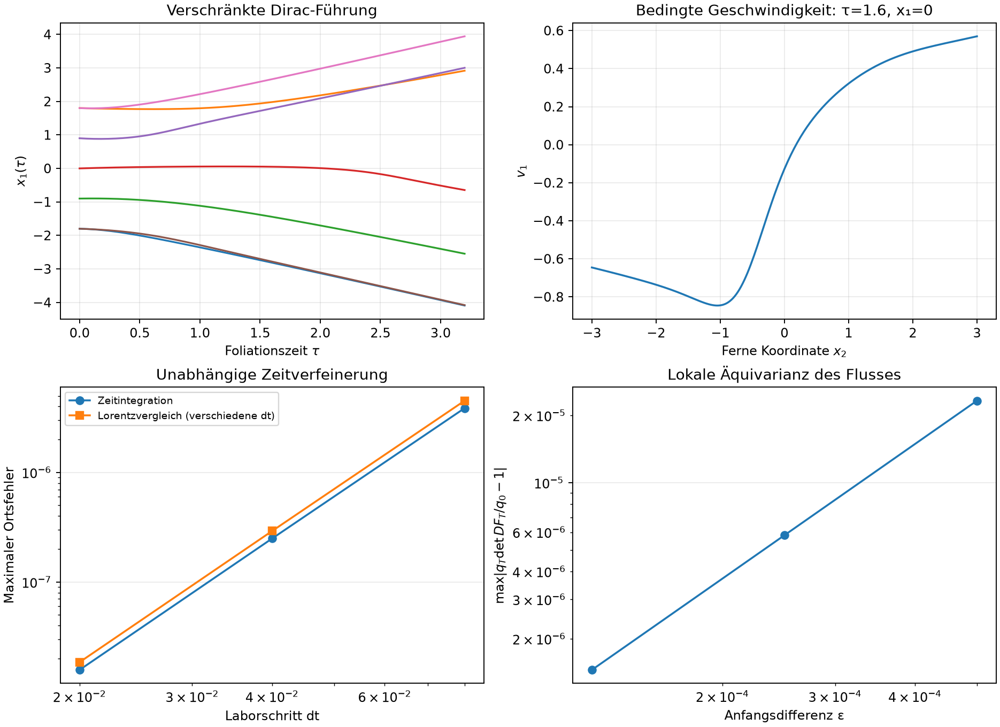

**Reproduzierbarkeit.** [Rechenskript](work/relativistic_two_particle.py), [Ergebnisdatei](work/relativistic_two_particle_20261017_refined.json) und [Roharrays](work/relativistic_two_particle_20261017_refined.npz) enthalten die Parameter, Verfeinerungen, Softwareversionen und SHA-256-Nachweise. Alle $20$ festgelegten Akzeptanzkriterien sind erfüllt. Die Prüfung betrifft die mathematische und numerische Konsistenz des freien massiven Modells in einer Raumdimension; der experimentelle Bell-Vergleich in Abschnitt 11 hat einen eigenen Messaufbau und Zustandsraum.

### 3.11 Formale Nachweise

Die zugehörige Lean-Formalisierung umfasst $34$ explizite Sätze in drei Dateien. Der tatsächlich ausgeführte Kernel-Lauf mit Lean 4.30.0 akzeptiert alle Sätze. Das transitive Axiomen-Audit umfasst einschließlich erzeugter Hilfssätze $59$ Theoremkonstanten und verwendet ausschließlich `propext`, `Classical.choice` und `Quot.sound` als logische Grundaxiome. Beweisplatzhalter oder zusätzliche Axiome kommen nicht vor.

- [Stromalgebra](work/lean/RelativisticCurrent.lean): Faktorisierung der Hyperflächendichte, strikte Positivität für jeden nichtverschwindenden komplexen Vierkomponentenspinor und zukünftige zeitartige Normalen, positive Zeitkomponente und kausale Führung. Der zweite Teilchenstrom folgt durch die bewiesene Transpositionsidentität.
- [Lorentzalgebra](work/lean/RelativisticLorentz.lean): Die Gewichte des tatsächlich transformierten Spinors ergeben alle vier Komponenten von $J'=\Lambda J\Lambda^T$. Verifiziert werden außerdem Metrik- und Dichteinvarianz, die mittransformierten kontrahierten Ströme und die kausale Geschwindigkeitsaddition. Die algebraischen Boostannahmen sind $g^2(1-b^2)=1$ sowie $s^2=g(1-b)$ und $t^2=g(1+b)$ für $S=\operatorname{diag}(s,t)$; die gewählten Exponentialwerte erfüllen diese Identitäten.
- [Tensor- und Schmidt-Algebra](work/lean/RelativisticTensor.lean): Kommutativität getrennter Tensorfaktorwirkungen, insbesondere der freien Dirac-Impulsmoden; $H(p)^2=(p^2+m^2)I$; Nichtfaktorisierbarkeit der verwendeten Schmidt-Koeffizientenmatrix, Spur eins und reduzierte Reinheit $1/2$. Die zur Anwendung auf Wellenpakete nötige Modenorthonormalität wurde in Abschnitt 3.5 analytisch hergeleitet.

Die Fourieranalysis, Maßtheorie und globale ODE-Existenz werden durch die analytischen Argumente in den Abschnitten 3.5–3.9 getragen; sie sind nicht Gegenstand dieser endlichen Lean-Formalisierung. Der [Kernel- und Axiomennachweis](work/lean/relativistic_proof_verification.json) enthält sämtliche Aussagen, Prüfresultate, Bibliotheksrevisionen und Quellhashes. Die [unabhängige Gesamtprüfung](work/verify_relativistic_research.py) gleicht diese Nachweise mit den Dateien ab und überprüft Fourierintegrale, adaptive Bahnintegration sowie die gespeicherten Tensor- und Flussdaten erneut; ihre Ergebnisse stehen im [Prüfprotokoll](work/relativistic_research_verification_20261017_refined.json).

## 4. Konsistenz einer Gravitationsquelle und Quanten-Impulsbilanz

### 4.1 Notwendige Erhaltung der Quelle

Für eine dynamische Metrik mit konstanter kosmologischer Konstante gilt die notwendige Implikation

$$G_{\mu\nu}+\Lambda g_{\mu\nu}=\frac{8\pi G}{c^4}T_{\mu\nu}
\quad\Longrightarrow\quad \nabla^\mu T_{\mu\nu}=0.$$

Der Beweis folgt durch kovariante Divergenz aus der kontrahierten Bianchi-Identität $\nabla^\mu G_{\mu\nu}=0$ und der Metrikverträglichkeit $\nabla g=0$. Ein allein aus beschleunigten Bohmschen Teilchen gebildeter Materietensor ist daher nur dann als Quelle verwendbar, wenn die vollständige Bilanz einschließlich seiner Austauschbeiträge erhalten ist. Struyve untersucht dieses Problem für konkrete semiklassische Ansätze [Struyve2019]. Daraus folgt kein allgemeines Unmöglichkeitstheorem für semiklassische Gravitation.

### 4.2 Geschlossene nichtrelativistische Bilanz

Ein explizites Beispiel für den erforderlichen Spannungsbeitrag liefert die skalare Bohmsche Theorie. Sei $R>0$ dreimal stetig räumlich differenzierbar und $\rho=R^2$. Definiere

$$\Pi_{ij}=\frac{\hbar^2}{2m}\big[(\partial_iR)(\partial_jR)-R\partial_i\partial_jR\big].$$

Unter Summation über $j$ heben sich bei der Produktregel die gemischten Ableitungen paarweise auf:

$$\partial_j\Pi_{ij}=\frac{\hbar^2}{2m}\big[(\partial_iR)\Delta R-R\partial_i\Delta R\big]=\rho\partial_iQ.$$

Der Gradient der Hamilton-Jacobi-Gleichung ergibt $mD_t v_i=-\partial_i(V+Q)$. Zusammen mit der Kontinuitätsgleichung folgt die lokale Impulsbilanz

$$\partial_t(m\rho v_i)+\partial_j(m\rho v_iv_j+\Pi_{ij})=-\rho\partial_iV.$$

Bei verschwindendem äußeren Kraftterm und verschwindenden Randflüssen ist der Gesamtimpuls erhalten. Der Quantenpotentialterm erscheint dabei als Divergenz eines Spannungsbeitrags. Diese hergeleitete Identität ist eine nichtrelativistische Bilanz auf knotenfreien Bereichen, kein relativistischer Einstein-Quellentensor. Ihr eindimensionaler algebraischer Kern wird zusätzlich in `work/lean/BellTransport.lean` geprüft.

### 4.3 Fester geometrischer Hintergrund

Auf einer vorgegebenen zeit-orientierten Lorentzschen Spin-Mannigfaltigkeit werden $\gamma^\mu=e_a{}^\mu\gamma^a$ und die Spinverbindung in $\nabla_\mu\psi$ verwendet. Die Dirac-Gleichung und ihre Adjungierte liefern dann unter den üblichen Glattheitsannahmen $\nabla_\mu(\bar\psi\gamma^\mu\psi)=0$. Dies ist eine Aussage über Materie auf vorgegebener Geometrie. Die gekrümmten Blätter der HBD-Konstruktion von 1999 liegen dagegen in flacher Minkowski-Raumzeit. Weder die Wahl solcher Blätter noch der Stromerhaltungssatz ersetzt eine dynamische Gleichung für die Metrik.

## 5. Transport von Gleichgewicht und Nichtgleichgewicht

### 5.1 Satz über den Dichtequotienten

Seien $q>0$ und $\rho$ differenzierbare Dichten, die dasselbe reguläre Geschwindigkeitsfeld $\mathbf v$ und dieselbe Kontinuitätsgleichung besitzen. Mit $D_t=\partial_t+\mathbf v\cdot\nabla$ gilt

$$D_t q=-q\nabla\cdot\mathbf v,\qquad D_t\rho=-\rho\nabla\cdot\mathbf v.$$

Die Quotientenregel liefert

$$D_t\frac{\rho}{q}=\frac{qD_t\rho-\rho D_tq}{q^2}=0.$$

Damit bleibt $\rho/q$ auf jedem zusammenhängenden regulären Bahnintervall konstant. Insbesondere bleibt ein anfangs gleich eins gesetzter Quotient gleich eins. Die einzelnen Dichten können sich durch Kompression oder Expansion ändern. In [BellTransport.lean](work/lean/BellTransport.lean) ist neben der algebraischen Kontinuitätsidentität auch die tatsächliche Ableitung des Quotienten als `HasDerivAt`-Aussage unter expliziten Differenzierbarkeits- und Nichtnullannahmen formalisiert.

### 5.2 Feinkörnige relative Entropie

Setze zunächst $\rho>0$ und $f=\rho/q$. Zusätzlich seien die Felder hinreichend regulär, die nachstehenden Integrale endlich, die Differentiation unter dem Integral zulässig und die Randflüsse verschwindend. Aus $D_tf=0$ folgt für jede differenzierbare Funktion $\Phi$

$$\partial_t[q\Phi(f)]+\nabla\cdot[q\Phi(f)\mathbf v]=0.$$

Daher bleibt $\int q\Phi(f)\,dx$ konstant. Mit $\Phi(f)=f\log f$ ergibt sich die Erhaltung der feinkörnigen relativen Entropie $H=\int\rho\log(\rho/q)\,dx$. Für nichtnegative Anfangsdichten mit Nullstellen folgt dieselbe Aussage durch Variablenwechsel entlang eines differenzierbaren invertierbaren Flusses: Sowohl $f$ als auch das transportierte Maß $q\,dx$ bleiben erhalten; für endliche Integrale wird dabei $0\log0=0$ gesetzt. Eine Annäherung grobkörniger Dichten aneinander ist damit vereinbar; sie ist keine Abnahme dieses feinkörnigen Integrals. Der Integral- und Randsatz ist hier analytisch hergeleitet, nicht in Lean formalisiert. Die zugrunde liegende lokale Kernidentität $\partial_t[q\,\Phi(f)]+\nabla\cdot[q\,\Phi(f)\mathbf v]=0$ ist dagegen in der separaten Datei [EntropyTransport.lean](work/lean/EntropyTransport.lean) mit Lean 4.30.0 formalisiert und vom Kernel mit bestandenem Axiomenaudit akzeptiert worden.

### 5.3 Explizites Gaußbeispiel

Für das freie Gaußpaket aus Abschnitt 9 mit $\sigma_0=1$ ist der Fluss $x(t)=J(t)x_0$, $J(t)=\sqrt{1+t^2}$. Eine beliebige Anfangsdichte wird zu $\rho(x,t)=\rho_0(x/J)/J$ transportiert. Für $q_0=N(0,1/2)$ und $\rho_0=N(0,4)$ ist

$$\frac{\rho(x(t),t)}{q(x(t),t)}=\frac{1}{\sqrt8}\exp\left(\frac78x_0^2\right),\qquad
H=\frac12(8-1-\log8).$$

Das Verhältnis variiert zwischen Bahnen, bleibt aber auf jeder Bahn gleich. `work/equilibrium_flow_check.py` bestätigt dies für sechs Startpositionen und sechs Zeiten. Das Beispiel liefert eine explizite Nichtgleichgewichtsverteilung mit konstantem feinkörnigem Abstand; es setzt keine Relaxation voraus.

## 6. Messung als Konfigurationsdynamik

Die Wellenfunktion von System und Apparatur entwickelt sich unitär. Eine ideale Messwechselwirkung führt aus einem Produktzustand auf

$$\Psi(x,y)=\sum_k c_k\varphi_k(x)\chi_k(y).$$

Sind die Apparatzweige $\chi_k$ im Konfigurationsraum näherungsweise disjunkt, liegt die tatsächliche Apparaturkonfiguration $Y$ in einem dieser Zweige. Dort bestimmt dieser Zweig die bedingte Systemwellenfunktion und näherungsweise die Führung. Dekohärenz stabilisiert die Trennung, lässt aber die Normen der anderen Zweige in der universellen Wellenfunktion nicht verschwinden.

Für normierte Zweige, disjunkte Pointerbereiche und die Gleichgewichtsverteilung $|\Psi|^2$ beträgt die Wahrscheinlichkeit des Bereichs $k$ gerade $|c_k|^2$. Ein effektiver Kollaps beschreibt die Auswahl des besetzten Zweigs, während die universelle Dynamik unitär bleibt. Die bedingte Wellenfunktion und die Voraussetzungen einer effektiven Wellenfunktion werden in [DGZ1992] präzisiert.

## 7. Was ein empirischer Vergleich unterscheiden kann

Die Übereinstimmung mit der Standard-Quantenmechanik betrifft Messergebnisstatistiken bei Quantengleichgewicht und übereinstimmender Dynamik einschließlich der Apparatur. Sie folgt nicht allein daraus, dass eine Führungsgleichung kovariant geschrieben ist.

In HBD-Modellen können ungestörte Bahnen und ihre Schnittpunkte auf fremden Hyperflächen von der Foliation abhängen. Daraus folgt keine entsprechende Abweichung einer konkreten Positionsmessung: Die Apparatur verändert die Dynamik und muss mitbeschrieben werden [DGNSZ2014, Abschnitt 6]. Ein universeller messbarer Foliationseffekt wird deshalb nicht postuliert.

Der Bell-Test in Abschnitt 11 unterscheidet eine gemeinsame lokale Verteilung verborgener Variablen mit einstellungsunabhängigen Gewichten von Quantenkorrelationen. Die De-Broglie-Bohm-Theorie verletzt im verschränkten Fall die entsprechende Lokalitätsannahme und wird deshalb durch die lokale CHSH-Schranke nicht begrenzt. Eine empirische Bevorzugung gegenüber einer statistisch äquivalenten Quantentheorie lässt sich aus diesem Test nicht ableiten.

## 8. Mathematische Beweise zur Führungsgleichung

Die folgenden Beweise erläutern die maschinell geprüften algebraischen Aussagen in mathematischer Schreibweise. Voraussetzungen und physikalische Bedeutung werden getrennt genannt. Die verlinkten Beweisdateien und Prüfprotokolle dienen der Nachvollziehbarkeit; die Argumentation selbst benötigt keine Kenntnis der Lean-Sprache. Alle fünf Nachweise wurden mit Lean 4.30.0 und Mathlib geprüft; die Prüfprotokolle melden Kernel-Akzeptanz und ein bestandenes Axiomen-Audit. Quell- und Prüfdateien stimmen mit den protokollierten SHA-256-Werten überein.

### 8.1 Kernidentität der De-Broglie-Bohm-Geschwindigkeit

**Satz.** Für komplexe Zahlen $z,w$ mit $z\ne0$ gilt

$$\frac{\operatorname{Im}(\overline z\,w)}{|z|^2}
=\operatorname{Im}\!\left(\frac wz\right).$$

**Beweis.** Wir schreiben $z=a+ib$ und $w=c+id$ mit reellen Zahlen $a,b,c,d$. Aus $z\ne0$ folgt $a^2+b^2>0$. Die Multiplikation mit dem konjugierten Nenner ergibt

$$\frac wz=\frac{(c+id)(a-ib)}{a^2+b^2}
=\frac{ac+bd}{a^2+b^2}+i\,\frac{ad-bc}{a^2+b^2}.$$

Andererseits ist $\overline z\,w=(ac+bd)+i(ad-bc)$ und $|z|^2=a^2+b^2$. Beide Seiten der behaupteten Gleichung sind somit gleich $(ad-bc)/(a^2+b^2)$. Damit ist die Identität bewiesen.

**Anwendung und Grenze.** Setzt man $z=\psi$ und komponentenweise $w=\partial_k\psi$, erhält man außerhalb der Knoten der Wellenfunktion

$$v_k=\frac{\hbar}{m}\operatorname{Im}\!\left(\frac{\partial_k\psi}{\psi}\right)
=\frac{\hbar}{m}\frac{\operatorname{Im}(\psi^*\partial_k\psi)}{|\psi|^2}.$$

Dies beweist die Gleichwertigkeit zweier algebraischer Darstellungen, nicht die Existenz von Teilchenbahnen an Knoten. Das formale Zahlensystem verwendet eine überall definierte Division, einschließlich einer Konvention für den Nenner null. Deshalb umfasst die gespeicherte formale Identität auch diesen Sonderfall. Daraus folgt keine physikalische Definition der Geschwindigkeit bei $\psi=0$; hier wird ausdrücklich nur $\psi\ne0$ verwendet.

**Geprüfte Hilfsaussagen.** Die formale Rechnung benutzt außerdem die üblichen Kürzungsregeln: In einem nullteilerfreien Zahlbereich ist das Produkt zweier von null verschiedener Zahlen nicht null. Natürliche Potenzen eines von null verschiedenen Elements sind in einem Zahlbereich ohne nichttriviale nilpotente Elemente ebenfalls nicht null; für ganzzahlige Potenzen gilt dies in einer multiplikativen Gruppe mit zusätzlich definiertem Nullelement. In Charakteristik null ist $n+1\ne0$ für jede natürliche Zahl $n$; insbesondere sind die hier auftretenden Zahlen $2,3,4$ nicht null. Zur Begründung der Potenzaussage genügt für positive natürliche Exponenten die Ausschlussannahme nichttrivialer nilpotenter Elemente; bei Exponent null gilt $a^0=1\ne0$. Negative Exponenten sind Potenzen des ebenfalls von null verschiedenen Inversen. Diese Hilfsaussagen rechtfertigen Umformungen und stellen keine zusätzlichen physikalischen Ergebnisse dar.

**Formale Prüfung.** Die Kernidentität ist in der [Beweisdatei zur Geschwindigkeit](work/lean/Proofb88b2665d4a04afd.lean) gespeichert; das zugehörige [Prüfprotokoll](work/lean/receipt-e2cb0fa2f7b747049a6e9256f1db5256.json) meldet Kernel-Akzeptanz und ein bestandenes Axiomen-Audit.

### 8.2 Antisymmetrie des Imaginärteils

**Satz.** Für alle $z,w\in\mathbb C$ gilt

$$\operatorname{Im}(\overline z\,w)=-\operatorname{Im}(z\,\overline w).$$

**Beweis.** Mit $z=a+ib$ und $w=c+id$ liefert die Ausmultiplikation

$$\overline z\,w=(ac+bd)+i(ad-bc),\qquad
z\,\overline w=(ac+bd)+i(bc-ad).$$

Die Imaginärteile unterscheiden sich also genau im Vorzeichen, weil $bc-ad=-(ad-bc)$. Damit folgt die Behauptung ohne weitere Voraussetzungen.

**Bedeutung.** Die Gleichung kontrolliert das Vorzeichen beim Vertauschen der konjugierten Faktoren im Stromausdruck. Sie beweist keine zusätzliche dynamische oder empirische Eigenschaft.

**Formale Prüfung.** [Beweisdatei zur Antisymmetrie](work/lean/Proofd4e83a729902e9cb.lean), [Prüfprotokoll](work/lean/receipt-9aedbfdb5d4842529e3bac8ec6a37c07.json): Kernel-Akzeptanz und Axiomen-Audit bestanden.

### 8.3 Paraxiale Führung als Folgerung

**Satz.** Seien $u,w\in\mathbb C$ mit $u\ne0$ und $k\in\mathbb R$ mit $k\ne0$. Dann gilt

$$\frac{\operatorname{Im}(\overline u\,w)}{k|u|^2}
=\frac1k\operatorname{Im}\!\left(\frac wu\right).$$

**Beweis.** Wegen $u\ne0$ und $k\ne0$ darf der Nenner in zwei Schritten dividiert werden. Die zuvor bewiesene Kernidentität ergibt unmittelbar

$$\frac{\operatorname{Im}(\overline u\,w)}{k|u|^2}
=\frac1k\,\frac{\operatorname{Im}(\overline u\,w)}{|u|^2}
=\frac1k\operatorname{Im}\!\left(\frac wu\right).$$

Damit ist die Behauptung bewiesen. Für das paraxiale Modell $i\partial_xu=-(2k)^{-1}\partial_y^2u$ setzt man $w=\partial_yu$. Die beiden Darstellungen von $dy/dx$ stimmen dann außerhalb der Knoten überein. Der Beweis überprüft diese algebraische Gleichwertigkeit; er leitet weder die paraxiale Näherung aus dem vollständigen Doppelspaltmodell her noch beweist er die Genauigkeit einer Simulation.

**Formale Prüfung.** [Beweisdatei zur paraxialen Führung](work/lean/Proofa7180cd01f5baf13.lean), [Prüfprotokoll](work/lean/receipt-8fda417469b9433d8cee4119d67770e1.json): Beide Identitäten wurden mit Lean 4.30.0 akzeptiert; das Axiomen-Audit ist bestanden.

### 8.4 Nichtnegative Dichte und Dirac-Gegenbeispiel

**Satz über die Dichte.** Für jede komplexe Zahl $z$ ist $|z|^2\ge0$. Für jeden endlichdimensionalen komplexen Vektor $\psi$ gilt entsprechend

$$\sum_{r=1}^{n}|\psi_r|^2\ge0.$$

**Beweis.** Schreibt man $z=a+ib$, so ist $|z|^2=a^2+b^2$. Jedes Quadrat einer reellen Zahl ist nichtnegativ; damit ist auch ihre Summe nichtnegativ. Dieselbe Rechnung gilt für jede Komponente von $\psi$. Eine endliche Summe nichtnegativer Summanden ist wieder nichtnegativ. Das schließt auch den leeren Vektor ein, dessen Summe null ist. Für einen nichtverschwindenden Vektor ist mindestens ein Summand positiv; daher ist seine Gesamtsumme positiv.

**Gegenbeispiel zur Gleichsetzung mit dem Dirac-Skalar.** In der hier verwendeten Darstellung sei

$$\gamma^0=\operatorname{diag}(1,1,-1,-1),\qquad
p=\begin{pmatrix}0\\0\\1\\0\end{pmatrix}.$$

Einsetzen liefert einerseits

$$p^\dagger p=0^2+0^2+1^2+0^2=1,$$

andererseits

$$\overline p\,p=p^\dagger\gamma^0p=0^2+0^2-1^2-0^2=-1.$$

Weil $-1\ne1$, sind die beiden Ausdrücke nicht allgemein gleich. Weil der zweite Ausdruck hier negativ ist, ist der Dirac-Skalar auch nicht allgemein nichtnegativ. Der in Abschnitt 3 verwendete Unterschied zwischen der Dichte $\psi^\dagger\psi$ und dem Skalar $\bar\psi\psi$ ist damit durch ein konkretes Gegenbeispiel bewiesen.

**Reichweite.** Formal geprüft sind die Nichtnegativität des Betragsquadrats und seiner endlichen Summe sowie die beiden Werte $1,-1$ und ihre Ungleichheit für den angegebenen Vektor. Die Interpretation der Matrix als $\gamma^0$ dieser Darstellung und ihre Einbettung in die vollständige Dirac-Theorie sind der physikalische Kontext, kein zusätzlicher, allein hierdurch erbrachter Kovarianz- oder Existenzbeweis.

**Formale Prüfung.** [Beweisdatei zu Dichte und Fluss](work/lean/Proof57d25c217d1a573a.lean), [Prüfprotokoll](work/lean/receipt-9b5f1a329f3e4834b510e713a53d08e9.json): Kernel-Akzeptanz und Axiomen-Audit bestanden.

### 8.5 Positiven Fluss vor dem Summieren bestimmen

**Behauptung.** Das Bilden des positiven Anteils und das Summieren von Flussbeiträgen sind nicht allgemein vertauschbar.

**Beweis durch Gegenbeispiel.** Wir betrachten die zwei Beiträge $j_1=1$ und $j_2=-1$. Bestimmt man zuerst jeden positiven Anteil und summiert anschließend, erhält man

$$\max(j_1,0)+\max(j_2,0)=1+0=1.$$

Summiert man dagegen zuerst beide Beiträge und nimmt erst danach den positiven Anteil, erhält man

$$\max(j_1+j_2,0)=\max(0,0)=0.$$

Da $1\ne0$, können beide Operationen nicht allgemein vertauscht werden. Das ist genau die diskrete Aussage des geprüften Gegenbeispiels. Überträgt man dieses Beispiel auf zwei gleich lange Zeitintervalle mit den konstanten Strömen $1$ und $-1$, erhält man dieselbe Unterscheidung bei der Zeitintegration. Diese Übertragung erläutert die Detektorkorrektur; sie ist kein hier separat formalisierter Satz über allgemeine Integrale.

**Bedeutung für den Detektor.** Wer den positiven zeitintegrierten Strom bestimmen will, muss den positiven Anteil vor der Integration bilden. Der Nachweis erlaubt keine Gleichsetzung dieses Stroms mit einer Erstankunftsverteilung ohne zusätzliche Annahmen über Wiederübertritte, Randflüsse und Detektormodell. Das geprüfte Gegenbeispiel ist in derselben [Beweisdatei](work/lean/Proof57d25c217d1a573a.lean) und demselben [Prüfprotokoll](work/lean/receipt-9b5f1a329f3e4834b510e713a53d08e9.json) dokumentiert.

### 8.6 Kontinuität in reellen Komponenten

**Voraussetzungen.** Betrachtet wird die freie eindimensionale Schrödinger-Gleichung in Einheiten $\hbar=m=1$,

$$i\,\partial_t\psi=-\tfrac12\partial_s^2\psi.$$

Für die folgende klassische Herleitung werden die benötigten Ableitungen und Produktregeln vorausgesetzt. An einem festen Raumzeitpunkt schreiben wir

$$\psi=A+iB,\qquad \partial_s\psi=U+iV,\qquad
\partial_s^2\psi=C+iD,$$

wobei alle sechs Komponenten reell sind. Damit sind $\partial_sA=U$, $\partial_sB=V$, $\partial_sU=C$ und $\partial_sV=D$. Aus der Schrödinger-Gleichung folgt

$$\partial_t\psi=\tfrac i2(C+iD)=-\tfrac D2+i\tfrac C2,$$

also $\partial_tA=-D/2$ und $\partial_tB=C/2$. Dichte und Strom lauten

$$\rho=A^2+B^2,\qquad j=\operatorname{Im}(\psi^*\partial_s\psi)=AV-BU.$$

**Erster Schritt: räumliche Ableitung des Stroms.** Mit der Produktregel erhalten wir

$$\partial_sj=UV+AD-(VU+BC)=AD-BC,$$

weil $UV=VU$. Dies ist der erste formal geprüfte algebraische Zwischenschritt: Wenn die Produktregel den ersten Ausdruck liefert, muss er gleich $AD-BC$ sein.

**Zweiter Schritt: zeitliche Ableitung der Dichte.** Mit der Kettenregel und den angegebenen Zeitkomponenten folgt

$$\partial_t\rho=2A\,\partial_tA+2B\,\partial_tB
=2A\left(-\tfrac D2\right)+2B\left(\tfrac C2\right)
=-AD+BC.$$

Dies ist der zweite geprüfte Zwischenschritt: Die eingesetzten Zeitkomponenten und die angenommene Ableitungsformel bestimmen den angegebenen Wert eindeutig.

**Dritter Schritt: Addition.** Beide Ausdrücke heben sich paarweise auf:

$$\partial_t\rho+\partial_sj=(-AD+BC)+(AD-BC)=0.$$

Damit ist die algebraische Kontinuitätsidentität bewiesen. Die drei Schritte entsprechen den drei Aussagen der [Beweisdatei zur Kontinuität](work/lean/Proof6f5f9895787e67ed.lean). Das zugehörige [Prüfprotokoll](work/lean/receipt-a52f38a01c044c5387b42c3fd36caec2.json) bestätigt Kernel-Akzeptanz und ein bestandenes Axiomen-Audit.

**Folgerung unter zusätzlichen analytischen Voraussetzungen.** Wo $\rho>0$ und $v=j/\rho$ gilt, wird daraus $\partial_t\rho+\partial_s(\rho v)=0$. Eine Ensembleverteilung, die anfänglich dieser Dichte entspricht und durch denselben wohldefinierten Fluss transportiert wird, bleibt unter geeigneten Regularitäts-, Eindeutigkeits- und Randbedingungen gleich verteilt. Diese übliche Transportfolgerung erklärt die Bedeutung für das Quantengleichgewicht. Ihre analytischen Voraussetzungen und die Eindeutigkeit des Transports sind in den vorliegenden algebraischen Lean-Aussagen nicht formalisiert. Die Born-Verteilung wird damit nicht aus beliebigen Anfangsverteilungen hergeleitet.

### 8.7 Geltungsbereich der formalen Prüfung

Die hier verlinkten erfolgreichen Protokolle wurden mit Lean 4.30.0 erzeugt. Ihre Axiomenprüfung enthält keine unerwarteten Axiome; die dort ausgewiesenen Grundaxiome sind die üblichen logischen Grundlagen der verwendeten Bibliothek. Quell- und geprüfte Dateien stimmen beim Abgleich mit den gespeicherten SHA-256-Werten überein. Die fünf zitierten Quelldateien wurden zusammen mit den neuen CHSH- und Transportbeweisen erneut mit dem Lean-Kernel geprüft; der gemeinsame aktuelle Nachweis steht in `work/lean/bell_proof_verification.json`.

Formal belegt sind die komplexen algebraischen Umformungen, die endlichen Dichte- und Flussbeispiele sowie die reellen Identitäten nach Einsetzen der lokalen Schrödinger-Beziehungen. Nicht in Lean formalisiert sind die Funktionalanalysis, Distributionen und Sobolev-Räume, globale Existenz oder Eindeutigkeit von Teilchenbahnen und die erforderlichen Randbedingungen. Für das konkrete relativistische Zweiteilchenmodell liefert Abschnitt 3.8 einen gesonderten analytischen Beweis fast sicherer globaler Existenz und Äquivarianz; die zusätzlichen 34 endlichen Lean-Sätze dieses Modells sind in Abschnitt 3.11 und einem eigenen Prüfprotokoll dokumentiert. Ebenso wenig folgt daraus eine numerische Konvergenz des Lösers, eine quantitativ bestandene Born-Verteilungsprüfung im Doppelspalt oder die physikalische Gültigkeit der Bohmschen Mechanik. Abschnitt 10 prüft ein klar abgegrenztes paraxiales Kontrollmodell; daraus folgt keine Validierung eines zeitabhängigen zweidimensionalen Detektormodells.

## 9. Freies Gaußpaket als numerischer Kontrollfall

### 9.1 Analytische Referenz

In Einheiten $\hbar=m=1$ löst

$$\psi(x,t)=(\pi\sigma_0^2)^{-1/4}(1+i\tau)^{-1/2}
\exp\left[-\frac{x^2}{2\sigma_0^2(1+i\tau)}\right],\qquad \tau=t/\sigma_0^2,$$

die freie Schrödinger-Gleichung mit reellem Gauß-Anfangsfeld. Die zugehörigen Größen sind

$$q(x,t)=\frac{e^{-x^2/s(t)^2}}{\sqrt\pi s(t)},\quad
s(t)^2=\sigma_0^2+t^2/\sigma_0^2,\quad
v(x,t)=\frac{xt}{\sigma_0^4+t^2},\quad
X(t)=X_0\sqrt{1+t^2/\sigma_0^4}.$$

Die Anfangsvarianz ist $\sigma_0^2/2$. Der Jacobian dieses Flusses transportiert die Anfangsdichte exakt auf $q(x,t)$; deshalb sind Feld, Führung, Bahnen und Verteilung unabhängig kontrollierbar.

### 9.2 Diskretisierung und statistische Referenz

Die Rechnung verwendet $\sigma_0=1$, $T=1$, $N_x=4096$ und $L_x=40$. Das freie Feld wird spektral fortgepflanzt. Innerhalb eines Zeitschritts wird die **komplexe Wellenfunktion** linear zeitlich interpoliert; daraus werden spektrale Ableitung und Führung berechnet. RK4 integriert die Bahnen, lineare Rauminterpolation wertet das Führungsfeld an den Teilchenorten aus. Die zeitliche Feldinterpolation begrenzt die beobachtete Gesamtordnung auf etwa zwei.

Für jedes der fünf unabhängigen Seeds werden 40.000 Startpositionen aus der analytischen Born-Dichte gezogen. Dieselben Startpositionen werden für den Schrittweitenvergleich wiederverwendet. Die 60 Histogrammzellen auf $[-8,8]$ besitzen exakte Referenzmassen

$$p_i=\frac12\left[\operatorname{erf}(b_{i+1}/s(T))-\operatorname{erf}(b_i/s(T))\right].$$

Die empirischen Massen sind $\widehat p_i=K_i/N_p$; aus dem Auswertungsbereich verlorene Teilchen würden gesondert gezählt. Es erfolgt keine Renormierung auf die Trefferzahl. Für unabhängige Proben ist die exakte Multinomial-Rauschreferenz

$$\mathbb E\left[\frac{\sum_i(\widehat p_i-p_i)^2}{\sum_i p_i^2}\right]
=\frac{\sum_i p_i-\sum_i p_i^2}{N_p\sum_i p_i^2}.$$

Dies folgt durch Summieren der binomialen Randvarianzen $p_i(1-p_i)/N_p$. Die Quadratwurzel ist ein RMS-Fehler, weder eine garantierte Fehlerschranke noch der Erwartungswert der Fehlernorm.

### 9.3 Erneut berechnete Ergebnisse

| Größe | Ergebnis |
|---|---|
| Relativer L2-Bahnfehler, Seed 1, $\Delta t=0{,}005$ | $2{,}0322\times10^{-6}$ |
| Bahndistanz $\Delta t=0{,}02$ gegen $0{,}01$ | $2{,}4387\times10^{-5}$ |
| Bahndistanz $\Delta t=0{,}01$ gegen $0{,}005$ | $6{,}0965\times10^{-6}$ |
| Daraus beobachtete Ordnung | $2{,}0001$ |
| Mittlerer relativer L2-Histogrammfehler, fünf Seeds | $1{,}6191\,\%$ |
| Standardabweichung dieses Fehlers zwischen Seeds | $0{,}3151$ Prozentpunkte |
| Ideale Multinomial-RMS-Referenz | $1{,}7559\,\%$ |

In allen sieben benötigten Pipelinekonfigurationen liegen sämtliche 40.000 Endpunkte im Histogrammbereich; keine RK-Zwischenabfrage verlässt das Feldgitter. Die Dichtewerte sind mit der Größenordnung des berechneten Stichprobenrauschens vereinbar. Die Bahnverfeinerung prüft den Integrationsfehler getrennt davon. Nachweise mit Roharrays, Quellenhash und Laufzeitangaben: `work/knotenfrei_kern_metrics.py` und `work/knotenfrei_kern_metrics_corrected_20261017.json`. Diese Größen sind numerische Modellfehler, keine experimentellen Messungen.

## 10. Paraxialer Gauß-Doppelspalt mit Quantilreferenz

### 10.1 Modell und geschlossene Lösung

Die Ausbreitungskoordinate $x$ parametrisiert die paraxiale Gleichung

$$i\partial_x u=-\frac{1}{2k}\partial_y^2u,\qquad
\frac{dy}{dx}=\frac{\operatorname{Im}(u^*\partial_yu)}{k|u|^2}.$$

Die Queramplitude ist eine kohärente Überlagerung zweier Gaußspalten. Mit Spaltparameter $a=1$, Abstand $d=4$, Beleuchtungsbreite $b=5\max(a,d)=20$ und $k=2\pi$ setzt das bestehende Modell

$$w^2=\left(\frac4{a^2}+\frac1{b^2}\right)^{-1},\qquad
c=\frac{d}{2}\frac{4w^2}{a^2},\qquad
\eta=e^{-c^2/w^2},\qquad q_x=w^2+i x/k.$$

Die normierte Lösung auf der unendlichen Geraden lautet

$$u(y,x)=\frac{(q_x/w^2)^{-1/2}}{\sqrt{2\sqrt{\pi w^2}(1+\eta)}}
\left[e^{-(y-c)^2/(2q_x)}+e^{-(y+c)^2/(2q_x)}\right].$$

Hier ist $x$ eine Strecke, keine physikalische Zeit. Verglichen werden Querpositionen bei festem $x$; eine Erstankunftsverteilung ist eine andere Observable.

### 10.2 Quantilkonstanz als unabhängige Bahnreferenz

Für $\rho=|u|^2$ sei $F(y,x)=\int_{-\infty}^y\rho(z,x)\,dz$. Die Kontinuitätsgleichung und ein verschwindender Strom bei $-\infty$ ergeben $\partial_xF=-j$. Entlang einer regulären Bahn gilt deshalb

$$\frac{dF(y(x),x)}{dx}=-j+\rho\frac{dy}{dx}=0.$$

Wo die inverse Verteilungsfunktion eindeutig definiert ist, lautet die exakte Führung somit $y(x)=F_x^{-1}(F_0(y_0))$. Diese Konstruktion liefert eine Bahnreferenz ohne Zeitintegration der Bewegungsgleichung.

Für die Gaußüberlagerung kann $F$ selbst geschlossen integriert werden. Mit $s^2=w^2+(x/k)^2/w^2$ und $z=x/k$ ist

$$F(y,x)=\frac{2+\operatorname{erf}((y-c)/s)+\operatorname{erf}((y+c)/s)
+2\eta\{1+\operatorname{Re}\operatorname{erf}[y/s-i c z/(w^2s)]\}}{4(1+\eta)}.$$

Der Ausdruck entsteht durch getrennte Integration der beiden Intensitäten und des Interferenzterms. Er wird zusätzlich gegen adaptive Quadratur von $|u|^2$ geprüft. Die größte Differenz an 21 Prüfpunkten beträgt $2{,}22\times10^{-16}$.

### 10.3 Schrittweiten- und Raumprüfung

257 feste Quantile von $0{,}001$ bis $0{,}999$ werden von $x=0$ bis $x=20$ verfolgt. Die RK4-Rechnung wertet das analytische Führungsfeld in allen Zwischenstufen aus und wird mit der unabhängig invertierten Verteilungsfunktion verglichen:

| Schritt $\Delta x$ | Relativer L2-Bahnfehler | Maximaler Fehler im erhaltenen Quantil |
|---|---|---|
| 0,2 | $1{,}357\times10^{-5}$ | $3{,}036\times10^{-5}$ |
| 0,1 | $9{,}426\times10^{-7}$ | $1{,}403\times10^{-6}$ |
| 0,05 | $6{,}303\times10^{-8}$ | $8{,}905\times10^{-8}$ |
| 0,025 | $4{,}003\times10^{-9}$ | $5{,}664\times10^{-9}$ |

Aus direkten Lösungsdistanzen auf identischen Startpunkten folgen die beobachteten Ordnungen 3,86 und 3,90. Alle geprüften Endpositionen bleiben geordnet. Die Bahnfehler enthalten kein Monte-Carlo-Rauschen, da feste Quantile verglichen werden.

Getrennt davon wird die freie Fourier-Feldfortpflanzung bei $x=20$ auf $y\in[-50,50)$ mit der geschlossenen Lösung verglichen:

| Gitterpunkte | Relativer L2-Fehler des komplexen Feldes |
|---|---|
| 128 | $9{,}195\times10^{-2}$ |
| 256 | $1{,}637\times10^{-4}$ |
| 512 | $1{,}072\times10^{-13}$ |
| 1024 | $1{,}064\times10^{-13}$ |

Die außerhalb des Gebiets liegende analytische Endwahrscheinlichkeit beträgt nach Quadratur $1{,}13\times10^{-26}$. Die feinsten Feldwerte erreichen damit das praktische Fehlerplateau dieser Rechnung. Diese Feldprüfung und die Bahnprüfung mit analytischem Feld kontrollieren zwei getrennte Rechenschritte; sie sind kein gemeinsamer Konvergenznachweis eines zweidimensionalen Barrieren- und Detektorsolvers.

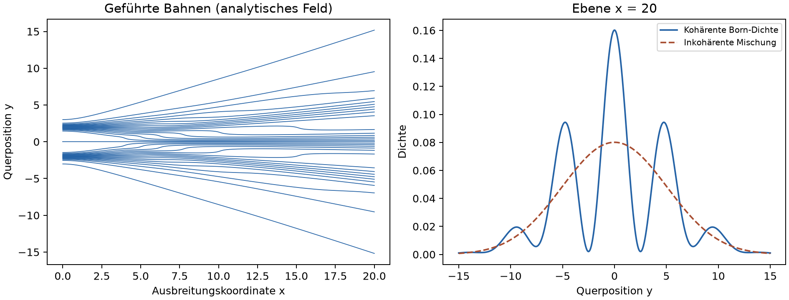

Die Interferenz entsteht durch den Kreuzterm der kohärenten Überlagerung. Die separat normierte inkohärente Mischung enthält keinen Kreuzterm und zeigt keine Interferenzstreifen. Beide Kurven sind Modellrechnungen, keine experimentellen Messdaten. Skript und vollständige Werte: `work/slits/simulation/paraxial_quantile_check.py` und `work/slits/simulation/paraxial_quantile_metrics_20261017.json`.

## 11. Bell-Korrelationen: formale Schranke und Vergleich mit Messdaten

### 11.1 Lokale Modellklasse und CHSH-Satz

Sei $\lambda$ eine verborgene Variable mit einer von den Messwahlen unabhängigen Verteilung. Lokale deterministische Antworten sind $A_0(\lambda),A_1(\lambda),B_0(\lambda),B_1(\lambda)\in\{-1,+1\}$. Für jede einzelne Zuordnung gilt

$$C(\lambda)=A_0(B_0+B_1)+A_1(B_0-B_1)\in\{-2,+2\}.$$

**Beweis.** Entweder ist $B_0=B_1$; dann verschwindet die zweite Klammer und die erste ist $\pm2$. Oder $B_0=-B_1$; dann ist es umgekehrt. Für gemeinsame nichtnegative normierte Gewichte $w_\lambda$ folgt

$$|S|=\left|\sum_\lambda w_\lambda C(\lambda)\right|
\le\sum_\lambda w_\lambda|C(\lambda)|=2.$$

Die vier Korrelationsmittel verwenden dabei dieselben Gewichte. Eine allgemeine Verteilung deterministischer Antwortfunktionen lässt sich auf die 16 möglichen Antwortvierer abbilden. Lokale stochastische Antworten können durch zusätzliche lokale Zufallsvariablen in diese Darstellung aufgenommen werden, sofern die gemeinsamen Verteilungsannahmen bestehen bleiben. Dies ist die lokale CHSH-Modellklasse [CHSH1969].

[BellCHSH.lean](work/lean/BellCHSH.lean) beweist den punktweisen Betrag $|C|=2$, die gewichtete endliche Schranke und ihre Form als $|E_{00}+E_{01}+E_{10}-E_{11}|\le2$. Das aktuelle [Prüfprotokoll](work/lean/bell_proof_verification.json) enthält insgesamt 23 benannte Sätze aus sieben Dateien, einschließlich der bisherigen Stromidentitäten und der neuen Transport- und Stressidentitäten. Der Lean-4.30.0-Kernel akzeptiert alle; das transitive Axiomen-Audit enthält nur die Bibliotheksgrundlagen `propext`, `Classical.choice` und `Quot.sound`. Die experimentelle Statistik und die physikalischen Lokalitätsannahmen sind keine Folgerungen dieses formalen Beweises.

### 11.2 Offene Ereignisdaten des Hensen-Experiments

Hensen et al. untersuchten zwei Elektronenspins in NV-Zentren in 1.280 m voneinander entfernten Laboren. Heraldierung der Verschränkung, schnelle Zufallswahl der Messbasen und anschließende lokale Spinauslese bilden den Event-ready-Bell-Test. Die publizierte Messdauer beträgt 220 Stunden [Hensen2015].

Der offene Datensatz enthält 4.746 Kandidaten mit zwei Photonen in breiten Heraldierungsfenstern. Die im deponierten Autorenskript festgelegten Zeitfenster, Kanal- und Gültigkeitsbedingungen selektieren daraus 245 Bell-Versuche. Die neue Python-Auswertung übernimmt diese Filter ohne Anpassung an die Messergebnisse und liest die Originalereignisse direkt aus dem archivierten Datensatz [HensenData2015]. Sie ergibt:

| Einstellungen $(a,b)$ | $++$ | $+-$ | $-+$ | $--$ | Anzahl $n_{ab}$ | Korrelation $\widehat E_{ab}$ |
|---|---|---|---|---|---|---|
| 00 | 23 | 3 | 4 | 23 | 53 | 0,735849057 |
| 01 | 33 | 11 | 5 | 30 | 79 | 0,594936709 |
| 10 | 22 | 10 | 6 | 24 | 62 | 0,483870968 |
| 11 | 4 | 20 | 21 | 6 | 51 | −0,607843137 |

Mit $\widehat E_{ab}=(N_{++}+N_{--}-N_{+-}-N_{-+})/n_{ab}$ folgen

$$\widehat S=\widehat E_{00}+\widehat E_{01}+\widehat E_{10}-\widehat E_{11}=2{,}42249987046,$$

$$\widehat\sigma_S=\sqrt{\sum_{a,b}\frac{1-\widehat E_{ab}^{\,2}}{n_{ab}}}=0{,}20382659825.$$

Damit werden die publizierten Korrelationszählungen und $S=2{,}42\pm0{,}20$ reproduziert. Die angegebene Standardunsicherheit ist die konventionelle Schätzung unter dem entsprechenden Binomialmodell. Die Hypothesenprüfung erfolgt gesondert, weil die Ensemble-Schranke $S\le2$ keine absolute Schranke für einen endlichen Stichprobenschätzer ist.

### 11.3 Prüfung der lokalen Nullhypothese

Ein Versuch zählt als CHSH-Erfolg, wenn $(-1)^{ab}xy=1$ für die gemessenen Antworten $x,y\in\{-1,+1\}$. Der Datensatz ergibt $k=196$ Erfolge in $n=245$ Versuchen. Die vollständige Analyse der Autoren berücksichtigt die kalibrierte Zufallsquellen-Schranke

$$\tau=2\cdot5{,}4\times10^{-6},\qquad
\xi=\frac34+3(\tau+\tau^2)=0{,}75003240034992.$$

Unter der in der Primärquelle begründeten bedingten Schranke für die lokale Erfolgswahrscheinlichkeit wird die obere Schwanzwahrscheinlichkeit durch

$$p_{\mathrm{bound}}=\sum_{j=196}^{245}\binom{245}{j}\xi^j(1-\xi)^{245-j}
=0{,}0391746435588$$

begrenzt. Die bedingte Form erlaubt Gerätegedächtnis unter den vorausgesetzten Lokalitäts- und Zufallsquellenbedingungen; ein unabhängiges und identisch verteiltes Gerätemodell ist dafür nicht erforderlich. Die Rechnung übernimmt die Kalibrationsschranke der Originalarbeit. Sie prüft deren numerische Auswertung, nicht erneut die damalige Hardwarekalibrierung [Hensen2015, HensenData2015].

Der Wert rundet auf die publizierte Angabe $0{,}039$. Er wird weder als Wahrscheinlichkeit der Wahrheit einer Theorie noch als Gaußtest aus $(\widehat S-2)/\widehat\sigma_S$ interpretiert. Da die Einstellungszahlen ungleich sind, ist der alternative Spielschätzer $8(k/n-1/2)=2{,}4$ nicht identisch mit dem Korrelationsschätzer $\widehat S$.

### 11.4 Vergleich der Vorhersagen

Für ein ideales Spin-Singulett besitzen Standard-Quantenmechanik und De-Broglie-Bohm-Theorie im Quantengleichgewicht bei gleicher Messmodellierung die gemeinsamen Wahrscheinlichkeiten

$$P(x,y\mid a,b)=\frac{1-xy\cos(\alpha_a-\beta_b)}4,\qquad E_{ab}=-\cos(\alpha_a-\beta_b).$$

Die tatsächlich verwendeten Winkel sind $\alpha_0=0$, $\alpha_1=\pi/2$, $\beta_0=-3\pi/4-\epsilon$, $\beta_1=3\pi/4+\epsilon$ mit $\epsilon=0{,}026\pi$ [Hensen2015]. Daraus folgt für ideale Präparation und ideale Auslese

$$S_{\mathrm{ideal}}=2\sqrt2\cos\epsilon=2{,}81899694516.$$

Der Python-Vergleich bestätigt diese Korrelationen unabhängig durch direkte Pauli-Matrix-Rechnung am Singulett. Er kontrolliert außerdem alle 16 deterministischen lokalen Zuordnungen. Der ideale Wert ist von der Vorhersage für die reale Apparatur zu unterscheiden: Aus vorheriger Zustandscharakterisierung und Auslesefidelitäten bestimmten die Autoren $S_{\mathrm{App}}=2{,}30\pm0{,}07$. Die nachgerechnete Messung liegt um $0{,}12250$ darüber, entsprechend $0{,}568$ kombinierten konventionellen Standardfehlern. Dies ist ein deskriptiver Vergleich mit einer unabhängig publizierten Apparaturprognose; es wird kein Parameter an die Bell-Daten angepasst.

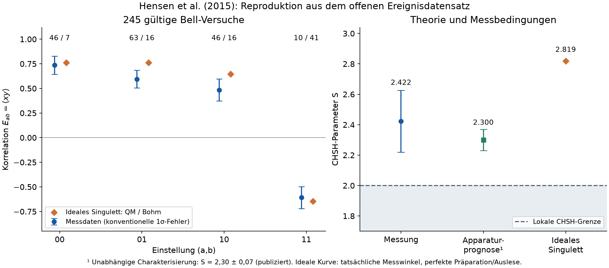

Die beobachtete Verletzung der lokalen Schranke ist mit den nichtlokalen Quantenvorhersagen vereinbar. Sie unterscheidet die De-Broglie-Bohm-Theorie im Quantengleichgewicht nicht von der Standard-Quantenmechanik. Die hier ausgeführte Theorieprüfung betrifft die gemeinsamen Ergebnisstatistiken, keine simulierte Mikrodynamik der konkreten Messgeräte.

**Reproduzierbarkeit.** `work/bell_experiment_compare.py` liest `inputs/bell_hensen_data.zip` und erzeugt die Zähltabelle, `work/bell_experiment_metrics.json` sowie die Abbildung. Der numerische Teil des unverändert archivierten Autorenauswerters wurde zusätzlich mit demselben Datensatz ausgeführt; Zählungen, $S$, Standardfehler und vollständiger $p$-Grenzwert stimmen mit der Neuimplementierung bis unter $10^{-14}$ überein. Das ZIP besitzt SHA-256 `c28eb0f075759aef620a0b2e00a70fd675ce712bc8214d11c103f5a3d29492c0`. Quellen, Filter, Dateihashes und Softwareversionen sind in der Ergebnisdatei hinterlegt.

## 12. Quantenfeld der De-Broglie-Bohm-Theorie

### 12.1 Feldzustand und Feldkonfiguration

Eine Bohmsche Quantenfeldtheorie kann ein tatsächliches Feld als zusätzliche Konfiguration verwenden. Der Quantenzustand $\Psi[\varphi,t]$ ist dann eine komplexe Funktion ganzer Feldkonfigurationen $\varphi(\mathbf x)$; das tatsächliche Feld $\Phi(\mathbf x,t)$ ist im hier regulierten Modell ein reeller Wert an jedem Raumpunkt. Diese beiden mathematischen Objekte sind verschieden. Der Feldansatz geht auf Bohms Behandlung des elektromagnetischen Feldes zurück und wird für bosonische Theorien systematisch bei Struyve entwickelt [Bohm1952b, Struyve2010]. Daneben existieren Bohmsche Quantenfeldmodelle mit Teilchenpositionen und Erzeugungs- beziehungsweise Vernichtungsereignissen [DGTZ2004]. Hier wählen wir ausdrücklich eine Feldkonfiguration als Ontologie.

Wir konstruieren ein freies reelles Skalarfeld der Masse $m>0$ auf einer periodischen räumlichen Box. Seine endliche Modenfassung besitzt einen vollständig definierten Hamiltonoperator, eine normierte Wellenfunktion und explizite globale Bohmsche Lösungen. Die Quantisierung erfolgt auf einer fest gewählten Foliation; Box und räumliche Impulsabschneidung sind Regulatoren. Für dieses regulierte Modell wird keine exakte Lorentzsymmetrie des Cutoffs behauptet. Die Unterscheidung von Regulierung und fundamentaler Kovarianz ist auch für die Feldmodelle der Primärliteratur wesentlich [Struyve2010, Struyve2011].

### 12.2 Reelle Moden und Hamiltonoperator

In Einheiten $\hbar=c=1$ sei der Raum $\mathbb T_L^3$ mit Volumen $V=L^3$. Im gesamten folgenden Modell wählen wir $L=2\pi$, sodass die Wellenvektoren $\mathbf k=\mathbf n\in\mathbb Z^3$ sind. Die Abschneidung $\|\mathbf n\|_\infty\le K$ enthält $D_K=(2K+1)^3$ reelle Freiheitsgrade. Aus jedem Paar $\{\mathbf n,-\mathbf n\}$ mit $\mathbf n\ne0$ wird der Vektor mit erster nichtverschwindender positiver Komponente gewählt. Mit dieser Halbmenge $\mathcal H_K$ lautet die orthonormale reelle Basis

$$\begin{aligned}
e_0(\mathbf x)&=V^{-1/2},\\
e_{\mathbf n,c}(\mathbf x)&=\sqrt{2/V}\cos(\mathbf n\cdot\mathbf x),\\
e_{\mathbf n,s}(\mathbf x)&=\sqrt{2/V}\sin(\mathbf n\cdot\mathbf x),
\qquad \mathbf n\in\mathcal H_K.
\end{aligned}$$

Der Modenindex $a$ umfasst Null-, Kosinus- und Sinusmoden. Es gelten

$$\varphi_K(\mathbf x)=\sum_a q_a e_a(\mathbf x),\qquad
\int_{\mathbb T_L^3}e_a e_b\,d^3x=\delta_{ab},\qquad
\omega_a=\sqrt{|\mathbf k_a|^2+m^2}.$$

Das kanonische Impulsfeld wird entsprechend als $\pi_K(\mathbf x)=\sum_a p_a e_a(\mathbf x)$ entwickelt.

Damit wird der klassische Feldhamiltonian exakt zu einer Summe unabhängiger Oszillatoren:

$$\begin{aligned}
H_K&=\frac12\int_{\mathbb T_L^3}
\bigl(\pi_K^2+|\nabla\varphi_K|^2+m^2\varphi_K^2\bigr)d^3x\\
&=\frac12\sum_a(p_a^2+\omega_a^2q_a^2).
\end{aligned}$$

Die Schrödinger-Quantisierung auf $L^2(\mathbb R^{D_K},d\mathbf q)$ ergibt

$$i\partial_t\Psi_K=\widehat H_K\Psi_K,\qquad
\widehat H_K=\frac12\sum_a\left(-\partial_{q_a}^2+\omega_a^2q_a^2\right).$$

Für eine präzise Operatordefinition seien $u_{\boldsymbol\nu}$ die orthonormalen Produkte der eindimensionalen Hermite-Eigenfunktionen, $\boldsymbol\nu\in\mathbb N_0^{D_K}$, mit $E_{\boldsymbol\nu}=\sum_a\omega_a(\nu_a+1/2)$. Der selbstadjungierte Hamiltonoperator ist durch

$$\begin{aligned}
\widehat H_K\sum_{\boldsymbol\nu}c_{\boldsymbol\nu}u_{\boldsymbol\nu}
&=\sum_{\boldsymbol\nu}E_{\boldsymbol\nu}c_{\boldsymbol\nu}u_{\boldsymbol\nu},\\
\mathcal D(\widehat H_K)
&=\left\{\Psi\in L^2:\sum_{\boldsymbol\nu}E_{\boldsymbol\nu}^2|c_{\boldsymbol\nu}|^2<\infty\right\}
\end{aligned}$$

festgelegt. Die unten verwendeten Gaußzustände liegen in diesem Definitionsbereich.

Hier ist $\widehat p_a=-i\partial_{q_a}$ und $[\widehat q_a,\widehat p_b]=i\delta_{ab}$. Die entsprechenden Feldoperatoren erfüllen den regulierten Kommutator

$$[\widehat\varphi_K(\mathbf x),\widehat\pi_K(\mathbf y)]
=i\sum_a e_a(\mathbf x)e_a(\mathbf y)=i\delta_K(\mathbf x,\mathbf y).$$

Die Summe ist der Projektionskern des endlichen Modenraums. Es gibt weder eine Doppelzählung der reellen Feldmoden noch ein formal vorausgesetztes unendlichdimensionales Lebesgue-Maß. Die endliche Theorie verwendet gewöhnliche Integrale über $\mathbb R^{D_K}$.

### 12.3 Exakter Gaußzustand

Für jede Mode definieren wir den klassischen Mittelpunkt und seinen Impuls durch

$$\begin{aligned}
\mu_a(t)&=\mu_a(0)\cos(\omega_at)
+\frac{p_a(0)}{\omega_a}\sin(\omega_at),\\
p_a(t)&=p_a(0)\cos(\omega_at)
-\omega_a\mu_a(0)\sin(\omega_at).
\end{aligned}$$

Der reelle Parameter $r_a$ beschreibt die anfängliche Quetschung. Mit $\sigma_{a0}=e^{r_a}/\sqrt{2\omega_a}$ und $\dot\sigma_a(0)=0$ ist

$$\begin{aligned}
\sigma_a(t)^2
&=\sigma_{a0}^2\cos^2(\omega_at)
+\frac{\sin^2(\omega_at)}{4\omega_a^2\sigma_{a0}^2}\\
&=\frac{e^{2r_a}\cos^2(\omega_at)+e^{-2r_a}\sin^2(\omega_at)}{2\omega_a}>0.
\end{aligned}$$

Die Breite erfüllt die Ermakov-Gleichung

$$\ddot\sigma_a+\omega_a^2\sigma_a=\frac1{4\sigma_a^3}.$$

Setze $y_a=q_a-\mu_a(t)$ und $b_a=\dot\sigma_a/\sigma_a$. Der normierte Produktzustand lautet

$$\Psi_K(\mathbf q,t)=\prod_a
(2\pi\sigma_a^2)^{-1/4}
\exp\!\left[-\frac{y_a^2}{4\sigma_a^2}
+i\left(p_a y_a+\frac{b_a}2y_a^2+\theta_a\right)\right],$$

wobei

$$\dot\theta_a=\frac{p_a^2-\omega_a^2\mu_a^2}{2}-\frac1{4\sigma_a^2}.$$

Diese Phase ist nicht beliebig: Zusammen mit $\dot\mu_a=p_a$, $\dot p_a=-\omega_a^2\mu_a$ und der Ermakov-Gleichung erfüllt sie die vollständige Schrödinger-Gleichung. Eine globale explizite Wahl mit $\theta_a(0)=0$ ist

$$\begin{aligned}
\theta_a(t)&=\tfrac12[\mu_a(t)p_a(t)-\mu_a(0)p_a(0)]-\tfrac12\chi_a(t),\\
\chi_a(t)&=\operatorname{Arg}_{\mathrm{stetig}}
\left[\cos(\omega_at)+i e^{-2r_a}\sin(\omega_at)\right],
\qquad \chi_a(0)=0.
\end{aligned}$$

Der komplexe Ausdruck verschwindet nie; sein stetig fortgesetztes Argument existiert auf der gesamten Zeitachse. Eine unverbundene Verwendung des Hauptzweigs würde künstliche Phasensprünge erzeugen. Die Gaußfaktoren sind einzeln normiert, daher gilt $\int|\Psi_K|^2d\mathbf q=1$.

### 12.4 Führung und Quantenpotential

Aus $\Psi_K=R_K e^{iS_K}$ folgen die Konfigurationsdichte und die Bohmsche Feldführung

$$\begin{aligned}
\rho_K&=\prod_a\frac{\exp[-(q_a-\mu_a)^2/(2\sigma_a^2)]}{\sqrt{2\pi}\sigma_a},\\
\dot q_a&=\partial_{q_a}S_K=p_a+b_a(q_a-\mu_a).
\end{aligned}$$

Das tatsächliche räumliche Feld ist $\Phi_K(\mathbf x,t)=\sum_a q_a(t)e_a(\mathbf x)$. Seine Dynamik ist die endliche, mathematisch wohldefinierte Fassung der funktionalen Führung $\partial_t\Phi=\delta S/\delta\varphi|_{\varphi=\Phi}$. Ein Beispiel mit reellen Skalarfeldmoden und exakten Gaußlösungen auf einem expandierenden Hintergrund behandeln Goldstein, Struyve und Tumulka [GST2015]. Die hier angegebenen massiven Lösungen auf einer flachen periodischen Box werden unmittelbar aus dem Hamiltonoperator in Abschnitt 12.2 hergeleitet.

In diesem Zustand bezeichnet $p_a(t)=\langle\widehat p_a\rangle$ den Impulsmittelwert, während $\dot q_a$ die tatsächliche Modenführung ist. Mit $\overline\Phi_K=\sum_a\mu_a e_a$ lässt sie sich auch räumlich schreiben:

$$\begin{aligned}
\partial_t\Phi_K(\mathbf x,t)&=\partial_t\overline\Phi_K(\mathbf x,t)\\
&\quad+\int_{\mathbb T_L^3}\mathcal B_K(\mathbf x,\mathbf y;t)
[\Phi_K(\mathbf y,t)-\overline\Phi_K(\mathbf y,t)]\,d^3y,\\
\mathcal B_K(\mathbf x,\mathbf y;t)&=\sum_a b_a(t)e_a(\mathbf x)e_a(\mathbf y).
\end{aligned}$$

Unabhängige Oszillatormoden bedeuten somit nicht automatisch eine punktweise lokale Führung im Ortsraum. Der Kern $\mathcal B_K$ koppelt für die gewählten Quetschungen im Allgemeinen räumlich getrennte Feldwerte; am Anfangszeitpunkt verschwindet er wegen $b_a(0)=0$.

Die zweite Modenableitung der Amplitude ergibt

$$\frac{\partial_{q_a}^2R_K}{R_K}
=\frac{(q_a-\mu_a)^2}{4\sigma_a^4}-\frac1{2\sigma_a^2}.$$

Somit ist das Quantenpotential

$$Q_K=-\frac1{2R_K}\sum_a\partial_{q_a}^2R_K
=\sum_a\left[\frac1{4\sigma_a^2}-\frac{(q_a-\mu_a)^2}{8\sigma_a^4}\right].$$

Die entlang der Führung abgeleitete Beschleunigung stimmt exakt mit der Quantenkraft überein:

$$\ddot q_a=-\partial_{q_a}\left(\tfrac12\sum_b\omega_b^2q_b^2+Q_K\right)
=-\omega_a^2q_a+\frac{q_a-\mu_a}{4\sigma_a^4}.$$

Für das Vakuum, also $r_a=\mu_a=p_a=0$, ist $\sigma_a^2=1/(2\omega_a)$ und $\dot q_a=0$. Das Quantenpotential hebt die klassische Oszillatorkraft auf. Ein vakuumverteiltes Bohmsches Feld ist in dieser Foliation deshalb zeitlich statisch, obwohl sein räumliches Muster und die Gleichgewichtsvarianz nicht verschwinden. Für einen kohärenten Zustand mit $r_a=0$ gilt dagegen $q_a(t)=\mu_a(t)+q_a(0)-\mu_a(0)$. Der Mittelwert löst die klassische Klein-Gordon-Gleichung; die gesamte individuelle Feldkonfiguration muss diese klassische Gleichung nicht erfüllen. Bei $r_a\ne0$ verändern sich auch die Abweichungen vom Mittelwert mit der Breite $\sigma_a(t)$.

Diese Aussage betrifft unbeobachtete Feldkonfigurationen. Beispielsweise gilt im Vakuum für eine Mode

$$\mathbb E[q_a(t)q_a(s)]=\frac1{2\omega_a},\qquad
\langle0|\widehat q_a(t)\widehat q_a(s)|0\rangle
=\frac{e^{-i\omega_a(t-s)}}{2\omega_a}.$$

Gleichzeitige Feldstatistiken stimmen überein; unbeobachtete Mehrzeit-Bahnen dürfen nicht mit Mehrzeit-Operator-Korrelationsfunktionen gleichgesetzt werden. Letztere sind, wie das komplexe Beispiel zeigt, auch nicht unmittelbar gemeinsame Wahrscheinlichkeitsmomente aufeinanderfolgender Messergebnisse. Zur Vorhersage solcher Ergebnisse gehört eine explizite Messwechselwirkung [GST2015, Abschnitt 3.6].

### 12.5 Globale Lösung und Gleichgewicht

Die standardisierte Modenkoordinate ist entlang jeder Bahn konstant:

$$\frac{d}{dt}\frac{q_a(t)-\mu_a(t)}{\sigma_a(t)}=0.$$

Daraus folgt die geschlossene Lösung

$$q_a(t)=\mu_a(t)+\frac{\sigma_a(t)}{\sigma_{a0}}
[q_a(0)-\mu_a(0)].$$

Es gilt sogar $\sigma_a(t)\ge e^{-|r_a|}/\sqrt{2\omega_a}>0$ für alle Zeiten. Die explizite Formel ist deshalb für jede Anfangskonfiguration eine eindeutige globale Lösung. Der Zustand hat keine Knoten. Die Flussabbildung $F_t$ ist affin, ihre Jacobi-Determinante positiv und

$$\det DF_t=\prod_a\frac{\sigma_a(t)}{\sigma_{a0}},\qquad
\rho_K(F_t(\mathbf q),t)\det DF_t=\rho_K(\mathbf q,0).$$

Damit ist die Äquivarianz hier direkt und ohne asymptotische Argumente bewiesen. Äquivalent erfüllt jeder Gaußfaktor $\partial_t\rho_a+\partial_{q_a}(\rho_a\dot q_a)=0$. Die Produktregel liefert die vollständige Kontinuitätsgleichung auf $\mathbb R^{D_K}$. Diese Resultate sind stärker als eine bloße numerische Übereinstimmung eines Stichprobenhistogramms.

Der Energieerwartungswert pro Mode lautet

$$\begin{aligned}
\langle H_a\rangle
&=\tfrac12(p_a^2+\omega_a^2\mu_a^2)
+\tfrac12\left(\dot\sigma_a^2+\omega_a^2\sigma_a^2+\frac1{4\sigma_a^2}\right)\\
&=\tfrac12[p_a(0)^2+\omega_a^2\mu_a(0)^2]
+\tfrac{\omega_a}2\cosh(2r_a).
\end{aligned}$$

Er ist konstant. Nach Abzug der Vakuumenergie $\sum_a\omega_a/2$ bleibt die endliche Anregungsenergie

$$E_{\mathrm{exc}}=\sum_a
\left[\tfrac12p_a(0)^2+\tfrac12\omega_a^2\mu_a(0)^2
+\omega_a\sinh^2r_a\right].$$

Im nachfolgenden Beispiel sind nur endlich viele Moden verschoben oder gequetscht. Daher bleibt diese Anregungsenergie bei Vergrößerung des Cutoffs unverändert; die extensive Vakuumsumme wird nicht als endliche Kontinuumsenergie ausgegeben.

### 12.6 Räumliche Auflösung und Grenzübergang

Ein dreidimensionales Bild muss angeben, welche räumliche Auflösung es darstellt. Wir verwenden das mit einem periodischen Gaußkern geglättete tatsächliche Feld

$$\Phi_{\ell,K}(\mathbf x,t)=\sum_a
e^{-\ell^2|\mathbf k_a|^2/2}\,q_a(t)e_a(\mathbf x),\qquad \ell>0.$$

Der Mittelwert entsteht durch Ersetzen von $q_a$ durch $\mu_a$. Für die in Kosinus- und Sinuspartnern gleich gewählten Quetschungen ist die gleichzeitige Kovarianz

$$C_{\ell,K}(\mathbf x,\mathbf y;t)
=\frac1V\sum_{\|\mathbf n\|_\infty\le K}
e^{-\ell^2|\mathbf n|^2}\sigma_{\mathbf n}(t)^2
\cos[\mathbf n\cdot(\mathbf x-\mathbf y)].$$

Ohne Glättung wächst schon die Vakuumvarianz am gleichen Raumpunkt mit dem Cutoff:

$$C_{0,K}^{\mathrm{vac}}(\mathbf x,\mathbf x)
=\frac1{2V}\sum_{\|\mathbf n\|_\infty\le K}\frac1{\sqrt{|\mathbf n|^2+m^2}}
\ge\frac{(2K+1)^3}{2V\sqrt{3K^2+m^2}}.$$

Die rechte Seite wächst quadratisch. Das unbegrenzt aufgelöste Kontinuumsfeld ist daher nicht durch eine gewöhnliche punktweise Feldvarianz beschrieben; die Feldverteilung muss auf räumlich verschmierte Größen bezogen werden. Diese Rolle der Regulierung und des distributionellen Grenzwerts entspricht der funktionalen Quantenfeldbeschreibung [Struyve2010, Abschnitt 2.2.2].

Für die geglättete Größe lässt sich die fehlende Vakuumvarianz oberhalb des Würfelcutoffs streng abschätzen. Für $K$ oberhalb aller angeregten Moden und eine gemeinsame Folge der unabhängigen standardnormalen Modenkoordinaten definiere bei festem Raumpunkt

$$B_K=\sup_{M>K}\mathbb E|\Phi_{\ell,M}-\Phi_{\ell,K}|^2.$$

Dann gilt

$$B_K\le\frac{3}{2mV}\left(1+\frac{\sqrt\pi}{\ell}\right)^2
\frac{\sqrt\pi}{\ell}\operatorname{erfc}(\ell K).$$

Dazu wird $1/\omega_{\mathbf n}\le1/m$ verwendet und die Menge der ausgelassenen Moden durch die Vereinigung der drei Bedingungen $|n_i|>K$ abgeschätzt. Die eindimensionalen Summen erfüllen

$$\sum_{n\in\mathbb Z}e^{-\ell^2n^2}\le1+\frac{\sqrt\pi}{\ell},\qquad
2\sum_{n>K}e^{-\ell^2n^2}\le\frac{\sqrt\pi}{\ell}\operatorname{erfc}(\ell K).$$

Die Schranke geht für jedes feste $\ell>0$ gegen null. Somit ist die Folge im quadratischen Mittel Cauchy und besitzt einen Grenzwert $\Phi_{\ell,\infty}$; dieselbe Schranke gilt für $\mathbb E|\Phi_{\ell,\infty}-\Phi_{\ell,K}|^2$. Ein wachsender Cutoff bei festgehaltener Glättung ist damit ein kontrollierter Grenzübergang; das bloße Verfeinern eines unverschmierten Bildes wäre eine andere Frage.

### 12.7 Beispiel und räumliche Darstellung

Das ausgeführte Beispiel verwendet $m=1$, $K=8$, also 4.913 reelle Moden, und $\ell=0{,}55$. Die 19 Moden mit $|\mathbf n|^2\le2$ einschließlich der Nullmode haben $r_a=0{,}65$; alle übrigen Moden besitzen ihre Vakuumbreite. Die von null verschiedenen Anfangsmittelwerte sind:

| Mode | $\mu_a(0)$ | $p_a(0)$ |
|---|---|---|
| Nullmode | 1 | 0 |
| Kosinus $(1,0,0)$ | 2 | 0 |
| Sinus $(1,0,0)$ | 0 | 1,25 |
| Kosinus $(0,1,0)$ | 0 | −0,75 |
| Sinus $(0,1,0)$ | 1,5 | 0 |
| Kosinus $(0,0,1)$ | −1 | 0 |

Die Anfangskonfiguration wird als $q_a(0)=\mu_a(0)+\sigma_{a0}\xi_a$ mit unabhängigen $\xi_a\sim N(0,1)$ gewählt. Der Generator NumPy-PCG64 mit Startwert 20261017 bestimmt die dargestellte Realisierung reproduzierbar. Kleinere Cutoffs verwenden dieselben bereits gezogenen Modenkoordinaten. Die exakte Anregungsenergie ist

$$E_{\mathrm{exc}}=8{,}8125+(1+6\sqrt2+12\sqrt3)\sinh^2(0{,}65)
=23{,}5072339927543.$$

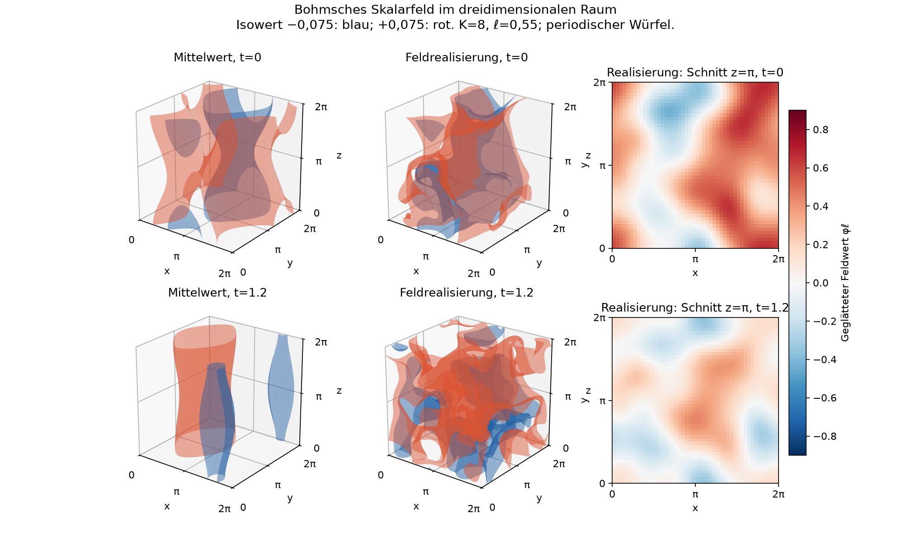

Die ersten beiden Spalten zeigen echte räumliche Isoflächen $\overline\Phi_{\ell,K}(x,y,z)=\pm0{,}075$ beziehungsweise $\Phi_{\ell,K}(x,y,z)=\pm0{,}075$. Alle drei Achsen sind Ortskoordinaten. Die dritte Spalte zeigt den Feldwert im Schnitt $z=\pi$; die Farbskala $[-0{,}9,0{,}9]$ ist für beide Zeiten gleich. Der Mittelwert und eine einzelne Feldkonfiguration unterscheiden sich trotz desselben Quantenzustands. Die Bewegung der Flächen folgt der oben hergeleiteten Modenführung. Gezeigt wird ein theoretisches Beispiel des tatsächlichen Feldes, keine räumliche Darstellung des Wellenfunktionals und keine experimentelle Rekonstruktion.

Das Darstellungsraster besitzt $48^3$ Punkte. Die Flächen werden durch lineare Interpolation in Tetraedern einschließlich der periodischen Randflächen rekonstruiert. Die zusätzliche [drehbare 3D-Ansicht](figures/quantum_field_20261017.html) enthält dasselbe Feld auf einem gröberen $24^3$-Raster; die [SVG-Fassung](figures/quantum_field_20261017.svg) enthält Vektortext und gerasterte 3D-Flächen.

### 12.8 Numerische Gegenprüfungen

[quantum_field_model.py](work/quantum_field_model.py) berechnet die Modenentwicklung, den räumlichen Fourieraufbau und die Grafik. Alle 22 festgelegten Prüfkriterien sind erfüllt; Schwellen, Versionen, Rohdaten- und Quellenhashes stehen im [numerischen Protokoll](work/quantum_field_20261017.json). Die folgenden Werte betreffen die ausgewerteten Konfigurationen und Zeitpunkte.

| Prüfung | Größter Fehler |
|---|---|
| Analytisches modales Schrödingerresiduum, 4.913 Moden, 25 Zeiten | $7{,}11\times10^{-15}$ |
| Modales Kontinuitätsresiduum, geteilt durch die Modendichte | $1{,}78\times10^{-15}$ |
| Beschleunigung gegenüber klassischer Kraft plus Quantenkraft | $1{,}79\times10^{-14}$ |
| Logarithmische Dichte-Jakobian-Identität | $3{,}70\times10^{-13}$ |
| Räumliche Feldpotentialenergie gegenüber Modensumme, relativ | $5{,}38\times10^{-16}$ |
| Unabhängige direkte reelle Basissumme gegenüber FFT, acht Raumpunkte | $3{,}34\times10^{-16}$ |

Das erste Residuum ist $|(i\partial_t\psi_a-\widehat H_a\psi_a)/\psi_a|$ pro Mode, ausgewertet entlang der gewählten Realisierung. Zusätzlich werden Zeitableitung und Laplace-Operator unmittelbar durch zentrale Differenzen an einem vollständigen Siebenmoden-Produktzustand bei $t=0{,}37$ berechnet. Die sieben Moden enthalten sämtliche verschobenen Anfangsmittelwerte. Hier ergibt sich für das durch $|\Psi|$ geteilte Schrödingerresiduum:

| Differenzschritt $h$ | Relatives Residuum |
|---|---|
| $2{,}5\times10^{-4}$ | $9{,}29\times10^{-5}$ |
| $1{,}25\times10^{-4}$ | $2{,}33\times10^{-5}$ |
| $6{,}25\times10^{-5}$ | $5{,}84\times10^{-6}$ |

Die annähernde Viertelung beim Halbieren von $h$ entspricht dem Fehler zweiter Ordnung dieser Differenzenformel. Die unabhängig integrierte Führung wird für drei Anfangskonfigurationen bis $t=2{,}4$ mit der geschlossenen Bahn verglichen:

| RK4-Zeitschritt | Maximaler absoluter Modenfehler |
|---|---|
| 0,08 | $9{,}54\times10^{-5}$ |
| 0,04 | $3{,}41\times10^{-6}$ |
| 0,02 | $1{,}72\times10^{-7}$ |

Die beobachteten Ordnungen sind 4,81 und 4,31. Die Prüfung umfasst alle Moden; nur die 19 gequetschten Moden sind dynamisch. Eine zusätzliche deterministische Gauß-Hermite-Quadratur prüft Mittelwerte, Varianzen und die aus den Bahnen berechnete Zweizeitkovarianz mit Fehlern bis $4{,}45\times10^{-16}$. Die unabhängige Auswertung der Anregungsenergie stimmt bis $2{,}49\times10^{-14}$ mit den gespeicherten Zeitwerten überein. Das separat berechnete Vakuum bleibt exakt stationär.

Eine zweite Implementierung in [verify_quantum_field_research.py](work/verify_quantum_field_research.py) prüft insbesondere die vollständige komplexe Phase. Für die Kosinusmode $(1,0,0)$ wird die anfängliche Gaußfunktion auf normierte Hermite-Eigenfunktionen $u_j$ projiziert und anschließend allein mit dem Oszillatorspektrum entwickelt:

$$\psi_N(q,t)=\sum_{j=0}^{N-1}c_j e^{-i\omega(j+1/2)t}u_j(q),
\qquad c_j=\int u_j(q)^*\psi(q,0)\,dq.$$

Die Projektionsquadraturen mit 192 und 256 Knoten unterscheiden sich in den Koeffizienten um höchstens $5{,}90\times10^{-15}$. Ohne nachträgliche Normierung oder Phasenanpassung ergibt der Vergleich mit der Gaußlösung an 1.601 Punkten in $[-8,8]$ und sieben Zeiten, einschließlich beider Seiten von $t=\pi/\omega$, folgende maximale komplexe Absolutfehler:

| Eigenzustände $N$ | $\max\lvert\psi_N-\psi\rvert$ auf dem Prüfraster |
|---|---|
| 16 | $7{,}89\times10^{-2}$ |
| 32 | $3{,}65\times10^{-3}$ |
| 64 | $1{,}76\times10^{-6}$ |
| 96 | $1{,}01\times10^{-9}$ |

Damit wird die Gaußentwicklung durch eine spektrale Schrödinger-Evolution gegengeprüft, die ihre zeitabhängige Breiten- und Phasenformel nicht verwendet.

Schließlich kontrolliert die Cutoff-Prüfung die physikalische Bedeutung der räumlichen Glättung. Im Vakuum liefert die direkte Modensumme:

| $K$ | Ungeglättete Punktvarianz | Geglättete Punktvarianz, $\ell=0{,}55$ |
|---|---|---|
| 4 | 0,3655388530 | 0,03243436769 |
| 6 | 0,7831782218 | 0,03244683957 |
| 8 | 1,3555321409 | 0,03244684592 |
| 16 | 5,1852336293 | 0,03244684592 |

Für das gequetschte Beispiel sind die hinzukommenden hohen Moden ebenfalls Vakuummoden. Die Schranke aus Abschnitt 12.6 beträgt bei $K=8$ höchstens $1{,}70\times10^{-10}$ für die fehlende Punktvarianz, entsprechend $1{,}31\times10^{-5}$ für den RMS-Fehler. Dies ist eine Ensemble-Abschätzung, keine garantierte Fehlergrenze einer einzelnen Realisierung. Für die tatsächlich geplottete, zwischen den Cutoffs gekoppelte Realisierung sinkt die räumliche $L^2$-Differenz von $0{,}05195$ bei $K=4\to6$ auf $0{,}001242$ bei $K=6\to8$.

### 12.9 Formale Nachweise und Reproduktion

[QuantumFieldGaussian.lean](work/lean/QuantumFieldGaussian.lean) und [QuantumFieldDynamics.lean](work/lean/QuantumFieldDynamics.lean) enthalten 37 benannte Sätze über die reellen Oszillatorkoordinaten. Lean 4.30.0 akzeptiert alle Beweise. Das transitive Audit der 69 entstandenen Theoremkonstanten enthält ausschließlich die Bibliotheksgrundlagen `propext`, `Classical.choice` und `Quot.sound`; Quellenhashes, vollständige Aussagen und Compilerergebnisse stehen im [formalen Prüfprotokoll](work/lean/quantum_field_proof_verification.json).

Verifiziert werden tatsächliche erste und zweite Gaußableitungen, das daraus definierte Quantenpotential und seine Kraft, die partielle Kontinuitätsgleichung sowie die Hamilton-Jacobi-Gleichung einschließlich der Zeitphase. Hinzu kommen affine Führung, Ableitung null der standardisierten Koordinate, Dichte-Jakobian-Identität, strikte Positivität der trigonometrischen Breite, Ermakov/Riccati-Identitäten und die Ableitung null der Gaußenergie. Die Gleichungen für Zentrum, Breite und Phase stehen dabei als ausdrückliche dynamische Voraussetzungen in den jeweiligen Sätzen. Die spezielle Ermakov-Lösung, Gaußnormierung, Fourierzerlegung, endliche Produktanwendung und Verbindung zur komplexen Schrödinger-Gleichung werden in den Abschnitten 12.2–12.6 analytisch begründet und durch die beschriebenen Python-Rechnungen geprüft. Die Kontinuums-Restabschätzung wird analytisch bewiesen; sie ist kein Bestandteil der Lean-Dateien.

Die Rohdaten enthalten Modenkoordinaten, Bahnen, Felder und Isoflächendreiecke. Das [unabhängige Prüfprotokoll](work/quantum_field_independent_verification_20261017_final.json) verbindet die spektrale Gegenrechnung mit den geprüften Quellen- und Ergebnisdateien. Die Reproduktion erfolgt aus dem Projektverzeichnis mit:

```text
python work/quantum_field_model.py --tag neue_rechnung
python work/lean/check_quantum_field_proofs.py
python work/verify_quantum_field_research.py --tag neue_rechnung --output-tag neue_pruefung
```

Die Ausgabekennungen schützen vorhandene numerische Läufe vor Überschreiben. Die Sätze und numerischen Ergebnisse schließen damit das beschriebene freie, regulierte Skalarfeldmodell ab; eine wechselwirkende Kontinuumstheorie ist nicht Gegenstand dieses Modells.

## 13. Dynamik und Gravitation der De-Broglie-Bohm-Theorie

Die Vereinbarkeit mit der Allgemeinen Relativitätstheorie umfasst drei verschiedene Aufgaben: Bohmsche Materie auf einer vorgegebenen gekrümmten Raumzeit, ihre Rückwirkung als Quelle der Einstein-Gleichung und eine Quantisierung der Geometrie selbst. Für diese Ebenen werden im Folgenden jeweils konkrete Ergebnisse hergeleitet. Ein exakt lösliches Feldmodell zeigt zugleich die wohldefinierte Führung auf einem expandierenden Hintergrund und das Scheitern einer bestimmten naiven Rückwirkungsquelle. Ein zweites, quantenkosmologisches Modell besitzt einen regulären Bounce und eine kausal geodätisch vollständige effektive Metrik.

Es gelten $\hbar=c=1$, die Signatur $(-,+,+,+)$ und die Krümmungskonvention, in der für räumlich flaches FLRW $R=6(\dot H+2H^2)$ gilt. Die Einstein-Gleichung lautet $G_{\mu\nu}+\Lambda g_{\mu\nu}=8\pi G T_{\mu\nu}$.

### 13.1 Geometrie, Foliation und Quelle

Ein glatter globalhyperbolischer Hintergrund besitzt eine Cauchyfoliation. In ADM-Koordinaten sei

$$ds^2=-N^2dt^2+h_{ij}(dx^i+N^i dt)(dx^j+N^jdt),\qquad N>0.$$

Die Wirkung eines minimal gekoppelten reellen Skalarfeldes ist

$$I_\phi=-\frac12\int d^4x\sqrt{-g}
\left(g^{\mu\nu}\partial_\mu\phi\partial_\nu\phi+m^2\phi^2\right).$$

Mit $h=\det h_{ij}$ erhält man

$$\pi=\frac{\sqrt h}{N}(\dot\phi-N^i\partial_i\phi),$$

$$H_\phi=\int d^3x\left[
\frac{N\pi^2}{2\sqrt h}
+\frac{N\sqrt h}{2}(h^{ij}\partial_i\phi\partial_j\phi+m^2\phi^2)
+N^i\pi\partial_i\phi\right].$$

Nach Regularisierung und Wahl einer geeigneten Operatorordnung führt die Phase $S$ des Schrödingerzustands die tatsächliche Feldkonfiguration durch

$$\dot\Phi(x)=\left.\frac{N(x)}{\sqrt{h(x)}}\frac{\delta S}{\delta\phi(x)}\right|_{\phi=\Phi}
+N^i(x)\partial_i\Phi(x).$$

Dies beschreibt Materie bei gegebenem $g_{\mu\nu}$. Die globale Hyperbolizität allein ersetzt weder die analytischen Voraussetzungen des Feld-Hamiltonoperators noch einen Existenzbeweis für beliebige Bohmsche Zustände. Für das endliche Modenmodell in Abschnitt 13.2 werden diese Fragen durch eine explizite Lösung beantwortet. Feldführungen auf kosmologischen Hintergründen werden in [GST2015] behandelt.

Ein Koordinatenwechsel transformiert auch eine vorhandene Foliation. Eine Refoliation verändert dagegen die räumlichen Gleichzeitigkeitsschichten. Noch schwächer ist eine positive Zeitumparametrisierung derselben Blätter. Diese Unterscheidung ist wesentlich: Aus der Kovarianz einer Führung mit mittransformierter Foliation folgt keine Unabhängigkeit von ihrer Wahl. Auch die auf Minkowski-Raumzeit mögliche Verwendung eines erhaltenen Gesamtviererimpulses als Foliationsregel überträgt sich nicht automatisch auf allgemeine gekrümmte Hintergründe ohne entsprechende globale Symmetrien. Die geometrische Rolle der Foliation wird in [GoldsteinTeufel1999] untersucht.

Für eine Rückwirkung muss die gewählte Quelle zusätzlich die Bianchi-Bedingung $\nabla_\mu T^{\mu\nu}=0$ erfüllen. Der klassische Tensor des Skalarfeldes lautet in der festgelegten Signatur

$$T_{\mu\nu}[\Phi]=\partial_\mu\Phi\partial_\nu\Phi
-g_{\mu\nu}\left[\frac12\partial_\alpha\Phi\partial^\alpha\Phi+\frac12m^2\Phi^2\right],$$

$$\nabla_\mu T^{\mu\nu}[\Phi]=(\Box\Phi-m^2\Phi)\nabla^\nu\Phi.$$

Ein tatsächliches Feld mit einer Quantenkraft erfüllt im Allgemeinen nicht die unveränderte klassische Klein-Gordon-Gleichung. Damit ist sein nackter klassischer Tensor nicht ohne Weiteres eine zulässige Einstein-Quelle. Erwartungswertquellen und eine quantisierte Geometrie sind andere Konstruktionen; [Struyve2019] erläutert diese Unterscheidung. Der folgende Fall macht den Quellenrest und den Unterschied zum Operator-Erwartungswert explizit berechenbar.

### 13.2 Exakte Feldmoden auf de Sitter

Betrachtet wird der vorgeschriebene räumlich flache Hintergrund

$$ds^2=-dt^2+a(t)^2d\mathbf x^2,\qquad a(t)=e^{Ht},\qquad H>0.$$

Das Feld ist masslos und minimal gekoppelt. Eine endliche Auswahl orthonormaler reeller Fouriermoden vermeidet sowohl die Doppelzählung komplex konjugierter Moden als auch unendliche Modensummen. Für eine Mode mit komovierender Wellenzahl $k>0$ sind

$$M=a^3,\qquad \Omega^2=\frac{k^2}{a^2},\qquad
i\partial_t\psi=\left(-\frac{1}{2M}\partial_q^2+\frac{M\Omega^2q^2}{2}\right)\psi.$$

Der homogene Modus $k=0$ ist ausgeschlossen. Die Konstruktion betrifft die positiven Wellenzahlen des Bunch-Davies-Modenansatzes; sie behauptet keinen normalisierbaren de-Sitter-invarianten Zustand des gesamten masslosen minimal gekoppelten Feldes einschließlich des Nullmodus. Eine periodische Raumregulierung beschreibt einen Quotienten dieses flachen FLRW-Patches, nicht den gesamten globalen de-Sitter-Raum. Die entsprechende Feldlösung und das späte Einfrieren werden in [GST2015] diskutiert.

Definiere die positive Standardabweichung, ihre logarithmische Rate und eine dimensionslose Wellenzahl durch

$$\sigma^2=\frac{H^2}{2k^3}+\frac{1}{2ka^2},\qquad
b=\frac{\dot\sigma}{\sigma},\qquad z=\frac{k}{aH}.$$

Direkte Ableitung ergibt

$$\dot z=-Hz,\qquad b=-\frac{Hz^2}{1+z^2},\qquad
\dot b=\frac{2H^2z^2}{(1+z^2)^2},$$

$$\ddot\sigma+3H\dot\sigma+\Omega^2\sigma
=\frac{1}{4M^2\sigma^3}.$$

Die Reibungs-Ermakov-Gleichung enthält den Beitrag $\dot M/M=3H$. Für $z_0=z(t_0)$ lautet der vollständige normierte Zustand

$$\psi(q,t)=(2\pi\sigma^2)^{-1/4}
\exp\left[-\frac{q^2}{4\sigma^2}+i\left(\frac{Mbq^2}{2}+\theta(t)\right)\right],$$

$$\theta(t)=\frac12\bigl[z-\arctan z-z_0+\arctan z_0\bigr],
\qquad \dot\theta=-\frac{1}{4M\sigma^2}.$$

Das Gaußintegral liefert $\int_{\mathbb R}|\psi|^2dq=1$. Mit
$A=1/(2\sigma^2)-iMb$ reduziert sich der quadratische Anteil der Schrödinger-Gleichung auf $i\dot A=A^2/M-M\Omega^2$; der konstante Anteil liefert die angegebene Normierungs- und Phasenentwicklung. Damit sind auch die zeitabhängige komplexe Phase und die Massenableitung berücksichtigt.

Die Führung und ihre Lösung sind

$$\dot q=\frac{\partial_qS}{M}=bq,\qquad
q(t)=q(t_0)\frac{\sigma(t)}{\sigma(t_0)}.$$

Für jedes endliche $t$ ist $\sigma(t)>0$. Alle endlichen Anfangswerte erzeugen daher eindeutige Lösungen auf der gesamten kosmischen Zeitachse. Mit $F_t(q_0)=q_0\sigma(t)/\sigma(t_0)$ folgt unmittelbar

$$\rho(F_t(q_0),t)\frac{\sigma(t)}{\sigma(t_0)}=\rho(q_0,t_0),
\qquad \rho=|\psi|^2.$$

Dies beweist Äquivarianz ohne Stichprobenargument. Für endliche Produkte multiplizieren sich die Dichten und Jacobianfaktoren. Wegen $\sigma(t)\to H/\sqrt{2k^3}$ friert jede Mode für $t\to\infty$ auf einem durch den Anfangswert bestimmten Feldwert ein. Die globale Existenz dieser Modenbahnen ist von der geodätischen Vollständigkeit des verwendeten Raumzeit-Patches zu unterscheiden.

Für $dt=N(\tau)d\tau$, $N>0$, gelten $\widehat H_\tau=N\widehat H_t$ und $dq/d\tau=Nbq$. Insbesondere ist bei $\eta=-e^{-Ht}/H$ die Lapse $dt/d\eta=a$ und

$$\widehat H_\eta=-\frac{1}{2a^2}\partial_q^2+\frac{a^2k^2q^2}{2}.$$

Hier bleibt die Konfigurationsvariable $q$ dieselbe. Ein zusätzlicher Wechsel zu $y=aq$ wäre eine weitere Transformation des Zustands einschließlich Jacobian und Phase. Der Vergleich kosmischer und konformer Zeit prüft somit die Umparametrisierung derselben Foliation.

### 13.3 Quantenkraft und Quellenbilanz

Aus der Gaußamplitude $R=|\psi|$ folgt

$$Q=-\frac{\partial_q^2R}{2MR}
=\frac{1}{4M\sigma^2}-\frac{q^2}{8M\sigma^4}.$$

Die reale Schrödinger-Gleichung ist $\partial_tS+(\partial_qS)^2/(2M)+M\Omega^2q^2/2+Q=0$. Ihre Ortsableitung zusammen mit der Führung ergibt

$$\ddot q+3H\dot q+\Omega^2q
=-\frac{\partial_qQ}{M}
=\frac{q}{4M^2\sigma^4}.$$

Die räumlich gemittelten klassischen Stressbeiträge einer reellen orthonormalen Mode sind, bei unterdrücktem gemeinsamem Normierungsfaktor $1/V_{\rm com}$,

$$\rho_B=\frac12(\dot q^2+\Omega^2q^2),\qquad
p_B=\frac12\dot q^2-\frac16\Omega^2q^2.$$

$p_B$ bezeichnet ein Drittel der räumlichen Spannungsspur. Eine einzelne Fouriermode wird dadurch nicht zu einem lokal homogenen und isotropen Fluid. Die periodische räumliche Mittelung beseitigt den Divergenzterm der Energieflussdichte. Wegen $\partial_t\Omega^2=-2H\Omega^2$ gilt exakt

$$D_B:=\dot\rho_B+3H(\rho_B+p_B)
=\dot q(\ddot q+3H\dot q+\Omega^2q)
=-\frac{\dot q\,\partial_qQ}{M}.$$

Für die konkrete de-Sitter-Lösung erhält man

$$D_B=-\frac{H^3q^2z^8}{(1+z^2)^3}<0
\quad\text{für }q\ne0.$$

Die nackte klassische Quelle der Bohmbahn verletzt somit eine notwendige Einstein-Konsistenzbedingung. Der Nullpfad $q=0$ ist eine Ausnahme. Das Ergebnis widerlegt diese konkrete Quellenwahl; es ist kein Unmöglichkeitssatz über sämtliche Bohmschen Gravitationstheorien. Eine zusätzliche Quelle müsste die entgegengesetzte Divergenz besitzen, doch diese Forderung allein definiert noch kein eindeutiges rückgekoppeltes System.

Der echte Operator-Erwartungswert lässt sich davon unterscheiden. Im Gaußgleichgewicht sind

$$\mathbb E\rho_B=\frac12(\dot\sigma^2+\Omega^2\sigma^2),\qquad
\mathbb E p_B=\frac12\dot\sigma^2-\frac16\Omega^2\sigma^2.$$

Für $\widehat\pi=-i\partial_q$ liefert die Amplitudenableitung zusätzlich
$\langle\widehat\pi^2\rangle=M^2\dot\sigma^2+1/(4\sigma^2)$. Daher

$$\langle\widehat\rho\rangle=\mathbb E\rho_B+\delta,\qquad
\langle\widehat p\rangle=\mathbb E p_B+\delta,\qquad
\delta=\frac{1}{8M^2\sigma^2}.$$

Mit $M=a^3$ folgt

$$\mathbb E D_B=\frac{b}{4M^2\sigma^2},\qquad
\dot\delta+6H\delta=-\frac{b}{4M^2\sigma^2}.$$

Damit verschwindet der gesamte Operatorrest:

$$\partial_t\langle\widehat\rho\rangle
+3H\bigl(\langle\widehat\rho\rangle+\langle\widehat p\rangle\bigr)=0.$$

Diese Kompensation stammt aus der quantenmechanischen Impulsvarianz. Sie ist kein nachträglich gewählter Gegenstrom einer einzelnen Bohmbahn. Der Beweis gilt pro regulierter Mode und für endliche Summen; eine renormierte unendliche Stressquelle und eine gekoppelte Einstein-Lösung werden damit nicht konstruiert.

Auch die Auswirkung auf einen Friedmann-Constraint ist präzise formulierbar. Setze $c_G=8\pi G/3$ und $C=H^2-c_G\rho-\Lambda/3$. Unter der ausdrücklich angenommenen Beschleunigungsgleichung $\dot H=-3c_G(\rho+p)/2$ gilt

$$\dot C=-c_G\bigl[\dot\rho+3H(\rho+p)\bigr].$$

Quellenkontinuität erhält also einen anfänglich erfüllten Constraint. Ein nichtverschwindender Rest erzeugt dagegen Constraintdrift, wenn zugleich dieselbe Beschleunigungsgleichung verwendet wird.

### 13.4 Kanonische Geometrie und Constraints

In der kanonischen Quantengeometrodynamik wird die räumliche Metrik selbst zur Konfiguration. Formal erfüllen Zustände die Hamilton- und räumlichen Diffeomorphismusconstraints. Für $\Psi=Re^{iS}$ entstehen eine quantenmodifizierte Hamilton-Jacobi-Constraint und Führungsrelationen $\pi^{ij}=\delta S/\delta h_{ij}$, $\pi_\phi=\delta S/\delta\phi$. Die Frage nach der erhaltenen Constraintstruktur ist hier stärker als die in Abschnitt 13.2 geprüfte Änderung einer einzigen Uhr.

Schreibt man die verschmierten klassischen Constraints als $C[N]$ und $D[v]$, lautet eine einheitliche Vorzeichenkonvention der Lorentzschen Hypersurflächenalgebra

$$\{C[N],C[M]\}=D[h^{ij}(N\partial_jM-M\partial_jN)].$$

Für $C_Q[N]=C[N]+Q[N]$ ohne Impulsabhängigkeit von $Q$ folgt

$$\{C_Q[N],C_Q[M]\}
=\{C[N],C[M]\}+\{C[N],Q[M]\}+\{Q[N],C[M]\}.$$

Die Zusatzterme müssen mit der verlangten geometrischen Rekonstruktion verträglich sein. Unter den Voraussetzungen metrischer kanonischer Geometrodynamik, unveränderter räumlicher Constraints und klassischer Deformationsalgebra als Rekonstruktionsbedingung erhalten Pinto-Neto und Santini restriktive Bedingungen an $Q$; insbesondere ist eine unveränderte Lorentzsche Raumzeitinterpretation nicht für jedes Quantenpotential verfügbar [PNS1999]. Diese bedingte Klassifikation ist kein Verbot anderer Bohmscher Ansätze.

Die spätere Konsistenzarbeit zeigt eine wichtige positive Aussage: Für die dort betrachtete Konstruktion schließt die quantenmodifizierte Algebra schwach auf dem Bohmschen Führungsgraphen. In den Gleichungen (105)–(110) von [PNS2002] verschwinden die relevanten Terme nach Einsetzen der Abweichungen $\pi-\delta S=0$. Dies gilt für das durch den jeweiligen Zustand bestimmte Quantenpotential. Die Autoren beschränken die Konsistenzaussage ausdrücklich auf Bohmsche Bahnen.

Schwache Schließung auf diesem Graphen und volle klassische Deformationsalgebra sind verschiedene Anforderungen. Die erste verhindert innerhalb der Konstruktion den pauschalen Schluss auf inkonsistente Bohmsche Entwicklung; sie beweist nicht die zweite oder eine beliebige Refoliationsinvarianz einer Lorentzschen Vierergeometrie. Eine ausgezeichnete Foliation kann zusätzliche geometrische Struktur bereitstellen. Das folgende Minisuperspace-Modell quantisiert bereits die Geometrie, ersetzt aber wegen seiner Homogenitätsreduktion keinen Test der vollständigen räumlich abhängigen Constraintalgebra.

### 13.5 Quantisierte Geometrie und Bounce

Betrachtet wird ein räumlich flaches, homogenes und isotropes Universum mit einem Schutz-Strahlungsfluid. Dessen kanonische Variable $T$ dient als interne Uhr. Nach der in [PNF2013] verwendeten Skalierung lautet der Constraint-Hamiltonian

$$\mathcal H=\frac{N}{a}\left(-\frac{p_a^2}{4}+p_T\right),\qquad a>0.$$

Die Wahl $N=a$ führt auf $d t=a\,dT$ für kosmische Eigenzeit $t$ und auf

$$i\partial_T\psi=\frac14\partial_a^2\psi.$$

Der Hilbertraum ist $L^2(\mathbb R_+,da)$. Der Operator $+\partial_a^2/4$ mit $H^2$-Domäne und Neumannbedingung $\partial_a\psi(0,T)=0$ ist selbstadjungiert und erzeugt unitäre Uhrentwicklung. Sein negatives Spektrum folgt aus dem Gravitationskinetikterm. Die Neumannbedingung ist eine konkrete selbstadjungierte Randwahl; die Forderung eines verschwindenden Randstroms allein würde sie nicht eindeutig auswählen. Fluiduhren und entsprechende nichtsinguläre Bahnen werden bereits in [deBarros1998] und [Alvarenga2002] behandelt. Die hier benutzte Gaußkonstruktion entspricht der Strahlungsspezialisierung von [PNF2013] und [PN2021].

Für $T_0>0$, $D=T_0^2+T^2$ und $\zeta=T_0-iT$ lautet die exakte Lösung

$$\psi(a,T)=\left(\frac{8T_0}{\pi}\right)^{1/4}
\zeta^{-1/2}\exp\left(-\frac{a^2}{\zeta}\right).$$

Der Zweig von $\zeta^{-1/2}$ ist auf $\operatorname{Re}\zeta>0$ stetig gewählt. Direkte Differentiation ergibt

$$\frac{\partial_T\psi}{\psi}=\frac{i}{2\zeta}-\frac{ia^2}{\zeta^2},\qquad
\frac{\partial_a^2\psi}{\psi}=-\frac{2}{\zeta}+\frac{4a^2}{\zeta^2},$$

und damit die Schrödinger-Gleichung einschließlich ihres Vorzeichens. Dichte und Phase sind

$$\rho(a,T)=\sqrt{\frac{8T_0}{\pi D}}\exp\left(-\frac{2T_0a^2}{D}\right),\qquad
S(a,T)=\frac12\arctan\frac{T}{T_0}-\frac{a^2T}{D}.$$

Das Halbachsen-Gaußintegral liefert Norm eins; die Randableitung verschwindet. Die Phase bleibt auch beim Durchgang durch $T=0$ stetig. Der Wahrscheinlichkeitsstrom und die Führung lauten wegen der negativen Kinetik

$$j=-\frac12\operatorname{Im}(\psi^*\partial_a\psi)
=-\frac{\rho\,\partial_aS}{2},\qquad
\frac{da}{dT}=-\frac{\partial_aS}{2}=\frac{aT}{D}.$$

Somit gilt für jeden Anfangswert $a_b=a(0)>0$

$$a(T)=a_b\sqrt{1+\frac{T^2}{T_0^2}}\ge a_b>0.$$

Der positive Skalierungsfluss erfüllt exakt $\rho(a_b f,T)f=\rho(a_b,0)$ mit $f=\sqrt{1+T^2/T_0^2}$. Daher transportiert er die Gleichgewichtsdichte äquivariant. Der Randwert $a_b=0$ entspräche einer degenerierten Metrik; er gehört nicht zum positiven Konfigurationsraum und hat unter der stetigen Dichte Wahrscheinlichkeit null.

Auch die quantenmodifizierte Hamilton-Jacobi-Gleichung ist vollständig überprüfbar. Mit $R=\sqrt\rho$ gilt

$$Q_a=\frac{\partial_a^2R}{4R}
=-\frac{T_0}{2D}+\frac{T_0^2a^2}{D^2},$$

$$\partial_TS=\frac{T_0}{2D}-\frac{a^2(T_0^2-T^2)}{D^2},\qquad
\partial_TS-\frac{(\partial_aS)^2}{4}+Q_a=0.$$

Das gegenüber einem positiven Materiekinetikterm umgekehrte Vorzeichen von $Q_a$ ist damit festgelegt. $T_0$ ist ein Breitenparameter: Bei $T=0$ gilt $\mathbb E(a_b^2)=T_0/4$, während $\operatorname{Var}(a_b)=T_0(1-2/\pi)/4$. Für den positiven Strahlungsuhroperator $\widehat p_T=-\widehat H$ folgt zudem $\langle\widehat p_T\rangle=1/(4T_0)$. Der später auftretende bahnabhängige Strahlungsparameter stimmt im Ensemble mit diesem Wert überein; er ist nicht auf jeder Bahn mit dem lokalen Phasengradienten $\partial_TS$ gleichzusetzen.

### 13.6 Geometrie des regulären Übergangs

Die kosmische Zeit ist explizit

$$t(T)=\frac{a_b}{2}\left[
T\sqrt{1+\frac{T^2}{T_0^2}}+T_0\operatorname{arsinh}\frac{T}{T_0}\right].$$

Es gilt $dt/dT=a(T)>0$, und $t$ bildet $\mathbb R$ bijektiv auf $\mathbb R$ ab. Definiere $H_c=(da/dT)/a^2$, $A=a_b^2/T_0^2$ und $B=a_b^4/T_0^2$. Dann folgen

$$H_c^2=\frac{A}{a^4}-\frac{B}{a^6},\qquad
\dot H_c=-\frac{2A}{a^4}+\frac{3B}{a^6},\qquad
\frac{\ddot a}{a}=-\frac{A}{a^4}+\frac{2B}{a^6},$$

wobei Punkte hier kosmische Zeitableitungen sind. Bei $T=0$ ist $H_c=0$ und $\dot H_c=1/(T_0^2a_b^2)>0$: Kontraktion geht glatt in Expansion über. Für große $|T|$ gelten $a\sim a_b|T|/T_0$ und $|t|\sim a_bT^2/(2T_0)$, somit $a\propto\sqrt{|t|}$ wie in der klassischen Strahlungsphase.

In Einheiten $8\pi G/3=1$ kann die modifizierte Friedmannrelation durch

$$\rho_{\rm eff}=\frac{A}{a^4}-\frac{B}{a^6},\qquad
p_{\rm eff}=\frac{A}{3a^4}-\frac{B}{a^6}$$

dargestellt werden. Beide Potenzbeiträge erfüllen ihre jeweilige reduzierte Kontinuitätsgleichung, sodass $\dot\rho_{\rm eff}+3H_c(\rho_{\rm eff}+p_{\rm eff})=0$. Der negative $a^{-6}$-Beitrag parametrisiert den Quanteneffekt dieser Lösung; er postuliert keine neue klassische Materieart. Am Bounce gilt

$$\rho_{\rm eff}+p_{\rm eff}=-\frac{2}{3T_0^2a_b^2}<0.$$

Die klassische Nullenergiebedingung ist dort also nicht erfüllt. Der reguläre Übergang widerspricht deshalb keinem Singularitätssatz, dessen einschlägige Energiebedingung vorausgesetzt wird.

Der Ricci- und Kretschmannskalar sind

$$R=\frac{6B}{a^6},$$

$$K=12\left[\left(-\frac{A}{a^4}+\frac{2B}{a^6}\right)^2
+\left(\frac{A}{a^4}-\frac{B}{a^6}\right)^2\right].$$

Sie erfüllen $0<R\le6/(T_0^2a_b^2)$ und $0<K\le12/(T_0^4a_b^4)$; beide Maxima liegen beim Bounce. Für die zweite Schranke setzt man $x=(a_b/a)^2\in(0,1]$. Dann ist $K=12x^4(2-6x+5x^2)/(T_0^4a_b^4)$; die Ableitung des Polynoms ist $x^3[30(x-1/2)^2+1/2]>0$.

Diese Grenzen gelten für jede feste Bahn $a_b>0$, nicht gleichmäßig im gesamten Gaußensemble. Dessen Dichte $\rho(a_b,0)=\sqrt{8/(\pi T_0)}\exp(-2a_b^2/T_0)$ bleibt bei $a_b=0$ positiv. Für die Riccikrümmung am jeweiligen Bounce, $R_b=6/(T_0^2a_b^2)$, ergibt das Halbachsenintegral exakt

$$\mathbb P(R_b>R_*)=\operatorname{erf}\sqrt{\frac{12}{T_0^3R_*}},\qquad R_*>0.$$

Die Wahrscheinlichkeit fällt für große $R_*$ nur wie $R_*^{-1/2}$. Deshalb divergiert $\mathbb E R_b$; ebenso divergiert wegen $K_b=12/(T_0^4a_b^4)$ der Erwartungswert $\mathbb E K_b$. Jede positive Anfangskonfiguration besitzt also eine endliche maximale Krümmung, während das Ensemble keine gemeinsame obere Krümmungsgrenze und insbesondere keinen universellen Planck-Cutoff liefert. Für $T_0=1$ ist beispielsweise $\mathbb P(R_b>100)=0{,}3757938852$.

Über die Endlichkeit dieser Invarianten hinaus ist die Metrik für vollständige räumliche Schnitte $\mathbb R^3$ oder einen flachen Torus kausal geodätisch vollständig. Entlang einer zeitartigen Geodäte mit erhaltenem komovierendem Impulsbetrag $P$ und Eigenzeit $s$ gilt

$$\frac{dt}{ds}=\sqrt{1+\frac{P^2}{a^2}}
\le\sqrt{1+\frac{P^2}{a_b^2}}.$$

Die unendliche kosmische Zeitachse besitzt daher in beiden Richtungen unendliche Eigenzeitlänge. Für eine Nullgeodäte mit $P>0$ ist die affine Parameterlänge proportional zu $\int a(t)dt=\int a(T)^2dT$; auch dieses Integral divergiert an beiden Enden. Wegen $a\ge a_b$ und räumlicher Vollständigkeit kann keine dieser Geodäten in endlicher Zeit an einer räumlichen Grenze enden. Dies beweist die kausale Vollständigkeit der expliziten reduzierten Metrik. Die Herleitung ist ein Ergebnis des angegebenen Minisuperspace-Modells, kein allgemeiner Singularitätsauflösungssatz der Quantengravitation.

### 13.7 Numerische Gegenprüfungen

[gravity_curved_field.py](work/gravity_curved_field.py) untersucht $H=1$, $k=(0{,}5;1;2;4;8)$ und $0\le t\le4$ mit anfänglichen standardisierten Koordinaten $(0{,}8;-1{,}1;0{,}7;1{,}25;-0{,}9)$. Die Zahlen sind normierte Modenbeiträge mit unterdrücktem gemeinsamen Volumenfaktor. Alle 19 festgelegten Prüfungen sind erfüllt; Parameter, Schwellen und Konvergenzreihen stehen im [Feldprotokoll](work/gravity_curved_field_20261017_refined.json).

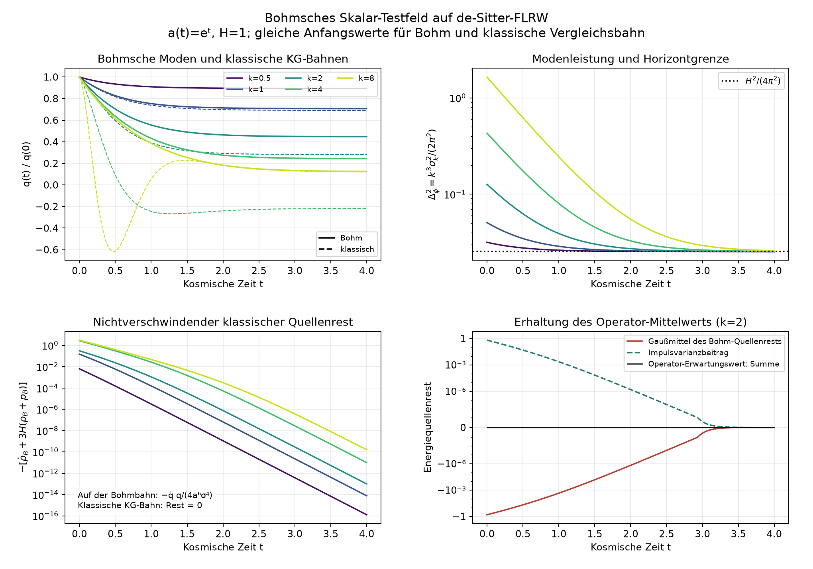

Die klassischen Vergleichsmoden lösen die homogene Klein-Gordon-Gleichung mit denselben Anfangskoordinaten und Geschwindigkeiten. Ihr Unterschied zu Bohmbahnen ist ein Unterschied zwischen klassischer und quantengeführter Feldentwicklung. Das dargestellte Modenspektrum $k^3\sigma^2/(2\pi^2)=H^2(1+z^2)/(4\pi^2)$ ist ein Ergebnis des Testfeldzustands und kein Vergleich mit CMB-Messdaten.

| Feldprüfung | Größter Fehler im Prüfbereich |
|---|---|
| Analytisches modales Schrödingerresiduum, durch $|\psi|$ geteilt | $8{,}77\times10^{-15}$ |
| Unabhängig integrierte komplexe Klein-Gordon-Mode, relativ | $1{,}96\times10^{-11}$ |
| Kanonischer Wronskian dieser Integration | $5{,}17\times10^{-11}$ |
| Führung in konformer Zeit gegen die geschlossene Bahn | $2{,}35\times10^{-14}$ |
| Logarithmische Dichte-Jacobian-Identität | $1{,}78\times10^{-15}$ |
| Operator-Erhaltungsrest | $2{,}66\times10^{-15}$ |

Die komplexe Mode wird ab $t=-3$ durch die Klein-Gordon-ODE integriert; ihr relativer Fehler ist $\max|u_{\rm num}-u|/|u|$ über die geprüften Moden und Zeiten. Für die Fünfmoden-Wellenfunktion werden die Zeit- und Ortsableitungen zusätzlich direkt durch zentrale Differenzen bei $t=0{,}37$ berechnet. Bei $h=4\times10^{-4},2\times10^{-4},10^{-4}$ sinkt $|i\partial_t\Psi-\widehat H\Psi|/|\Psi|$ von $7{,}70\times10^{-6}$ über $1{,}93\times10^{-6}$ auf $5{,}04\times10^{-7}$. In konformer Zeit ergeben sich $2{,}47\times10^{-5}$, $6{,}18\times10^{-6}$ und $1{,}54\times10^{-6}$.

Eine RK4-Integration der Führung mit Zeitschritten $0{,}08$, $0{,}04$ und $0{,}02$ liefert absolute Bahnfehler $3{,}24\times10^{-8}$, $1{,}99\times10^{-9}$ und $1{,}23\times10^{-10}$. Die beobachteten Ordnungen 4,03 und 4,01 stimmen mit dem Verfahren überein.

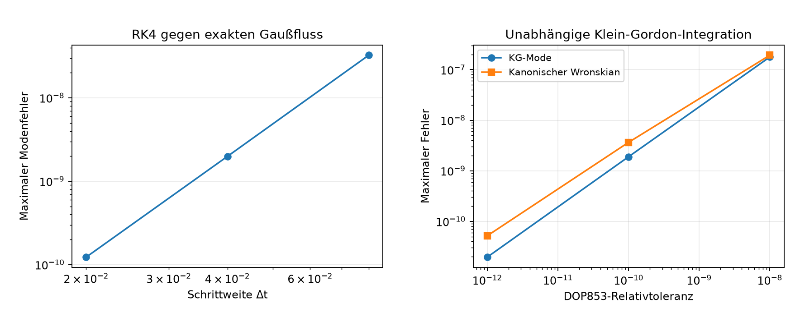

Der nackte Bohm-Quellenrest erreicht einen Betrag von $3{,}141074556$, während die klassischen Vergleichsmoden bis $1{,}78\times10^{-15}$ erhalten sind. Die Gleichheit des Bohmrests mit der Quantenkraftleistung besitzt einen relativen Maximalnormfehler von $7{,}07\times10^{-16}$: Der größte Differenzfehler wird durch den größten Quellbetrag im gesamten Prüfbereich geteilt. Dies ist keine punktweise relative Fehlergrenze bei sehr kleinen späten Quellenwerten. Zentrale Zeitdifferenzen mit $h=5\times10^{-4}$ bestätigen die Quantenkraftleistung bis $2{,}40\times10^{-7}$ und die Operatorbilanz bis $5{,}78\times10^{-7}$.

[gravity_bounce.py](work/gravity_bounce.py) prüft das zweite Modell mit $T_0=1$, Referenzbahn $a_b=1$ und $-4\le T\le4$. Alle 20 festgelegten Prüfungen im [Bounce-Protokoll](work/gravity_bounce_20261017.json) sind erfüllt. Eine unabhängige Neumann-Spektralentwicklung verwendet die Cosinustransformierte der Anfangswellenfunktion und entwickelt jede Impulskomponente mit $e^{+ip^2T/4}$. Ohne nachträgliche Normierung oder Phasenanpassung ergibt sich an 321 Punkten $0\le a\le8$ und sieben Zeiten:

| Quadraturknoten im Spektralintegral | Maximaler komplexer Absolutfehler |
|---|---|
| 24 | $1{,}86\times10^{-1}$ |
| 48 | $5{,}01\times10^{-3}$ |
| 96 | $9{,}34\times10^{-15}$ |
| 192 | $9{,}66\times10^{-14}$ |

Die letzte Verfeinerung liegt bereits im Bereich numerischer Rundungs- und Quadraturfehler. Zentrale Differenzen mit $h=5\times10^{-4}$ ergeben ein absolutes Schrödingerresiduum von $2{,}75\times10^{-8}$ und ein Kontinuitätsresiduum von $1{,}21\times10^{-7}$. Eine separate Phasendifferenz bei $h=10^{-5}$ bestätigt die Führung bis $1{,}23\times10^{-11}$. Die Gaußnormierung stimmt bis $3{,}33\times10^{-16}$, die Hamilton-Jacobi-Einsetzung bis $3{,}54\times10^{-16}$ und die modifizierte Friedmannrelation bis $4{,}70\times10^{-16}$.

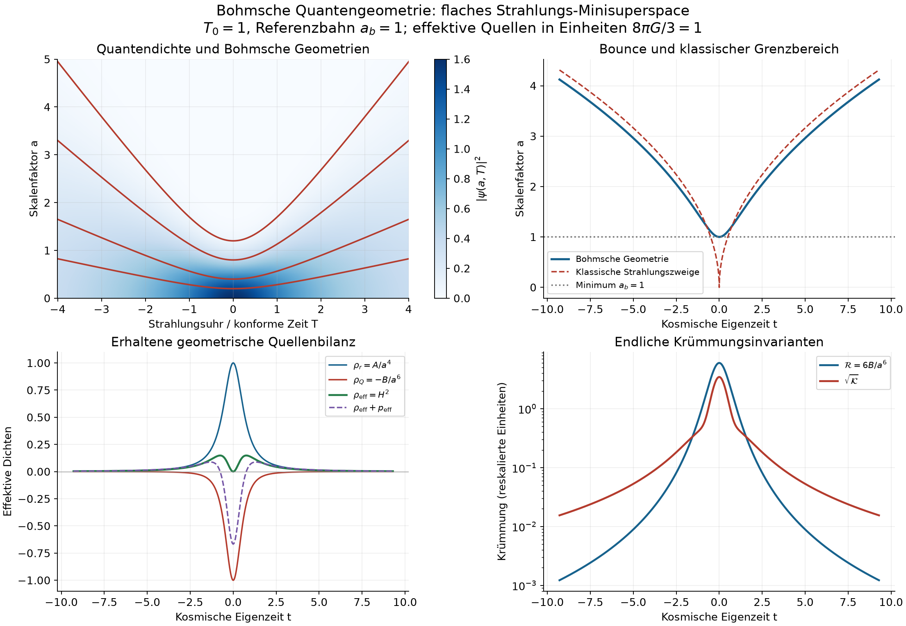

Die unabhängig in kosmischer Zeit integrierte Gleichung für $(a,T)$ weicht um höchstens $8{,}78\times10^{-12}$ im Skalenfaktor und $9{,}18\times10^{-12}$ in der Uhr ab. Eine Differenzenprüfung der effektiven Kontinuitätsgleichung liefert $6{,}39\times10^{-10}$; die aus einer unabhängigen Hubble-Ableitung berechnete Riccikrümmung weicht um $3{,}60\times10^{-9}$ ab. Für die Referenzbahn sind $a_{\min}=1$, $R_{\max}=6$, $K_{\max}=12$ und $(\rho_{\rm eff}+p_{\rm eff})_{T=0}=-2/3$. Diese Rechnungen prüfen die abgeleiteten Modelle, nicht experimentell angepasste kosmologische Parameter.

Die unabhängige Implementierung [verify_gravity_research.py](work/verify_gravity_research.py) konstruiert Christoffelsymbole und Riemanntensor unmittelbar aus $g=a(T)^2\operatorname{diag}(-1,1,1,1)$. Sie bestätigt symbolisch die Krümmungsformeln, alle vier Divergenzkomponenten des Einstein-Tensors und die skalare Stressdivergenz für allgemeines $\phi(T,x,y,z)$ innerhalb dieses FLRW-Ansatzes. Einsetzen der Bounce-Metrik gewinnt $\rho_{\rm eff}$ und $p_{\rm eff}$ direkt aus dem Einstein-Tensor. Zusätzliche Quadraturen prüfen die Krümmungsschwanzwahrscheinlichkeit und die Norm des Neumann-Cosinusspektrums; dessen abgeschnittene Fourieramplitude oberhalb $p=12$ beträgt im verwendeten Fall weniger als $3\times10^{-17}$. Das [unabhängige Gesamtprotokoll](work/gravity_research_verification_20261017.json) verbindet diese Kontrollen mit den geprüften Rohdaten, Quellendateien und Lean-Nachweisen.

### 13.8 Formale Nachweise und Reproduktion

Die vier Dateien [GravityGaussian.lean](work/lean/GravityGaussian.lean), [GravityDeSitter.lean](work/lean/GravityDeSitter.lean), [GravitySource.lean](work/lean/GravitySource.lean) und [GravityBounce.lean](work/lean/GravityBounce.lean) enthalten 48 benannte Sätze. Lean 4.30.0 akzeptiert sämtliche Beweise. Das transitive Audit von 126 neuen Theoremkonstanten verwendet ausschließlich `propext`, `Classical.choice` und `Quot.sound`; vollständige Aussagen, Quellenhashes und Compilerergebnisse stehen im [formalen Prüfprotokoll](work/lean/gravity_proof_verification.json).

Verifiziert werden die tatsächliche Ableitung von $a^3$, Zeit- und Ortsableitungen der Gaußdichte, ihre Kontinuitätsgleichung, der affine Transport und die Dichte-Jacobian-Identität. Die positive Lapse wird mit einer echten Ableitungskettenregel und strenger Monotonie der Uhr behandelt. Für die explizite de-Sitter-Breite beweisen die Sätze Positivität, erste und zweite Ableitung sowie die Reibungs-Ermakov-Gleichung; die spezielle Lösungseigenschaft wird nicht vorausgesetzt. Hinzu kommen die Ableitung des angegebenen Quantenpotentials und die strikt negative Quantenkraftleistung bei $q\ne0$.

Die Quellenbeweise leiten die tatsächliche Bilanzableitung aus den Modengleichungen ab. Sie zeigen getrennt den Defekt der nackten Gauß-Mittelquelle und seine Kompensation durch $\delta=1/(8a^6\sigma^2)$. Der Friedmann-Constraint wird unter der ausdrücklich angenommenen Beschleunigungsgleichung als erhalten bewiesen. Diese Aussagen sind keine Formalisierung der allgemeinen Bianchi-Identität oder der vollständigen Einstein-Gleichungen.

Für den Bounce werden positive Mindestgröße, tatsächliche Bahnableitung, Führung, modifizierte Friedmannrelation und negative Nullenergiebedingung am Übergang bewiesen. Die Hamilton-Jacobi-Einsetzung ist ein zusätzlicher rationaler Identitätssatz mit den explizit eingesetzten Phasenableitungen und $Q_a$; sie enthält keinen weiteren Ableitungsbeweis der komplexen Halbachsen-Wellenfunktion. Deren Schrödinger-Gleichung, Normierung und Randbedingung sowie die Krümmungsgrenzen und kausale geodätische Vollständigkeit sind in den Abschnitten 13.5–13.6 analytisch bewiesen. Die volle räumliche Constraintalgebra ist Literaturgegenstand in Abschnitt 13.4 und kein Inhalt dieser Lean-Dateien.

Die archivierten Roharrays, numerischen Protokolle und unveränderten Primärquellen ermöglichen die getrennte Nachprüfung von Theorie, Numerik und Formalisierung. Die Reproduktion aus dem Projektverzeichnis erfolgt in PowerShell mit neuen Ausgabekennungen:

```powershell
python work/gravity_curved_field.py --tag feld_neu
python work/gravity_bounce.py --tag bounce_neu
python work/lean/check_gravity_proofs.py
python work/verify_gravity_research.py `
  --field-tag feld_neu --bounce-tag bounce_neu `
  --output-tag pruefung_neu
```

Der Lean-Lauf verwendet das vorhandene Mathlib-Abbild ohne Netzwerk und mit schreibgeschützt eingebundenen Quellen. Die beiden Modelle liefern damit abgeschlossene Ergebnisse auf ihren jeweiligen Ebenen: globale äquivariante Feldführung mit präziser Quellenprüfung auf gegebenem Hintergrund sowie eine explizite reguläre quantenkosmologische Geometrie. Ihre Kombination ist keine Behauptung einer bereits konstruierten vollständigen Bohmschen Quantengravitation.

## 14. Semiklassische Rückwirkung

Die erhaltene Operatorquelle aus Kapitel 13 lässt sich zu einem geschlossenen Modell ausbauen: Die Feldmoden bestimmen die Geometrie, und dieselbe Geometrie bestimmt ihre weitere Quantenentwicklung. Für eine endliche symmetrische Modenschar wird dieses Anfangswertproblem hier vollständig formuliert. Es besitzt eindeutige globale zukünftige Lösungen, erlaubt innerhalb seiner positiven Quellenklasse keinen Bounce und hat auf dem expandierenden Ast eine notwendige vergangene Krümmungssingularität. Die zugehörigen Bohmschen Feldbahnen bleiben äquivariant. Zusätzlich wird die Energievarianz berechnet, um die mathematische Konsistenz der Erwartungswertkopplung von der Größe ihrer Quellenfluktuationen zu unterscheiden.

### 14.1 Moden und räumliche Symmetrie

Es gelten die Signatur $(-,+,+,+)$, $\hbar=c=1$ und
$c_G=8\pi G/3>0$. Der räumlich flache Hintergrund

$$ds^2=-dt^2+a(t)^2d\mathbf x^2$$

wird gemeinsam mit einem masslosen minimal gekoppelten reellen Skalarfeld entwickelt. Der komovierende Raum ist ein Torus mit Kantenlänge $2\pi$ und Volumen $V=(2\pi)^3$. Für $n=1,2,3$ werden die Wellenvektoren $n\mathbf e_x,n\mathbf e_y,n\mathbf e_z$ gewählt, jeweils mit beiden reellen Basisfunktionen

$$e_{\mathbf k,c}=\sqrt{\frac2V}\cos(\mathbf k\cdot\mathbf x),\qquad
e_{\mathbf k,s}=\sqrt{\frac2V}\sin(\mathbf k\cdot\mathbf x).$$

Das sind drei vollständige kubische Achsenorbits mit jeweils $d_j=6$ unabhängigen Realmoden. Es handelt sich insgesamt nicht um vollständige Energieschalen: Bei $|\mathbf k|=3$ fehlt beispielsweise $(2,2,1)$. Die Auswahl bleibt ein fester Bestandteil des endlichen Modells.

Der Zustand ist ein Produkt zentrierter reiner Gaußzustände. Alle sechs Moden desselben Orbits besitzen dieselbe Breite $\sigma_j$ und Breitenrate $v_j$, aber unabhängige Konfigurationskoordinaten. Die notwendigen räumlichen Symmetrien folgen punktweise aus

$$e_c^2+e_s^2=\frac2V,\qquad
e_c\partial_i e_c+e_s\partial_i e_s=0,$$

$$\partial_i e_c\partial_l e_c+\partial_i e_s\partial_l e_s
=\frac{2k_i k_l}{V}.$$

Die Paarung macht Energiedichte und Gradientenergie homogen und lässt den erwarteten Energiefluss verschwinden. Die drei Achsen erfüllen zusätzlich
$\sum_{r=1}^3(n\mathbf e_r)(n\mathbf e_r)^T=n^2I$. Deshalb ist der vollständige erwartete räumliche Stresstensor isotrop. Die Entwicklung hängt innerhalb eines Orbits nur von $k_j^2=n^2$ ab und erhält die gleichen Gaußdaten durch Eindeutigkeit.

Damit besitzt die Einstein-Quelle exakt FLRW-Form. Die höheren Feldkorrelationen der endlichen Achsenauswahl sind dadurch nicht vollständig rotationsinvariant. Auch einzelne tatsächliche Bohmsche Feldkonfigurationen sind im Allgemeinen inhomogen. Ihre gemeinsame Geometrie wird hier vom Operator-Erwartungswert bestimmt.

### 14.2 Geschlossene Entwicklung

Mit $w_j=d_j/V$, $k_j=j$ und $v_j=\dot\sigma_j$ lautet das gekoppelte System

$$\dot a=Ha,\qquad \dot\sigma_j=v_j,$$

$$\dot v_j=-3Hv_j-\frac{k_j^2}{a^2}\sigma_j
+\frac{1}{4a^6\sigma_j^3},\qquad
\dot H=-\frac{3c_G}{2}(\rho+p),$$

$$\rho=\frac12\sum_jw_j\left[v_j^2+\frac{k_j^2\sigma_j^2}{a^2}
+\frac{1}{4a^6\sigma_j^2}\right],$$

$$p=\frac12\sum_jw_j\left[v_j^2-\frac{k_j^2\sigma_j^2}{3a^2}
+\frac{1}{4a^6\sigma_j^2}\right].$$

Der Friedmann-Constraint ist

$$C=H^2-c_G\rho-\frac\Lambda3=0.$$

Die Impulsvarianz erscheint sowohl in $\rho$ als auch in $p$. Das Vektorfeld ist auf $a>0$, $\sigma_j>0$ glatt und besitzt damit eine eindeutige lokale Lösung für endliche Anfangsdaten. Der Constraint wird anfangs erfüllt; seine Erhaltung folgt aus den Bewegungsgleichungen.

Diese Gleichungen besitzen auch ein reduziertes Variationsprinzip. Für eine positive Lapse $N(\tau)$ und Punkte als $\tau$-Ableitung lautet die Gaußwirkung bis auf Randterme

$$\begin{aligned}
I_{\rm eff}=\int d\tau\bigg\{&V\left[-\frac{a\dot a^2}{c_GN}-\frac{N\Lambda a^3}{3c_G}\right]\\
&+\sum_jd_j\left[\frac{a^3\dot\sigma_j^2}{2N}
-\frac{Na k_j^2\sigma_j^2}{2}-\frac{N}{8a^3\sigma_j^2}\right]\bigg\}.
\end{aligned}$$

Variation nach $\sigma_j$, $N$ und $a$ liefert die Breitenentwicklung, den Constraint und die geometrische Entwicklung. Insbesondere ergibt die materielle $a$-Variation bei $N=1$ genau $3Va^2p$. Die Gaußklasse ist für die quadratischen Feld-Hamiltonoperatoren invariant; ihre Breitenentwicklung ist innerhalb dieser Zustandsklasse exakt.

Jede Realmode besitzt entlang der gekoppelten Lösung die vollständige Wellenfunktion

$$\psi_j(q,t)=(2\pi\sigma_j^2)^{-1/4}
\exp\left[-\frac{q^2}{4\sigma_j^2}
+i\left(\frac{a^3v_jq^2}{2\sigma_j}+\theta_j\right)\right],$$

$$\dot\theta_j=-\frac{1}{4a^3\sigma_j^2}.$$

Sie erfüllt $i\partial_t\psi_j=[-\partial_q^2/(2a^3)+ak_j^2q^2/2]\psi_j$. Die Bohmsche Führung ist

$$\dot q_{j,r}=\frac{v_j}{\sigma_j}q_{j,r},\qquad
q_{j,r}(t)=q_{j,r}(0)\frac{\sigma_j(t)}{\sigma_j(0)},\qquad r=1,\ldots,d_j.$$

Aus dem positiven Skalierungsjacobian folgt für jede Mode die exakte Dichtetransportidentität. Ihre endliche Produktanwendung beweist Äquivarianz auch auf der selbstkonsistent entwickelten Geometrie. Eine positive Umparametrisierung $dt=N\,d\tau$ multipliziert Hamiltonoperator und Führung mit derselben Lapse; sie verändert die räumliche Foliation nicht.

### 14.3 Erhaltung und Vorzeichen

Definiere die beiden positiven Beiträge

$$\mathcal K=\frac12\sum_jw_j\left[v_j^2+\frac{1}{4a^6\sigma_j^2}\right],\qquad
\mathcal G=\frac12\sum_jw_j\frac{k_j^2\sigma_j^2}{a^2}.$$

Dann sind $\rho=\mathcal K+\mathcal G$ und $p=\mathcal K-\mathcal G/3$. Damit gelten

$$-\frac\rho3\le p\le\rho,\qquad
\frac{2\rho}{3}\le\rho+p\le2\rho,\qquad
\rho+3p=4\mathcal K>0.$$

Direkte Ableitung der Quelle mit der Breitenentwicklung liefert

$$\dot\rho=-3H(\rho+p),\qquad
\dot C=2H\dot H-c_G\dot\rho=0.$$

Die volle Impulsvarianz schließt somit die in Kapitel 13 nachgewiesene Erhaltungslücke. Zugleich ist $\dot H<0$: Ein regulärer Wechsel von Kontraktion zu Expansion ist in diesem räumlich flachen positiven Quellenmodell ausgeschlossen. Bei $\Lambda=0$ gilt zusätzlich $\ddot a/a=-2c_G\mathcal K<0$. Der positive Operatorbeitrag ist daher physikalisch verschieden von der negativen effektiven Quelle des quantisierten Minisuperspace-Bounces.

Eine weitere Schranke folgt durch quadratische Ergänzung beziehungsweise AM-GM:

$$\frac{k_j^2\sigma_j^2}{a^2}+\frac{1}{4a^6\sigma_j^2}
\ge\frac{k_j}{a^4}.$$

Mit $\mathcal L=\frac12\sum_jw_jk_j>0$ ergibt sich

$$\rho\ge\frac{\mathcal L}{a^4}.$$

Für einen expandierenden Ast gilt außerdem

$$\frac{d}{dt}(\rho a^2)=-Ha^2(\rho+3p)\le0,\qquad
\frac{d}{dt}(\rho a^6)=3Ha^6(\rho-p)\ge0.$$

Somit liegt die Dichte zwischen $\rho_0(a_0/a)^6$ und $\rho_0(a_0/a)^2$. Diese Positivitätsaussagen betreffen die unsubtrahierte endliche Quelle. Sie werden nicht auf beliebige renormierte Stress-Energie-Tensoren übertragen.

### 14.4 Zeitliche Existenzgrenzen

**Globale Zukunft.** Für eine endliche nichtleere Modenschar mit $w_j,k_j,c_G>0$, $\Lambda\ge0$, $a_0,\sigma_{j0}>0$, endlichen $v_{j0}$ und
$H_0=\sqrt{c_G\rho_0+\Lambda/3}$ existiert die gekoppelte Lösung für alle $t\ge0$.

Zum Beweis bleibt zunächst $C=0$ erhalten. $H$ kann auf einem regulären Intervall nicht null werden, denn dann wäre $0=c_G\rho+\Lambda/3$ trotz $\rho>0$. Deshalb sind $H>0$, $H\le H_0$ und $\rho\le\rho_0$. Auf jedem endlichen Intervall $0\le t\le T$ gelten

$$a_0\le a\le a_0e^{H_0T}=:a_{\max},\qquad
|v_j|\le\sqrt{\frac{2\rho_0}{w_j}},$$

$$\sqrt{\frac{w_j}{8\rho_0a_{\max}^6}}
\le\sigma_j\le\sigma_{j0}+T\sqrt{\frac{2\rho_0}{w_j}}.$$

Alle Variablen bleiben damit in einem kompakten Teil des regulären ODE-Zustandsraums. Der Fortsetzungssatz schließt jedes endliche maximale Zukunftsende aus. Die expliziten Bohmbahnen und die normierte Produktdichte bestehen deshalb ebenfalls für alle zukünftigen Zeiten.

Für $\Lambda=0$ folgen aus Constraint und Energieschranken

$$\sqrt{a_0^2+2\sqrt{c_G\mathcal L}\,t}
\le a(t)\le a_0+a_0\sqrt{c_G\rho_0}\,t.$$

Insbesondere gehen $a\to\infty$, $\rho\to0$ und $H\to0$. Diese Grenzen erzwingen keine exakte Potenzasymptotik. Für $\Lambda>0$ und $h_\Lambda=\sqrt{\Lambda/3}$ erhält man hingegen

$$a\ge a_0e^{h_\Lambda t},\qquad
\rho\le\rho_0e^{-2h_\Lambda t},$$

$$0<H-h_\Lambda\le\frac{c_G\rho_0}{2h_\Lambda}e^{-2h_\Lambda t}.$$

Die Expansion nähert sich damit dem durch die vorgegebene kosmologische Konstante bestimmten de-Sitter-Wert.

Auch die zukünftige kausale geodätische Vollständigkeit folgt. Für eine zeitartige Geodäte mit komovierendem Impulsbetrag $P$ ist $dt/ds=\sqrt{1+P^2/a^2}\le\sqrt{1+P^2/a_0^2}$; unendliche kosmische Zukunft besitzt daher unendliche Eigenzeit. Die affine Nullparameterlänge ist proportional zu $\int a(t)dt\ge a_0\int dt$ und ebenfalls unendlich. Die vollständigen räumlichen Torusschnitte enthalten keine zusätzliche Randobstruktion. Aus $H\le H_0$ und $|\dot H|\le3c_G\rho_0$ folgen zugleich beschränkte zukünftige Ricci- und Kretschmannskalare.

**Vergangene Singularität.** Dieselbe positive Quellenklasse erzwingt auf dem maximalen expandierenden Ast ein endliches vergangenes Ende. Für einen Referenzzeitpunkt $t_0$ gilt

$$\frac{d}{dt}a^2=2a^2H\ge2\sqrt{c_G\mathcal L},$$

also für $t<t_0$

$$a(t)^2\le a_0^2-2\sqrt{c_G\mathcal L}(t_0-t).$$

Der vergangene Endpunkt erfüllt deshalb

$$t_-\ge t_0-\frac{a_0^2}{2\sqrt{c_G\mathcal L}}.$$

Wäre der monotone Grenzwert von $a$ dort positiv, so gäbe
$\rho\le\rho_0(a_0/a)^6$ beschränkte Dichte und Hubbleparameter. Die Energie würde alle $v_j$ und die positiven oberen und unteren Breitengrenzen kontrollieren. Der ODE-Fortsetzungssatz würde eine Fortsetzung über $t_-$ erlauben. Folglich muss $a\to0$ gelten. Daraus folgen

$$\rho\ge\frac{\mathcal L}{a^4}\to\infty,\qquad
K=12[(\dot H+H^2)^2+H^4]
\ge\frac{12c_G^2\mathcal L^2}{a^8}\to\infty.$$

Die komovierende zeitartige Geodäte hat Eigenzeit $t$ und erreicht dieses Ende in endlicher Eigenzeit. Das Modell ist somit zukünftig vollständig, aber vergangenheitssingulär. Die konsistente Erwartungswertkopplung erhält den Constraint; sie löst innerhalb dieser positiven Quellenklasse nicht die kosmologische Anfangssingularität.

### 14.5 Kovarianzen und Energievarianz

Eine unabhängige Beschreibung verwendet pro Realmode

$$X=\langle q^2\rangle,\quad
Y=\frac12\langle q\pi+\pi q\rangle,\quad
Z=\langle\pi^2\rangle.$$

Mit $M=a^3$ und $\Omega=k/a$ lautet die Kovarianzentwicklung

$$\dot X=\frac{2Y}{M},\qquad
\dot Y=\frac ZM-M\Omega^2X,\qquad
\dot Z=-2M\Omega^2Y.$$

Sie erhält $XZ-Y^2$. Für die verwendeten reinen Gaußzustände sind

$$X=\sigma^2,\qquad Y=M\sigma v,\qquad
Z=M^2v^2+\frac{1}{4\sigma^2},\qquad XZ-Y^2=\frac14.$$

Die Kovarianzformulierung reproduziert die Ermakov-Gleichung und dieselbe Quelle. Solche erhaltenen Kovarianzdeterminanten treten auch in der Kontinuumsbehandlung homogener Gaußzustände auf [GS2021].

Die mathematische Konsistenz ersetzt keine Prüfung der Quellenfluktuationen. Für den momentanen Moden-Hamiltonoperator
$\widehat h=\widehat\pi^2/(2M)+M\Omega^2\widehat q^2/2$ ist

$$E=\langle\widehat h\rangle=\frac12\left(\frac ZM+M\Omega^2X\right).$$

Quantenmechanische Wick-Kontraktion einschließlich des Kommutators ergibt

$$\operatorname{Var}(\widehat h)
=\frac12\left[\left(\frac ZM\right)^2+(M\Omega^2X)^2+2\Omega^2Y^2\right]
-\frac{\Omega^2}{4}.$$

Für $XZ-Y^2=1/4$ vereinfacht sich dies zu

$$\operatorname{Var}(\widehat h)=2E^2-\frac{\Omega^2}{2}\ge0.$$

Der Kommutatorterm ist unverzichtbar: Im momentanen Oszillatorgrundzustand $E=\Omega/2$ verschwindet die Energievarianz. Eine direkte Gegenherleitung setzt $A=1/(2\sigma^2)-iMv/\sigma$ und

$$\widehat h\psi=(D_0+D_2q^2)\psi,\qquad
D_2=\frac12\left(M\Omega^2-\frac{A^2}{M}\right).$$

Da $\mathbb E[(q^2-\sigma^2)^2]=2\sigma^4$, folgt unabhängig
$\operatorname{Var}(\widehat h)=\| (\widehat h-E)\psi\|^2=2\sigma^4|D_2|^2$.

Für die räumlich gemittelte Feldenergiedichte
$\widehat{\bar\rho}=\sum_{j,r}\widehat h_{j,r}/(Va^3)$ addieren sich die Varianzen der unabhängigen Moden. Der dimensionslose Quotient lautet

$$\mathcal R_E=
\frac{\operatorname{Var}(\widehat{\bar\rho})}{\langle\widehat{\bar\rho}\rangle^2}
=\frac{\sum_j d_j\operatorname{Var}(\widehat h_j)}{(\sum_jd_jE_j)^2}.$$

Im Zähler steht $d_j$, nicht $d_j^2$: Gleiche Gaußbreiten sind keine identischen Zufallsvariablen. Dieses endliche räumliche Diagnostikum ist nicht mit einem normalgeordneten lokalen Stressfluktuationsmaß gleichzusetzen; die Bedeutung solcher Fluktuationen für semiklassische Gültigkeit wird in [KF1993] untersucht.

Für $N$ unabhängige gleich präparierte Kopien mit ausdrücklich gemittelter Quelle $\widehat A_N=N^{-1}\sum_{r=1}^N\widehat{\bar\rho}_r$ gelten

$$\mathbb E\widehat A_N=\rho,\qquad
\operatorname{Var}(\widehat A_N)=\frac{\operatorname{Var}(\widehat{\bar\rho})}{N},\qquad
\mathcal R_{E,N}=\frac{\mathcal R_E}{N}.$$

Bei Verwendung der ungemittelten Gesamtquelle entspricht dies der Gravitationsskalierung $G_N=G/N$. Damit ist eine präzise Familie mit reduzierter Varianz definiert; sie ist vom ursprünglichen Einfeldmodell zu unterscheiden. Die Aussage kontrolliert diese Observable und ist kein allgemeiner Fehlerbeweis für die semiklassische Näherung.

### 14.6 Numerische Gegenprüfungen

[gravity_backreaction.py](work/gravity_backreaction.py) integriert die vollständige Rückkopplung für $a_0=1$, $c_G=1$, $0\le t\le30$ und $\Lambda=0$ beziehungsweise $0{,}03$. Die Anfangsbreiten und Raten sind

$$\sigma_{j0}=\frac{(0{,}7;1{,}4;0{,}9)_j}{\sqrt{2k_j}},\qquad
v_{j0}=(0{,}1;-0{,}2;0{,}15)_j\sigma_{j0}.$$

Es folgen $\rho_0=0{,}08257463078$ und $\mathcal L=0{,}07256595247$. $H_0$ wird einmalig aus dem positiven Anfangsconstraint bestimmt und danach eigenständig durch die Raychaudhuri-Gleichung entwickelt. Alle 32 festgelegten Prüfungen sind erfüllt; ihre Schwellen und Rohwerte stehen im [numerischen Protokoll](work/gravity_backreaction_20261017.json).

| Größe | $\Lambda=0$ | $\Lambda=0{,}03$ |
|---|---|---|
| $H(0)$ | 0,2873580185 | 0,3042607940 |
| $a(30)$ | 4,278961289 | 28,63955379 |
| $H(30)$ | 0,01586671771 | 0,1000012359 |
| $\rho(30)$ | $2{,}517527309\times10^{-4}$ | $2{,}471762992\times10^{-7}$ |
| Größter absoluter Friedmannrest | $2{,}99\times10^{-15}$ | $2{,}64\times10^{-15}$ |

Für $\Lambda=0$ liegt $a(30)$ zwischen den analytischen Schranken $4{,}142805932$ und $9{,}620740554$. Für $\Lambda=0{,}03$ nähert sich $H$ dem bewiesenen Grenzwert $\sqrt{\Lambda/3}=0{,}1$.

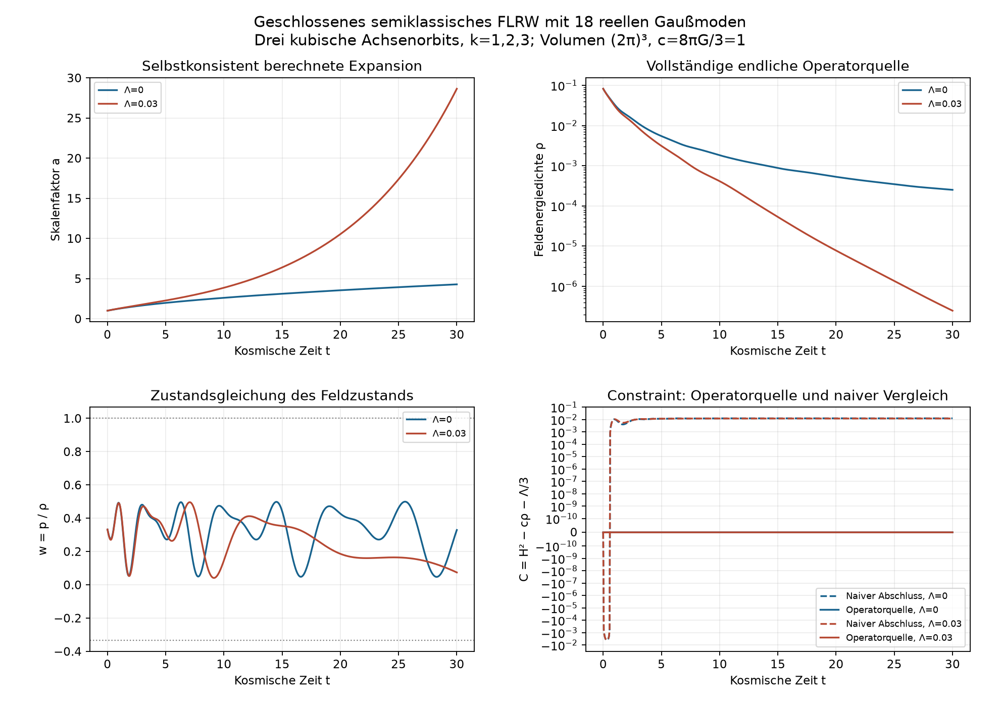

Die unabhängige komplexe Klein-Gordon-Implementierung entwickelt Moden $u_j$ gemeinsam mit $a,H$ und berechnet die Quelle direkt aus $|u_j|^2$ und $|\dot u_j|^2$. Sie verwendet die Breitenkraft nicht. Der maximale absolute Geometriefehler gegenüber der Ermakovimplementierung beträgt $1{,}63\times10^{-12}$ beziehungsweise $3{,}51\times10^{-12}$, der relative Breitenfehler $1{,}26\times10^{-12}$ beziehungsweise $5{,}65\times10^{-12}$. Die kanonischen Wronskianfehler bleiben unter $1{,}49\times10^{-12}$.

Eine getrennte Integration in konformer Zeit entwickelt eine eigene kosmische Uhr und rekonstruiert gleiche Vergleichszeiten durch Nullstellensuche. Ihre absoluten Geometriefehler sind $6{,}95\times10^{-13}$ und $1{,}30\times10^{-11}$. Das prüft die Umparametrisierung derselben FLRW-Blätter. Drei Integrationstoleranzen prüfen zusätzlich Konvergenz; der skalierte Zustandsfehler ist dabei $\max|y-y_{\rm ref}|/(1+|y_{\rm ref}|)$.

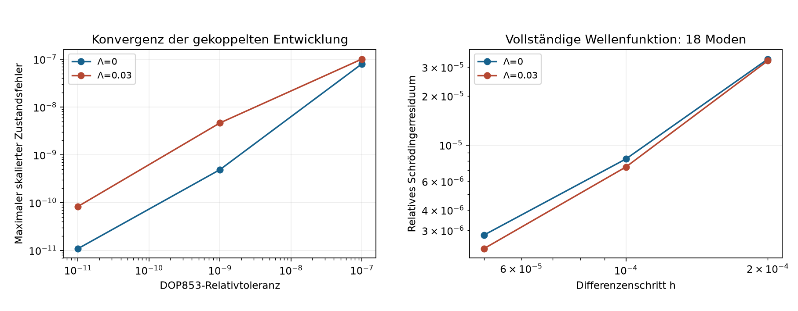

Zentrale Differenzen werden unmittelbar auf die komplexe 18-Moden-Wellenfunktion einschließlich integrierter Phase angewandt. Für $h=2\times10^{-4},10^{-4},5\times10^{-5}$ ergibt sich an den vier Prüfzeiten $0{,}25;2;10;25$ für $|i\partial_t\Psi-\widehat H\Psi|/|\Psi|$:

| $h$ | $\Lambda=0$ | $\Lambda=0{,}03$ |
|---|---|---|
| $2\times10^{-4}$ | $3{,}36\times10^{-5}$ | $3{,}29\times10^{-5}$ |
| $10^{-4}$ | $8{,}21\times10^{-6}$ | $7{,}34\times10^{-6}$ |
| $5\times10^{-5}$ | $2{,}81\times10^{-6}$ | $2{,}32\times10^{-6}$ |

Die feinste direkte Kontinuitätsprüfung liefert absolute Restwerte von $1{,}15\times10^{-8}$ und $1{,}25\times10^{-8}$. Die logarithmische Dichte-Jacobian-Identität stimmt bis $1{,}60\times10^{-14}$.

Ein gezielt inkonsistenter Kontrolllauf lässt nur den Impulsvarianzbeitrag der Quelle weg und behält die quantengeführte Breitenentwicklung bei. Er startet mit denselben $a_0,\sigma_0,v_0$, aber einem für seine eigene Quelle anfänglich erfüllten Constraint. Anschließend entstehen Constraintabweichungen bis $0{,}0127302$ beziehungsweise $0{,}0123439$. Die Identität $C_B(t)=-c_G\int_0^tD_B(s)ds$ stimmt dabei bis $3{,}93\times10^{-15}$. Diese Kontrolle isoliert die Erhaltungslücke; sie beschreibt keine alternative konsistente Kosmologie.

Eine weitere unabhängige Implementierung in [verify_backreaction_research.py](work/verify_backreaction_research.py) integriert die Kovarianzgleichungen mit Radau. Gegenüber den gespeicherten Breitenlösungen betragen die skalierten Maximalfehler $4{,}93\times10^{-12}$ und $5{,}07\times10^{-11}$; die absoluten Casimirabweichungen bleiben unter $1{,}48\times10^{-11}$. Die punktweise Auswertung der reellen Basis bestätigt homogene Energiedichte, isotropen räumlichen Tensor und verschwindenden Energiefluss bis $2{,}78\times10^{-17}$. Direkte Gaußquadratur von $|(\widehat h-E)\psi|^2$ bestätigt die Energievarianz mit absoluten Fehlern unter $1{,}0\times10^{-15}$.

Die relative Standardabweichung der räumlich gemittelten **Feldenergie** beträgt anfangs $\sqrt{\mathcal R_E}=0{,}15199526$. Bei $t=30$ ist sie $0{,}16177845$ für $\Lambda=0$ und $0{,}31137428$ für $\Lambda=0{,}03$. Im zweiten Fall ist die Feldenergiedichte inzwischen sehr klein. Zählt man die deterministische Vakuumquelle $\rho_\Lambda=\Lambda/(3c_G)$ zur mittleren Gesamtquelle, lautet das entsprechende Verhältnis

$$\frac{\Delta\rho}{\rho+\rho_\Lambda}
=\sqrt{\mathcal R_E}\,\frac{\rho}{\rho+\rho_\Lambda}.$$

Für $\Lambda=0{,}03$ sinkt es von $0{,}1355766$ auf $7{,}6962440\times10^{-6}$. Die zunehmende relative Feldenergiefluktuation belegt daher keine zunehmende relative Fluktuation der unter $\Lambda$-Dominanz wirksamen Gesamtquelle.

Eine Rückwärtsintegration für $\Lambda=0$ illustriert den analytischen Singularitätssatz:

| Erreichter Skalenfaktor | Kosmische Zeit | Kretschmannskalar |
|---|---|---|
| 0,5 | $-1{,}265581888$ | 33,9983 |
| 0,25 | $-1{,}588803558$ | 19503,6693 |
| 0,125 | $-1{,}658569631$ | $1{,}41947374\times10^7$ |

Die analytische obere Grenze der vergangenen Eigenzeit bis zur Singularität beträgt für die Anfangsdaten $a_0^2/(2\sqrt{c_G\mathcal L})=1{,}856109332$. Die numerischen Stichproben illustrieren die Krümmungszunahme; der Divergenz- und Unvollständigkeitsbeweis stammt aus Abschnitt 14.4. Das [unabhängige Gesamtprotokoll](work/backreaction_independent_verification_20261017.json) bindet diese Kontrollen an Quellen, Roharrays und Formalnachweise.

### 14.7 Formale Nachweise

[BackreactionCoupled.lean](work/lean/BackreactionCoupled.lean) enthält 31 explizite Sätze zur endlichen Quellenalgebra und den tatsächlichen Ableitungen der gekoppelten Dynamik. Der erfolgreiche Offline-Lauf mit Lean 4.30.0 und Mathlib-Revision `c5ea00351c28e24afc9f0f84379aa41082b1188f` ist im [Prüfprotokoll](work/lean/backreaction_proof_verification.json) dokumentiert. Der Kernel akzeptiert sämtliche Beweise; die 50 transitiv auditierten Theorem-Konstanten umfassen auch vom Elaborator erzeugte Hilfskonstanten. Der Axiomenaudit enthält ausschließlich `propext`, `Classical.choice` und `Quot.sound`.

Die Quadratergänzung der Modenenergie, ihre positive untere Schranke und die Druckschranken werden zunächst für eine Mode und anschließend für endliche gewichtete Summen bewiesen. Der Satz `mode_density_hasDerivAt` differenziert die definierte rationale Quelle aus den ausdrücklich vorausgesetzten Gleichungen für $a,\sigma_j,v_j$. Damit ist die Kontinuitätsgleichung eine Folgerung der Modendynamik. `coupled_constraint_hasDerivAt_zero` kombiniert diese Ableitung mit der Raychaudhuri-Gleichung und erhält $\dot C=0$. Ein weiterer Satz beweist die Konstanz auf einem offenen Lösungsintervall mittels Mittelwertsatz.

Die Erhaltung des positiven Expansionszweigs folgt im formalen Text aus Stetigkeit, Zwischenwertsatz und dem Ausschluss von $H=0$. Bewiesen werden außerdem $H\ge\sqrt{c_G\mathcal L}/a^2$, die tatsächliche Ableitung $(a^2)'\ge2\sqrt{c_G\mathcal L}$ sowie die Vorzeichen von $\dot H$, $\dot\rho$ und $(\rho a^2)'$ unter den angegebenen Hypothesen. Für die unabhängigen Kovarianzgleichungen werden $(XZ-Y^2)'=0$ und die Intervallkonstanz bewiesen. Die Gaußzuordnung erfüllt formal exakt $XZ-Y^2=1/4$. Aus $E=a^3\rho_j$ folgen $E\ge k/(2a)$ und die Nichtnegativität der algebraischen Varianzformel $2E^2-k^2/(2a^2)$.

Die Identifikation dieser Formel als Operatorvarianz sowie die räumliche Symmetrie der Quelle sind die analytischen Herleitungen in den Abschnitten 14.1 und 14.5. Der ODE-Fortsetzungsbeweis, die Zukunftsasymptotik, die vergangene Krümmungsdivergenz und die geodätischen Aussagen sind die gesonderten Beweise aus Abschnitt 14.4. Das Lean-Modul formalisiert somit konkrete Ableitungs- und Intervallaussagen des angegebenen endlichen Modells; eine allgemeine ODE-Existenztheorie, die volle Einstein-Constraintalgebra oder eine Kontinuumsrenormierung sind nicht Gegenstand dieser 31 Sätze.

Die Reproduktion erfolgt aus dem Projektverzeichnis in PowerShell mit neuen Ausgabekennungen:

```powershell
python work/gravity_backreaction.py --tag rueckwirkung_neu
python work/lean/check_backreaction_proofs.py
python work/verify_backreaction_research.py `
  --tag rueckwirkung_neu --output-tag pruefung_neu
```

Für die Gesamtkontrolle der erweiterten Manuskriptfassung ist dieser letzte Prüfer maßgeblich. Er bindet auch das vorherige Gravitationsprotokoll an dessen Manuskriptsnapshot und überprüft die unveränderten Quellen- und Ergebnisdateien. Frühere kapitelbezogene Gesamtprüfer und ihre Protokolle beziehen sich auf die jeweils gespeicherte Manuskriptrevision.

### 14.8 Physikalische Einordnung

Das Ergebnis ist eine geschlossene semiklassische Rückkopplung mit tatsächlichen äquivarianten Bohmbahnen. Die Quelle selbst ist der gewöhnliche quantenmechanische Operator-Erwartungswert; die Konstruktion beansprucht deshalb keine besondere empirische Abweichung gegenüber der entsprechenden semiklassischen Quantentheorie. Die Feldenergiefluktuationen sind ein berechnetes Gültigkeitsdiagnostikum, kein Beweis einer kontrollierten Approximation vollständiger Quantengravitation.

Der Unterschied zur renormierten Kontinuumstheorie bleibt wesentlich. Diese benötigt geeignete Zustandsregularität, lokale kovariante Subtraktionen und zusätzliche geometrische Renormierungsparameter. Die einschlägigen Existenzarbeiten [GS2021, MPS2021] und der aktuelle Überblick [Meda2026] behandeln gerade die dadurch entstehenden nichtlokalen und höheren Ableitungsterme. Unsere positiven endlichen Quellen erfüllen einen einfacheren, vollständig angegebenen Satz. Sein Zukunfts- und Vergangenheitsergebnis wird auf diese Quellenklasse begrenzt; es ersetzt weder eine Kontinuumsrenormierung noch die volle räumliche Constraintalgebra.

## 15. Renormierte Quelle und Rückwirkung

Der Singularitätssatz des vorigen Kapitels verwendet die positive, unsubtrahierte Energie einer endlichen Modenschar. Für eine renormierte Quantenfeldquelle gilt diese Voraussetzung nicht allgemein. Das folgende vollständig berechenbare Referenzmodell zeigt beide Möglichkeiten: Eine festgelegte Kopplung führt zu einem endlichen Krümmungsendpunkt, eine andere zu einer glatten, kausal geodätisch vollständigen Bounce-Familie. Für einen ihrer Spezialfälle wird zugleich die reine Bohmsche Feldführung exakt rekonstruiert.

### 15.1 Feldmodell und Renormierung

Es gelten weiterhin die Signatur $(-,+,+,+)$, $c_G=8\pi G/3$, $\hbar=c=1$ und

$$ds^2=-dt^2+a(t)^2d\mathbf x^2,\qquad R=6(\dot H+2H^2).$$

Der Raum ist jetzt $\mathbb R^3$; eine topologische Casimirquelle tritt nicht auf. Das reelle Feld ist masslos und **konform gekoppelt**, $\xi=1/6$. Diese Änderung gegenüber $\xi=0$ in Kapitel 14 ist ein Wechsel des Materiemodells. Zur konformen Kopplung gehören die verbesserte Stress-Energie-Quelle und der Krümmungsterm in der Feldgleichung; die minimal gekoppelte Modenenergie wird nicht unverändert weiterverwendet.

Mit dem geometrischen Operator $\Box=g^{\mu\nu}\nabla_\mu\nabla_\nu$, also $\Box f=-\ddot f-3H\dot f$ für homogene Skalare, lautet die renormierte Spur

$$\mathcal T:=\langle T^\mu{}_{\mu}\rangle_{\rm ren}
=-4A(H^4+H^2\dot H)+b\Box R,\qquad
A=\frac{1}{960\pi^2}.$$

Der Koeffizient lässt sich unmittelbar kontrollieren: Für einen reellen konformen Skalar beträgt der Eulerbeitrag $-E_4/[360(4\pi)^2]$, und im flachen FLRW-Raum gilt $E_4=24(H^4+H^2\dot H)$. Die lokalkovariante Hadamardrechnung und die besonderen de-Sitter-Konsistenzgleichungen liefern denselben Wert [GS2021, GRS2023, HHR2001].

$b$ ist der festgelegte effektive Koeffizient des lokalen $\Box R$-Terms. Ein endlicher $R^2$-Gegenterm verändert ihn. Wird ein Term $\gamma\int\sqrt{-g}\,R^2$ auf der Gravitationsseite hinzugefügt und anschließend als Quelle geschrieben, verschiebt sich $b$ um $-12\gamma$. Ein bloßer Wechsel des Subtraktionsschemas mit entsprechend kompensierter renormierter Gravitationskopplung verändert deshalb keine physikalische Vorhersage. Die nachfolgenden Fälle $b=0$ und $b\ne0$ vergleichen verschiedene ausdrücklich festgelegte effektive Kopplungen. Die Bedeutung dieses Parameters für die höhere Differentialordnung ist auch in der Anomalie-Literatur wesentlich [HHR2001, Hirano2026].

Bereits ohne Wechsel der Krümmungskopplung widerlegt das renormierte Minkowski-Vakuum eine universelle Übertragung der Schranke aus Kapitel 14: Bei $\Lambda=0$ und Minkowski-Vakuumnormierung ist $\langle T_{\mu\nu}\rangle_{\rm ren}=0$ und die Minkowski-Geometrie eine vollständige Lösung. Die positive endliche Nullpunktsumme $\mathcal L/a^4$ ist somit keine allgemeine Untergrenze einer renormierten Quelle.

### 15.2 Erhaltene Quelle und Zustand

Homogenität und Isotropie geben $\mathcal T=-\rho+3p$. Zusammen mit der Kontinuitätsgleichung folgt

$$\dot\rho+4H\rho+H\mathcal T=0.$$

Die vollständige Lösung für die betrachtete Zustandsklasse ist

$$\rho=A H^4+b\left(H\dot R+H^2R-\frac{R^2}{12}\right)
+\frac{C}{a^4},\qquad p=\frac{\mathcal T+\rho}{3}.$$

Insbesondere sind

$$\rho_b=b(6H\ddot H+18H^2\dot H-3\dot H^2),$$

$$p_b=\frac b3\left(-\ddot R-2H\dot R+H^2R-\frac{R^2}{12}\right).$$

Zur direkten Prüfung differenziert man den Ausdruck in $\rho_b$. Mit $R=6(\dot H+2H^2)$ verschwinden sämtliche restlichen Terme und es bleibt

$$\dot\rho_b+4H\rho_b=-Hb\Box R.$$

Der Anteil $AH^4$ erfüllt dieselbe Identität für die Eulerspur, während $C/a^4$ eine erhaltene spurfreie Quelle ist. Die Kontinuität gilt folglich auf jedem hinreichend glatten FLRW-Verlauf; sie wird nicht erst durch Einsetzen einer Lösung erzwungen.

$C$ wird vom Zustand bestimmt. Für das konform transformierte Minkowski-Vakuum ist $C=0$. Ein homogener isotroper Minkowski-KMS-Zustand mit komovierender Temperatur $T_c$ besitzt nach konformer Transformation

$$C=\frac{1}{2\pi^2}\int_0^\infty
\frac{k^3}{e^{k/T_c}-1}\,dk
=\frac{\pi^2T_c^4}{30}\ge0.$$

Seine physische Temperatur ist $T_c/a$. Die thermische Differenz der Zweipunktfunktion zum Vakuum ist glatt, sodass die Hadamard-Eigenschaft erhalten bleibt; die verwendete Minkowski-KMS-Konstruktion ist in [GS2021] angegeben. Auch ein endliches konformes Zeitintervall ist zulässig: Der Zustand wird auf den entsprechenden global hyperbolischen Minkowski-Streifen eingeschränkt und konform übertragen. Die Quellenparameter $C$ und $b$ beschreiben damit unterschiedliche Daten, nämlich Zustand und lokale geometrische Kopplung.

### 15.3 Reduzierte Gleichung

Für $b=0$ wird der Friedmann-Constraint algebraisch:

$$H^2=\frac\Lambda3+c_G\left(AH^4+\frac{C}{a^4}\right).$$

Definiere die dimensionslosen Größen

$$\alpha=c_GA>0,\quad \tau=\frac{t}{\sqrt\alpha},\quad
h=\sqrt\alpha H,\quad \ell=\frac{\alpha\Lambda}{3},\quad
D=\alpha c_GC.$$

Ein Strich bezeichnet fortan $d/d\tau$. Dann gilt

$$h^2=h^4+\ell+\frac D{a^4},\qquad a'=ah.$$

Für $C=0$ sind die konstanten Lösungen

$$h^2=x_\pm=\frac{1\pm\sqrt{1-4\ell}}2.$$

Bei $\ell=0$ erhält man Minkowski und den anomaliegetragenen de-Sitter-Zweig $H^2=1/\alpha$; bei $0<\ell<1/4$ zwei positive de-Sitter-Werte. Die anomaliegetragene Lösung gehört zur seit Starobinsky untersuchten semiklassischen Kosmologie [Starobinsky1980, HHR2001]. Die hier verwendete algebraische Spezialgleichung wird unabhängig durch [GRS2023] gestützt. Diese konstanten Lösungen bestehen auch für beliebiges $b$, weil dort $\dot R=\Box R=\rho_b=0$ gilt.

Die flache expandierende de-Sitter-Karte hat beschränkte Krümmung und kein endliches kosmisches Vergangenheitsende. Sie ist dennoch vergangenheitsunvollständig: Die affine Länge einer Nullgeodäte ist proportional zu $\int a(t)dt$, und dieses Integral ist für $a\propto e^{Ht}$ von $-\infty$ bis zu einer endlichen Zeit endlich. Die Karte lässt sich in die vollständige globale de-Sitter-Geometrie einbetten [GRS2023]. Krümmungsregularität, Vollständigkeit einer Koordinatenkarte und Fortsetzbarkeit sind daher getrennte Eigenschaften.

Für $D>0$ und $0\le\ell<1/4$ lauten die beiden reellen Zweige

$$h^2=x_\pm(a)=\frac{1\pm\sqrt{\Delta(a)}}2,\qquad
\Delta(a)=1-4\ell-\frac{4D}{a^4}.$$

Sie existieren nur für

$$a\ge a_{\min}=\left(\frac{4D}{1-4\ell}\right)^{1/4}>0.$$

Ableiten des Constraints auf einem expandierenden Zweig ergibt

$$h'=-\frac{2D}{a^4(1-2h^2)}.$$

Beide Zweige erreichen $a_{\min}$ rückwärts in endlicher Zeit: Der Endwert von $a'=ah$ ist $a_{\min}/\sqrt2>0$. Dabei bleiben $a$, $h$ und $\rho$ endlich; $h'$ divergiert auf dem unteren Zweig nach $-\infty$, auf dem oberen nach $+\infty$. Damit divergieren Druck und Krümmung. Lokal gilt

$$\Delta=4(1-4\ell)h_s(\tau-\tau_s)
+o(\tau-\tau_s),\qquad h_s=\frac1{\sqrt2},$$

also $|h'|\propto(\tau-\tau_s)^{-1/2}$ und $K\propto(\tau-\tau_s)^{-1}$. Es handelt sich um einen plötzlichen Krümmungsendpunkt bei positivem Skalenfaktor. Eine reguläre $C^2$-Lösung derselben reduzierten Gleichung setzt sich dort nicht fort. Weil jedoch $a$ und $a'$ endlich bleiben, ist eine $C^1$-metrische Fortsetzung mit fortsetzbaren Geodäten möglich. Die Aussage ist damit genauer als eine Gleichsetzung dieses Endpunkts mit dem $a\to0$-Fall aus Kapitel 14.

### 15.4 Höhere Dynamik und exakter Bounce

Für $b\ne0$ bleibt die geometrische Quelle erhalten, doch der algebraische Constraint wird durch eine höhere Differentialgleichung ergänzt. Setze

$$\beta=\frac bA,\qquad r=\alpha R=6(h'+2h^2),\qquad s=r'.$$

Die Spur der Einstein-Gleichung liefert das reguläre System

$$a'=ah,\qquad h'=\frac r6-2h^2,\qquad r'=s,$$

$$s'=-3hs+\frac{r(1-2h^2)+12h^4-12\ell}{3\beta}.$$

Es enthält keine Division durch $h$ und gilt somit auch am Bounce. Der zugehörige Energieconstraint ist

$$\mathcal E=h^2-h^4-\ell
-\beta\left(hs+h^2r-\frac{r^2}{12}\right)-\frac D{a^4}=0.$$

Eine direkte Ableitung mit dem System ergibt auch außerhalb des Constraints

$$\mathcal E'=-4h\mathcal E.$$

Anfangs erfüllte Energiedaten bleiben daher erfüllt. Die Auswahl $b=0$ reduziert die Differentialordnung; sie ist kein gleichmäßiger Grenzübergang, bei dem die zusätzlichen geometrischen Anfangsdaten einfach entfallen würden.

Eine geschlossene Familie erhält man für $u\in[3/4,1]$ durch

$$a(\tau)=a_b\cosh(\sqrt u\,\tau),\qquad
h(\tau)=\sqrt u\tanh(\sqrt u\,\tau),\qquad a_b>0.$$

Mit $z=\operatorname{sech}^2(\sqrt u\,\tau)$ sind

$$h^2=u(1-z),\qquad r=6u(2-z),$$

$$hs+h^2r-\frac{r^2}{12}=u^2(6z-9z^2).$$

Einsetzen in den vollständigen Constraint und Vergleichen der Koeffizienten von $1,z,z^2$ ergibt exakt

$$\ell=u-u^2,\qquad
\beta=\frac{2u-1}{6u},\qquad
\frac D{a_b^4}=\frac{u(4u-3)}2.$$

Damit sind $\ell\ge0$, $\beta>0$ und $D\ge0$. Der Ansatz erfüllt auch die reguläre Spurgleichung einschließlich $h=0$. Zusammen mit der erhaltenen Quelle liegt folglich eine vollständige selbstkonsistente Lösung vor.

| $u$ | $\ell$ | $\beta$ | $D/a_b^4$ | Zustand |
|---|---|---|---|---|
| $3/4$ | $3/16$ | $1/9$ | $0$ | reines konformes Vakuum |
| $1$ | $0$ | $1/6$ | $1/2$ | positive konforme Strahlungsquelle |

Der zweite Fall besitzt $\Lambda=0$ und kann mit einem positiven thermischen Zustand realisiert werden. Er benötigt keine negative Strahlungskonstante. Der erste Fall stellt die reine Vakuumvariante für die Bohmsche Feldkonstruktion bereit.

### 15.5 Krümmung und Vollständigkeit

Die Familie ist für alle $t\in\mathbb R$ glatt und erfüllt $a\ge a_b>0$. Direkt berechnet man

$$R=\frac{6u}{\alpha}(2-z),\qquad
K=\frac{12u^2}{\alpha^2}\left[1+(1-z)^2\right].$$

Beide Krümmungsskalare bleiben beschränkt. Am Bounce gilt $H=0$ und $\dot H=u/\alpha>0$; in den beiden Zeitrichtungen nähert sich die Lösung einer kontrahierenden beziehungsweise expandierenden de-Sitter-Phase.

Die Regularität lässt sich zu einer geodätischen Aussage verstärken. Für zeitartige Geodäten mit erhaltenem komovierendem Impulsbetrag $P$ und Eigenzeit $s$ gilt

$$\frac{dt}{ds}=\sqrt{1+\frac{P^2}{a^2}}
\le\sqrt{1+\frac{P^2}{a_b^2}}.$$

Unendliche kosmische Zeit in beiden Richtungen erfordert somit unendliche Eigenzeit. Für Nullgeodäten ist die affine Parameterlänge proportional zu $\int a(t)dt$ und wegen $a\ge a_b$ ebenfalls beidseitig unendlich. Die vollständigen räumlichen $\mathbb R^3$-Schnitte enthalten keine zusätzliche Randobstruktion. Damit ist die gesamte Bounce-Geometrie kausal geodätisch vollständig.

Die Quelle erfüllt gerade nicht die Positivitätsbedingungen des endlichen Modells. Aus Einstein folgt

$$\alpha c_G\rho=u^2-uz,\qquad
\alpha c_G(\rho+p)=-\frac{2u}{3}z<0.$$

Die Nullenergiebedingung ist für jede endliche Zeit verletzt. Am Bounce ist $\alpha c_G\rho=u(u-1)$: Für $u<1$ ist die renormierte Feldenergiedichte negativ, für $u=1$ null. Dies betrifft die gesamte geometrisch ergänzte Quelle und ist mit $C\ge0$ vereinbar. Deshalb widerspricht der Bounce nicht dem vorher bewiesenen No-bounce-Satz, dessen positive Quellenannahme hier fehlt.

### 15.6 Reine Vakuumführung der De-Broglie-Bohm-Theorie

Für $u=3/4$ ist $C=0$ und der Quantenzustand das reine konforme Vakuum. Mit konformer Zeit $d\eta=dt/a$ und reskaliertem Feld $\chi=a\phi$ wird die Feldgleichung zur masslosen Minkowski-Gleichung. Jeder regulierte reelle $\chi$-Modus befindet sich in einem stationären harmonischen Grundzustand und besitzt verschwindenden Bohmschen Konfigurationsstrom.

Für die entsprechende physische Feldmode $q$ mit $k>0$ erhält man die normierte Wellenfunktion

$$\psi_k(q,t)=(2\pi\sigma_k^2)^{-1/4}
\exp\left[-\frac{q^2}{4\sigma_k^2}
-i\frac{a^3Hq^2}{2}+i\theta_k(t)\right],$$

$$\sigma_k^2=\frac{1}{2ka^2},\qquad
\dot\theta_k=-\frac{k}{2a}.$$

Sie erfüllt die Schrödingergleichung mit $M=a^3$ und
$\Omega_k^2=k^2/a^2+R/6$. Die Breitenprüfung ist explizit:

$$\ddot\sigma_k+3H\dot\sigma_k+
\left(\frac{k^2}{a^2}+\frac R6\right)\sigma_k
=\frac{1}{4a^6\sigma_k^3}.$$

Denn $\dot\sigma_k=-H\sigma_k$ und $R/6=\dot H+2H^2$ lassen auf der linken Seite nur $k^2\sigma_k/a^2$ übrig, das mit der rechten Seite übereinstimmt. Die vollständige quadratische Phase einschließlich $\theta_k$ liefert

$$\dot q=\frac{\partial_qS}{a^3}=-Hq,\qquad
q(t)=q(t_0)\frac{a(t_0)}{a(t)}.$$

Für die Konfigurationsdichte $P_k=|\psi_k|^2$ gilt mit dem positiven Jacobian

$$P_k(q,t)\,dq=P_k(q_0,t_0)\,dq_0,\qquad
q=q_0\frac{a(t_0)}{a(t)}.$$

Damit sind Führung und Äquivarianz für den ganzen Bounce explizit gelöst. Der Kontinuumszustand wird als Gaußmaß auf Feldverteilungen verstanden; räumlich geglättete Felder sind wohldefiniert. Die Modenrechnung beschreibt seine endlichen Projektionen, während die gravitative Quelle der renormierte Operatorstress bleibt. Sie wird nicht aus der unabgezogenen Energie einer einzelnen tatsächlichen Feldkonfiguration gewonnen. Die komovierende Foliation ist in diesem Modell festgelegt; ein Wechsel von kosmischer zu konformer Zeit parametrisiert dieselben Blätter.

### 15.7 Stabilität und physikalischer Umfang

Die konstanten de-Sitter-Lösungen sind unabhängig von $b$, ihre homogene Stabilität ist es nicht. Für $H_*>0$, $C=0$ und $b\ne0$ ergibt die Linearisierung des Energieconstraints

$$\delta\ddot H+3H_*\delta\dot H
-\frac{1-2\alpha H_*^2}{3c_Gb}\delta H=0.$$

Für $0\le\ell<1/4$ ist der hohe Zweig bei $b>0$ im homogenen Vakuumsektor linear asymptotisch stabil und bei $b<0$ instabil. Beim niedrigen positiven Zweig kehrt sich dies um. Die volle homogene Spurgleichung besitzt zusätzlich einen Modus mit Exponent $-4H_*$, der eine Variation der Strahlungsintegrationskonstante beschreibt. Bei festem $C=0$ und erfülltem Energieconstraint entfällt dieser Modus. Beim doppelten Zweig $\ell=1/4$ entsteht eine Nullrichtung, sodass daraus keine strikte Stabilität folgt.

Für die expandierende $u=1$-Asymptote sind die dimensionslosen Exponenten $-1,-2,-4$. Diese Rechnung prüft homogene Störungen der angegebenen Gleichungen; sie beweist keine globale Stabilität des gesamten Bounces und keine Stabilität allgemeiner inhomogener Skalar- oder Tensorstörungen. Insbesondere sind die Kopplungen einer reduzierten algebraischen Gleichung und einer höheren geometrischen Dynamik nicht austauschbar.

Auch die Minkowski-Lösung ist gesondert zu betrachten. Bei $\Lambda=0$ liefert ihre linearisierte homogene Spurgleichung $\delta r''=\delta r/(3\beta)$. Für $\beta>0$ existiert damit eine wachsende Mode. Die Stabilität des hohen de-Sitter-Zweigs macht diese Kopplung folglich nicht zu einem allgemein stabilen Gravitationsmodell.

Für einen einzelnen reellen Skalar ist

$$\alpha=c_GA=\frac{G}{360\pi}.$$

Die anomaliegetragene Skala $H^2=1/\alpha$ liegt damit nicht in einem automatisch kontrollierten Bereich kleiner Planckkrümmung. Die exakte Lösung der renormierten semiklassischen Gleichung ist ein mathematisches Konsistenzresultat und eine präzise Grenze der positiven Singularitätsargumente. Sie ist weder eine gemessene kosmologische Geschichte noch ein Genauigkeitsbeweis für eine vollständige Quantengravitation. Die geometrische Rückwirkung verwendet weiterhin den gewöhnlichen Operator-Erwartungswert; die zusätzlichen Bohmschen Feldbahnen ändern diese Quellenregel nicht.

### 15.8 Numerische und formale Prüfung

Das Skript [gravity_renormalized.py](work/gravity_renormalized.py) entwickelt die vollständigen reduzierten Gleichungen und besteht im [archivierten Lauf](work/gravity_renormalized_20261017_refined.json) 68 von 68 vorab festgelegten Prüfungen. Für $\beta=0$ werden $D=0{,}04$, $a(0)=1$ und beide expandierenden Zweige bei $\ell=0$ beziehungsweise $0{,}02$ bis $\tau=30$ untersucht. Die ODE entwickelt $\log a$ und $h$ unabhängig; eine gesonderte Quadratur von $d\tau=d\log a/h(a)$ prüft das Ergebnis. Die vergangenen Randzeiten ergeben sich zu:

| $\ell$ | Zweig | $a_{\min}$ | $\tau_s$ relativ zu $a(0)=1$ |
|---|---|---:|---:|
| $0$ | unten | $0{,}632455532034$ | $-1{,}403085122979$ |
| $0$ | oben | $0{,}632455532034$ | $-0{,}498311984323$ |
| $0{,}02$ | unten | $0{,}645777692487$ | $-1{,}199043403744$ |
| $0{,}02$ | oben | $0{,}645777692487$ | $-0{,}480915827412$ |

Der größte skalierte Zukunftsfehler gegenüber der Quadratur beträgt weniger als $2{,}01\times10^{-13}$, der Vergangenheitsfehler weniger als $2{,}90\times10^{-12}$. Dabei bedeutet skaliert jeweils $\max_i|y_i-y_{i,\mathrm{ref}}|/(1+|y_{i,\mathrm{ref}}|)$. Die Rückwärtsintegration stoppt vor dem Pol bei $\delta=a/a_{\min}-1=10^{-6}$. Die engeren Grenzdaten bis $\delta=10^{-8}$ stammen aus der regulären Parametrisierung durch $z_\Delta=\sqrt{\Delta}$; sie sind kein numerisches Durchlaufen des singulären Punkts. Ihre logarithmischen Steigungen bestätigen $|h'|\propto\delta^{-1/2}$ und $K\propto(\tau-\tau_s)^{-1}$. Die analytischen Grenzbeweise stehen in Abschnitt 15.3.

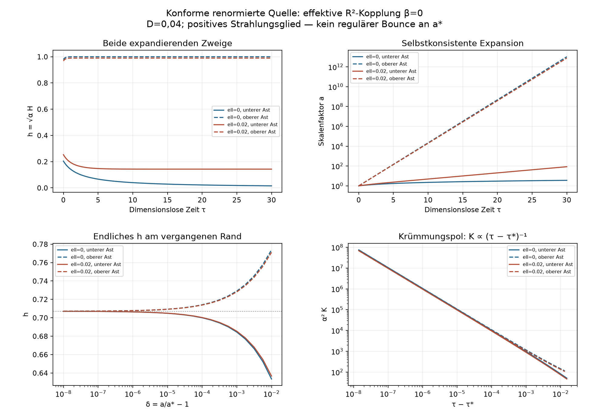

*Darstellung:* Bei effektiver Kopplung $\beta=0$ bleiben $a$ und $h$ am vergangenen Rand endlich, während die Krümmung divergiert. Durchgezogene und gestrichelte Linien unterscheiden den unteren und oberen Zweig; die Zukunftsverläufe sind selbstkonsistent entwickelt.

Für die Bounces wird das vollständige System $(a,h,r,s)$ von $\tau=0$ bis $\tau=\pm6$ integriert. Der Constraint wird während der Entwicklung nicht durch Projektion erzwungen. DOP853 und eine gesonderte Radau-Integration werden mit der geschlossenen Lösung verglichen. Bei $u=1$ bleibt der skalierte DOP853-Fehler unter $1{,}36\times10^{-12}$, beim reinen Vakuumfall $u=3/4$ unter $6{,}22\times10^{-12}$. Beide erfüllen den Constraint bis auf absolute Reste unter $5{,}18\times10^{-12}$. Zentrale Zeitdifferenzen prüfen Quellenkontinuität und Spurgleichung zusätzlich.

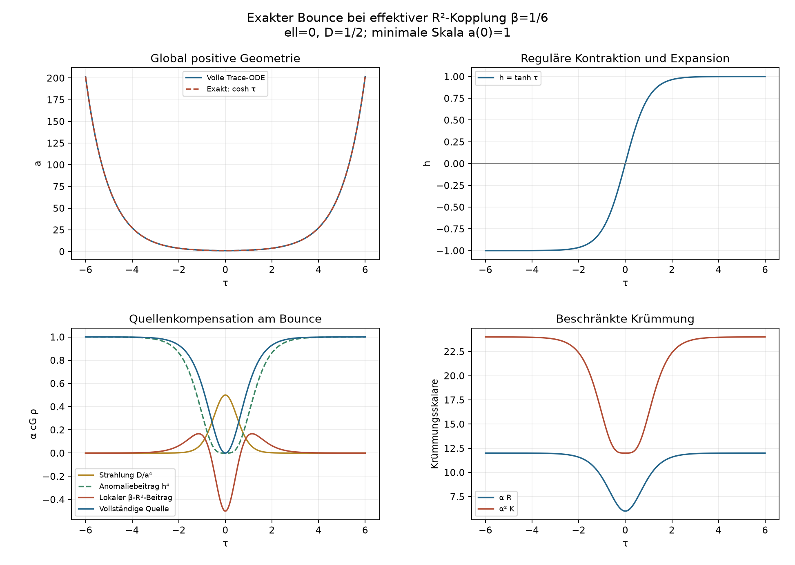

*Darstellung:* Für $u=1$, $\beta=1/6$, $\ell=0$ und $D=1/2$ kompensieren sich am Bounce der positive Strahlungsanteil $1/2$ und der lokale geometrische Anteil $-1/2$. Der Anomaliebeitrag $h^4$ verschwindet dort. Die vollständige Quelle erfüllt $h^2=\alpha c_G\rho$; beide dargestellten Krümmungsskalare bleiben beschränkt.

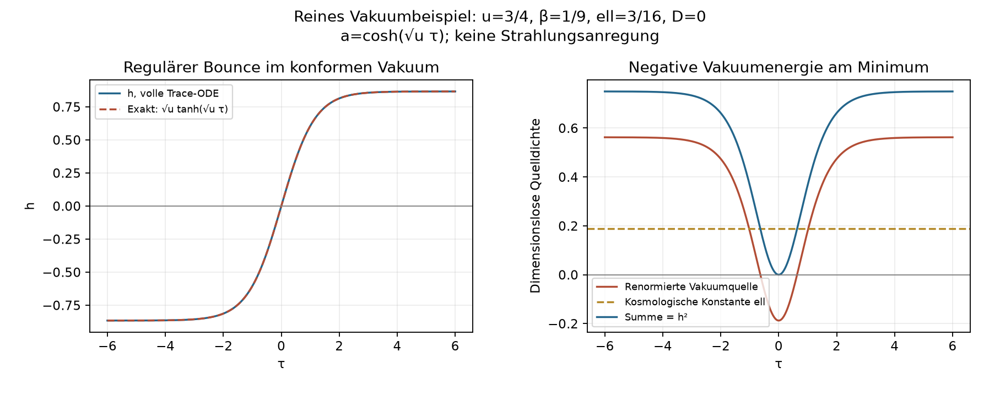

*Darstellung:* Der reine konforme Vakuumzustand bei $u=3/4$ benötigt keine Strahlungsanregung. Die renormierte Vakuumdichte beträgt am Bounce $-3/16$ und wird im Friedmann-Constraint von $\ell=3/16$ kompensiert. Die geschlossene und die unabhängig integrierte Lösung stimmen überein.

Der zusätzliche Prüfer [verify_renormalized_research.py](work/verify_renormalized_research.py) importiert das Modellskript nicht. Er integriert stattdessen $(\log a,h,h',h'')$ mit Radau und rekonstruiert die Krümmung aus diesen Größen. Über beide Zeitrichtungen und beide Bounce-Beispiele beträgt sein maximaler skalierter Lösungsfehler $1{,}70\times10^{-12}$; der absolute Constraintrest liegt unter $1{,}08\times10^{-12}$. SymPy prüft Quellenkontinuität, Euleranomaliekoeffizient, $\mathcal E'=-4h\mathcal E$, die gesamte hyperbolische Familie, ihre Krümmung, die linearisierte Vakuumgleichung sowie Breite und vollständige Phase der konformen Gaußmode exakt. Die direkte thermische Quadratur reproduziert $\pi^2/30$ bei $T_c=1$ mit absolutem Fehler $1{,}12\times10^{-16}$. Sämtliche Rechnungen sind Modellprüfungen; ein experimenteller Datensatz wird in diesem Kapitel nicht angepasst.

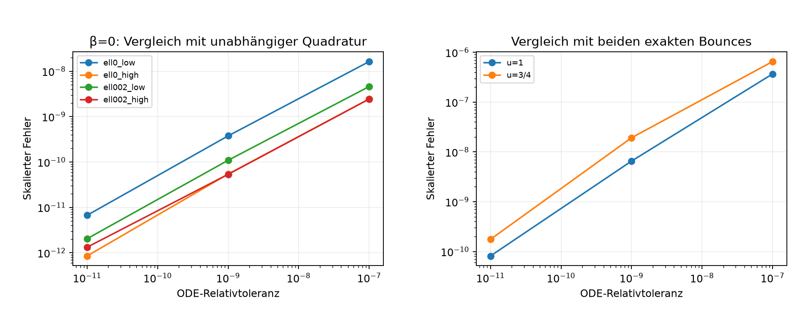

*Darstellung:* Die Fehler gegenüber unabhängiger Quadratur beziehungsweise exakten Bounce-Lösungen sinken beim Verschärfen der ODE-Toleranzen. Die endgültigen Läufe verwenden strengere Toleranzen als die drei hier dargestellten Konvergenzstufen. Alle vier Abbildungen liegen zusätzlich im skalierbaren SVG-Format vor.

Die drei Module [RenormalizedSource.lean](work/lean/RenormalizedSource.lean), [RenormalizedBranches.lean](work/lean/RenormalizedBranches.lean) und [RenormalizedBounce.lean](work/lean/RenormalizedBounce.lean) enthalten zusammen **73 explizite Sätze**. Der tatsächliche Offline-Kernlauf mit Lean 4.30.0 und Mathlib-Revision `c5ea00351c28e24afc9f0f84379aa41082b1188f` ist im [Formalprotokoll](work/lean/renormalized_proof_verification.json) dokumentiert: alle drei Module sind akzeptiert, und die 106 transitiv auditierten Theorem-Konstanten verwenden ausschließlich `propext`, `Classical.choice` und `Quot.sound`.

Das Quellenmodul beweist echte Ableitungen der expliziten renormierten FLRW-Quelle, ihre Kontinuität und die Constraint-Erhaltung auf Lösungsintervallen. Das Zweigmodul klassifiziert die reellen algebraischen Lösungen, schließt $H=0$ bei positiver Strahlung und nichtnegativer kosmologischer Konstante aus und schließt unter den angegebenen dynamischen Voraussetzungen eine differenzierbare Fortsetzung durch den Zweigzusammenlauf aus. Das Bounce-Modul umfasst die Parameterzeichen, die expliziten Krümmungsschranken und tatsächliche Ableitungen der reskalierten hyperbolischen Familie. `exact_scaled_bounce_constraint` und `exact_scaled_bounce_trace` verifizieren die vollständigen Gleichungen für alle $u>0$ mit den zugeordneten Parametern; das physische Teilintervall $3/4\le u\le1$ besitzt die oben realisierten Zustände.

Die Identifikation der Quelle mit dem renormierten Hadamard-Erwartungswert beruht auf den angegebenen Primärquellen und der analytischen Rekonstruktion in Abschnitt 15.2. Die Tensorinterpretation der Krümmung und die geodätische Vollständigkeit sind die mathematischen Beweise aus Abschnitt 15.5. Lean konstruiert hier keine Quantenfeldalgebra und keine allgemeine Einstein-Existenztheorie. Damit bleiben die formal geprüften Aussagen und ihre physikalische Anwendung genau zugeordnet.

Das [unabhängige Gesamtprotokoll](work/renormalized_independent_verification_20261017_final.json) bindet Roharrays, Literaturarchive, Skripte und Lean-Dateien durch SHA256 an diese Manuskriptfassung. Es prüft außerdem die unveränderten Nachweise des vorigen Kapitels gegen dessen Snapshot. Für eine erneute Gesamtkontrolle der archivierten Daten genügt:

```powershell
python work/verify_renormalized_research.py --output-tag pruefung_neu
```

Neue numerische Daten und ein erneuter Kernlauf werden so geprüft:

```powershell
python work/gravity_renormalized.py --tag renormierung_neu
python work/lean/check_renormalized_proofs.py
python work/verify_renormalized_research.py `
  --tag renormierung_neu --output-tag pruefung_neu
```

Für diese erweiterte Manuskriptfassung ist der neue Gesamtprüfer maßgeblich; die vorherigen kapitelbezogenen Protokolle bleiben an ihre archivierten Fassungen gebunden. Der ursprüngliche Singularitätsbefund bleibt für die positive endliche Quelle gültig. Für renormierte Quellen lautet das abgeschlossene Ergebnis genauer: Der angegebene $b=0$-Strahlungszweig ist krümmungssingulär, während die explizite $b\ne0$-Familie mit festgelegter Kopplung und zulässigem Zustand regulär und kausal geodätisch vollständig ist. Die renormierte Entwicklung derselben minimal gekoppelten Anfangsdaten aus Kapitel 14 wird durch diesen Modellvergleich nicht bestimmt.

## 16. Schwarze Löcher und Dynamik der De-Broglie-Bohm-Theorie

Die kosmologischen Rückwirkungsmodelle der vorigen Kapitel lassen sich nicht durch einen bloßen Austausch des Skalenfaktors auf ein schwarzes Loch übertragen. Hier werden drei genau definierte Systeme untersucht: ein vierdimensionales konformes Skalarfeld auf Schwarzschild, ein eigenständiges zweidimensionales konformes Skalarfeld und ein massloser Dirac-Teststrom in einer Raum- und einer Zeitdimension. Das erste System bestimmt eine notwendige Krümmungskorrektur und die durch Streupotentiale gefilterte Hawking-Leistung. Das zweite erlaubt einen vollständigen Vergleich dreier renormierter Stresszustände. Das dritte liefert explizite Bohmsche Bahnen vom Außenraum durch den Horizont bis zum Singularitätsrand. Die folgenden Resultate beziehen sich auf diese festgelegten Systeme.

### 16.1 Geometrie und notwendige Rückwirkung

Wir verwenden die Signatur $(-,+,+,+)$ und $c=\hbar=k_B=1$, behalten $G$ aber ausdrücklich bei. Der geometrische Massenparameter ist $m=GM$, wobei $M$ die physikalische Masse bezeichnet. Für $m>0$ lautet die Schwarzschildmetrik

$$ds^2=-f(r)dt^2+\frac{dr^2}{f(r)}+r^2d\Omega^2,\qquad f(r)=1-\frac{2m}{r}.$$

Der Horizont liegt bei $r=2m$. Eine direkte Berechnung aus den Christoffelsymbolen ergibt, mit regulärer Fortsetzung der Invarianten am Horizont, auf $r>0$

$$R_{\mu\nu}=0,\qquad R=0,\qquad K=R_{\mu\nu\rho\sigma}R^{\mu\nu\rho\sigma}=\frac{48m^2}{r^6}.$$

Damit ist $r=2m$ kein Krümmungssingularitätspunkt; $K(2m)=3/(4m^4)$ ist endlich. Bei $r\to0$ divergiert dagegen eine koordinatenunabhängige Krümmungsgröße.

Für einen reellen masslosen Skalar mit konformer Kopplung $\xi=1/6$ lautet die vierdimensionale Spuranomalie in den Konventionen von Kapitel 15

$$\mathcal T:=\langle T^\mu{}_{\mu}\rangle_{\mathrm{ren}}=\frac{W^2}{1920\pi^2}-\frac{E_4}{5760\pi^2}+b\Box R.$$

Die ersten beiden Koeffizienten sind fest; $b$ bezeichnet die festzulegende effektive lokale Kopplung [HHR2001]. Da Schwarzschild Ricci-flach ist, stimmen Weylquadrat und Eulerdichte mit $K$ überein. Es folgt für jeden Zustand, für den die renormierte konforme Stressquelle definiert ist,

$$\mathcal T_{\mathrm{Schw}}=\frac{K}{2880\pi^2}=\frac{m^2}{60\pi^2r^6}>0.$$

Der lokale Term $b\Box R$ verschwindet auf dieser Hintergrundmetrik. Die Zustandssensitivität der einzelnen Stresskomponenten bleibt bestehen, obwohl ihre Spur hier zustandsunabhängig ist.

Die Spur von $G_{\mu\nu}=8\pi G\langle T_{\mu\nu}\rangle_{\mathrm{ren}}$ ist bei $\Lambda=0$ gleich $-R=8\pi G\mathcal T$. Deshalb ist die exakte Ricci-flache Schwarzschildmetrik keine Lösung dieser vollständigen semiklassischen Gleichung mit dem angegebenen Quantenfeld. Dies ist bereits eine Konsequenz der Spur und benötigt keine Näherung für den restlichen Stress.

Auf dem in $G$ glatten, ordnungsreduzierten Störungszweig erhält man bei festem $m$ und festen endlichen lokalen Kopplungen die führende Korrektur

$$\delta R=-8\pi G\mathcal T_{\mathrm{Schw}}=-\frac{2Gm^2}{15\pi r^6}+O(G^2).$$

Hier trägt $G b\Box\delta R$ erst zur nächsten Ordnung bei. Zusätzliche homogene Lösungen der höheren Ableitungsgleichungen werden durch diese Störungsentwicklung nicht erfasst. Als dimensionslose Diagnose der führenden Spurkorrektur dient

$$\frac{|\delta R|}{\sqrt K}=\frac{Gm}{30\pi\sqrt3\,r^3}=\frac{G\sqrt K}{360\pi}+O(G^2),$$

also am Horizont $G/(240\pi\sqrt3\,m^2)$ in führender Ordnung. Der Quotient kontrolliert ausschließlich diese Spurkorrektur. Er begrenzt weder sämtliche Stresskomponenten noch den Fehler der gesamten Metrik. Insbesondere folgt aus seiner Zunahme zum Zentrum keine verlässliche Fortsetzung der Näherung und kein Beweis einer Singularitätsauflösung.

Die Anomalie schließt die vierdimensionale Rückwirkung nicht allein. Schon im stationären sphärischen Sektor ohne Nettofluss enthält $T^\mu{}_\nu=\operatorname{diag}(-\rho,p_r,p_t,p_t)$ drei Funktionen. Spur und radiale Erhaltung ergeben nur

$$-\rho+p_r+2p_t=\mathcal T,\qquad p_r'+\frac{f'}{2f}(\rho+p_r)+\frac2r(p_r-p_t)=0.$$

Nach Elimination von $p_t$ verbleibt eine Differentialrelation für $\rho$ und $p_r$. Ohne Zustand und weitere Stressdaten ist die lokale Quelle damit nicht bestimmt. Die Weylkrümmung verschwindet hier außerdem nicht wie im räumlich flachen FLRW-Fall; dessen besondere Reduktion und Bounce-Lösung sind deshalb keine Schwarzschild-Lösung.

### 16.2 Ein exakt bestimmter Stress in zwei Dimensionen

Für den Zustandsvergleich betrachten wir nun ein eigenständiges reelles massloses konformes Skalarfeld in zwei Raumzeitdimensionen. Seine Wirkung enthält keinen Dilatonfaktor. Mit

$$r_*=r+2m\log\left|\frac{r}{2m}-1\right|,\qquad u=t-r_*,\qquad v=t+r_*$$

wird die Metrik $ds_2^2=-f(r)du\,dv$. Im Außenraum ist $f=e^{2\varrho}>0$. Der renormierte Stress des konformen Feldes folgt aus der zweidimensionalen Anomalie und der Kovarianzerhaltung; die verbleibenden Funktionen legen den Zustand fest [BF1999]. Die additive zweidimensionale Vakuumkonstante wird so gewählt, dass das Minkowski-Vakuum verschwindenden Stress besitzt.

Für stationäre Zustände definieren wir

$$B(r)=\frac{2ff''-f'^2}{192\pi},\qquad F_H=\frac{\kappa^2}{48\pi}=\frac{1}{768\pi m^2},\qquad \kappa=\frac{1}{4m}.$$

Die vollständigen Komponenten sind

$$T_{uu}=B+c_u,\qquad T_{vv}=B+c_v,\qquad T_{uv}=\frac{ff''}{96\pi}.$$

Zur direkten Kontrolle gilt $\partial_u r=-f/2$, $\partial_v r=f/2$ und $\partial_u\varrho=-f'/4$. Damit ergeben die geometrischen Beiträge $-(\partial_u\varrho)^2/(12\pi)+\partial_u^2\varrho/(12\pi)$ genau $B$. Ferner ist

$$T^a{}_a=-\frac{4T_{uv}}{f}=-\frac{f''}{24\pi}=\frac{R_2}{24\pi},\qquad R_2=-f''.$$

Die nichttriviale radiale Erhaltungsidentität reduziert sich auf

$$f(B'-T_{uv}')+f'T_{uv}=0,$$

was durch Einsetzen ohne zusätzliche Feldgleichung erfüllt ist. Die beiden Konstanten verändern die Spur nicht. Sie sind daher durch die Anomalie allein unbestimmt.

| Zustand | $c_u$ | $c_v$ | Physikalische Randbedingungen |
|---|---:|---:|---|
| Boulware | $0$ | $0$ | Vakuum bezüglich der statischen Zeit, leer im Unendlichen |
| Unruh | $F_H$ | $0$ | Keine einlaufende Strahlung aus dem Unendlichen, regulärer zukünftiger Horizont |
| Hartle–Hawking | $F_H$ | $F_H$ | Thermisches Gleichgewicht, regulärer zukünftiger und vergangener Horizont |

Der nach außen gerichtete Killing-Energiefluss ist

$$\mathcal F=-T^r{}_t=T_{uu}-T_{vv}=c_u-c_v.$$

Somit besitzt Unruh den Fluss $F_H$, während Boulware und Hartle–Hawking keinen Nettofluss haben. Hartle–Hawking ist trotzdem kein leerer Zustand: Im Unendlichen sind beide Strahlungsrichtungen thermisch bei $T_H=\kappa/(2\pi)=1/(8\pi m)$ besetzt. Für eine Richtung liefert die direkte Bose-Quadratur

$$\int_0^\infty\frac{d\omega}{2\pi}\frac{\omega}{e^{\omega/T_H}-1}=\frac{\pi T_H^2}{12}=F_H.$$

Diese Rechnung zeigt konkret, warum eine identische lokale Anomalie verschiedene Strahlungszustände zulässt.

### 16.3 Horizontregularität und frei fallende Energie

Eine Divergenz in statischen Koordinaten genügt nicht zur Diagnose einer physikalischen Singularität. Für Schwarzschild gilt $B(2m)=-F_H$. Im Unruh-Zustand faktorisiert die auslaufende Komponente zu

$$T_{uu}^{U}=B+F_H=\frac{(r-2m)^2(r^2+4mr+12m^2)}{768\pi m^2r^4}.$$

Daraus folgt

$$\lim_{r\to2m}\frac{T_{uu}^{U}}{f^2}=\frac{1}{128\pi m^2}.$$

In den Kruskalkoordinaten $U=-\kappa^{-1}e^{-\kappa u}$ und $V=\kappa^{-1}e^{\kappa v}$ transformiert der Stress eines festgehaltenen Zustands als Tensor. Am zukünftigen Horizont ist $U=0$ bei endlichem $V$ und $f\propto U$. Deshalb kompensiert der doppelte Nullpunkt von $T_{uu}^{U}$ den Faktor $(du/dU)^2=1/(\kappa^2U^2)$. Auch $T_{uv}=O(f)$ hat die erforderliche einfache Nullstelle. Der Unruh-Stress besitzt damit dort reguläre Komponenten. Beim Boulware-Zustand bleibt hingegen $T_{uu}\to-F_H$, sodass diese Kompensation ausbleibt. Beim Hartle–Hawking-Zustand gilt die Kompensation zusätzlich für $T_{vv}$ am vergangenen Horizont. Ein Wechsel des Quantenzustands ist von dieser bloßen Koordinatentransformation zu unterscheiden.

Ein unmittelbar physikalischer Vergleich entsteht durch Kontraktion mit dem Vierergeschwindigkeitsanalogon eines radialen zeitartigen Beobachters, der aus Ruhe im Unendlichen fällt. Bezeichnet $s$ seine Eigenzeit und $w=\sqrt{2m/r}$, so gilt

$$\frac{dt}{ds}=\frac1f,\qquad \frac{dr}{ds}=-w,\qquad \frac{du}{ds}=\frac1{1-w},\qquad \frac{dv}{ds}=\frac1{1+w}.$$

Die gemessene zweidimensionale Energiedichte ist

$$\rho_{\mathrm{ff}}=\frac{T_{uu}}{(1-w)^2}+\frac{2T_{uv}}{1-w^2}+\frac{T_{vv}}{(1+w)^2}.$$

Der Horizontgrenzwert wird aus der faktorisierten Form berechnet; die einzelnen statischen Brüche werden nicht separat am Horizont ausgewertet. Man erhält

$$\rho_{\mathrm{ff}}^{U}(2m)=\frac{21}{1024\pi m^2},\qquad \rho_{\mathrm{ff}}^{HH}(2m)=\frac{1}{48\pi m^2},\qquad \rho_{\mathrm{ff}}^{B}\longrightarrow-\infty.$$

Diese Ergebnisse betreffen den angegebenen frei fallenden Beobachter und das reine zweidimensionale Feld. Sie sind keine vierdimensionalen lokalen Energiedichten. Die Regularität eines Zustands am Horizont besagt außerdem nichts über seine Regularität an der zentralen Krümmungssingularität.

### 16.4 Vierdimensionale Strahlung und Streupotential

Die zweidimensionale Rechnung lässt sich nicht durch eine einfache Flächendivision in eine vollständige vierdimensionale Feldtheorie verwandeln. Schon die sphärische Reduktion der klassischen Wirkung erzeugt einen radialen Dilatonfaktor; Quantisierung und Dimensionsreduktion dürfen nicht ohne zusätzliche Prüfung vertauscht werden [BF1999reduction]. Eine direkte Modenrechnung in vier Dimensionen vermeidet diese Gleichsetzung.

Auf dem Ricci-flachen Hintergrund stimmen die Wellengleichungen minimal und konform gekoppelter massloser Skalare überein. Mit der Zerlegung $\phi=e^{-i\omega t}Y_{lm}(\theta,\varphi)\chi_{\omega l}(r)/r$ erhält man

$$\frac{d^2\chi_{\omega l}}{dr_*^2}+\left[\omega^2-V_l(r)\right]\chi_{\omega l}=0,\qquad V_l=f\left[\frac{l(l+1)}{r^2}+\frac{2m}{r^3}\right].$$

Auch die $l=0$-Mode hat ein nichtverschwindendes Potential. Die Transmission dieses Potentials heißt Graukörperfaktor $\Gamma_l(\omega)$. Mit einer am Horizont rein einlaufenden Lösung und den Amplituden $A_{\mathrm{in}}$, $A_{\mathrm{out}}$ im Unendlichen liefert der konstante Wronskian

$$\Gamma_l=\frac1{|A_{\mathrm{in}}|^2},\qquad \mathcal R_l=\frac{|A_{\mathrm{out}}|^2}{|A_{\mathrm{in}}|^2},\qquad \Gamma_l+\mathcal R_l=1.$$

Dabei ist die Horizontamplitude auf eins normiert; beide asymptotischen Wellenzahlen sind $\omega$. Für das reelle Skalarfeld im Unruh-Zustand ist die Leistung im Unendlichen

$$\mathcal L=\frac1{2\pi}\sum_{l=0}^{\infty}(2l+1)\int_0^\infty\frac{\omega\,\Gamma_l(\omega)}{e^{8\pi m\omega}-1}\,d\omega.$$

Die dimensionslose Größe $p_\mathrm{H}=m^2\mathcal L$ hängt für das vorliegende masslose Feld nicht von $m$ ab. Taylor, Chambers und Hiscock geben im Schwarzschild-Grenzwert $p_\mathrm{H}\simeq7.44\times10^{-5}$ mit drei signifikanten Stellen an [TCH1998]. Die hier durchgeführte vierdimensionale Streu- und Integrationsrechnung ergibt $7.438686789368773\times10^{-5}$; ihre Fehlerkontrollen werden im Prüfungsabschnitt angegeben. Die zusätzlichen Dezimalstellen beschreiben das eigene numerische Ergebnis, keine entsprechend genaue Literaturkonstante und keinen experimentellen Messwert.

Der reine zweidimensionale Wert $m^2F_H=1/(768\pi)$ ist deutlich größer. Er enthält weder das vierdimensionale Streupotential noch die korrekte Summe über Drehimpulskanäle. Beide Rechnungen prüfen unterschiedliche, ausdrücklich angegebene Modelle.

Für ein makroskopisches Loch kann die Leistung als führende quasistatische Fernfeldenergiebilanz verwendet werden. Bei unveränderten Feldarten gilt

$$\frac{dM}{dt}=-\mathcal L,\qquad \frac{dm}{dt}=-\frac{G p_\mathrm{H}}{m^2},\qquad m^3(t)=m_0^3-3G p_\mathrm{H}(t-t_0).$$

Die Adiabatizität der Oberflächengravitation lässt sich direkt prüfen:

$$\frac{|\dot\kappa|}{\kappa^2}=\frac{4G p_\mathrm{H}}{m^2}\ll1.$$

Diese Bilanz ist im Bereich $m\gg\sqrt G$ mit langsam variierender Geometrie verwendbar. Sie ist keine Lösung der vollständigen orts- und zeitabhängigen semiklassischen Einstein-Gleichung. Die formale Nullstelle des kubischen Ausdrucks beweist weder eine kontrollierte Entwicklung bis $m=0$ noch die Existenz oder Abwesenheit eines Überrests.

### 16.5 Feld der De-Broglie-Bohm-Theorie im statischen Außenraum

Die Feldontologie aus Kapitel 12 kann auch auf statischen Außenraumschnitten formuliert werden. Für $N=\sqrt f$ und die räumliche Metrik $h_{ij}$ lautet die Führung ohne Verschiebungsvektor

$$\partial_t\phi(x)=\frac{N(x)}{\sqrt{h(x)}}\frac{\delta S}{\delta\phi(x)}.$$

Zunächst kann man einen endlichen Außenraumbereich $2m+\varepsilon\le r\le R_\mathrm{out}$ und endlich viele reelle Normalmoden verwenden. Für deren positiven quadratischen Hamiltonoperator besitzt der Grundzustand eine reelle Gaußamplitude und lediglich die globale Phase $S=-E_0t$. Jede tatsächliche Feldkonfiguration dieses regulierten Grundzustands bleibt daher auf den gewählten statischen Schnitten zeitlich konstant. Das ist dieselbe Führungsaussage wie im freien Vakuum des endlichen Feldmodells.

Die Boulware-Wahl ist die entsprechende statische Vakuumwahl im unbeschränkten Außenraum. Der endliche Regulator kann zusätzlich Randbeiträge besitzen; seine Entfernung muss diesen Außenraumzustand realisieren. Eine zeitlich konstante tatsächliche Feldkonfiguration bedeutet weder verschwindende Operatorfluktuationen noch verschwindenden renormierten Stress. Vor allem hebt diese Bohmsche Ergänzung die nachgewiesene Horizontsingularität des Boulware-Stresszustands nicht auf. Die statischen Außenraumschnitte liefern selbst keine horizontübergreifende Foliation; für eine solche Beschreibung müssen Zustand und Führung auf geeigneten Schnitten festgelegt werden. Die semiklassische Quellenregel bleibt hier der Operator-Erwartungswert. Das tatsächliche Feld wird nicht stillschweigend als Ersatzquelle eingesetzt.

### 16.6 Ein exakter Bohm-Dirac-Strom durch den Horizont

Für eine explizite Teilchenbahn wählen wir nun ein eigenes massloses Dirac-Testmodell in einer Raum- und einer Zeitdimension. Es ist keine Teilchenbeschreibung des zuvor untersuchten vierdimensionalen Skalarfeldes. Die radiale Painlevé–Gullstrand-Metrik lautet

$$ds_2^2=-dT^2+[dr+v(r)dT]^2,\qquad v(r)=\sqrt{\frac{2m}{r}}.$$

Sie ist am Horizont regulär, und $T=\mathrm{const}$ besitzt das räumliche Längenelement $dr$. Mit dem orthonormalen Koframe $e^0=dT$, $e^1=dr+v\,dT$ und $\alpha=\operatorname{diag}(1,-1)$ hat die masslose Diracgleichung die Transportform

$$\left[\partial_T+(\alpha-v)\partial_r-\frac{v'}2\right]\psi=0.$$

Aus $de^1=-v'e^0\wedge e^1$ folgt die Verbindungsform $\omega^0{}_1=-v'e^1$. Der Term $-v'/2$ ist der Beitrag dieser Spinverbindung in der angegebenen Diracdarstellung. Er gewährleistet gleichzeitig die Kontinuitätsgleichung für

$$q=\psi^\dagger\psi,\qquad j=\psi^\dagger(\alpha-v)\psi,\qquad \partial_Tq+\partial_rj=0.$$

Die Bohmsche Geschwindigkeit ist für $q>0$

$$\frac{dr}{dT}=\frac jq=-v+\frac{\psi^\dagger\alpha\psi}{\psi^\dagger\psi}\in[-1-v,1-v].$$

Dies ist genau das durch die Metrik vorgegebene kausale Intervall. Im Inneren $r<2m$ ist $v>1$, sodass jede dieser Geschwindigkeiten negativ ist. Die Kausalität eines solchen Stroms lässt daher keinen nach außen laufenden Fluchtweg aus diesem vorgegebenen Schwarzschildinneren zu.

Eine vollständige geschlossene Lösung ergibt sich mit

$$g(r)=r-2\sqrt{2mr}+4m\log\left(1+\sqrt{\frac{r}{2m}}\right),\qquad V=T+g(r).$$

Direktes Differenzieren liefert

$$g'(r)=\frac1{1+v(r)}>0,\qquad g(0)=0,\qquad g(2m)=m(4\log2-2).$$

Für eine beliebige einmal stetig differenzierbare Amplitude $F$ ist

$$\psi_+=0,\qquad \psi_-(T,r)=\frac{F(V)}{\sqrt{1+v(r)}}$$

eine exakte einlaufende Lösung. Die Ableitung von $F(V)$ verschwindet im Transportoperator wegen $1-(1+v)g'=0$; die Ableitung des Vorfaktors kompensiert den Spinverbindungsterm. Deshalb sind

$$P(V)=|F(V)|^2,\qquad q(T,r)=\frac{P(T+g(r))}{1+v(r)},\qquad j(T,r)=-P(T+g(r)).$$

Für die konkrete Prüfung wird ein kompakter Wellenzug gewählt:

$$P(V)=\begin{cases}\dfrac{315}{256L}(1-z^2)^4,&|z|<1,\\0,&|z|\ge1,\end{cases}\qquad z=\frac{V-8m}{L},\qquad L=2m.$$

Das Integral von $P$ ist eins, weil $\int_{-1}^1(1-z^2)^4dz=256/315$. Die Wahl $F=\sqrt P$ ist global $C^1$ und erfüllt die erste Ordnung auch an den Rändern des Trägers. Der Wellenzug enthält beide Fourierfrequenzvorzeichen. Er ist eine zulässige Lösung des angegebenen Dirac-Testmodells, aber keine ausschließlich positivfrequente Einteilchenanregung eines festgelegten Fockvakuums.

Entlang jeder Bahn mit Label $V_0\in(6m,10m)$ bleibt $V$ konstant. Die eindeutige Bahn ist durch

$$g(r(T))=V_0-T,\qquad \frac{dr}{dT}=-(1+v)$$

bestimmt. Da $g$ streng von null nach unendlich wächst, existiert sie für alle $T<V_0$. Der Horizont wird bei $T_\mathrm{cross}=V_0-m(4\log2-2)$ regulär durchquert; der Radius erreicht seinen singulären Rand bei der endlichen PG-Zeit $T_\mathrm{end}=V_0$. Insbesondere bleiben am Horizont $q=P(V_0)/2$ und $j=-P(V_0)$ endlich. Eine bloße Umbenennung der Zeitkoordinate ist hierfür nicht ausreichend: Der Strom wurde tatsächlich auf den horizontübergreifenden Schnitten gelöst.

Die Anfangsverteilung bei $T=0$ ist auf $r>0$ normiert. Mit $dV=dr/(1+v)$ folgt für ihre spätere überlebende Masse exakt

$$N(T)=\int_0^\infty q(T,r)\,dr=\int_T^\infty P(V)\,dV,\qquad \frac{dN}{dT}=-P(T)=j(T,0^+).$$

Die anfängliche Gleichgewichtsverteilung wird somit bis zum Endpunkt jeder Bahn transportiert. Der fehlende Anteil ist genau der Fluss durch $r=0$; zwischen $T=6m$ und $T=10m$ sinkt $N$ von eins auf null. Auf dem verbleibenden Bereich ist $q$ eine Subwahrscheinlichkeitsdichte. Eine Normierung durch $N(T)$ beschreibt stattdessen die bedingte Verteilung unter der Voraussetzung des Überlebens.

Damit sind Horizontübertritt, Kausalität und Wahrscheinlichkeitsverlust vollständig bestimmt, ohne eine Fortsetzung durch die Krümmungssingularität zu postulieren. Allgemeinere Bohmsche Modelle mit Teilchenverlust am raumartigen Singularitätsrand benötigen zusätzliche Zustands- und Fockraumstrukturen; eine solche Konstruktion untersucht Tumulka [Tumulka2010]. Die vorliegende explizite Lösung behauptet weder deren allgemeine Wohldefiniertheit noch eine Behebung der Singularität. Zusammen mit dem Anomalie- und Strahlungsergebnis grenzt sie präzise ab, welche Fragen bereits durch Quantenfelder und kausale Führung auf einer gegebenen Geometrie beantwortet werden und welche eine selbstkonsistente Änderung dieser Geometrie verlangen.

### 16.7 Numerische und formale Prüfung

Die beiden Python-Rechnungen prüfen getrennte Systeme mit $m=1$. [blackhole_geometry.py](work/blackhole_geometry.py) berechnet die vierdimensionale Krümmung aus den Christoffelsymbolen, kontrolliert den zweidimensionalen Stress symbolisch und entwickelt den Dirac-Teststrom. Der [archivierte Geometrielauf](work/blackhole_geometry_20261018.json) besteht alle acht numerischen Prüfungen. Die kontrahierte vierdimensionale Riemannrechnung ergibt exakt $R_{\mu\nu}=0$ und $K=48m^2/r^6$. Die Ward-Identität, die Horizontaufhebung und die beiden endlichen frei fallenden Grenzwerte werden unabhängig von ihrer numerischen Darstellung mit SymPy vereinfacht.

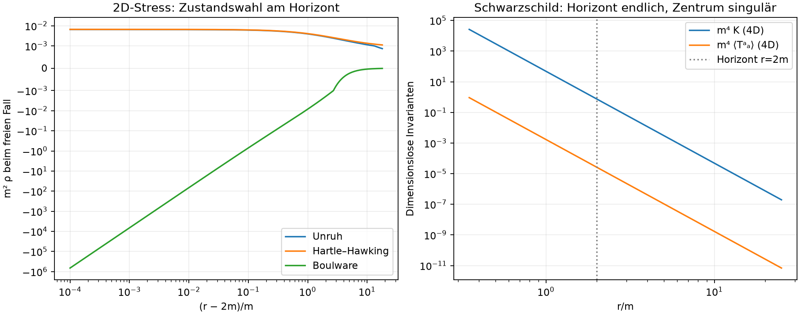

*Darstellung:* Links stehen die vierdimensionale Krümmung und Anomalie, rechts die Energiedichten des eigenständigen zweidimensionalen Feldes für den festgelegten frei fallenden Beobachter. Der Boulware-Stress divergiert am Horizont; Unruh und Hartle–Hawking besitzen dort die berechneten endlichen Grenzwerte. Die gemeinsame Abbildung setzt die beiden Feldtheorien nicht gleich.

Für den Teststrom werden 13 Anfangsquantile zwischen 5 und 95 Prozent durch Umkehrung von $g$ entwickelt und mit einer gesonderten DOP853-Integration der Führungs-ODE verglichen. Die ODE stoppt bei $r=0{,}02m$; das analytische Endereignis wird nicht numerisch durchlaufen. Der größte Fehler der erhaltenen Nullkoordinate $T+g(r)$ beträgt weniger als $1{,}16\times10^{-11}m$. Eine direkte Quadratur der Dichte stimmt mit $N(T)$ bis auf $1{,}34\times10^{-15}$ überein. Zentrale Differenzen bestätigen die Kontinuitätsgleichung mit quadratischer Konvergenz; der feinste absolute Rest liegt unter $9{,}05\times10^{-9}$ in den skalierten Einheiten.

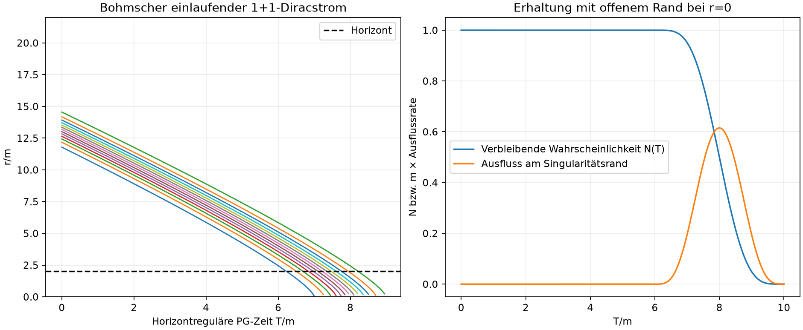

*Darstellung:* Die Bahnen überqueren $r=2m$ auf regulären PG-Schnitten. Die Dichte und die überlebende Wahrscheinlichkeitsmasse zeigen den genau bilanzierten Abfluss am Singularitätsrand. Nach ihrer Endzeit werden die Bahnen ausgeblendet; dies bezeichnet ihre mathematische Terminierung auf dem gewählten Hintergrund.

[blackhole_numerics.py](work/blackhole_numerics.py) löst die vierdimensionale Radialgleichung für $l=0,\ldots,5$ an 400 positiven Frequenzen $x=m\omega=0{,}0025,\ldots,1$, insgesamt 2400 Streufälle. Eine Frobeniusreihe dritter Ordnung setzt die Horizontdaten bei $r/(2m)-1=10^{-5}$. Am äußeren Radius $r/m=\max(60,20/x)$ werden Wert und Ableitung an ein- und auslaufende Jostreihen zwölfter Ordnung angepasst. Die Integration verwendet DOP853 mit relativer Toleranz $2\times10^{-10}$ und absoluter Toleranz $2\times10^{-13}$. Horizontabstand, Außenradius, Reihenordnungen und ODE-Toleranzen werden gesondert variiert. Der [verfeinerte Streulauf](work/blackhole_numerics_20261018_refined.json) besteht alle 17 festgelegten Prüfungen; [Methoden und Rohdatenzuordnung](work/blackhole_numeric_notes.md) dokumentieren die Rekursionen und Kontrollen.

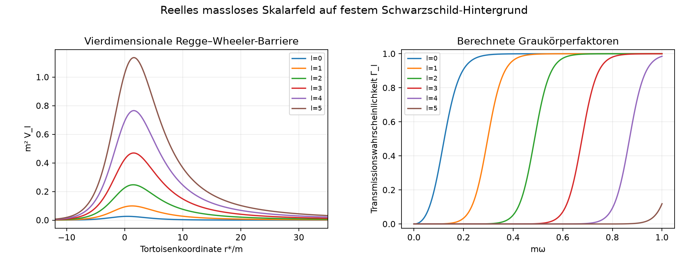

*Darstellung:* Mit wachsendem Drehimpuls steigt die Potentialbarriere. Die berechneten Transmissionsfaktoren bestimmen, welcher Anteil jeder thermisch erzeugten Mode das Unendliche erreicht.

| Beitrag | $m^2\mathcal L_l$ |
|---|---:|
| $l=0$ | $6{,}70043753\times10^{-5}$ |
| $l=1$ | $7{,}18606776\times10^{-6}$ |
| $l=2$ | $1{,}93032324\times10^{-7}$ |
| $l=3$ | $3{,}34597834\times10^{-9}$ |
| $l=4$ | $4{,}62821867\times10^{-11}$ |
| $l=5$ | $2{,}73761579\times10^{-13}$ |
| Summe | $7{,}43868679\times10^{-5}$ |

Die größte Unitaritätsabweichung $|\Gamma_l+\mathcal R_l-1|$ liegt unter $3{,}70\times10^{-10}$. Der unskalierte Wronskian ist bei extrem kleiner Transmission wegen Auslöschung numerisch schlecht konditioniert. Seine Rohwerte bleiben im Datensatz erhalten; für die 1557 Fälle mit $\Gamma_l\ge10^{-4}$ liegt der relative Erhaltungsrest unter $1{,}09\times10^{-9}$. Der gesonderte Extremfalltest bei $l=5$, $x=0{,}0025$ bestätigt $\Gamma_l\simeq1{,}44601\times10^{-40}$ durch Variation von Integrations- und Randdaten mit relativen Änderungen unter $1{,}43\times10^{-9}$.

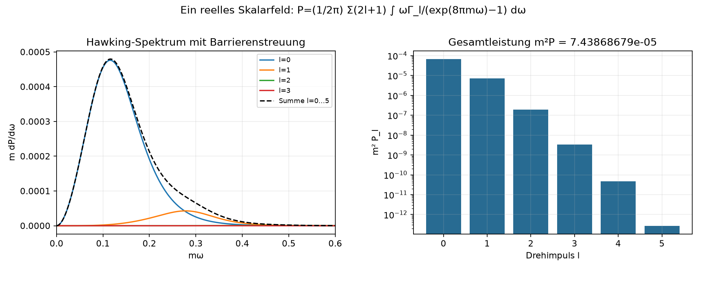

*Darstellung:* Die $l=0$-Mode dominiert die Leistung des einen reellen masslosen Skalarfelds. Das Spektrum enthält die berechnete Barrierenstreuung. Es ist eine theoretische Testfeldvorhersage, keine Messkurve.

Die Frequenzschritte $0{,}01$, $0{,}005$ und $0{,}0025$ bilden drei geschachtelte Gitter. Die letzten beiden Simpson-Ergebnisse unterscheiden sich relativ um $1{,}63\times10^{-7}$. Eine monotone kubische Interpolation der Transmissionsfaktoren mit anschließender unabhängiger adaptiver Quadratur unterscheidet sich auf dem feinsten Gitter um $1{,}51\times10^{-7}$. Für die berücksichtigten Kanäle $l\le5$ liefert $0\le\Gamma_l\le1$ eine obere Schranke von $2{,}89\times10^{-12}$ für den absoluten Leistungsanteil bei $x>1$. Der sehr kleine letzte Partialwellenbeitrag prüft die numerische Drehimpulskonvergenz; eine rigorose Schranke für die Summe aller ausgelassenen Drehimpulse wird daraus nicht abgeleitet.

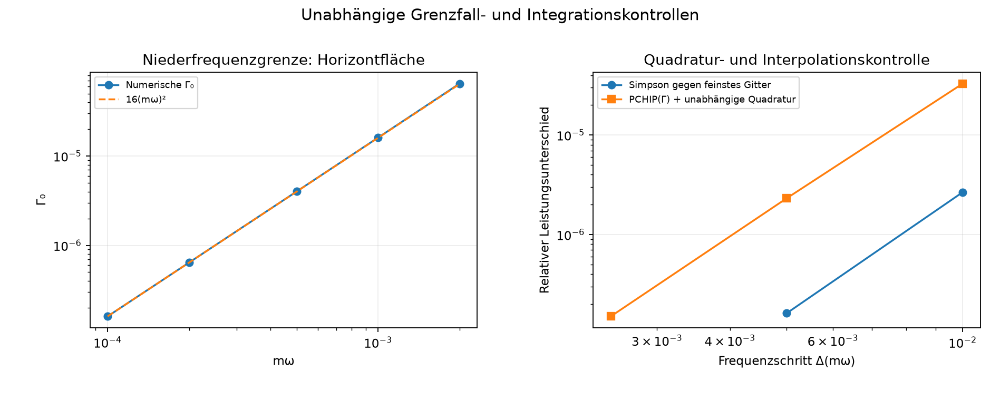

*Darstellung:* Die Niederfrequenzkontrolle nähert sich $\Gamma_0\sim16(m\omega)^2$, entsprechend der Absorptionsfläche $16\pi m^2$. Die beiden Quadraturverfahren konvergieren bei Gitterverfeinerung. Alle fünf Abbildungen liegen zusätzlich als SVG vor.

Der zusätzliche Prüfer [verify_blackhole_research.py](work/verify_blackhole_research.py) importiert keines der Modellskripte. Er leitet die Radialgleichung erneut aus der Klein-Gordon-Gleichung her und integriert fünf Streufälle mit den Variablen $(\chi,d\chi/dr_*)$ direkt in $r$, mit ebenen Wellen als einfacheren Randdaten. Bei $r_\mathrm{out}/m=8000$ stimmen die Transmissionen relativ bis auf $1{,}39\times10^{-6}$ mit der genaueren Jostrechnung überein. Diese Kontrolle ist weniger genau, aber methodisch unabhängig. Für die Bohmschen Bahnen definiert der Prüfer $g$ durch eine eigene Quadratur von $g'$; der größte Labelrest bleibt unter $1{,}30\times10^{-13}m$. Eine unabhängige Integration des Randflusses reproduziert die überlebende Masse bis auf $4{,}45\times10^{-16}$.

Die Module [BlackHoleAnomaly.lean](work/lean/BlackHoleAnomaly.lean), [BlackHoleStress.lean](work/lean/BlackHoleStress.lean), [BlackHoleScattering.lean](work/lean/BlackHoleScattering.lean) und [BlackHoleCurrent.lean](work/lean/BlackHoleCurrent.lean) enthalten **62 explizite Sätze**. Der tatsächliche Offline-Lauf mit Lean 4.30.0 und Mathlib-Revision `c5ea00351c28e24afc9f0f84379aa41082b1188f` akzeptiert alle vier Module. Die 127 transitiv auditierten Theorem-Konstanten verwenden ausschließlich `propext`, `Classical.choice` und `Quot.sound`; das [Formalprotokoll](work/lean/blackhole_proof_verification.json) enthält die vollständigen Aussagen und Quellenhashes.

Formalisiert sind die Anomalie- und Spurfolgen unter den angegebenen Eingaben, echte Ableitungen der 2D-Stressquelle und ihre reduzierte Ward-Identität sowie die stetige Fortsetzung des Horizontquotienten. Für die Streuung wird die Konstanz des Wronskians aus den tatsächlichen ODE-Ableitungen bewiesen; die Flussrelation folgt unter expliziten asymptotischen Matching-Voraussetzungen. Weitere Sätze beweisen die kubische Massenbilanz auf Lösungsintervallen und den Adiabatizitätsparameter. Das Strommodul umfasst die kausalen Geschwindigkeitsgrenzen, die tatsächliche Ableitung der PG-Primitive, die Kontinuitätsgleichung und die chirale Amplituden-PDE für das verwendete reelle Profil. QFT-Zustandskonstruktion, asymptotische Streuexistenz und vollständige geometrische Rückwirkung werden durch diese Sätze nicht voraussetzungslos formalisiert. Die Zuordnung steht ausführlich in den [Formalisierungsnotizen](work/blackhole_formal_notes.md).

Das [unabhängige Gesamtprotokoll](work/blackhole_independent_verification_20261018.json) bindet Quellarchive, Roharrays, Skripte, Abbildungen und Formalnachweise durch SHA256 an diese Manuskriptfassung. Es kontrolliert außerdem die unveränderten Kapitel 1 bis 15 und die 36 gebundenen Artefakte des vorigen Forschungsstands. Die archivierte Rechnung lässt sich ohne neue PDF-Erzeugung prüfen:

```powershell
python work/verify_blackhole_research.py --output-tag pruefung_neu
```

Neue Streudaten und ein erneuter Kernlauf werden mit eigenen Ausgabetags erzeugt:

```powershell
python work/blackhole_numerics.py --tag streuung_neu
python work/lean/check_blackhole_proofs.py
python work/verify_blackhole_research.py `
  --tag streuung_neu --output-tag pruefung_neu
```

Das abgeschlossene Ergebnis ist modellabhängig und eindeutig: Auf Schwarzschild ist der zukünftige Horizont mit geeignetem Quantenzustand und kausalem Bohm-Strom regulär passierbar. Der vorgegebene zentrale Singularitätsrand bleibt für den expliziten Teststrom in endlicher Zeit erreichbar. Die renormierte vierdimensionale Feldquelle verlangt zugleich eine Änderung der Schwarzschildgeometrie. Die Spurkorrektur und die quasistatische Massenbilanz bestimmen Teile dieser Rückwirkung, aber keine vollständige Lösung im Zentrum. Der kosmologische Bounce aus Kapitel 15 liefert daher für dieses schwarze Loch keinen bereits geführten Singularitätsauflösungsbeweis.

## 17. Selbstkonsistente Schwarzlochquelle

### 17.1 Festgelegtes Quanten- und Quellenmodell

Die Spuranomalie und die Fernfeldenergiebilanz aus Kapitel 16 bestimmen noch keine vollständige rückgekoppelte Geometrie. Eine geschlossene Untersuchung erfordert die gesamte Quelle als Funktion der veränderlichen Metrik. Hier wird hierzu das statische, sphärisch symmetrische Einstein–Polyakov-Modell mit positiver Zentralladung untersucht. Es beschreibt die Boulware-Vakuumpolarisation; ein Hawkingfluss wird in diesem Zustand nicht vorausgesetzt. Das Ergebnis ist eine selbstkonsistente Lösung dieses ausdrücklich reduzierten Modells.

Wir setzen $c=1$, behalten $G$ und $\hbar$ bei und schreiben die vierdimensionale Metrik in radialer Eigendistanz $\ell$ als

$$ds_4^2=-e^{2\rho(\ell)}dt^2+d\ell^2+r(\ell)^2d\Omega^2.$$

Die Kugelflächen haben die Fläche $4\pi r^2$. Die reduzierte Einstein-Wirkung und der renormierte Polyakov-Anteil lauten

$$S_g=\frac1{4G}\int d^2x\sqrt{-g_2}\left[r^2R_2+2(\nabla r)^2+2\right],$$

$$\Gamma_P=-\frac{N\hbar}{96\pi}\int d^2x\sqrt{-g_2}\,R_2\Box^{-1}R_2.$$

Dabei steht $N>0$ für die Zentralladung; für $N$ unabhängige gewöhnliche reelle konforme Skalare ist sie gleich ihrer Anzahl. Die Zustandswahl liegt in den Randbedingungen des inversen Operators beziehungsweise in den homogenen Stressanteilen. Die statische Boulware-Wahl setzt die normalgeordneten ein- und auslaufenden Beiträge bezüglich der optischen Nullkoordinaten auf null. Die kosmologische Konstante und zusätzliche endliche lokale geometrische Kopplungen werden für dieses Modell auf null festgelegt. Die angegebenen Wirkungen und die entsprechende Boulware-Quelle werden in [Fabbri2006, Abschnitt 3] hergeleitet.

Die Quelle ist exakt für das angegebene zweidimensionale Konformfeld. Ihre Kopplung an die vierdimensionale sphärische Geometrie ist die Polyakov-Näherung: Höhere Drehimpulsmoden und das radiale Streupotential werden ausgelassen. Insbesondere ist sie nicht die vollständige vierdimensionale konforme Quelle aus Abschnitt 16.1. Dies lässt sich bereits auf Schwarzschild quantitativ erkennen:

$$\mathcal T_P^{(4)}=\frac{N\hbar m}{24\pi^2r^5},\qquad
\mathcal T_{\mathrm{konform}}^{(4)}=\frac{N\hbar m^2}{60\pi^2r^6}.$$

Die verschiedenen Spuren dürfen nicht gleichgesetzt oder ohne neue Wirkung addiert werden. Gerade die in Abschnitt 16.4 berechnete Streuung fehlt in der hier gewählten Näherung. Der mathematische Singularitätsbefund wird deshalb im Folgenden für dieses geschlossene Quellenmodell bewiesen, ohne ihn als Satz über sämtliche vierdimensionalen Quantenzustände auszugeben.

### 17.2 Quelle und vollständige Rückwirkung

Striche bezeichnen jetzt Ableitungen nach $\ell$. Mit $v=\rho'$ und $\alpha=NG\hbar/(12\pi)>0$ besitzt der zweidimensionale renormierte Stress im lokalen orthonormalen Rahmen die Komponenten

$$\varepsilon_2=\frac{N\hbar}{24\pi}(2v'+v^2),\qquad
p_2=-\frac{N\hbar}{24\pi}v^2,\qquad T_{\hat t\hat\ell}=0.$$

Zum Nachrechnen wähle man die optische Koordinate $z$ durch $dz=e^{-\rho}d\ell$. Dann ist $\rho_{zz}=e^{2\rho}(v'+v^2)$ und $\rho_z^2=e^{2\rho}v^2$. Die beiden Nullkomponenten aus der Polyakov-Quelle ergeben unmittelbar die angegebenen Rahmenkomponenten. Ihre Spur ist $N\hbar R_2/(24\pi)$ mit $R_2=-2(v'+v^2)$, und

$$p_2'+v(\varepsilon_2+p_2)=0.$$

Variation der reduzierten Wirkung liefert die sphärische Quelle

$$\varepsilon=\frac{\varepsilon_2}{4\pi r^2},\qquad
p_r=\frac{p_2}{4\pi r^2},\qquad p_t=0.$$

Sie erfüllt tatsächlich die vierdimensionale Erhaltungsidentität

$$p_r'+v(\varepsilon+p_r)+\frac{2r'}r(p_r-p_t)=0.$$

Der Flächenfaktor und die verschwindende Winkelspannung sind hier Bestandteile des festgelegten reduzierten Modells. Das ist keine allgemeine Vorschrift zur Rekonstruktion eines exakten vierdimensionalen Stresstensors aus beliebigen 2D-Daten [ABCG2020].

Setze $u=r'$. Die drei unabhängigen Einstein-Gleichungen lauten vollständig

$$1-u^2-2ru'=\alpha(2v'+v^2),$$

$$u^2+2ruv+\alpha v^2=1,$$

$$v'+v^2+\frac{uv+u'}r=0.$$

Die mittlere Gleichung ist der radiale Constraint. Die anderen beiden ergeben für $r^2\ne\alpha$ das geschlossene autonome System

$$r'=u,\qquad \rho'=v,$$

$$u'=\frac{v[(r^2+\alpha)u+\alpha rv]}{r^2-\alpha},\qquad
v'=-\frac{rv(2u+rv)}{r^2-\alpha}.$$

Für $\mathcal C=u^2+2ruv+\alpha v^2-1$ liefert tatsächliches Differenzieren entlang dieses Systems exakt $\mathcal C'=0$. Aus constrainttreuen Anfangsdaten folgen deshalb alle drei Einstein-Gleichungen auf dem gesamten regulären Lösungsintervall. Die Quelle wird bei jedem Schritt aus $r,\rho$ und deren aktuellen Ableitungen berechnet. Sie bleibt nicht auf der Schwarzschild-Ausgangsmetrik eingefroren.

### 17.3 Ein regulärer Hals statt des Horizonts

Eine geeignete Parametrisierung der Lösungen beginnt direkt an einer minimalen Kugelfläche:

$$r(0)=r_0>\sqrt\alpha,\qquad u(0)=0,\qquad
v(0)=\frac1{\sqrt\alpha},\qquad \rho(0)=\rho_0.$$

Die additive Konstante $\rho_0$ normiert die statische Zeit. Der Constraint ist erfüllt, und die rechte Seite der ODE ist an diesen Daten glatt. Damit existiert eine eindeutige lokale Lösung durch den Hals. Dort gilt

$$r''(0)=\frac{r_0}{r_0^2-\alpha}>0,\qquad
\rho''(0)=-\frac{r_0^2}{\alpha(r_0^2-\alpha)}.$$

Der Hals ist folglich ein striktes lokales Minimum von $r$, während $e^{2\rho_0}>0$ bleibt. Die statische Killing-Norm verschwindet nicht: Diese Fläche ist kein Killing-Horizont. Die lokale Ausweitung des Halses wird durch eine negative radiale Nullenergie ermöglicht,

$$8\pi G(\varepsilon+p_r)\big|_0=-\frac2{r_0^2-\alpha}<0.$$

Die vollständige vierdimensionale Krümmung ist am Hals endlich. Aus der direkten Riemannkontraktion folgt

$$K=4\left[(v'+v^2)^2+2\left(\frac{uv}{r}\right)^2
+2\left(\frac{u'}r\right)^2+\left(\frac{1-u^2}{r^2}\right)^2\right],$$

und damit

$$K(0)=\frac{12}{(r_0^2-\alpha)^2}+\frac4{r_0^4}.$$

Der äußere Zweig besitzt $u,v>0$, $u'>0$ und durch den Constraint $u<1$. Außerdem gilt $v' <0$. Diese Schranken und $r^2-\alpha\ge r_0^2-\alpha>0$ verhindern einen endlichen ODE-Abbruch. Nach einem beliebigen positiven Startabstand ist $u$ von null getrennt, sodass $r$ nach unendlich wächst. Die geometrische Misner–Sharp-Masse $m=r(1-u^2)/2$ ist positiv und erfüllt

$$\frac{dm}{d\ell}=\frac{\alpha u}{2}(2v'+v^2)<0.$$

Sie bleibt somit durch $r_0/2$ beschränkt. Aus dem Constraint folgt $v\le m/(r^2u)=O(r^{-2})$. Die exakte Massengleichung liefert außerhalb eines festen Radius $|d\log m/dr|=O(r^{-3})$; ihr Integral ist endlich, also ist auch der Grenzwert $m_\infty$ strikt positiv. Ebenso existiert $\rho_\infty$. Nach der Zeitnormierung $\rho_\infty=0$ erhält man

$$u^2=1-\frac{2m_\infty}{r}+O(r^{-3}),\qquad
e^{2\rho}=1-\frac{2m_\infty}{r}+O(r^{-2}).$$

Der Zweig ist damit asymptotisch flach; seine physikalische ADM-Masse ist $m_\infty/G$. Der Wert von $m$ an einem endlichen Außenradius ist nicht bereits dieser Grenzwert. Auf der anderen Seite des Halses wächst $r$ ebenfalls wieder. Ein solches Minimum allein beweist daher weder eine reguläre zweite Außenregion noch geodätische Vollständigkeit.

### 17.4 Beweis der inneren Singularität

**Satz.** Für $\alpha>0$ und die Halsdaten $r_0\ge2\sqrt\alpha$ besitzt der nach innen laufende Zweig des angegebenen Einstein–Polyakov-Systems eine unbeschränkte vierdimensionale Krümmung. Sein innerer Grenzbereich liegt bei $r\to\infty$, in endlicher radialer Eigendistanz und endlichem affinen Parameter radialer Nullgeodäten. Er ist keine reguläre Fortsetzung des Halses zu einer zweiten asymptotisch flachen Region.

**Beweis.** Verwende im Inneren die monotone Rotverschiebungsvariable $s=\rho_0-\rho\ge0$ und setze

$$q=-\frac uv,\qquad D=\frac1{v^2}=\alpha-2rq+q^2.$$

Der Hals entspricht $r=r_0$, $q=0$, $D=\alpha$. Die Gleichungen werden zu

$$\frac{dr}{ds}=q,\qquad
\frac{dq}{ds}=\frac{(r-q)(\alpha-2rq)}{r^2-\alpha},$$

$$\frac{dD}{ds}=-\frac{2r(r-2q)}{r^2-\alpha}D.$$

Am Rand $q=0$ zeigt das Vektorfeld nach $q>0$. Die lineare Gleichung für $D$ erhält $D>0$ für jedes endliche $s$. Kontinuität wählt dabei den vom Hals ausgehenden Zweig der quadratischen Ungleichung:

$$0<q<r-\sqrt{r^2-\alpha}=\frac{\alpha}{r+\sqrt{r^2-\alpha}}<\frac\alpha r
\quad(s>0).$$

Somit ist $r\ge r_0$, und $d(r^2)/ds=2rq<2\alpha$. Auf jedem endlichen $s$-Intervall bleiben $r,q$ beschränkt und der Nenner $r^2-\alpha$ von null getrennt. Der gewöhnliche ODE-Fortsetzungssatz liefert die Lösung für alle $s\ge0$. Insbesondere wird die problematische Fläche $r^2=\alpha$ niemals erreicht.

Für die untere Wachstumsschranke definiere $k=2rq/\alpha$. Direktes Differenzieren ergibt

$$k'=\frac{2q^2}{\alpha}+A(1-k),\qquad
A=\frac{2r(r-q)}{r^2-\alpha}\ge2.$$

Der Vergleich mit $b(s)=1-e^{-2s}$ liefert $k\ge b$. Präzise gilt für $w=k-b$ die lineare Gleichung

$$w'+Aw=\frac{2q^2}{\alpha}+(A-2)e^{-2s}\ge0,\qquad w(0)=0.$$

Ein positiver Integrationsfaktor beweist $w\ge0$, auch wenn $k$ später größer als eins wird. Integration von $d(r^2)/ds=\alpha k$ gibt die beidseitige Abschätzung

$$r_0^2+\alpha\left[s-\frac{1-e^{-2s}}2\right]
\le r(s)^2\le r_0^2+2\alpha s.$$

Folglich wächst der Flächenradius unbegrenzt. Aus $q<\alpha/r$ und $r^2\ge4\alpha$ folgt gleichzeitig

$$\frac{r(r-2q)}{r^2-\alpha}\ge\frac23,\qquad
0<D(s)\le\alpha e^{-4s/3}.$$

Da $d\ell/ds=-\sqrt D$, besitzt der innere radiale Abstand die endliche Schranke

$$0<\ell(0)-\ell_* =\int_0^\infty\sqrt{D(s)}\,ds\le\frac32\sqrt\alpha.$$

Für eine radiale Nullgeodäte mit positiver erhaltener Killing-Energie $E=e^{2\rho}\,dt/d\lambda$ gilt $|d\ell/d\lambda|=Ee^{-\rho}$. Ihre restliche affine Länge ist deshalb ebenfalls endlich:

$$\lambda_*-\lambda_0
=\frac{e^{\rho_0}}E\int_0^\infty e^{-s}\sqrt{D(s)}\,ds
\le\frac{3e^{\rho_0}\sqrt\alpha}{5E}.$$

Der Krümmungsbeweis benötigt keine angenommene asymptotische Reihenlösung. In der positiven Quadratsumme für $K$ ist bereits ein Term ausreichend:

$$K\ge\frac{8q^2}{r^2D^2}
\ge\frac{2(1-e^{-2s})^2e^{8s/3}}{(r_0^2+2\alpha s)^2}
\longrightarrow\infty.$$

Die erste Ungleichung folgt aus $uv=-q/D$, die zweite aus den bewiesenen Schranken für $q$, $r$ und $D$. Exponentielles Wachstum dominiert den quadratischen Nenner. Der endliche affine Rand ist daher eine echte Krümmungssingularität und keine bloße Koordinatenstörung. Eine $C^2$-Fortsetzung als nichtentartete Lorentzmetrik mit regulärem Endpunkt dieser Nullgeodäte ist ausgeschlossen, weil ihr Krümmungsinvariant dort endlich und stetig sein müsste.

Auch der Nullcharakter des inneren Endes lässt sich ohne Extrapolation eines Plots bestimmen. Für $Z=e^{2s}D$ folgt

$$\frac{d\log Z}{ds}=\frac{2\alpha(k-1)}{r^2-\alpha}
\ge-\frac23e^{-2s},\qquad Z(s)\ge\alpha e^{-1/3}.$$

Die nach innen zunehmende optische Koordinate erfüllt somit

$$\frac{dz}{ds}=e^{-\rho_0}\sqrt Z
\ge e^{-\rho_0}\sqrt\alpha\,e^{-1/6}>0.$$

Also geht $z$ nach unendlich, obwohl die affine Länge endlich ist. Im radialen konformen Diagramm erreichen einlaufende Nullkurven bei festem $t-z$ den Rand $t+z\to\infty$; die innere Krümmungsgrenze ist nullartig. Damit ist der Satz bewiesen.

Das Resultat stimmt mit dem Polyakov-Zweig von [Fabbri2006, Abschnitt 3] überein. Es betrifft weder dessen andere dilatonabhängige Quelle aus Abschnitt 4 noch eine reguläre Wurmlochverbindung. Eine unabhängige Untersuchung einer am Zentrum regularisierten Polyakov-Quelle findet ebenfalls einen Hals mit singulärer innerer Region [ABCG2020]. Unser Beweis benötigt eine solche Zentrumsregularisierung nicht: Seine gesamte Bahn liegt bei $r\ge r_0\ge2\sqrt\alpha$.

### 17.5 Bedeutung für die De-Broglie-Bohm-Theorie

Die zusätzliche Bohmsche Feldkonfiguration ändert die hier festgelegte semiklassische Quellenregel nicht. Auf statischen Schnitten hat ein regulierter reeller Gaußgrundzustand erneut nur eine globale zeitabhängige Phase; seine tatsächlichen Modenkoordinaten bleiben konstant. Trotzdem sind sein renormierter Operatorstress und dessen Rückwirkung nicht null. Die Lösung der rückgekoppelten Gleichungen muss deshalb aus der vollständigen ausgewählten Quelle erfolgen, nicht aus der zeitlichen Bewegung einer einzelnen Feldkonfiguration.

Im untersuchten positiven Polyakov-Modell bleibt eine Singularität bestehen, aber ihre Geometrie unterscheidet sich grundlegend vom klassischen Zentrum: Der Radius fällt nicht bis null, der klassische Horizont wird durch einen regulären Hals ersetzt, und die Krümmung divergiert auf der inneren Seite bei unbegrenztem Flächenradius. Der Hals ist kein zeitlicher kosmologischer Bounce. Insbesondere widerlegt dieses Beispiel die Schlussfolgerung, ein Minimum von $r$ allein bedeute Singularitätsfreiheit.

Die Aussage ist kein universeller Singularitätssatz für Bohmsche Quantengravitation. Der Zustand ist statisch und hat keinen Hawking-Nettofluss; das Modell beschreibt keine selbstkonsistente Unruh-Verdampfung. Ebenso fehlen gerade die höheren Moden und Streubeiträge einer vollständigen vierdimensionalen Quelle. Sobald die Krümmung groß wird, liefert die mathematische Fortsetzung dieser semiklassischen Modellgleichungen keinen Genauigkeitsnachweis für die zugrunde liegende Quantengravitation. Abgeschlossen ist hier der positive Singularitätsnachweis innerhalb der angegebenen selbstkonsistenten Quelle und seine genaue Abgrenzung zur vollständigen Theorie.

Diese Abgrenzung ist auch für den Literaturvergleich entscheidend. Andere ordnungsreduzierte Stressnäherungen können andere Innengeometrien liefern [ABCG2023]. Eine neuere Singularitätsauflösung in einem sphärisch reduzierten 2D-Modell verwendet dagegen eine negative Zentralladung [delRio2025]. Das ist eine andere Feldannahme: Die hier untersuchten gewöhnlichen Skalare haben $N>0$; das Vorzeichen ihrer Zentralladung ist keine frei veränderbare lokale Renormierung. Keines dieser Resultate ersetzt daher den Quellen- und Zustandsvergleich durch einen allgemeinen Satz über alle schwarzen Löcher.

### 17.6 Numerische und formale Prüfung

[bhback_numerics.py](work/bhback_numerics.py) integriert die vollständigen reduzierten Gleichungen für drei Halsradien $r_0/\sqrt\alpha=2,4,10$. Alle Größen werden mit $\sqrt\alpha$ skaliert, sodass im Rechenlauf $\alpha=1$ gilt. Der [archivierte Lauf](work/bhback_numerics_20261018.json) besteht **75 von 75** vorab festgelegten Prüfungen. Die Anfangsdaten liegen am Hals und erfüllen den Constraint; in der unabhängigen Integration nach radialer Eigendistanz wird dieser während der Entwicklung nicht durch Projektion erzwungen.

Für das tiefe Innere wird $d=\log D$ integriert. Der Quotient

$$q=\frac{\alpha-D}{r+\sqrt{r^2-\alpha+D}}$$

vermeidet die Auslöschung bei der direkten Auswertung der kleinen Differenz $D=\alpha-2rq+q^2$. DOP853 und eine getrennte Radau-Integration entwickeln diesen Chart bis $s=18$. Ein unabhängiger Vergleich mit dem ursprünglichen Eigendistanzsystem bis $s=2{,}9$ prüft den Chartwechsel. Nach außen wird zusätzlich die Misner–Sharp-Masse direkt als Funktion von $\log r$ integriert, um die Subtraktion $1-u^2$ bei großen Radien zu vermeiden.

| $r_0/\sqrt\alpha$ | $m_\infty/\sqrt\alpha$ | $e^{2\rho(0)}$ bei $\rho_\infty=0$ | $\ell(18)/\sqrt\alpha$ | $\alpha^2K(18)$ |
|---:|---:|---:|---:|---:|
| $2$ | $0{,}704618475286$ | $0{,}0907237588103$ | $-0{,}917407484834$ | $2{,}08866\times10^{29}$ |
| $4$ | $1{,}81719256768$ | $0{,}0176893295107$ | $-0{,}979299920346$ | $7{,}18418\times10^{28}$ |
| $10$ | $4{,}90567006172$ | $0{,}00257080277408$ | $-0{,}996670913013$ | $5{,}48185\times10^{27}$ |

Die äußeren Kontrollradien sind $R/r_0=50,150,450,1350$. Asymptotische Reihen für $m(R)$ und $\rho(R)$ werden aus den Gleichungen abgeleitet und unabhängig symbolisch nachgerechnet. Ihre Anwendung bestimmt die ADM- und Zeitnormierung; Radius- und Toleranzverfeinerung prüfen den verbleibenden numerischen Fehler. Es wird kein Literaturwert oder Messwert an die drei Lösungen angepasst.

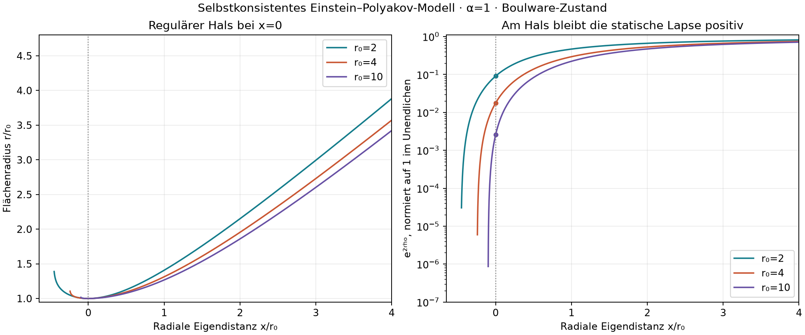

*Darstellung:* Die Eigendistanz ist in den Abbildungen mit $x$ bezeichnet und entspricht $\ell$ im Text. Alle drei Geometrien haben bei $x=0$ einen regulären minimalen Flächenradius. Die Punkte rechts markieren die strikt positive Killing-Norm am Hals nach Normierung der Zeit im Unendlichen. Die innere Seite ist links vom Hals.

Die größte skalierte Differenz zwischen DOP853 und Radau bleibt unter $5{,}61\times10^{-13}$, der Vergleich mit dem unabhängigen Eigendistanzchart bleibt unter $5{,}27\times10^{-12}$. Dabei bezeichnet skaliert jeweils $|y-y_\mathrm{ref}|/(1+|y_\mathrm{ref}|)$. Die Toleranzen $2\times10^{-8}$, $2\times10^{-10}$ und $2\times10^{-12}$ bestätigen Konvergenz. Zwischen den letzten beiden Stufen ändern sich die inneren Zustände skaliert um weniger als $1{,}59\times10^{-11}$ und die ADM-Massen absolut um weniger als $1{,}22\times10^{-10}\sqrt\alpha$.

Aus der bereits bewiesenen Differentialungleichung folgen für jedes endliche $S$ die nachlaufenden Restabschätzungen

$$|\ell_* -\ell(S)|\le\frac32\sqrt{D(S)},\qquad
\lambda_* -\lambda(S)\le\frac{3e^{\rho_0-S}}{5E}\sqrt{D(S)}.$$

Bei $S=18$ ergeben die berechneten Zustände für den verbleibenden radialen Abstand die Werte $2{,}116$, $2{,}232$ und $2{,}274$ mal $10^{-8}\sqrt\alpha$. Das sind die analytischen Restformeln, ausgewertet am numerischen Zustand. Die gesondert gemessene Integrationsunsicherheit kommt hinzu; eine intervallarithmetische Zertifizierung dieser Dezimalzahlen wird nicht beansprucht. Der Singularitätssatz selbst beruht auf den exakten Schranken aus Abschnitt 17.4.

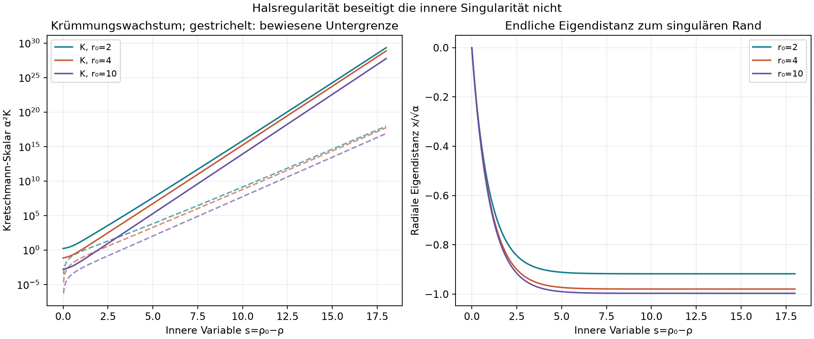

*Darstellung:* Die gestrichelten Kurven sind die mathematisch bewiesenen Krümmungsuntergrenzen. Sowohl sie als auch die vollständig berechnete Krümmung wachsen unbegrenzt, während die innere Eigendistanz konvergiert. Die endliche numerische Strecke erreicht den singulären Rand nicht und wird nicht durch ihn fortgesetzt.

Alle unabhängigen Einstein-Komponenten werden gegen die aktuelle Quantenquelle geprüft. Nach Einsetzen der ODE liegen die skalierten Reste unter $4{,}39\times10^{-16}$. Zusätzlich differenziert ein Fünfpunktverfahren die integrierten Metrikfunktionen selbst: Der feinste Einsteinrest liegt unter $4{,}14\times10^{-9}$; die unabhängig differenzierte Druck-Erhaltungsidentität unter $1{,}03\times10^{-8}$. Die Residuen sinken bei Schrittverfeinerung. Die vollständigen Werte und die asymptotischen Reihen stehen in den [Methodennotizen](work/bhback_numeric_notes.md).

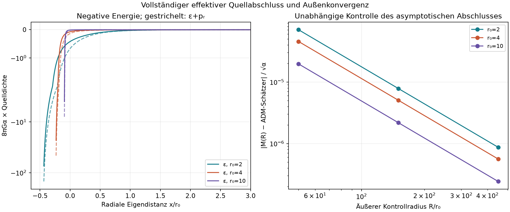

*Darstellung:* Die negative radiale Nullenergie ermöglicht den regulären Hals. Rechts wird die Annäherung der endlichen Quasilokalmasse an den ADM-Schätzer mit wachsendem Außenradius gezeigt. Alle drei Abbildungen liegen zusätzlich als SVG vor; die zugrunde liegenden 96 Arrays sind vollständig archiviert.

Der zusätzliche Prüfer [verify_bhback_research.py](work/verify_bhback_research.py) importiert das Modellskript nicht. Er berechnet Einstein-Tensor und Kretschmann-Skalar erneut aus der allgemeinen vierdimensionalen Metrik und prüft Quelle, Erhaltung, Constraint sowie die äußeren Reihen symbolisch. Numerisch integriert er $r$, $q$ und $\log D$ als unabhängige Variablen; $q$ wird dabei nicht aus dem Constraint rekonstruiert. Über alle drei Lösungen beträgt die größte skalierte Abweichung $4{,}67\times10^{-13}$. Die vollständige Riemannformel reproduziert die Krümmungsarrays relativ bis auf $1{,}95\times10^{-12}$. Zusätzlich werden die Radius-, Barriere-, Determinanten- und optischen Schranken gesondert geprüft.

Die Module [BHBackSource.lean](work/lean/BHBackSource.lean), [BHBackChart.lean](work/lean/BHBackChart.lean) und [BHBackBounds.lean](work/lean/BHBackBounds.lean) enthalten **41 explizite Sätze**. Der tatsächliche Offline-Kernlauf mit Lean 4.30.0 und Mathlib-Revision `c5ea00351c28e24afc9f0f84379aa41082b1188f` akzeptiert alle drei Module. Die 97 transitiv auditierten Theorem-Konstanten verwenden ausschließlich `propext`, `Classical.choice` und `Quot.sound`. Das [Formalprotokoll](work/lean/bhback_proof_verification.json) dokumentiert Aussagen, Axiomenaudit und Quellenhashes.

Das Quellenmodul beweist tatsächliche Druck- und Constraint-Ableitungen, die reduzierte Erhaltungsidentität, alle drei Einstein-Beziehungen auf dem Constraint sowie Halsaufweitung und negative radiale Nullenergie. Das Chartmodul prüft die tatsächlichen Ableitungen von $D$ und $\log D+2s$, die Rücktransformation und die benötigten Krümmungs- und Wurzelschranken. Das Schrankenmodul beweist echte Differentialvergleiche auf Intervallen, die exponentielle Krümmungsuntergrenze und mit `curvature_lower_bound_tendsto` deren Grenzwert $+\infty$. `conditional_curvature_diverges` überträgt ihn unter der ausdrücklich vorausgesetzten asymptotischen Untergrenze auf $K$. Auch der logarithmische Vergleich und die daraus folgende optische Untergrenze werden formal geprüft.

Die globale ODE-Fortsetzung, das invariante Gebiet, der $k$-Barrierenvergleich und die geodätische Interpretation sind die mathematischen Argumente aus Abschnitt 17.4. Sie werden nicht als vollständige Lean-Konstruktion von Raumzeit und Quantenfeld ausgegeben. Die [Formalisierungsnotizen](work/bhback_formal_notes.md) ordnen jede Aussage ihren Voraussetzungen zu. Damit ergänzen sich der analytische Singularitätssatz, der Kernnachweis seiner expliziten Hilfssätze und die unabhängige numerische Kontrolle.

Das [unabhängige Gesamtprotokoll](work/bhback_independent_verification_20261018.json) bindet Literaturarchive, Rohdaten, Skripte, Abbildungen und Lean-Nachweise durch SHA256 an diese Manuskriptfassung. Es kontrolliert außerdem die unveränderten Kapitel 1 bis 16 und die 54 gebundenen Artefakte des vorherigen Schwarzlochkapitels. Die archivierte Rechnung kann mit einem neuen Berichtsnamen erneut geprüft werden:

```powershell
python work/verify_bhback_research.py --output-tag pruefung_neu
```

Ein neuer numerischer Lauf wird mit einem eigenen Tag erzeugt:

```powershell
python work/bhback_numerics.py --tag rueckwirkung_neu
python work/verify_bhback_research.py `
  --tag rueckwirkung_neu --output-tag pruefung_neu
```

Der Kernlauf ist mit `python work/lean/check_bhback_proofs.py` reproduzierbar; sein bisheriges Protokoll ist vor einer Wiederholung zu archivieren, wenn die historischen Hashbindungen erhalten bleiben sollen.

## 18. Dilatonquelle und Rückstreuung

### 18.1 Reduktion und radiales Potential

Die Erweiterung verwendet $N>0$ reelle, masslose, **minimal gekoppelte** Skalarfelder und behält ihre sphärischen Moden $l=0$. Sie ist ein festgelegtes reduziertes Quellmodell. Die vollständige vierdimensionale konforme Quelle aus Kapitel 16 hat eine andere Kopplung; ihre Spuranomalie wird hier nicht eingesetzt. Mit $c=1$, $\Lambda=0$, $\alpha=GN\hbar/(12\pi)>0$ und $r=\sqrt\alpha e^{-\phi}$ lauten die reduzierten Wirkungen

$$S_g=\frac1{4G}\int\sqrt{-g_2}\,[r^2R_2+2(\nabla r)^2+2]\,d^2y,
\qquad S_m=-\frac12\sum_{i=1}^N\int\sqrt{-g_2}\,r^2(\nabla f_i)^2\,d^2y.$$

In der statischen konformen Metrik $ds_2^2=e^{2\rho(x)}(-dt^2+dx^2)$ ergibt die Variation $-r^2f_{tt}+(r^2f_x)_x=0$. Die kanonische Variable $\psi=rf$ erfüllt exakt

$$[-\partial_t^2+\partial_x^2-V_0(x)]\psi=0,
\qquad V_0=\frac{r_{xx}}r.$$

Der Term $V_0$ erzeugt radiale Rückstreuung schon bei $l=0$. Für die vorgegebene Schwarzschild-Geometrie ist $V_0=(1-2m/r)2m/r^3$; sein positives Maximum liegt bei $r=8m/3$. Auf der rückgekoppelten Geometrie wird dagegen deren eigenes $r(x)$ eingesetzt. Das reduzierte Feld ist damit kein freies konformes Feld in zwei Dimensionen.

### 18.2 Konservierte renormierte Quelle

Wir untersuchen den statischen Zustandsschluss aus [Fabbri2006, Abschnitt 2.2]: In den bei räumlicher Unendlichkeit normierten Koordinaten $x^\pm=t\pm x$ werden die normalgeordneten Größen $\langle:T_{\pm\pm}:\rangle$ auf null gesetzt. Die dilatonabhängige Anomalie und die Ward-Identität bestimmen dann die verwendete Quelle. Eine vollständige spektrale Berechnung des Vakuumstresses ist damit nicht vorausgesetzt: Die Anomalie legt den Weyl-invarianten Teil der effektiven Wirkung nicht fest [BF1999]. Eine nachträgliche Verschiebung von $\rho$ ohne entsprechende Transformation des Zustandsschlusses ist unzulässig.

Mit $\kappa=N\hbar/(48\pi)$ gilt

$$T_{++}^{(2)}=T_{--}^{(2)}
=\kappa[\rho_{xx}-\rho_x^2+6\rho_x\phi_x+6\rho\phi_x^2],$$
$$T_{+-}^{(2)}=\kappa[\rho_{xx}+3\phi_x^2-3\phi_{xx}].$$

Die Spur lautet $T^{(2)a}{}_a=N\hbar[R_2-6(\nabla\phi)^2+6\Box\phi]/(24\pi)$. Der radiale Lift bleibt $T^{(4)}_{ab}=T^{(2)}_{ab}/(4\pi r^2)$, doch der Winkeldruck verschwindet jetzt nicht. Setzt man $a=\phi_x$, $b=\rho_x$, $c=\phi_{xx}$, $d=\rho_{xx}$, $j=\phi_{xxx}$ sowie $F_0=\kappa e^{-2\rho}/(2\pi r^2)$, erhält man

$$\varepsilon=F_0[2d-b^2+6ba+6\rho a^2+3a^2-3c],$$
$$p_r=F_0[-b^2+6ba+6\rho a^2-3a^2+3c],$$
$$p_t=-\frac32F_0\left[\frac ja-2c+2d+4ba+4\rho c\right].$$

Die letzte Darstellung gilt zunächst für $a\ne0$. Ihr Vorzeichen folgt unabhängig aus der Materievariation und aus der vierdimensionalen Erhaltung:

$$p_{r,x}+\rho_x(\varepsilon+p_r)
+2\frac{r_x}{r}(p_r-p_t)=0.$$

Insbesondere ist $p_t=(\delta W/\delta r)/(8\pi r\sqrt{-g_2})=- (\delta W/\delta\phi)/(8\pi r^2\sqrt{-g_2})$. Das gegenteilige Vorzeichen der Winkelvariation in Gleichung (15) von [Fabbri2006] erfüllt diese Identität nicht. Das hier verwendete Vorzeichen stimmt mit deren Ward-Gleichung (19) und den eigentlichen Rückwirkungsgleichungen (30)–(32) überein. Am regulären Hals wird die scheinbar singuläre Quotientenform durch ihre stetige Lösungsauswertung fortgesetzt; die nachfolgende Evolutionsgleichung und die Winkelquelle sind dort endlich.

### 18.3 Geschlossene Rückwirkung

Mit radialer Eigendistanz $\ell$, $u=dr/d\ell$, $v=d\rho/d\ell$ und $U=du/d\ell$, $V=dv/d\ell$ wird das ursprüngliche Gleichungssystem zu

$$r'=u,\qquad \rho'=v,$$
$$U=\frac r{3\alpha}\left[1-u^2-\alpha v^2-
\left(2r+\frac{9\alpha}r\right)uv+\frac{6\alpha\rho u^2}{r^2}\right],$$
$$V=\frac{r+6\alpha/r}{\alpha}uv-\frac{6\rho u^2}{r^2}-\frac r\alpha U.$$

Alle Quellen werden auf der so entwickelten Geometrie ausgewertet. Insbesondere

$$8\pi G\varepsilon=\frac\alpha{r^2}
\left[2V+v^2+\frac{3U}r-\frac{3uv}r+\frac{6\rho u^2}{r^2}\right],$$
$$8\pi Gp_r=\frac\alpha{r^2}
\left[-v^2-\frac{3U}r-\frac{9uv}r+\frac{6\rho u^2}{r^2}\right].$$

Die unabhängige Tensorauswertung liefert $G_{\hat0\hat0}=(1-u^2-2rU)/r^2$, $G_{\hat1\hat1}=(u^2-1+2ruv)/r^2$ und $G_{\hat2\hat2}=V+v^2+(U+uv)/r$. Alle drei stimmen mit der Quelle überein; die Winkelgleichung folgt auf glatten Lösungen aus der Ward-Identität. Am Hals $u=0$ ist

$$U_B=\frac{r_B}{3\alpha}(1-\alpha v_B^2),\qquad
V_B=-\frac{r_B^2}{3\alpha^2}(1-\alpha v_B^2).$$

Ein regulärer minimaler Hals verlangt also $\alpha v_B^2<1$; auf dem hier untersuchten Zweig gilt zusätzlich $v_B>0$. Die Halsbedingung des Polyakov-Modells, $\alpha v_B^2=1$, darf nicht übernommen werden. Das Streupotential der neuen Lösung ist

$$V_0=e^{2\rho}\frac{U+uv}{r}.$$

### 18.4 Ausschluss eines endlichen Nullpunkts

Die Unvereinbarkeit dieses endlichen Radiusansatzes mit den ursprünglichen Gleichungen wurde bereits von Ho und Matsuo gezeigt [HoMatsuo2018, Abschnitt 4.3]. Der folgende Beweis gibt dafür eine unabhängige Differentialabschätzung; der Korrekturbefund selbst wird nicht als neu beansprucht.

Eine eigenständige Kontrolle betrifft den in [Fabbri2006, Abschnitt 4.3] angenommenen Endpunkt. Auf dem inneren Zweig mit nach innen zunehmendem Radius seien $w=d\rho/dr$ und $h=(d\ell/dr)^2=1/u^2>0$. Das ursprüngliche System impliziert exakt

$$\rho_r=w,\qquad h_r=-2Ph,$$
$$P=\frac r{3\alpha}\left[h-1-\alpha w^2-
\left(2r+\frac{9\alpha}r\right)w+\frac{6\alpha\rho}{r^2}\right],$$
$$w_r=\frac{r+6\alpha/r}{\alpha}w-\frac{6\rho}{r^2}
-\left(\frac r\alpha+w\right)P.$$

Für reguläres $P$ folgt durch einen Integrationsfaktor

$$h(r)=h(r_1)\exp\left[-2\int_{r_1}^rP(\xi)\,d\xi\right].$$

Die quadratische Ergänzung gibt sogar ohne Beschränktheit von $w$ die obere Schranke

$$P\le\frac r{3\alpha}\left[h-1+\frac{6\alpha\rho}{r^2}
+\frac{(2r+9\alpha/r)^2}{4\alpha}\right].$$

Geht $r$ gegen einen endlichen positiven Wert und bleiben $\rho$ nach oben sowie $h$ beschränkt, ist die rechte Seite durch eine Konstante $M$ beschränkt. Daher ist $h(r)\ge h(r_1)e^{-2M(r-r_1)}>0$. Ein einfacher Nullpunkt $h\sim C(r_M-r)$ mit $C>0$ ist ausgeschlossen. Insbesondere ist der dort aus diesem Nullpunkt abgeleitete Ansatz $r_M-r\sim(x-x_M)^{2/3}$ mit endlichem regulärem $\rho(r_M)$ keine mögliche Endpunktasymptotik dieser Gleichungen.

Diese Feststellung beruht nicht auf der Auswahl eines anderen Differentialgleichungssystems: Die unabhängige Elimination reproduziert exakt den relevanten Faktor von Gleichung (95), und eine gesonderte Kettenregelrechnung bestätigt Gleichung (96) derselben Arbeit. Korrigiert wird die Endpunktfolgerung, nicht diese beiden ODE-Umformungen. Der positive Metrikfaktor wird numerisch logarithmisch entwickelt, damit exponentiell kleine Werte weder durch Auslöschung noch durch Unterlauf zu einem falschen Nullpunkt werden.

### 18.5 Innerer Singularitätssatz

Der Ausschluss dieses endlichen Radius bedeutet keine Regularität der inneren Geometrie. Für den inneren Zweig mit $v>0$ verwenden wir

$$s=-\rho,\quad q=-u/v,\quad
y=r^2/\alpha,\quad k=rq/\alpha,\quad b=1/(\alpha v^2)>0.$$

Das System besitzt die reguläre Form

$$y_s=2k,\qquad k_s=J,\qquad (\log b)_s=2F,$$
$$F=\frac y3(1-2k-b)+\frac{k^2}3-4k-\frac{6k}y
+\frac{2sk^2}y+\frac{6sk^2}{y^2},$$
$$J=\frac y3(1-k)(b-1+2k)+\frac{k^3}3-\frac{13k^2}3+3k
-\frac{5k^2}y+\frac{2sk^2(k-1)}y+\frac{6sk^3}{y^2}.$$

**Satz.** Beginnt eine exakte Lösung bei $s_0\ge0$ in

$$y_0\ge\max(s_0,16),\qquad \frac34\le k_0\le1,\qquad b_0>0,$$

so existiert sie für jedes endliche $s\ge s_0$, bleibt in diesem Gebiet und besitzt eine innere Krümmungssingularität bei $s\to\infty$.

**Beweis.** Auf der unteren $k$-Grenze gilt

$$J\big|_{k=3/4}\ge\frac y{24}-\frac{21}{64}-\frac{45}{16y}
\ge\frac{125}{768}>0,$$

auf der oberen $J|_{k=1}=-1-5/y+6s/y^2\le-1+1/y<0$. Zudem ist $(y-s)_s=2k-1\ge1/2$. Die Vektorfelder weisen somit an den relevanten Grenzen nach innen. Im gesamten Gebiet gilt

$$F\le-\frac y6-\frac54.$$

Dies folgt durch Zerlegung von $-y/6-5/4-F$ in nichtnegative Terme:

$$\frac y3(2k-3/2+b)+\frac{2(y-s)k^2}y
+\frac{6(y-s)k^2}{y^2}+\frac{6k(1-k)}y
+\frac73k(1-k)+\frac53(k-3/4).$$

Mit $\tau=s-s_0\ge0$ erhält man

$$y_0+\frac32\tau\le y(s)\le y_0+2\tau,$$
$$0<b(s)\le b_0\exp\left[-\left(\frac{y_0}3+\frac52\right)\tau-\frac{\tau^2}4\right].$$

Auf jedem endlichen $s$-Intervall bleiben $y,k,b$ beschränkt, $y\ge16$, und $\log b$ hat eine beschränkte Ableitung. Es gibt dort weder einen Nennernullpunkt noch einen Verlust von $b>0$; der gewöhnliche Fortsetzungssatz schließt einen endlichen Abbruch aus. Damit ist das invariante Gebiet global nach innen erhalten.

Die volle vierdimensionale Krümmung ist

$$K=4\left[(V+v^2)^2+2(uv/r)^2+2(U/r)^2+
\left(\frac{1-u^2}{r^2}\right)^2\right].$$

Schon ein Summand liefert

$$K\ge\frac{8k^2}{\alpha^2y^2b^2}
\ge\frac9{2\alpha^2b_0^2}
\frac{\exp[(2y_0/3+5)\tau+\tau^2/2]}{(y_0+2\tau)^2}
\longrightarrow+\infty.$$

Es gilt $r\to\infty$ und $e^{2\rho}\to0$. Gleichzeitig sind die verbleibende Eigendistanz, die affine Länge radialer Nullgeodäten mit Killing-Energie $E>0$ und sogar die optische Distanz endlich:

$$\Delta\ell\le\frac{\sqrt{\alpha b_0}}{y_0/6+5/4},\qquad
\Delta\lambda\le\frac{e^{-s_0}\sqrt{\alpha b_0}}{E(y_0/6+9/4)},$$
$$\Delta x\le\frac{e^{s_0}\sqrt{\alpha b_0}}{y_0/6+1/4}.$$

Die Abschätzungen folgen durch Integration von $|d\ell/ds|=\sqrt{\alpha b}$, $|d\lambda/ds|=e^{-s}\sqrt{\alpha b}/E$ und $|dx/ds|=e^s\sqrt{\alpha b}$. Die zusätzliche Gaußdämpfung verbessert alle drei Schranken. Der innere Rand bildet eine **zeitartige Grenzlinie im radialen konformen Diagramm**: $x$ endet endlich, während $t$ frei bleibt. Damit ist keine reguläre zeitartige Hyperfläche gemeint. Die divergierende skalare Krümmung schließt einen regulären $C^2$-Endpunkt der unvollständigen Nullgeodäten aus.

Der Satz benötigt keine numerische Extrapolation. Beispielsweise sind $(s_0,y_0,k_0,b_0)=(16,32,7/8,1/2)$ exakte zulässige Anfangsdaten. Für von außen berechnete Lösungen bleibt ihr Eintritt in das Gebiet gesondert zu prüfen. Der numerische Eintrittsnachweis unten ist keine intervallarithmetische Zertifizierung dieser Außenlösungen.

### 18.6 Spektrale Randbedingung

Das Rückstreupotential liefert einen weiteren mathematischen Befund. Der räumliche Modenoperator

$$H=-\frac{d^2}{dx^2}+\frac{r_{xx}}r$$

besitzt die beiden exakten Nullenergielösungen

$$\psi_1(x)=r(x),\qquad
\psi_2(x)=r(x)\int_{x_*}^{x}\frac{d\xi}{r(\xi)^2},\qquad
W(\psi_1,\psi_2)=1.$$

Hier ist $x_*$ der endliche innere optische Grenzwert. Die zuvor bewiesenen Schranken implizieren

$$\int_{x_*}^{x_0}r^2dx
\le\alpha y_0 e^{s_0}\sqrt{\alpha b_0}
\int_0^\infty\left(1+\frac{2\tau}{y_0}\right)
e^{-(y_0/6+1/4)\tau-\tau^2/8}\,d\tau<\infty.$$

Außerdem ist der Integralanteil in $\psi_2$ durch $(x_0-x_*)/(\alpha y_0)$ beschränkt. Beide unabhängigen Nullenergielösungen sind daher am inneren Ende quadratintegrierbar. Für den reellen, lokal regulären Schrödingeroperator ist dies der Limit-Circle-Fall: Die Normierbarkeit bestimmt keine eindeutige selbstadjungierte Randbedingung.

Auf kompakt getragenen Testfunktionen gilt mit $A=d/dx-r_x/r$ die Faktorisierung $H=A^\dagger A$ und damit $\langle\psi,H\psi\rangle=\|A\psi\|^2\ge0$. Eine nichtnegative Friedrichs-Erweiterung ist eine mögliche Wahl; sie folgt nicht allein aus dem lokalen Potential. Dies erklärt konkret, warum eine absorbierende Schwarzschild-Horizontbedingung keine automatisch gültige innere Randbedingung dieser rückgekoppelten Geometrie ist. Die Bedeutung selbstadjungierter Erweiterungen für die eindeutige statische Feldentwicklung wird in [HM1995] begründet; der hier verwendete Nullmoden- und Integrabilitätsbeweis ist die vorstehende eigene Rechnung.

Eine Streurechnung auf einem ausdrücklich begrenzten regulären Gebiet prüft die Modenausbreitung unter ihren angegebenen Randbedingungen. Sie berechnet nicht zugleich den vollständigen renormierten Erwartungswert auf dem singulären Gesamtgebiet. Auch eine Bohmsche Beschreibung muss dieselbe Operator-Domäne festlegen: Die zusätzliche Feldkonfiguration beseitigt diese spektrale Mehrdeutigkeit nicht. Der Singularitätssatz aus Abschnitt 18.5 gilt für den vollständig angegebenen Quellenschluss aus Abschnitt 18.2.

### 18.7 Numerik und formale Prüfung

Das Skript [swave_numerics.py](work/swave_numerics.py) löst die ursprünglichen Gleichungen in Eigendistanz und unabhängig im Rotverschiebungsparameter. Die Außenbedingungen verwenden eine bis $r^{-6}$ hergeleitete asymptotische Reihe mit $\rho\to0$ und $u^2=1-2m/r+O(r^{-3})$. Alle Zahlen beziehen sich auf $\alpha=1$; der Hauptlauf beginnt bei $R=200m$. Für $R/m=50,100,200$ und drei Integratortoleranzen werden die Hals- und Innenwerte verglichen. Die größten skalierten Halsabweichungen durch Verschieben des Außenstarts liegen unter $2{,}15\times10^{-9}$; der Vergleich der beiden feinsten Integratortoleranzen unter $1{,}51\times10^{-9}$. Die [Methodennotizen](work/swave_numeric_notes.md) enthalten Reihen, Fehlermaße und Randkonventionen.

| $m/\sqrt\alpha$ | $r_B/\sqrt\alpha$ | $\rho_B$ | $\sqrt\alpha v_B$ | $y(10)$ | $k(10)$ |
| ---: | ---: | ---: | ---: | ---: | ---: |
| 1 | 2,371094024 | −1,027151471 | 0,647535989 | 19,18148771 | 0,863872112 |
| 2 | 4,406930868 | −1,746717776 | 0,885781590 | 33,55884127 | 0,917756630 |
| 5 | 10,249127423 | −2,851947239 | 0,981754412 | 118,50269400 | 0,975304231 |

Bei $s=10$ liegen alle drei numerischen Lösungen strikt im Gebiet des Satzes. Dort sind $\log b=-87{,}88281573$, $-158{,}70947791$ beziehungsweise $-532{,}81664965$. Die großen Sicherheitsabstände zu den $y$- und $k$-Grenzen sowie die Konvergenzprüfung stützen diesen numerischen Eintrittsbefund. Der analytische Satz gilt für exakte Eintrittsdaten; eine rigorose Fehlerhülle vom asymptotischen Außenrand bis zu diesem Schnitt wird nicht behauptet.

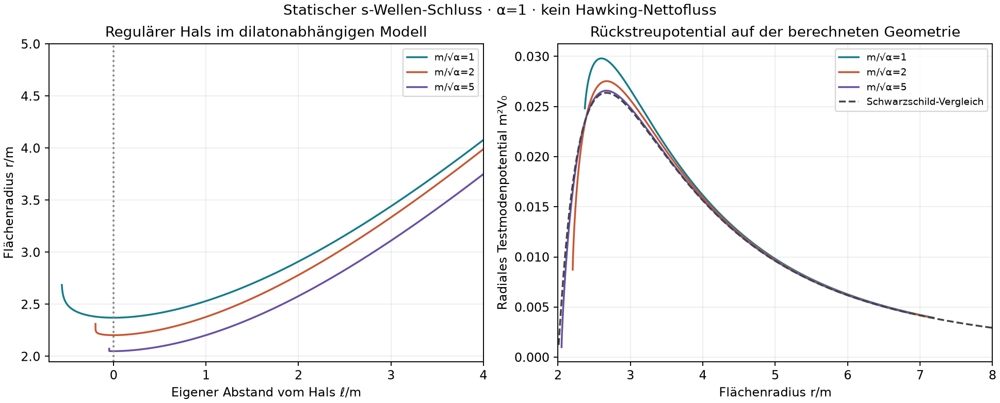

*Darstellung:* Links ist der reguläre Hals in Eigendistanz dargestellt, rechts das auf derselben Geometrie berechnete Rückstreupotential. Der gestrichelte Vergleich verwendet die vorgegebene Schwarzschild-Metrik. Er ersetzt keine rückgekoppelte Quellenrechnung.

Die inneren Läufe reichen bis $s=30$ und ergeben $r/\sqrt\alpha=7{,}480592805$, $8{,}443655926$ und $12{,}555727938$. Die entsprechenden Werte $\log(\alpha^2K)=1236{,}160020$, $1798{,}967929$ und $4868{,}545692$ werden direkt in Logarithmen berechnet. Zusätzlich wird die Familie mit den exakten Anfangsdaten aus Abschnitt 18.5 integriert; sie benötigt keinen numerischen Eintritt aus einer Außenlösung.

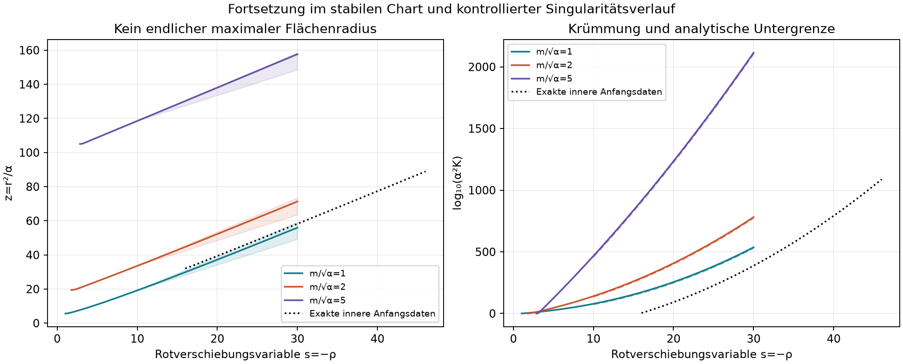

*Darstellung:* Die schattierten Radiusbereiche und gestrichelten Krümmungskurven zeigen die analytischen Schranken. Das Achsensymbol $z=r^2/\alpha$ bezeichnet hier die Größe $y$ aus Abschnitt 18.5. Die schwarz gepunktete Kurve gehört zu den exakt vorgegebenen inneren Daten, ohne behauptete asymptotische Außenanbindung.

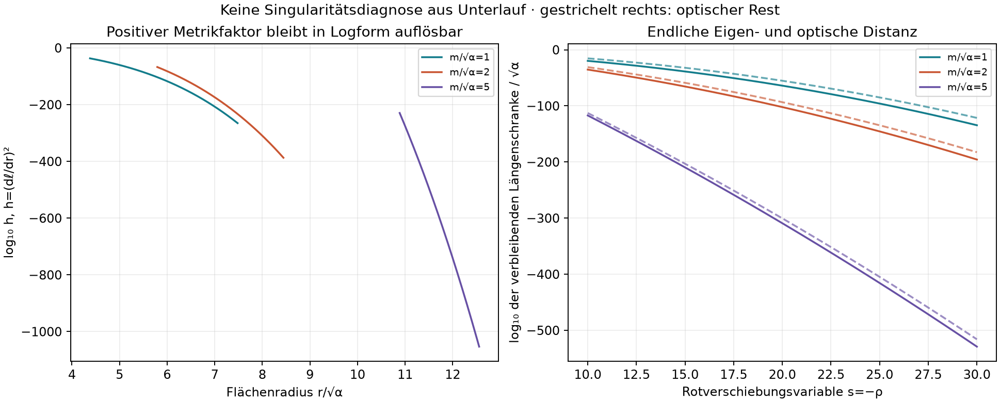

*Darstellung:* Die logarithmische Entwicklung erhält die Information über den positiven Metrikfaktor auch weit unterhalb des direkt darstellbaren Gleitkommabereichs. Rechts stehen die analytischen Restlängenschranken, ausgewertet an den berechneten Zuständen. Numerische Zustandsfehler sind gesondert zu berücksichtigen. Am Hals ist die Flächenradiuskoordinate selbst ungeeignet; ein Maskenarray kennzeichnet dort den nicht definierten endlichen Wert von $\log h$.

Der zusätzliche [Streutest](work/swave_scattering.py) verwendet ausschließlich den regulären Außenabschnitt $0\le\ell\le8m$, mit $\ell=0$ am Hals. Außerhalb dieses Abschnitts wird das eindimensionale Potential ausdrücklich auf null gesetzt. Diese freien Anschlüsse definieren das Testproblem vollständig; die Reflexion enthält auch die Effekte der abrupten Abschneidung. Mit $\chi=\psi_x$ werden

$$\frac d{d\ell}\begin{pmatrix}\psi\\\chi\end{pmatrix}
=e^{-\rho}\begin{pmatrix}\chi\\(V_0-\omega^2)\psi\end{pmatrix}$$

und die links auslaufenden Daten $(\psi,\chi)=(1,-i\omega)$ integriert. Am rechten Anschluss sind bis auf Phasen $A_{\mathrm{in}}=(\psi-\chi/(i\omega))/2$ und $A_{\mathrm{out}}=(\psi+\chi/(i\omega))/2$. Der erhaltene Wronskian liefert

$$\mathcal R=|A_{\mathrm{out}}/A_{\mathrm{in}}|^2,\qquad
\mathcal T=1/|A_{\mathrm{in}}|^2,\qquad \mathcal R+\mathcal T=1.$$

Für jede Masse werden 48 Frequenzen $0{,}015\le m\omega\le0{,}8$ sowie an sämtlichen Frequenzen Gitter- und Solververfeinerungen geprüft. Der größte Einheitsrest beträgt $8{,}00\times10^{-10}$, die größte Änderung der Streuwahrscheinlichkeiten bei Gitterhalbierung $1{,}75\times10^{-6}$. Bei der niedrigsten Frequenz ergeben sich $\mathcal R=0{,}990283$, $0{,}991554$ und $0{,}992445$. Ein Nullpotential-Kontrolllauf ist transparent. Diese Größen charakterisieren das angegebene begrenzte Potential; sie sind keine globalen Schwarzloch-Absorptionsfaktoren oder Hawking-Leistungen.

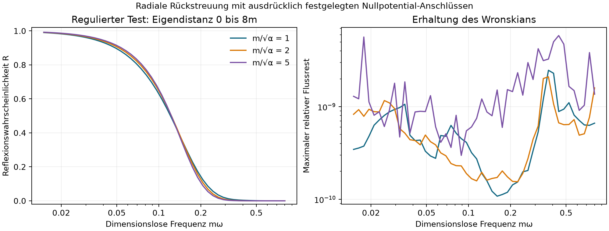

Die Geometrierechnung besteht **56 Kontrollen** und archiviert 126 endliche Roharrays; der Streutest besteht **18 Kontrollen**. Maßgeblich sind die [Geometriedaten](work/swave_numerics_20261018_final.json), ihre [Roharrays](work/swave_numerics_20261018_final.npz), die [Streudaten](work/swave_scattering_20261018_verified.json) und deren [Roharrays](work/swave_scattering_20261018_verified.npz). Die drei Einstein-Komponenten stimmen skaliert bis $8{,}60\times10^{-15}$ mit der Quelle überein. Eine unabhängige Fünfpunktableitung der Druckbilanz ergibt auf dem feinsten Gitter höchstens $2{,}27\times10^{-9}$, mit abnehmendem Rest bei Verfeinerung.

Der [unabhängige Prüfer](work/verify_swave_research.py) importiert keines der beiden Rechenskripte. Er konstruiert Christoffel-Symbole, Riemann- und Einstein-Tensor erneut, prüft die Quelle einschließlich des Winkelvorzeichens, beide ODE-Umformungen, die äußeren Reihen und die Barrieren symbolisch. Ein eigener Integrator entwickelt $y,k,\log b$ statt $r,q,\log b$. Die größte skalierte Zustandsabweichung beträgt $1{,}64\times10^{-11}$, diejenige der unabhängig berechneten logarithmischen Krümmung $2{,}43\times10^{-11}$. Der zusätzliche Lauf mit exakten inneren Daten kontrolliert alle Schranken bis $s=56$.

Die Module [SWaveReduction.lean](work/lean/SWaveReduction.lean), [SWaveSource.lean](work/lean/SWaveSource.lean), [SWaveEndpoint.lean](work/lean/SWaveEndpoint.lean) und [SWaveInterior.lean](work/lean/SWaveInterior.lean) enthalten **37 explizite Sätze**. Der tatsächliche Offline-Kernlauf mit Lean 4.30.0 und derselben Mathlib-Revision wie in Kapitel 17 akzeptiert alle Module. Die 70 transitiv auditierten Theorem-Konstanten verwenden ausschließlich `propext`, `Classical.choice` und `Quot.sound`; das [Kernprotokoll](work/lean/swave_proof_verification.json) bindet Aussagen und Quellenhashes.

Formal geprüft sind insbesondere tatsächliche Ableitungen der Feldreduktion und der Quelle, die Ward-Identität, die beiden Nullmoden, der Integrationsfaktor und der positive Endpunktgrenzwert unter expliziten Regularitätsannahmen. Ein gesonderter L'Hôpital-Beweis schließt die lineare Metriknullstelle bei regulärem Koeffizienten aus. Das Innenmodul beweist die $F$- und $J$-Schranken sowie den tatsächlichen Grenzwert der expliziten Krümmungsuntergrenze nach $+\infty$; die Übertragung auf $K$ setzt die hergeleitete Untergrenze voraus. Globale ODE-Fortsetzung, Eintritt der Außenlösungen, geodätische Interpretation und Limit-Circle-Klassifikation sind nicht als vollständige Lean-Raumzeitkonstruktion formalisiert. Die [Formalisierungsnotizen](work/swave_formal_notes.md) und [Theorienotizen](work/swave_theory_notes.md) ordnen Beweise und Voraussetzungen zu.

Das [Gesamtprotokoll](work/swave_independent_verification_20261018_final.json) bindet die Primärtexte, Skripte, Rohdaten, vier PNG/SVG-Abbildungspaare und Lean-Nachweise an diese Manuskriptfassung. Es prüft außerdem die unveränderten Kapitel 1 bis 17 und die früheren gebundenen Forschungsartefakte. Die vorherige Fassung bleibt als [Snapshot](snapshots/Publikation-vor-dilaton-s-welle-20261018.md) erhalten. Die Reproduktion mit neuen Berichtsnamen erfolgt durch

```powershell
python work/swave_numerics.py --tag neuer_lauf
python work/swave_scattering.py --input-tag neuer_lauf --tag neue_streuung
python work/verify_swave_research.py --tag neuer_lauf `
  --scatter-tag neue_streuung --output-tag neue_pruefung
```

Der Kernlauf ist mit `python work/lean/check_swave_proofs.py` reproduzierbar; sein fest benanntes Receipt ist vor erneutem Schreiben zu archivieren, wenn dessen historische Hashbindung erhalten bleiben soll.

## 19. Vierdimensionale Quantenquelle

Die Erweiterung auf eine vierdimensionale analytische Quelle bestätigt die Krümmungssingularität für die hier untersuchten minimalen und konformen Felder, verändert aber deren Geometrie. Der reguläre Hals aus Kapitel 17 und 18 verschwindet; die statische Außenlösung endet an einem zeitartigen singulären Rand bei endlichem Flächenradius. Dieser Befund wird für eine ganze Klasse exakter Anfangsdaten bewiesen und für sechs asymptotisch flache Lösungen numerisch geprüft. Die Rechnung verwendet die ordnungsreduzierte Anderson–Hiscock–Samuel-Quelle von Arrechea et al. [ABCG2023]. Sie bestimmt einen weiteren vollständig festgelegten Näherungsvergleich, keine exakte vierdimensionale Vakuumlösung.

### 19.1 Kugelradius und Winkelmoden

Für die Signatur $(-+++)$ und

$$ds^2=f(r)(-dt^2+dx^2)+r^2d\Omega^2,
\qquad \frac{dx}{dr}=\sqrt{\frac{h}{f}},
\qquad f,h>0$$

zerlegen wir ein massloses Feld mit $(\Box-\xi\mathcal R)\Phi=0$ in normierte Kugelflächenfunktionen:

$$\Phi=\sum_{l=0}^{\infty}\sum_{m=-l}^{l}
\frac{\psi_{lm}(t,x)}{r(x)}Y_{lm}(\theta,\varphi).$$

Direkte Substitution, einschließlich der Ableitungen des veränderlichen Kugelradius, ergibt exakt

$$(-\partial_t^2+\partial_x^2-V_l)\psi_{lm}=0,
\qquad V_l=\frac{r_{xx}}r+
f\left[\frac{l(l+1)}{r^2}+\xi\mathcal R\right].$$

Dabei ist $\mathcal R$ der vierdimensionale Ricci-Skalar. Der erste Beitrag enthält die radiale Rückstreuung aus Kapitel 18; der zweite ergänzt die Zentrifugalbarriere und die Krümmungskopplung. Die Winkelmoden haben Entartung $2l+1$, also

$$\sum_{l=0}^{L_{\max}}(2l+1)=(L_{\max}+1)^2.$$

Eine endliche Modenzahl ist damit ein Regulator, keine Renormierung. Zur vollständigen Quelle gehören die zustandsabhängigen radialen Moden, die vierdimensionale Kurzdistanzsubtraktion und ein kontrollierter Rest der Frequenz- und Winkelsummen. Die AHS-Konstruktion trennt den renormierten Tensor in einen analytischen Anteil und einen zusätzlich numerisch zu bestimmenden Anteil; beide sind separat erhalten. Die hier verwendete OR-Quelle reduziert die Ableitungsordnung des analytischen Anteils und ergänzt den Winkeldruck durch exakte Erhaltung [ABCG2023, Abschnitt II]. Sie ist daher weder eine bloße Addition einiger $l>0$-Moden zur s-Wellen-Quelle noch die vollständige Streuinformation des Feldes.

### 19.2 Erhaltene Quelle und Rückwirkung

Wir betrachten $N>0$ gleiche Felder im statischen Boulware-Quellenschluss, ohne klassische Materie und ohne kosmologische Konstante. Die Temperaturkonstante ist $\kappa=0$. Mit derselben Normierung wie zuvor definieren wir

$$\alpha=\frac{GN\hbar}{12\pi}>0,
\qquad L=\frac{GN\hbar}{16\pi}=\frac{3\alpha}{4},
\qquad ds^2=-f\,dt^2+h\,dr^2+r^2d\Omega^2.$$

Hier bezeichnet $L$ eine Größe der Dimension Länge zum Quadrat, keinen Winkelabschneider. Schreiben wir $j=f'/f$, so lautet Gleichung (9) der Primärquelle bei $\kappa=0$

$$\langle T^t{}_t\rangle=\frac{N\hbar}{16\pi^2r^4}A(h),
\qquad \langle T^r{}_r\rangle=\frac{N\hbar}{16\pi^2r^4}B(h),$$

$$A=\frac{(h-1)^2(h^2+6h+33)}{480h^2}
-\left(\xi-\frac16\right)
\frac{(h-1)^2(h^2+2h+5)}{8h^2},$$

$$B=-\frac{(h-1)^2(h^2+6h-15)}{1440h^2}
+\left(\xi-\frac16\right)
\frac{(h-1)^2(h+3)^2}{24h^2}.$$

Der Winkeldruck ist eindeutig durch die statische Ward-Identität festgelegt:

$$\langle T^\theta{}_\theta\rangle
=\langle T^\varphi{}_\varphi\rangle
=\frac{N\hbar}{16\pi^2r^4}C,
\qquad C=-B+\frac r2 B_hh'+\frac{rj}{4}(B-A).$$

Damit gilt für beliebige hinreichend glatte positive $f,h$, bereits vor Einsetzen der Feldgleichungen,

$$\partial_r T^r{}_r+
\frac j2(T^r{}_r-T^t{}_t)+
\frac2r(T^r{}_r-T^\theta{}_\theta)=0.$$

Die beiden unabhängigen Einstein-Gleichungen ergeben

$$h'=-\frac{h(h-1)}r+
\frac{L(h-1)^2}{r^3}\mathcal A(h),$$

$$j=\frac{h-1}r+
\frac{L(h-1)^2}{3hr^3}\mathcal B(h),$$

$$\mathcal A(h)=
\left(\xi-\frac{11}{60}\right)h^2+
2\left(\xi-\frac{13}{60}\right)h+
5\left(\xi-\frac{83}{300}\right),$$

$$\mathcal B(h)=
\left(\xi-\frac{11}{60}\right)h^2+
6\left(\xi-\frac{11}{60}\right)h+
9\left(\xi-\frac{5}{36}\right).$$

Die Winkelgleichung folgt aus diesen Gleichungen und der Ward-Identität; sie wird zusätzlich am vollständigen Einstein-Tensor geprüft. Die Konstanten sind direkt aus dem gedruckten Tensor abgeleitet. In den gedruckten Gleichungen (15) und (16) von [ABCG2023] stehen dagegen $\xi-\xi_c+1/30$ statt $\xi-\xi_c-1/30$ sowie $25/3$ statt $5/36$. Die hier angegebenen Koeffizienten erfüllen Quelle (9) und die kritische Entwicklung (28). Die Winkelspannung wird aus (11) mit vollständiger Kettenregel berechnet. Auch die gedruckte Expansion (12) erfüllt diese Identität nicht: Für $\xi=1/6$, konstante $f=1,h=2$ und $r=1$ verlangt Erhaltung $C=1/5760$, während (12) den Wert $-1/576$ liefert. Die Abweichungen wurden auch im Original-PDF geprüft. Daraus folgt keine Aussage darüber, welche Formeln die Autoren in ihrem numerischen Code verwendeten.

Die kritische Kopplung ist $\xi_c=11/60$. Im Folgenden gilt

$$\delta=\xi_c-\xi>0,$$

insbesondere für minimale Kopplung $\xi=0$ und konforme Kopplung $\xi=1/6$. Dann ist

$$\mathcal A=-\delta(h^2+2h+5)-\frac{h+7}{15}<0
\qquad(h>1).$$

Eine additive Konstante in $\log f$ verändert diese Quelle bei $\kappa=0$ nicht. Die Normierung $f(\infty)=1$ ist daher zulässig. Das unterscheidet diesen Quellenschluss von der expliziten $\rho$-Abhängigkeit in Kapitel 18.

### 19.3 Globaler Endpunktsatz

**Satz.** Für $L,\delta,R>0$, $0<w_0<1$ und beliebiges $f(R)>0$ besitzt die OR-Lösung mit $w(R)=w_0$, $w=1/h$, ein asymptotisch flaches Außenende mit positiver ADM-Masse $M$. Nach Zeitnormierung ist $f(\infty)=1$. Nach innen endet die Lösung an einem endlichen Radius $r_D>2M$ mit $K\to\infty$. Es gibt weder einen regulären Hals noch eine Nullstelle von $f$ im glatten Lösungsgebiet. Der innere Rand liegt in endlicher Eigen-, optischer und radialer Nullaffindistanz.

**Außenende.** Definiere

$$a(w)=\delta+(2\delta+1/15)w+(5\delta+7/15)w^2.$$

Dann gelten

$$w_r=\frac{1-w}{r}+
\frac{L(1-w)^2a(w)}{r^3w^2},
\qquad m(r)=\frac{r(1-w)}2,$$

$$m'=-\frac{2Lm^2a(w)}{r^4w^2}<0.$$

Nach außen bleibt $w_0\le w<1$; die glatte Lösung setzt sich bis $r=\infty$ fort. Da $a(w)\le8\delta+8/15$, ist die Zunahme von $1/m$ integrierbar und

$$M\ge\left[\frac1{m(R)}+
\frac{2L(8\delta+8/15)}{3R^3w_0^2}\right]^{-1}>0.$$

Es folgt $m(r)=M+O(r^{-3})$ und $w=1-2M/r+O(r^{-4})$. Die Gleichung für $j$ liefert einen endlichen positiven Grenzwert von $f$ und nach Normierung $f=1-2M/r+O(r^{-2})$.

**Inneres Ende.** Statt bis zu einem Abbruch in der Radiuskoordinate zu integrieren, setzen wir

$$g=\log f+\frac13\log w,
\qquad D=r^2w^2(1-w)+L(1-w)^2a(w).$$

Das äquivalente System ist

$$r_w=\frac{r^3w^2}{D},$$

$$g_w=\frac{4r^2w(1-w)+L(1-w)^2
[(1/15-4\delta)+(13/15-4\delta)w]}{3D}.$$

Auf $0\le w\le w_0$ gilt $D\ge L\delta(1-w_0)^2>0$. Mit

$$I(w)=\int_0^w\frac{z^2}{(1-z)^2}\,dz
=\frac1{1-w}+2\log(1-w)+w-1$$

und $(r^{-2})_w=-2w^2/D$ folgt

$$R\ge r\ge
\left[R^{-2}+\frac{2I(w_0)}{L\delta}\right]^{-1/2}>0.$$

Damit bleiben $r$ und $g$ in einem Gebiet, auf dem das inverse System glatt ist. Es erreicht $w=0$ mit $r_D>0$ und endlichem $g_D$. Setze $C_D=e^{g_D}>0$. Die dort analytischen Koeffizienten ergeben

$$r-r_D=\frac{r_D^3}{3L\delta}w^3[1+O(w)],
\qquad f=C_Dw^{-1/3}[1+O(w)],
\qquad h=w^{-1}.$$

Aus der strikt abnehmenden Massenfunktion folgt $r_D/2>m(R)>M$. Obwohl $dr/d\ell=\sqrt w\to0$ gilt, ist dieser Grenzpunkt kein glatter Hals: Der volle vierdimensionale Tensor liefert

$$\mathcal R=-\frac{8L^2\delta^2}{9r_D^6}w^{-5}[1+O(w)],
\qquad K=\frac{64L^4\delta^4}{81r_D^{12}}w^{-10}[1+O(w)].$$

Insbesondere ist $K\propto(r-r_D)^{-10/3}$, während $f\propto(r-r_D)^{-1/9}$ divergiert. Der unabhängig berechnete Vorfaktor in

$$\mathcal R\sim-\chi(r-r_D)^{-5/3},
\qquad \chi=\frac{8(L\delta)^{1/3}}{3^{11/3}r_D}$$

ist um den Faktor drei kleiner als der gedruckte Ausdruck (27) in [ABCG2023]; Exponent und Singularitätsklassifikation bleiben gleich.

Für die positiven Restdistanzen nach außen gelten

$$\Delta\ell\sim\frac{2r_D^3}{5L\delta}w^{5/2},
\qquad \Delta x\sim\frac{3r_D^3}{8L\delta\sqrt{C_D}}w^{8/3},$$

$$\Delta\lambda\sim
\frac{3r_D^3\sqrt{C_D}}{7EL\delta}w^{7/3},
\qquad E=f\frac{dt}{d\lambda}>0.$$

Die radiale Nullgeodäte erreicht somit in endlichem affinem Parameter divergierende skalare Krümmung; eine reguläre $C^2$-Fortsetzung an ihrem Endpunkt ist ausgeschlossen. Der endliche optische Abstand beschreibt eine zeitartige Grenzlinie $x=x_D$ im radialen konformen Diagramm. Massive Testgeodäten mit endlicher Killing-Energie können dagegen wegen $f\to\infty$ vor diesem Rand umkehren. Die Nullunvollständigkeit setzt keine Behauptung voraus, dass jede zeitartige Bahn den Rand erreicht.

### 19.4 Feldoperator am inneren Rand

Die exakten Potentiale aus Abschnitt 19.1 erlauben eine zusätzliche Prüfung der Winkelmoden auf der zurückwirkenden Geometrie. Aus dem Endpunktsatz folgt für jedes feste endliche $l$

$$\frac{r_{xx}}r\sim\frac{C_DL\delta}{3r_D^4}w^{-7/3},
\qquad f\frac{l(l+1)}{r^2}\sim
\frac{C_Dl(l+1)}{r_D^2}w^{-1/3},$$

$$\frac{fl(l+1)/r^2}{r_{xx}/r}
\sim\frac{3l(l+1)r_D^2}{L\delta}w^2\longrightarrow0.$$

Die Zentrifugalbarriere dominiert die radiale Rückstreuung am inneren Rand daher für kein festes $l$. Die Krümmungskopplung ist dagegen führend:

$$\lim_{x\downarrow x_D}(x-x_D)^2V_l=-\frac\xi8.$$

Bei $\xi=0$ gilt $V_l=O((x-x_D)^{-7/8})$; das Potential ist lokal integrierbar. Bei $\xi=1/6$ ist der führende Beitrag $-1/[48(x-x_D)^2]$. Beide Fälle benötigen eine zusätzliche Randbedingung. Dies lässt sich direkt an den Nullenergiemoden zeigen: In der regulären Koordinate $w$ hat deren Gleichung einen regulär singulären Punkt mit Indizialpolynom

$$\beta^2-\frac83\beta+\frac89\xi=0.$$

Die beiden Lösungen haben im optischen Abstand die führenden Potenzen

$$\psi_\pm\sim (x-x_D)^{p_\pm},
\qquad p_\pm=\frac{1\pm\sqrt{1-\xi/2}}2.$$

Für $\xi=0$ sind dies $0,1$, für $\xi=1/6$ die Werte $(1\pm\sqrt{11/12})/2$. Beide Lösungen liegen jeweils lokal in $L^2(dx)$, also im Limit-Circle-Fall. Die glatten Endpunktkoeffizienten sichern die Frobenius-Entwicklungen; die Exponentendifferenz in $w$ ist in beiden Fällen nicht ganzzahlig. Normalisierbarkeit allein bestimmt somit auch nach Einbeziehung jeder festen Winkelmode keinen eindeutigen globalen Feldoperator [HM1995]. Die Aussage ist lokal am inneren Ende und behauptet keine globale Quadratintegrabilität.

Die Grenzwerte sind nicht gleichmäßig in $l$: Bereits das Verhältnis der Winkel- zur Radialbarriere enthält $l(l+1)w^2$. Ein Austausch von $w\to0$ mit einer unendlichen, renormierten Modensumme folgt daraus nicht. Insbesondere beweist der feste-$l$-Satz keine Singularität des noch unberechneten vollständigen vierdimensionalen RSET.

### 19.5 Reichweite der Quelle

Ein exakter Test begrenzt die Aussagekraft der Ordnungsreduktion. Auf Schwarzschild reproduziert die konforme OR-Quelle die Spuranomalie aus Kapitel 16. Auf beliebigen rückgekoppelten Geometrien gilt diese Identität jedoch nicht exakt. Als lokales Gegenbeispiel wählen wir $f=1$, $h=H>0$ konstant. Dann ist

$$\frac{2880\pi^2r^4}{N\hbar}\operatorname{Tr}T_{\rm OR}
=\frac{(H-1)^2(H^2+6H+21)}{2H^2},$$

$$K-R_{\mu\nu}R^{\mu\nu}
=\frac{2(H-1)^2}{H^2r^4},
\qquad \Box\mathcal R=\frac{4(H-1)}{H^2r^4}.$$

Für einen beliebigen festen endlichen Koeffizienten $b$ des lokalen $\Box\mathcal R$-Terms ist die skalierte Differenz zur konformen Anomalie daher

$$\frac{(H-1)^2(H^2+6H+17)/2-4b(H-1)}{H^2}.$$

Der Zähler besitzt den nichtverschwindenden $H^4$-Koeffizienten $1/2$; kein konstantes $b$ beseitigt die Abweichung für alle $H$. Dieses Gegenbeispiel ist eine lokale Prüfung des Quellentensors und wird nicht als zusätzliche asymptotisch flache Lösung ausgegeben. Es zeigt, weshalb exakte Erhaltung allein keine vollständige vierdimensionale Quelle garantiert.

Die nichtperturbative Fortsetzung der OR-Gleichungen bis zum singulären Rand ist ein wohldefiniertes mathematisches Näherungsmodell. Sie ist kein kontrollierter Restabschätzungsbeweis für den analytischen AHS-Tensor oder dessen ausgelassenen numerischen Anteil. Die Ordnungsreduktion verändert zusätzlich die zulässigen Lösungszweige; bereits die ordnungsreduzierte Polyakov-Quelle kann ihren Hals verlieren [ABCG2023, Abschnitt V]. Der Geometriewechsel darf deshalb nicht allein den höheren Winkelmoden zugeschrieben werden.

Für die konkret bewiesenen Familien ergibt sich folgender Vergleich:

| Eigenschaft | Polyakov, Kapitel 17 | Dilaton-s-Welle, Kapitel 18 | Vierdimensionale OR-Quelle |
|---|---|---|---|
| Glatter Hals | ja | ja | nein |
| Innerer Flächenradius | unbegrenzt | unbegrenzt | endlich, $r_D>2M$ |
| Optische Restdistanz | unendlich | endlich | endlich |
| Radialer Singularitätsrand | nullartig | zeitartig | zeitartig |
| Krümmung und Nullgeodäten | $K\to\infty$, unvollständig | $K\to\infty$, unvollständig | $K\to\infty$, unvollständig |

Die Singularität und die radiale Nullunvollständigkeit überstehen diese drei festgelegten Quellenmodelle. Hals, innerer Radius und Kausaltyp sind dagegen nicht gemeinsam stabil. Die OR-Spalte gilt für $\xi<11/60$, insbesondere für die beiden berechneten Kopplungen. Sie ist kein Satz über andere Kopplungen, Zustände oder die vollständige Quantenfeldquelle. Ebenso wird weiterhin ein renormierter Operator-Erwartungswert rückgekoppelt; eine zusätzliche Gravitation durch die tatsächliche Bohmsche Feldkonfiguration wurde damit nicht hergeleitet.

### 19.6 Numerische und formale Prüfung

Die [Python-Rechnung](work/fourdim_numerics.py) verwendet $\alpha=1$, also $L=3/4$, und $M/\sqrt\alpha=1,2,5$. Die äußeren Reihen für $w$ und $\log f$ werden durch Ordnung $r^{-6}$ aus den korrigierten Gleichungen bestimmt. Startflächen $R/M=50,100,200$, drei Toleranzstufen und unabhängige Integratoren prüfen die Approximation der asymptotischen Daten. Der Hauptlauf erreicht den regulären Endpunkt $w=0$; seine Singularitätsaussage stammt aus dem Satz, nicht aus einem Solver-Abbruch.

| $M/\sqrt\alpha$ | $r_D/\sqrt\alpha$, $\xi=0$ | $r_D/\sqrt\alpha$, $\xi=1/6$ | s-Wellen-Hals aus Kapitel 18 |
|---:|---:|---:|---:|
| 1 | 2,5803456103 | 2,2400681752 | 2,3710940241 |
| 2 | 4,5925754752 | 4,2193158239 | 4,4069308684 |
| 5 | 10,5931106573 | 10,1986078399 | 10,2491274232 |

Die letzte Spalte bezeichnet einen regulären Hals bei minimaler Kopplung, die beiden mittleren Spalten einen singulären Rand. Vergleichbar sind Masse und $GN\hbar$; diese verschiedenen geometrischen Objekte werden nicht gleichgesetzt.

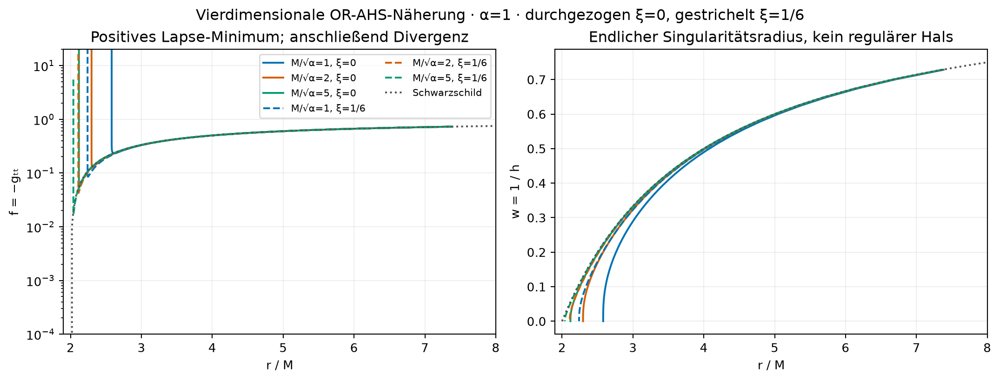

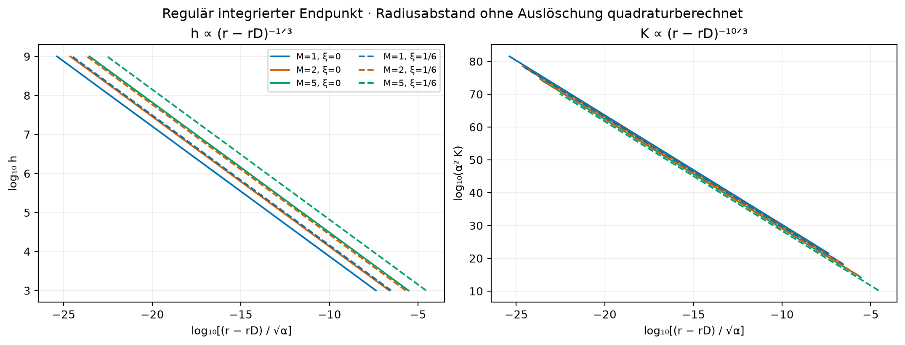

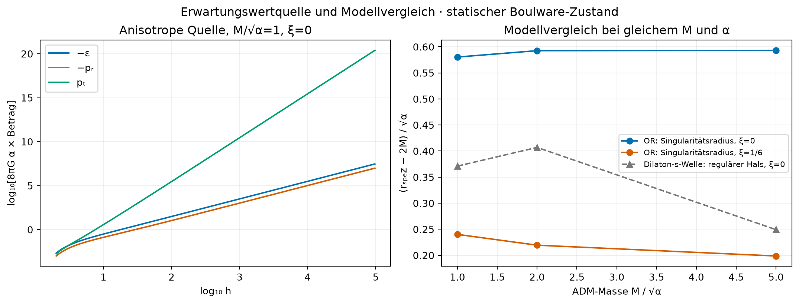

Die [Modenrechnung](work/fourdim_modes.py) setzt die exakten Potentiale auf diese Geometrien und prüft jeweils $l=0,1,5,20$. Positive Quadraturen berechnen kleine Radius- und optische Abstände ohne Subtraktion fast gleicher Zahlen. Die Darstellung zeigt insbesondere den verschwindenden relativen Winkelbeitrag und den Grenzwert $-1/48$ bei konformer Kopplung.

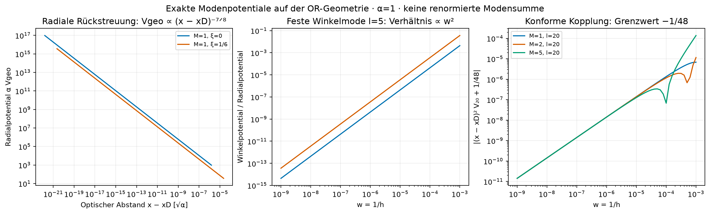

Der Geometrielauf besteht **99 Kontrollen** und archiviert 210 endliche Roharrays; die Modenrechnung besteht **55 Kontrollen** mit 96 weiteren Arrays. Die [Geometriedaten](work/fourdim_numerics_20261018_final.json), [Geometrieroharrays](work/fourdim_numerics_20261018_final.npz), [Modendaten](work/fourdim_modes_20261018_final.json) und [Modenroharrays](work/fourdim_modes_20261018_final.npz) enthalten die genauen Parameter und Hashbindungen. Die größte skalierte Abweichung der verglichenen Koordinatensysteme beträgt $1{,}18\times10^{-11}$; die drei Einstein-Komponenten stimmen bis $8{,}78\times10^{-16}$ mit der Quelle überein. Eine unabhängige finite Druckableitung erreicht einen skalierten Ward-Rest von höchstens $1{,}60\times10^{-11}$. Der zusätzliche unabhängige Integrator weicht im Zustand um höchstens $9{,}02\times10^{-12}$ und in der logarithmischen Krümmung um höchstens $3{,}44\times10^{-11}$ ab. Diese Konvergenzkontrollen sind keine intervallarithmetischen Fehlerzertifikate.

Die Module [FourDimModes.lean](work/lean/FourDimModes.lean), [FourDimSource.lean](work/lean/FourDimSource.lean) und [FourDimEndpoint.lean](work/lean/FourDimEndpoint.lean) enthalten **34 explizite Sätze**. Der Offline-Kernlauf mit Lean 4.30.0 akzeptiert alle drei Module; 90 transitiv auditierte Theorem-Konstanten verwenden ausschließlich `propext`, `Classical.choice` und `Quot.sound`. Das [Kernprotokoll](work/lean/fourdim_proof_verification.json) bindet die vollständigen Satzmengen und Quellenhashes. Formal geprüft sind unter anderem die beiden radialen Einstein-Gleichungen, die tatsächliche Druckableitung und Ward-Identität, die inversen Differentialgleichungen, ein L'Hôpital-Beweis des kubischen Radiusabstands sowie der echte Grenzwert $w^{10}K\to64(L\delta)^4/(81r_D^{12})$ und die daraus folgende Divergenz. Die Endpunktsätze setzen den positiven Radiusgrenzwert ausdrücklich voraus. Der globale Fortsetzungsbeweis, die Herleitung des allgemeinen Riemann-Tensors, die geodätische Interpretation und die Limit-Circle-Klassifikation werden analytisch beziehungsweise unabhängig symbolisch begründet und nicht als vollständig in Lean konstruierte Raumzeit ausgegeben.

Der [unabhängige Prüfer](work/verify_fourdim_research.py) konstruiert Christoffel-Symbole, Riemann-, Ricci- und Einstein-Tensor erneut. Er prüft die Quelle, ihre Erhaltung, die korrigierten Koeffizienten, die Endpunktskalierung, das Anomalie-Gegenbeispiel und die Modenreduktion symbolisch. Ein eigener Integrator entwickelt $r^{-2}$ und $g$ in der inversen Radialkoordinate. Die [Theorienotizen](work/fourdim_theory_notes.md), [Numeriknotizen](work/fourdim_numeric_notes.md) und [Formalisierungsnotizen](work/fourdim_formal_notes.md) ordnen Annahmen und Nachweise zu.

Das [Gesamtprotokoll](work/fourdim_independent_verification_20261018_final.json) bindet Manuskript, Primärtexte, vier PNG/SVG-Abbildungspaare, Roharrays und Beweise. Die vorherige Fassung bleibt im [Snapshot](snapshots/Publikation-vor-vierdimensionaler-quelle-20261018.md) erhalten. Neue Ausgaben lassen sich ohne Überschreiben der archivierten Ergebnisse erzeugen:

```powershell
python work/fourdim_numerics.py --tag neuer_lauf
python work/fourdim_modes.py --input-tag neuer_lauf --tag neue_moden
python work/verify_fourdim_research.py --tag neuer_lauf `
  --modes-tag neue_moden --output-tag neue_pruefung
```

Der Lean-Kernlauf ist mit `python work/lean/check_fourdim_proofs.py` reproduzierbar; das fest benannte Kernprotokoll ist vor einem erneuten Lauf zu archivieren, wenn seine historische Hashbindung erhalten bleiben soll.

## 20. Exakte Spur und relative Modensumme

Die vollständige vierdimensionale Quantenfeldtheorie setzt der Näherung aus Kapitel 19 eine zusätzliche Grenze: Keine ihrer exakten konformen OR-Innenlösungen erfüllt die vollständige semiklassische Spurgleichung, selbst bei beliebiger fester endlicher Krümmungsquadratkopplung. Dieser Ausschluss lässt sich ohne Berechnung des unbekannten zustandsabhängigen Tensoranteils beweisen. Daneben bestimmen wir auf der minimal gekoppelten OR-Geometrie den vollständigen relativen Modenkern zweier innerer Randvakuum-Probleme. Seine gemeinsame Frequenz- und Multipolsumme ist im Inneren endlich und besitzt eine explizite Resthülle.

Die beiden Ergebnisse betreffen unterschiedliche Fragen. Der erste Satz widerlegt eine konkrete konforme Näherungsfamilie als exakte Lösung. Die zweite Rechnung bestimmt, wie eine Änderung der inneren Quantendomäne die Quelle auf derselben festen Geometrie verändert. Weder daraus noch aus der bisherigen Singularität der OR-Gleichungen folgt Singularitätsfreiheit oder eine bereits gefundene neue selbstkonsistente Innengeometrie.

### 20.1 Lokaler Abzug und globaler Zustand

Eine vollständige renormierte Energie-Impulsquelle benötigt die globalen Feldmoden und den lokalen vierdimensionalen Kurzdistanzabzug. Schematisch gilt für einen Hadamard-Zustand

$$\langle T_{\mu\nu}\rangle_{\mathrm{ren}}
=\lim_{X'\to X}\mathscr D_{\mu\nu}
\bigl(G(X,X')-H_{\mathrm{Had}}(X,X')\bigr)
+\mathcal L_{\mu\nu}.$$

Der Operator $\mathscr D_{\mu\nu}$ enthält die zur Feldtheorie gehörenden Ableitungen; $\mathcal L_{\mu\nu}$ bezeichnet die festgelegte lokale Ergänzung. Das Parametrix $H_{\mathrm{Had}}$ ist aus der Geometrie aufgebaut. Der Green-Kern $G$ hängt zusätzlich vom Zustand und den globalen Randbedingungen ab. Bei einer Änderung der rückwirkenden Geometrie müssen beide Anteile neu berechnet werden.

Das Modensummenverfahren von Taylor, Breen und Ottewill führt den Hadamard-Abzug für den Tensor aus; seine konkrete Anwendung behandelt Hartle–Hawking-Zustände und perturbative Rückwirkung auf Schwarzschild [TBO2022]. Levi und Ori demonstrieren die direkte Lorentzsche Modensummenregularisierung zunächst anhand der Boulware-Vakuumpolarisation; bei Frequenzintegralen müssen auch die durch entfernte Nullgeodäten erzeugten Oszillationen berücksichtigt werden [LO2015]. Diese Verfahren zeigen, welche zusätzlichen Informationen über eine lokale analytische Quelle hinaus erforderlich sind.

Für die statische Metrik aus Kapitel 19,

$$ds^2=f(r)(-dt^2+dx^2)+r^2d\Omega^2,
\qquad \frac{dx}{dr}=\sqrt{\frac hf},$$

lautet der vollständige radiale Feldoperator

$$H_l=-\frac{d^2}{dx^2}+V_l,\qquad
V_l=\frac{r_{xx}}r+
f\left[\frac{l(l+1)}{r^2}+\xi\mathcal R\right].$$

Die Winkelentartung ist $2l+1$. Eine statische Positivfrequenzzerlegung bestimmt erst dann einen Grundzustand, wenn auch der selbstadjungierte Definitionsbereich von $H_l$ und die Nichtnegativität seines Spektrums feststehen. Am zeitartigen OR-Innenrand besteht die in Abschnitt 19.4 nachgewiesene Limit-circle-Mehrdeutigkeit. Die Bezeichnung „Boulware“ allein wählt dort keine innere Randbedingung aus [HM1995].

### 20.2 Die vollständige Spurbedingung

Wir verwenden weiterhin Signatur $(-,+,+,+)$, $\Lambda=0$ und $N$ identische reelle masslose Felder. Setze

$$Q=K-R_{\mu\nu}R^{\mu\nu},\qquad
L=\frac{GN\hbar}{16\pi},\qquad
\alpha=\frac{GN\hbar}{12\pi}.$$

Für konforme Kopplung $\xi=1/6$ ist die lokale Spur zustandsunabhängig:

$$\langle T^\mu{}_\mu\rangle_{\mathrm{ren}}
=\frac{N\hbar}{2880\pi^2}
\bigl(Q+b\Box\mathcal R\bigr).$$

Hier bezeichnet $b$ den gesamten festen Koeffizienten nach Wahl der endlichen lokalen Gravitationskopplungen. Die Hadamard-Konvention in [TBO2022] hat vor einer zusätzlichen endlichen $R^2$-Verschiebung $b=1$. Eine solche Verschiebung ändert den $\Box\mathcal R$-Term; die Variation des Weylquadrats ist tracelos. Eine bloße Änderung der Renormierungsbeschreibung mit kompensierender Änderung der Gravitationskopplungen beschreibt dieselbe physische Gleichung. Ein radiusabhängig angepasstes $b$ wäre dagegen kein zulässiger fester Gegenparameter.

Der folgende Ausschluss bezieht sich auf Einstein-Gravitation mit den üblichen lokalen Krümmungsquadrattermen; zusätzliche unabhängige höhere EFT-Operatoren würden die zugrunde gelegte Feldgleichung ändern.

Die Spur von $G_{\mu\nu}=8\pi G\langle T_{\mu\nu}\rangle_{\mathrm{ren}}$ verlangt notwendig

$$\boxed{\mathcal E_b:=
\mathcal R+\frac{\alpha}{30}
\bigl(Q+b\Box\mathcal R\bigr)=0.}$$

Diese Gleichung gilt an jedem glatten inneren Beobachtungspunkt, unabhängig von der Wahl eines zulässigen konformen Hadamard-Zustands. Sie ist eine notwendige Bedingung, keine Rekonstruktion des gesamten Tensors.

Für minimale Kopplung gilt eine andere Spur. Bezeichne $W$ die renormierte Vakuumpolarisation, summiert über die $N$ Felder. Aus den Hadamard-Koinzidenzidentitäten folgt für masslose Felder

$$\langle T^\mu{}_\mu\rangle_{\mathrm{ren}}
=3\left(\xi-\frac16\right)\Box W+
\frac{N\hbar}{2880\pi^2}\mathcal P_\xi,$$

$$\mathcal P_\xi=
Q+(6-30\xi)\Box\mathcal R+
90\left(\xi-\frac16\right)^2\mathcal R^2,$$

zuzüglich einer festgelegten endlichen $\Box\mathcal R$-Verschiebung [TBO2022, Gleichungen (12), (15)]. Bei $\xi=0$ bleibt also der zustandsabhängige Beitrag $-\Box W/2$. Der folgende konforme Ausschlusssatz darf deshalb nicht auf die minimale Feldtheorie übertragen werden.

### 20.3 Ausschluss der konformen OR-Familie

Für die exakte OR-Familie sei wie in Kapitel 19

$$w=\frac1h,\qquad
\delta=\frac{11}{60}-\xi>0,\qquad
r(w)\longrightarrow r_D>0.$$

Die Lösung hat einen regulären inneren $w$-Chart mit $r-r_D=O(w^3)$. Um Ableitungen bloß formaler führender Potenzen zu vermeiden, berechnen wir die Invarianten zuerst aus der exakten rationalen Geometrie. Mit $j=f'/f$ und $H=w'$ lauten die orthonormalen Krümmungsgrößen

$$A_c=\frac w2j'+\frac w4j^2+\frac H4j,\qquad
B_c=\frac{wj}{2r},$$

$$C_c=\frac H{2r},\qquad S_c=\frac{1-w}{r^2}.$$

Daraus folgen

$$\mathcal R=-2A_c-4B_c-4C_c+2S_c,$$

$$K=4(A_c^2+2B_c^2+2C_c^2+S_c^2),$$

$$R_{\mu\nu}R^{\mu\nu}
=(A_c+2B_c)^2+(A_c+2C_c)^2
+2(S_c-B_c-C_c)^2.$$

Für den statischen Skalar ist außerdem

$$\Box\mathcal R=
w\mathcal R''+
\left(\frac{2w}{r}+\frac{wj+H}{2}\right)\mathcal R'.$$

Die Ableitungen werden entlang der exakten OR-Lösung ausgeführt. Die anschließende Laurent-Entwicklung ergibt

$$\mathcal R=
-\frac{8L^2\delta^2}{9r^6}w^{-5}+O(w^{-4}),$$

$$Q=\frac{32L^4\delta^4}{81r^{12}}w^{-10}
+\frac{4L^4\delta^3(44\delta+1)}{81r^{12}}w^{-9}
+O(w^{-8}),$$

$$\Box\mathcal R=
-\frac{920L^4\delta^4}{27r^{12}}w^{-10}
-\frac{460L^4\delta^3(12\delta+1)}{81r^{12}}w^{-9}
+O(w^{-8}).$$

Weil $r-r_D=O(w^3)$ gilt, verändert die Ersetzung von $r$ durch $r_D$ die beiden angegebenen führenden Koeffizienten von $Q$ und $\Box\mathcal R$ nicht.

Der Term der Ordnung $w^{-10}$ in $Q+b\Box\mathcal R$ verschwindet ausschließlich für

$$b_*=\frac4{345}.$$

Für jedes $b\ne b_*$ widerspricht bereits dieser Term der vollständigen Spurgleichung, denn $\mathcal R=O(w^{-5})$ ist zu schwach, um ihn auszugleichen. Bei $b=b_*$ bleibt

$$Q+b_*\Box\mathcal R=
\frac{4L^4\delta^3(84\delta-1)}
{243r_D^{12}}w^{-9}+O(w^{-8}).$$

Die konforme OR-Lösung hat $\delta=1/60$. Damit folgt der streng positive Grenzwert

$$\lim_{w\downarrow0}
w^9\bigl(Q+b_*\Box\mathcal R\bigr)
=\frac{L^4}{32805000\,r_D^{12}}>0.$$

**Satz.** Keine exakte konforme OR-Innenlösung aus Kapitel 19 mit $L>0$ erfüllt die vollständige masslose konforme semiklassische Spurgleichung in einer ganzen offenen Umgebung ihres inneren Endes, für irgendein konstantes endliches $b$.

**Beweis.** Angenommen, $\mathcal E_b=0$ gelte dort. Für $b\ne b_*$ multiplizieren wir mit $w^{10}$ und bilden den Grenzwert. Der Ricci-Anteil verschwindet, der verbleibende Anomaliekoeffizient ist ungleich null. Für $b=b_*$ verwenden wir stattdessen $w^9$; der eben berechnete positive Grenzwert bleibt. Beide Fälle widersprechen $\mathcal E_b=0$.

Andere konforme Hadamard-Zustände ändern diese Schlussfolgerung nicht, weil ihre Tensorunterschiede tracelos sind. Der Satz betrifft die konkrete exakte OR-Familie einschließlich ihrer nächstführenden Koeffizienten. Er schließt bei $b=b_*$ nicht alle anderen Geometrien mit denselben führenden Potenzen aus. Insbesondere beweist er weder die Auflösung einer Singularität noch eine andere bestimmte Endpunktform.

### 20.4 Zwei innere Quantendomänen

Für die relative spektrale Rechnung betrachten wir nun die **minimale** OR-Geometrie mit $\xi=0$, $M=1$ und $\alpha=1$. Die optische Koordinate beginnt am inneren Rand bei $x=0$. Am endlichen äußeren Flächenradius $R_{\mathrm{out}}$ liegt $x=X$. Beide Vergleichsprobleme erfüllen dort dieselbe Randbedingung

$$\psi_x(X)=0.$$

Dies ist Neumann für das reduzierte Feld $\psi=r\Phi$. Für $\Phi$ entspricht es am äußeren Rand der Bedingung $\Phi_x=-(r_x/r)\Phi$. Der Hauptlauf verwendet $R_{\mathrm{out}}=200$; die Rechnungen mit $400$ und $800$ prüfen getrennt die Empfindlichkeit gegenüber dieser äußeren Wand. Eine endliche gemeinsame Wand ist keine exakte Quelle im unendlichen asymptotisch flachen Außenraum.

Am inneren Ende vergleichen wir

$$D:\ \psi(0)=0,\qquad
N:\ \psi_x(0)=0.$$

Die exakte OR-Geometrie liefert

$$V_0=
\frac{f(1-w)}{r^2}
+\frac{fL(1-w)^2}{2r^4w^2}\mathcal C(w),$$

$$\mathcal C(w)=
\frac{2\delta}{3}+\frac{w}{15}
+\left(2\delta+\frac35\right)w^2>0.$$

Folglich ist $V_l=V_0+f\,l(l+1)/r^2>0$. Für jedes feste $l$ ist das innere Potential lokal integrierbar: Der stärkste Term verhält sich wie $x^{-7/8}$. Beide inneren Randbedingungen sind daher wohldefiniert. Zusammen mit der gemeinsamen äußeren Neumannbedingung erzeugen sie positive selbstadjungierte Operatoren auf dem endlichen Intervall. Die entsprechenden statischen Vakuumprobleme enthalten keine negative Eigenmode.

Für $\kappa\ge0$ sei $q_{\kappa l}$ die positive Lösung

$$q_{xx}=(\kappa^2+V_l)q,\qquad q_x(X)=0,$$

normiert durch $q(0)=1$. Definiere

$$\zeta(x)=-\frac{q_x(x)}{q(x)},\qquad
\zeta_x=\zeta^2-\kappa^2-V_l,\qquad \zeta(X)=0.$$

Positivität des Potentials gibt $\zeta(x)>0$ für $x<X$. Wählen wir die linke Dirichlet-Lösung mit Anfangsdaten $(0,1)$ und die Neumann-Lösung mit $(1,0)$, folgt aus dem konstanten Wronskian der exakte Resolventunterschied

$$\boxed{\Delta g_{\kappa l}(x,y)
=g_N-g_D=
\frac{q_{\kappa l}(x)q_{\kappa l}(y)}
{\zeta_{\kappa l}(0)}.}$$

Der Kern hängt also tatsächlich von der inneren Domäne ab. Allgemeiner ergibt die Robin-Bedingung $\psi_x(0)=\gamma\psi(0)$, $\gamma\ge0$, denselben Zähler mit Nenner $\zeta(0)+\gamma$. Die Diagonalkorrektur fällt streng mit $\gamma$.

### 20.5 Die vollständige relative Summe

Das Additionstheorem der Kugelflächenfunktionen und die gerade euklidische Frequenzintegration ergeben

$$\Delta G_E=
\frac{N\hbar}{4\pi^2r(x)r(y)}
\sum_{l=0}^{\infty}(2l+1)P_l(\cos\vartheta)
\int_0^\infty
\cos(\kappa\Delta\tau)\,
\Delta g_{\kappa l}(x,y)\,d\kappa.$$

Hier ist $\Delta=N-D$; für mehrere Felder bezeichnet der Ausdruck die Summe ihrer Korrelatoren. Die kontinuierliche euklidische Integration bleibt auch bei diskretem reellem Boxspektrum gültig: Sie ist die Resolventdarstellung des Grundzustandskorrelators. Bei Koinzidenz folgt

$$\Delta W(x)=
\frac{N\hbar}{4\pi^2r(x)^2}
\sum_{l=0}^{\infty}(2l+1)
\int_0^\infty \mathscr K_{\kappa l}(x)\,d\kappa,$$

$$\mathscr K_{\kappa l}(x)=
\frac{q_{\kappa l}(x)^2}{\zeta_{\kappa l}(0)}>0.$$

Es werden sämtliche Winkelmultipletts erfasst. Die beiden Probleme besitzen denselben lokalen Kurzdistanzabzug und dieselben endlichen Gegenterme; diese fallen in der Differenz weg. Die Endlichkeit wird zusätzlich durch eine gemeinsame Spektralabschätzung bewiesen.

Fixiere einen inneren Probenpunkt $x_p>0$, mit Geometriewerten $w_p,r_p,f_p$ und $g=\log f+\frac13\log w$. Für $\delta=11/60$ folgt aus dem exakten OR-System

$$g_w\ge-\frac{40}{33}.$$

Auf $0<x\le x_p$ gelten deshalb die expliziten positiven unteren Schranken

$$c_1=
\frac{\exp(g_D-40w_p/33)\,w_p^{-1/3}}{r_p^2},
\qquad c_0=c_1(1-w_p),$$

$$\frac f{r^2}\ge c_1,\qquad V_0\ge c_0.$$

Mit

$$\mu=\sqrt{\kappa^2+c_0+c_1l(l+1)}$$

liefert der Vergleich mit dem konstanten Potential, unter Benutzung von $q_x(x_p)\le0$,

$$q(x_p)\le\operatorname{sech}(\mu x_p),\qquad
\zeta(0)\ge\mu\tanh(\mu x_p).$$

Die zweite Ungleichung folgt auch aus der Energieidentität auf $[0,x_p]$ und dem Minimum von $\int(u'^2+\mu^2u^2)\,dx$ bei $u(0)=1$ und freiem rechten Rand. Somit gilt

$$\mathscr K_{\kappa l}(x_p)
\le C_*e^{-a\kappa}z^l,$$

$$C_*=\frac4{\sqrt{c_0}\tanh(x_p\sqrt{c_0})},
\quad a=\sqrt2x_p,\quad
z=e^{-\sqrt{2c_1}x_p}<1.$$

Der Faktor vier darf bei der gemeinsamen äußeren Neumannwand nicht entfallen. Schon für konstantes Potential ist die Lösung ein Quotient von Kosinus-hyperbolicus-Funktionen und keine einzelne abfallende Exponentialfunktion.

Die Hülle gilt gemeinsam für Frequenz und Multipol, einschließlich $\kappa=l=0$. Beispielsweise sind die ausgelassenen Reste durch

$$\sum_{l=0}^{\infty}(2l+1)
\int_{\kappa_{\max}}^\infty\mathscr K_{\kappa l}\,d\kappa
\le\frac{C_*}{a}e^{-a\kappa_{\max}}
\frac{1+z}{(1-z)^2}$$

und

$$\sum_{l=J+1}^{\infty}(2l+1)
\int_0^\infty\mathscr K_{\kappa l}\,d\kappa
\le\frac{C_*}{a}
\frac{z^{J+1}[(2J+3)-(2J+1)z]}{(1-z)^2}$$

beschränkt. Der Vorfaktor $N\hbar/(4\pi^2r_p^2)$ wird für $\Delta W$ zusätzlich eingesetzt. Damit ist die unendliche relative vierdimensionale Summe mathematisch kontrolliert; die Konvergenz wird nicht allein aus dem scheinbaren Abklingen einiger berechneter Moden geschlossen.

### 20.6 Relative Energie und Erhaltung

Für die Tensorableitungen definieren wir am Probenpunkt die lineare Summenoperation

$$\mathcal I[A]=
\frac{N\hbar}{4\pi^2r_p^2}
\sum_{l=0}^{\infty}(2l+1)
\int_0^\infty A_{\kappa l}\,
\mathscr K_{\kappa l}(x_p)\,d\kappa,$$

sowie $c=r_x/r$ und $\zeta_p=\zeta(x_p)$. Die drei orthonormalen Gradientenbeiträge lauten

$$E_t=\mathcal I\!\left[-\frac{\kappa^2}{f_p}\right],\qquad
E_r=\mathcal I\!\left[\frac{(\zeta_p+c)^2}{f_p}\right],$$

$$E_\Omega=\mathcal I\!\left[\frac{l(l+1)}{r_p^2}\right].$$

Das negative Vorzeichen des Zeitbeitrags folgt aus der Wick-Rotation beider Zeitableitungen. Eine Differenz von Erwartungswerten ist selbst kein positives Gradientenquadrat. Die minimalen Tensoränderungen ergeben sich zu

$$\Delta\varepsilon=\frac12(E_t+E_r+E_\Omega),$$
$$\Delta p_r=\frac12(E_t+E_r-E_\Omega),\qquad
\Delta p_t=\frac12(E_t-E_r).$$

Die vollständigen Winkelmultipletts verteilen $E_\Omega$ gleich auf beide tangentialen Richtungen. Die Quelle erfüllt im Inneren die exakten Prüfidentitäten

$$\Delta T^\mu{}_\mu
=-\frac12\Box\Delta W,$$

$$\partial_x\Delta p_r+
\frac{f_x}{2f}(\Delta\varepsilon+\Delta p_r)
+\frac{2r_x}{r}(\Delta p_r-\Delta p_t)=0.$$

Für eine sichere Stressresthülle wird zusätzlich eine obere Schranke für $\zeta_p$ benötigt. Die minimale OR-Geometrie erfüllt auf dem äußeren Abschnitt

$$f(r)\le F_{\max}:=
f_p\exp\!\left(\frac{1-w_p}{w_p}\right).$$

Daher sind

$$B_1=\frac{F_{\max}}{r_p^2},$$

$$B_0=F_{\max}\left[
\frac{1-w_p}{r_p^2}
+\frac{L(1-w_p)^2(8\delta/3+2/3)}
{2r_p^4w_p^2}\right]$$

obere Schranken für die beiden Potentialkoeffizienten. Aus der äußeren Neumannbedingung folgt durch Riccati-Vergleich

$$\zeta_p^2\le\kappa^2+B_0+B_1l(l+1).$$

Jeder Betrag eines diagonalen Tensorintegranden wird damit durch

$$\left[
\frac{B_0+c^2}{f_p}
+\frac{3\kappa^2}{2f_p}
+\left(\frac{B_1}{f_p}+\frac1{2r_p^2}\right)l(l+1)
\right]\mathscr K_{\kappa l}$$

beschränkt. Polynome in $\kappa$ und $l$ bleiben unter der gemeinsamen exponentiellen Hülle integrierbar und summierbar. Dasselbe Argument auf kompakten inneren Umgebungen kontrolliert die benötigten Koinzidenzableitungen. Die lokalen Tensorunterschiede sind daher endlich.

Ein unabhängiger ebener Grenztest kontrolliert Normierung und Vorzeichen. Für den vierdimensionalen flachen Halbraum ergibt Neumann minus Dirichlet

$$\Delta W=\frac{N\hbar}{8\pi^2x^2},\qquad
\Delta\varepsilon=\frac{N\hbar}{8\pi^2x^4},$$

$$\Delta p_{\mathrm{normal}}=0,\qquad
\Delta p_{\mathrm{tangential}}
=-\frac{N\hbar}{8\pi^2x^4}.$$

Die Spur ist genau $-\frac12\partial_x^2\Delta W$. Dieser Test verwendet keine numerisch erzeugte gekrümmte Geometrie.

### 20.7 Bedeutung für die Rückwirkung

Für die geometrische Massenfunktion $m(r)$, mit $h=(1-2m/r)^{-1}$, lauten die exakten statischen Einstein-Gleichungen

$$m'=4\pi G r^2\varepsilon,\qquad
\frac{f'}f=
\frac{2[m+4\pi G r^3p_r]}{r(r-2m)}.$$

Die Größen $\varepsilon,p_r,p_t$ müssen dabei der vollständige Tensor auf derselben gesuchten Geometrie sein. Die relative Rechnung bestimmt nur den Unterschied zweier Quellen; ein gemeinsamer absoluter Anteil bleibt unbestimmt. Ihre Einsetzung als alleinige Einstein-Quelle würde das physische Problem verändern.

Auch Erhaltung und Spuranomalie schließen die absolute Quelle nicht. Mit $\tau=-\varepsilon+p_r+2p_t$ und $j=f'/f$ wird die Ward-Identität zu

$$p_r'+\left(\frac j2+\frac3r\right)p_r
=\left(\frac1r-\frac j2\right)\varepsilon+\frac{\tau}{r}.$$

Selbst bei vorgegebener Spur bleibt die Funktion $\varepsilon(r)$ lokal unbestimmt. Erst der globale Quantenzustand und seine vollständige renormierte Modensumme liefern diese fehlende Information.

Der konforme Ausschlusssatz erzwingt daher eine Änderung gegenüber der exakten OR-Innenfamilie. Die minimale relative Rechnung belegt unabhängig davon eine mathematisch bestimmbare Abhängigkeit lokaler Quellgrößen von der inneren Quantendomäne. Die Auswahl einer physikalischen inneren Domäne, die absolute renormierte Quelle und eine neue vollständig selbstkonsistente Innengeometrie sind durch diese beiden Ergebnisse nicht bestimmt. Eine Aussage über die endgültige Singularitätsstruktur der vollständigen Theorie wäre deshalb weitergehend als die hier bewiesenen Resultate.

### 20.8 Numerische Gegenprüfungen

Die [Spurrechnung](work/fullrset_numerics.py) wertet die konformen OR-Geometrien für $M/\sqrt\alpha=1,2,5$ mit $\alpha=1$ aus. Sie besteht **44 festgelegte Kontrollen** und archiviert 156 endliche Roharrays. Die nächstführende Kombination bei $b=b_*$ wird vor der numerischen Auswertung symbolisch gebildet, um Auslöschung zweier großer führender Terme zu vermeiden. Eine unabhängige Fünfpunktableitung kontrolliert den vollständigen $\Box\mathcal R$-Operator; der kleinste gemeinsame Differenzenschritt liefert einen maximalen skalierten Fehler von $1{,}28\times10^{-10}$.

Eine anschauliche Diagnose ist der lokal zum Spurausgleich erforderliche Wert

$$b_{\mathrm{erf}}(r)=
\frac{-30\mathcal R/\alpha-Q}{\Box\mathcal R}.$$

Wo der Nenner nicht verschwindet, folgt für die konforme OR-Familie $b_{\mathrm{erf}}=b_*(1+w)+O(w^2)$. Der verbleibende Ortsverlauf ist kein zulässiger konstanter Renormierungsparameter. Die Abbildungen zeigen sowohl die unterschiedlichen Divergenzordnungen als auch den nichtverschwindenden Rest nach führender Kompensation.

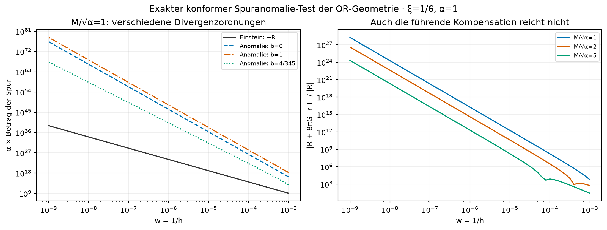

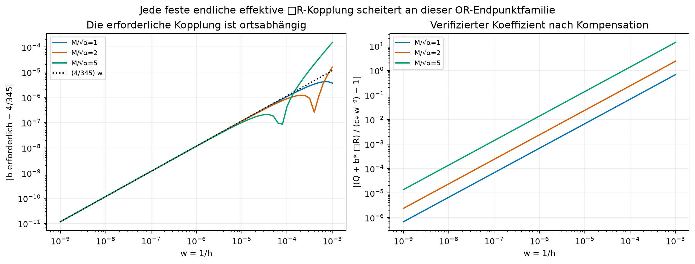

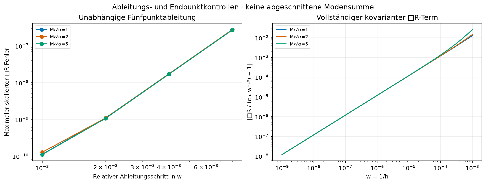

Der [unabhängige Geometrieprüfer](work/verify_fullrset_geometry.py) konstruiert Christoffel-Symbole, Riemann- und Ricci-Tensor unmittelbar aus der vierdimensionalen Metrik. Schwarzschild und de Sitter kontrollieren die Konvention. Ohne Import des Produzenten werden beide Laurent-Ordnungen und der flache Randbenchmark erneut berechnet. **78 Kontrollen** bestehen; der maximale skalierte Unterschied zu den archivierten Krümmungswerten beträgt $1{,}45\times10^{-13}$. [Spurprotokoll](work/fullrset_numerics_20261018_final.json), [Roharrays](work/fullrset_numerics_20261018_final.npz) und [unabhängiger Beleg](work/fullrset_geometry_verification_20261018.json) enthalten Parameter, Ergebnisse und Hashbindungen.

Die [relative Spektralrechnung](work/fullrset_spectral.py) verwendet die minimale Geometrie mit $M/\sqrt\alpha=1$. Sie integriert die Riccati-Gleichung und $\partial_x\log q=-\zeta$ vom gemeinsamen äußeren Rand nach innen. Der reguläre Chart $z=w^{1/3}$ hält die Produkte $V_l\,dx/dz$ am inneren Ende endlich. Im Hauptlauf werden $l=0,\ldots,128$ und 128 Gaußpunkte in der quadratischen Frequenzkoordinate $\kappa=16t^2$, $0<t<1$, ausgewertet. Die maximale Frequenz ist $\kappa_{\max}\sqrt\alpha=16$. Die ODE-Toleranz beträgt $2\times10^{-12}$. Der ausgelassene unendliche Rest wird mit der gemeinsamen analytischen Hülle abgeschätzt.

Für $R_{\mathrm{out}}/\sqrt\alpha=200$ ergeben sich folgende Werte. Die Tabelle gibt $\alpha\Delta W/(N\hbar)$ beziehungsweise $\alpha^2\Delta T/(N\hbar)$ an; $\Delta=N-D$.

| $r/\sqrt\alpha$ | $\Delta W$ | $\Delta\varepsilon$ | $\Delta p_r$ | $\Delta p_t$ |
|---:|---:|---:|---:|---:|
| 3 | $8{,}461923\times10^{-3}$ | $1{,}004651\times10^{-2}$ | $1{,}900441\times10^{-3}$ | $-1{,}009081\times10^{-2}$ |
| 4 | $7{,}701308\times10^{-4}$ | $1{,}334816\times10^{-4}$ | $5{,}735583\times10^{-5}$ | $-1{,}443521\times10^{-4}$ |
| 6 | $1{,}158825\times10^{-4}$ | $4{,}634236\times10^{-6}$ | $3{,}158409\times10^{-6}$ | $-5{,}629510\times10^{-6}$ |

Die Tensoränderung ist anisotrop; insbesondere ist der tangentiale Druckunterschied negativ. Es handelt sich um eine berechnete Quellenänderung bei festgehaltener Geometrie und festem äußeren Regulator.

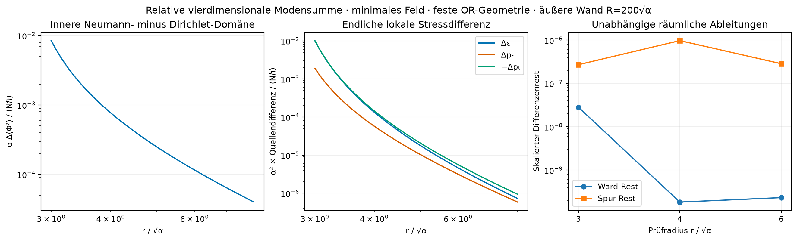

Die Variation $l_{\max}=64\to128$ ändert die vier Tabellenwerte um höchstens $5{,}404\times10^{-9}$ relativ, die Frequenzverfeinerung $80\to128$ um höchstens $6{,}963\times10^{-9}$ und die Verschärfung der Solver-Toleranz um höchstens $4{,}148\times10^{-9}$. Gesonderte Außenrechnungen bei $R_{\mathrm{out}}/\sqrt\alpha=400,800$ verwenden jeweils $l=0,\ldots,48$, 128 Frequenzpunkte und die ODE-Toleranz $2\times10^{-9}$. Der Vergleich des Hauptlaufs bei $200$ mit der Rechnung bei $400$ ändert somit zugleich Modenzahl und Toleranz; seine größte relative Abweichung liegt unter $7{,}154\times10^{-4}$. Der Vergleich $400\to800$ hält diese Recheneinstellungen fest und ergibt höchstens $1{,}821\times10^{-4}$. Diese Außenradiuskontrolle beweist keinen exakten Grenzwert $R_{\mathrm{out}}\to\infty$.

| $r/\sqrt\alpha$ | Resthülle für $\alpha\Delta W/(N\hbar)$ | Resthülle für jede diagonale $\alpha^2\Delta T/(N\hbar)$ |
|---:|---:|---:|
| 3 | $5{,}141\times10^{-14}$ | $1{,}223\times10^{-9}$ |
| 4 | $7{,}483\times10^{-21}$ | $2{,}704\times10^{-17}$ |
| 6 | $2{,}369\times10^{-21}$ | $2{,}456\times10^{-18}$ |

Die Resthüllen gelten für die Vereinigung der ausgelassenen Frequenzen und Multipole; der überlappende Bereich wird konservativ doppelt gezählt. Sie betreffen die Spektraltrunkierung. Quadratur, ODE-Integration und endlicher Außenradius werden durch die getrennten Verfeinerungen kontrolliert.

Fünfpunktableitungen der numerisch berechneten lokalen Größen mit $\Delta r/\sqrt\alpha=0{,}003$ und $0{,}0015$ prüfen Erhaltung und minimale Spur unabhängig von den algebraischen Tensorformeln. Nach Skalierung mit $|\Delta\varepsilon|+|\Delta p_r|+|\Delta p_t|$ erreichen die Ward-Reste höchstens $2{,}820\times10^{-8}$ und die Spurreste höchstens $9{,}725\times10^{-7}$. Der Spektrallauf besteht **10 Kontrollen** und speichert 147 endliche Roharrays.

Ein [zweiter Green-Prüfer](work/verify_fullrset_green.py) integriert die Geometrie unabhängig und löst anschließend sechs direkte lineare Systeme für $(q,q_x)$ statt einer Riccati-Gleichung. Die beiden ausgewählten archivierten Frequenzen liegen nahe $0{,}05/\sqrt\alpha$ und $0{,}2/\sqrt\alpha$, jeweils bei $l=0,2,5$. An den drei Tabellenradien bestehen **9 Kontrollen** mit 18 Kernvergleichen. Die maximale relative Kernabweichung beträgt $2{,}649\times10^{-11}$. [Spektralprotokoll](work/fullrset_spectral_20261018_verified.json), [Spektralroharrays](work/fullrset_spectral_20261018_verified.npz) und [linearer Gegencheck](work/fullrset_green_verification_20261018_verified.json) binden die tatsächlich geprüften Daten.

### 20.9 Formale Nachweise

Die vier Module [FullRSETTrace.lean](work/lean/FullRSETTrace.lean), [FullRSETGreen.lean](work/lean/FullRSETGreen.lean), [FullRSETLocal.lean](work/lean/FullRSETLocal.lean) und [FullRSETUV.lean](work/lean/FullRSETUV.lean) enthalten **41 ausdrücklich benannte Sätze**. Der Offline-Lauf bestätigt **59 auditierte Theorem-Konstanten** mit **KernelAccepted**; verwendet werden Lean 4.30.0 und ausschließlich die Grundlagenaxiome `propext`, `Classical.choice` und `Quot.sound`; der [Prüfbeleg](work/lean/fullrset_proof_verification.json) enthält die Aussagen, Quellenhashes und Axiomenlisten.

Formal geprüft werden der Spurenwiderspruch aus den ausdrücklich angegebenen geometrischen Grenzwerten, tatsächliche Wronskian- und Green-Kern-Ableitungen einschließlich Sprungnormierung, die Abhängigkeit von Robin-Randdaten sowie das Wegfallen gemeinsamer lokaler Subtraktionen unter expliziten Regularitätsannahmen. Für die gemeinsame exponentielle Majorante beweist Lean die Integrabilität und Summierbarkeit der unendlichen Frequenz- und Winkelausdrücke. Die Gewinnung der OR-Koeffizienten aus der vollständigen Geometrie und der konkrete Vergleichssatz für die radialen Lösungen sind die vorstehenden analytischen beziehungsweise unabhängigen symbolischen Rechnungen; sie werden nicht als bereits formal konstruierte Hadamard-Renormierung ausgegeben.

Die analytischen Spektralhüllen gelten auf der exakten Geometrie. Ihre Auswertung mit numerisch bestimmten Geometriekonstanten ist von einer Intervallzertifizierung sämtlicher Geometrie-, ODE- und Quadraturfehler zu unterscheiden. Die äußere Wandvariation ist eine weitere, von den Frequenz- und Multipolresten getrennte Kontrolle.


Das [Gesamtprotokoll](work/fullrset_independent_verification_20261018_verified.json) prüft die Quellen- und Datenbindungen, berechnet die relativen Tensorwerte aus den Rohkernen erneut und kontrolliert Vorgängerartefakte, Manuskriptverweise und Formelsyntax. [Theorie](work/fullrset_theory_notes.md), [Numerik](work/fullrset_numeric_notes.md), [spektraler Fachreview](work/fullrset_spectral_review.md) und [Formalisierung](work/fullrset_formal_notes.md) dokumentieren die Zuordnung. Kapitel 1–19 bleiben unverändert; die frühere Publikation ist im [Snapshot](snapshots/Publikation-vor-vollstaendiger-modensumme-20261018.md) erhalten.

Neue numerische Ausgaben verwenden neue Tags, damit die archivierten Ergebnisse erhalten bleiben:

```powershell
python work/fullrset_numerics.py --tag neuer_spurlauf
python work/fullrset_spectral.py --tag neuer_spektrallauf
python work/verify_fullrset_research.py --output-tag neue_archivpruefung
```

Der letzte Befehl prüft die fest benannten archivierten Referenzläufe erneut. Der Lean-Kernlauf ist mit `python work/lean/check_fullrset_proofs.py` reproduzierbar; vor dessen Wiederholung ist das fest benannte Kernprotokoll zur Erhaltung seiner historischen Hashbindung zu archivieren.

## 21. Massive Bohm-Bahnen

Die massive Diracgleichung lässt sich auf einer vorgegebenen gekrümmten Raumzeit mit einer kausalen Bohmschen Führung verbinden. Dieses Kapitel konstruiert einen zeitabhängigen, normierten Testzustand auf Schwarzschild, einschließlich eines echten vierdimensionalen Winkelkanals. Die Rechnung ergänzt die flachen massiven Modelle aus Kapitel 3 und das masslose zweidimensionale Modell aus Abschnitt 16.6. Die Geometrie wird festgehalten; die hier berechnete Einteilchenentwicklung ist keine renormierte Quantenfeldquelle für die Einstein-Gleichung.

### 21.1 Geometrie und Diracoperator

Mit $c=\hbar=1$, geometrischem Schwarzschildparameter $M>0$ und Diracmasse $\mu>0$ verwenden wir einfallende Painlevé–Gullstrand-Koordinaten:

$$ds^2=-dT^2+(dr+v\,dT)^2+r^2d\Omega^2,
\qquad v(r)=\sqrt{\frac{2M}{r}},\qquad v'=-\frac{v}{2r}.$$

Die Flächen $T=\mathrm{const}$ haben das euklidische räumliche Volumenmaß $r^2\,dr\,d\Omega$. Die orthonormale Zeitrichtung ist $e_0=\partial_T-v\partial_r$. In einer kartesisch orientierten Diracframe lautet der volle Hamiltonoperator

$$H_4=-i\boldsymbol\alpha\cdot\boldsymbol\nabla+\mu\beta
+iv\left(\partial_r+\frac{3}{4r}\right).$$

Dieser Operator folgt aus der kovarianten Diracgleichung einschließlich Spinverbindung; er stimmt mit [Lasenby2005, Doran2005] und dem unabhängigen PG-Ausdruck in Anhang D von [DolanDempsey2015] überein. Die einfallende Verschiebung bestimmt das Vorzeichen. Alle Koeffizienten sind am Horizont $r=2M$ regulär.

Für eine normierte Spinorkugelfunktion $\eta_\kappa^{m_j}$ setzen wir

$$\Psi_4(T,r,\theta,\phi)=\frac1r
\begin{pmatrix}u_1(T,r)\eta_\kappa^{m_j}(\theta,\phi)\\
u_2(T,r)\sigma_r\eta_\kappa^{m_j}(\theta,\phi)\end{pmatrix},
\qquad (\boldsymbol\sigma\cdot\mathbf L+1)\eta_\kappa^{m_j}
=\kappa\eta_\kappa^{m_j}.$$

Hier gilt $\kappa=\pm1,\pm2,\ldots$. Der Faktor $1/r$ entfernt das radiale Volumenmaß. Winkeltrennung und der konstante unitäre Basiswechsel $\psi=Wu$, $W=(\sigma_1+\sigma_3)/\sqrt2$, ergeben

$$i\partial_T\psi=H_\kappa\psi,\qquad
H_\kappa=-i(\sigma_3-vI)\partial_r+\frac{iv'}2I
+\mu\sigma_1-\frac\kappa r\sigma_2.$$

Der Winkelterm $-\kappa\sigma_2/r$ ist auch im niedrigsten tatsächlichen Dirackanal vorhanden. Das zusätzlich ausgewertete Modell $\kappa=0$ ist ein eigenständiger zweidimensionaler Benchmark. Es ist kein vierdimensionaler Dirac-$s$-Wellenkanal.

Mit $B_\kappa=\mu\sigma_1-\kappa\sigma_2/r$ ist der lokale Anteil hermitesch. Der Transportterm $iv'/2$ sichert die richtige Halb­dichteentwicklung. Für glatte Testspinoren auf $[a,R]$ gilt

$$\langle\varphi,H_\kappa\psi\rangle-
\langle H_\kappa\varphi,\psi\rangle
=-i[\varphi^\dagger(\sigma_3-vI)\psi]_a^R.$$

Eine Normänderung auf diesem begrenzten Gebiet stammt somit aus Randströmen. Der eingeschränkte Zustand verliert Norm, sobald Wahrscheinlichkeit den inneren Ausflussrand passiert.

### 21.2 Strom und volle Raumkurven

Schreibe $\psi=(a,b)^t$, $q=|a|^2+|b|^2$, $z=a^*b$. Aus den beiden tatsächlichen Komponentengleichungen folgen

$$\partial_T|a|^2+\partial_r[(1-v)|a|^2]=\mathcal S_\kappa,
\qquad
\partial_T|b|^2+\partial_r[-(1+v)|b|^2]=-\mathcal S_\kappa,$$

$$\mathcal S_\kappa=2\mu\operatorname{Im}z+
\frac{2\kappa}{r}\operatorname{Re}z.$$

Masse und Winkelkopplung tauschen Dichte zwischen den beiden Komponenten aus. In der Summe heben sich ihre Beiträge exakt auf:

$$\partial_Tq+\partial_rj=0,\qquad
j=(1-v)|a|^2-(1+v)|b|^2.$$

Für den im Folgenden verwendeten Sektor $\kappa=1$, $m_j=1/2$ ist $\eta=(1,0)^t/\sqrt{4\pi}$. Insbesondere gilt $\mathbf L\eta=0$ und $(\boldsymbol\sigma\cdot\mathbf L+1)\eta=\eta$; dies fixiert die Vorzeichenkonvention. Der vierdimensionale Diracstrom liefert die Dichte $\Psi_4^\dagger\Psi_4=q/(4\pi r^2)$ sowie

$$\boxed{\dot r=-v+\frac{|a|^2-|b|^2}{q},\qquad
\dot\theta=0,\qquad
\dot\phi=-\frac{2\operatorname{Im}z}{rq}.}$$

Diese Formeln gelten an regulären Punkten mit $q>0$. Sie ergeben sich durch unmittelbare Berechnung von $\Psi_4^\dagger\alpha_i\Psi_4$. Die orthonormalen räumlichen Komponenten, nach Unterdrückung des gemeinsamen Faktors $1/(4\pi r^2)$, sind

$$J^{\hat r}=|a|^2-|b|^2,\qquad J^{\hat\theta}=0,
\qquad J^{\hat\phi}=-2\operatorname{Im}z\sin\theta.$$

Der [symbolische Gegencheck](work/massive_symbolic.py) bildet hierzu die tatsächlichen vierkomponentigen Spinoren und kartesischen Diracmatrizen. Eine reine räumliche Einbettung der zweidimensionalen Radialkurven würde den Azimutstrom übergehen.

Die radiale Kegelschranke bleibt

$$-1-v\leq\dot r\leq1-v.$$

Für die vollständige Raumzeitkurve gilt darüber hinaus die Identität

$$-1+(\dot r+v)^2+r^2\sin^2\theta\,\dot\phi^2
=-\frac{4\big[(\operatorname{Re}z)^2+
(\operatorname{Im}z)^2\cos^2\theta\big]}{q^2}\leq0.$$

Damit ist die Führung kausal und wegen $dT/dT=1$ zukunftsgerichtet. Bei $\operatorname{Re}z\ne0$ ist sie strikt zeitartig. Eine positive Diracmasse allein garantiert diese Striktheit nicht an jedem Punkt: $a=1$, $b=i$, $\theta=\pi/2$ ergibt eine nullartige Tangente. Die reduzierte zweidimensionale Formel $-4|a|^2|b|^2/q^2$ darf nicht als volle vierdimensionale Norm verwendet werden. Die Eigenzeit entlang einer zeitartigen Kurve erfüllt

$$\frac{d\tau}{dT}=
\frac{2\sqrt{(\operatorname{Re}z)^2+
(\operatorname{Im}z)^2\cos^2\theta}}{q}.$$

### 21.3 Horizont und innere Zeitgrenzen

Am Horizont ist $\dot r=-2|b|^2/q\leq0$. Für $b\ne0$ wird er strikt nach innen überschritten. Im Inneren $0<r<2M$ gilt $v>1$ und daher für jeden regulären Führungspunkt $\dot r<0$. Weder Masse noch Winkelkopplung erlauben hier eine Umkehr zu größeren Radien.

Sei eine kausale Bahn ab einem strikt inneren Radius $a<r_c<2M$ bis zum Abschneider $a>0$ fortsetzbar. Aus $v-1\leq-\dot r\leq v+1$ folgen die integrierten Grenzen

$$g(r_c)-g(a)\leq T_a-T_c\leq G(r_c)-G(a),$$

$$g(r)=r-2\sqrt{2Mr}+4M\log\!\left(1+\sqrt{\frac r{2M}}\right),$$

$$G(r)=-r-2\sqrt{2Mr}-4M\log\!\left(1-\sqrt{\frac r{2M}}\right),
\qquad 0\leq r<2M.$$

Tatsächlich sind $g'=1/(1+v)$ und $G'=1/(v-1)$. Der Nachweis besteht aus diesen Ableitungen und der Integration der positiven Geschwindigkeitsgrenzen; beide Ableitungen werden zusätzlich symbolisch kontrolliert. Weil $G(0)=0$, bleibt die obere Zeitgrenze bei $a\downarrow0$ für festes $r_c<2M$ endlich. Dies ist eine bedingte Endzeitschranke für eine entsprechend fortsetzbare Führung. Sie konstruiert keine Fortsetzung des Spinors am singulären Zentrum. Am Horizont selbst divergiert $G$; eine uniforme obere Grenze ab einem beliebigen Horizontpunkt wird dadurch nicht bewiesen.

Die fest vorgegebene Schwarzschildkrümmung $K=48M^2/r^6$ bleibt unverändert. Der Testspinor beseitigt ihre Singularität nicht. Ob eine vollständige renormierte, selbstkonsistent rückgekoppelte Quelle eine andere Innengeometrie ergibt, ist die in Kapitel 20 abgegrenzte eigene Fragestellung.

### 21.4 Quantile und Randbilanz

Für $0<a<2M$ sind beide charakteristischen Geschwindigkeiten am inneren Rand negativ. Es ist dort keine einlaufende Randbedingung vorzugeben. Eine reflektierende Wand würde ein anderes Problem definieren. Wir beenden die numerische Bahn beim Erreichen von $a$ und bilanzieren den ausgetretenen Anteil

$$A(T)=-\int_0^Tj(t,a)\,dt,\qquad
N(T)=\int_a^R q(T,r)\,dr,\qquad
B(T)=\int_0^Tj(t,R)\,dt.$$

Die Kontinuitätsgleichung ergibt $A+N+B=1$ für normierte Anfangsdaten. Im betrachteten Zeitfenster ist $B=0$. Die Quantilfunktion einschließlich ausgetretener Masse lautet

$$F(T,r)=A(T)+\int_a^r q(T,s)\,ds.$$

Unter den üblichen Differenzierbarkeits- und Integrabilitätsannahmen gilt $F_T=-j$, $F_r=q$. Für eine reguläre geführte Kurve folgt daher

$$\frac{d}{dT}F(T,r(T))=-j+q\dot r=0.$$

Umgekehrt erzwingt ein konstantes differenzierbares Quantil bei $q>0$ die Führung $\dot r=j/q$. Eine Anfangsmarke $\zeta\in(0,1)$ bleibt bis $A(T)=\zeta$ im Rechengebiet. Ihre radiale Bahn ist die verallgemeinerte Inverse von $F(T,\cdot)$. Die gleichverteilten Marken reproduzieren $q\,dr$ einschließlich der Masse $A$ im absorbierten Zustand. Weil $\dot\theta=0$ und $\dot\phi$ unabhängig von $\phi$ ist, bleibt das gleichverteilte Winkelmaß $d\Omega/(4\pi)$ erhalten. Dies liefert die vierdimensionale Born-Verteilung im angegebenen Sektor. Die laufende Radialdichte wird dabei nicht nach jedem Zeitschritt erneut auf eins normiert.

### 21.5 Festgelegtes Wellenpaket

Der Hauptfall verwendet $M=\mu=1$, $\kappa=1$, $m_j=1/2$, $p_0=-2$, $r_0=12$, $\sigma=3$. Mit $E_0=\sqrt{p_0^2+\mu^2}$ sind die Daten

$$\psi(0,r)=C\left[1-\left(\frac{r-r_0}{\sigma}\right)^2\right]_+^4
e^{ip_0(r-r_0)}
\begin{pmatrix}\sqrt{(E_0+p_0)/(2E_0)}\\
\sqrt{(E_0-p_0)/(2E_0)}\end{pmatrix},$$

$$C=[\sigma\,\mathrm B(1/2,9)]^{-1/2}.$$

Dabei ist $[x]_+=\max(x,0)$. Substitution $x=(r-r_0)/\sigma$ zeigt unmittelbar $\int q(0,r)\,dr=1$. Die durch null fortgesetzte Amplitude ist $C^3$ und hat Unterstützung $[9,15]$. Die Spinorrichtung entspricht dem positiven lokalen flachen Hamiltonian bei $p_0$. Wegen der endlichen Impulsbreite und der gekrümmten Geometrie sind dies keine auf ausschließlich positive globale Killingfrequenz projizierten Daten.

Das Rechengebiet ist $a=0{,}5$, $R=40$, $0\leq T\leq14$. Die auswärtige Front bewegt sich höchstens mit Koordinatengeschwindigkeit eins und bleibt somit unter $15+14=29<R$. Der äußere Rand beeinflusst die exakte Lösung im untersuchten Zeitfenster nicht. Der innere Abschneider ist eine Auswertungsgrenze und wird nicht mit dem Singularitätsort verwechselt.

Für die klassische Vergleichsbewegung verwenden wir auf derselben Metrik

$$H_{\mathrm{geo}}=\sqrt{p^2+\mu^2}-v(r)p,\qquad
\dot r=\frac p{\sqrt{p^2+\mu^2}}-v,
\qquad\dot p=v'p.$$

Direkte Ableitung ergibt $dH_{\mathrm{geo}}/dT=0$. Die Geodäten starten an denselben Quantilradien mit $p=p_0$. Da zunächst $\operatorname{Im}z=0$ und $(|a|^2-|b|^2)/q=p_0/E_0$, stimmen radiale und tangentiale Anfangsgeschwindigkeiten vollständig überein. Spätere Unterschiede folgen aus der Diracentwicklung des festgelegten Pakets; eine nachträgliche Anpassung des klassischen Anfangsimpulses wird nicht vorgenommen.

### 21.6 Numerische Ergebnisse

Der [Hauptsolver](work/massive_bohm.py) kombiniert diagonalen Charakteristiktransport entlang numerisch hochgenau berechneter Flussabbildungen mit dem exakten lokalen unitären Schritt

$$e^{-iB_\kappa\Delta T}
=\cos(\Omega\Delta T)I-i\frac{\sin(\Omega\Delta T)}\Omega B_\kappa,
\qquad \Omega=\sqrt{\mu^2+\kappa^2/r^2}.$$

Die symmetrische Strang-Komposition ist zweiter Ordnung in der Zeit; der Transport verwendet lokale Lagrange-Interpolation fünften Grades und die Quadratwurzel der Fluss-Jakobideterminante. Fluss und Jakobideterminante werden gemeinsam mit DOP853 bei relativer Toleranz $2\times10^{-13}$ und absoluter Toleranz $2\times10^{-14}$ integriert. Der Hauptlauf hat $\Delta r=0{,}01$, $\Delta T=0{,}000625$ und speichert Profile in Abständen $0{,}02$. Volumennorm und integrierte Randströme werden getrennt berechnet. Eine zusätzliche ODE-Integration von $(r,\phi,\tau)$ prüft die Quantilrekonstruktion.

Die fünf ausgewerteten Bahnen überqueren den Horizont regulär und erreichen anschließend den Abschneider. Zeiten und Azimutänderungen in der Tabelle stammen aus der direkten Führungsgleichung; $a=0{,}5M$.

| Quantil $\zeta$ | $r(0)/M$ | $T_H/M$ | $T_a/M$ | $\Delta\phi(T_a)$ |
|---:|---:|---:|---:|---:|
| $0{,}100000$ | $11{,}102369$ | $6{,}213420$ | $6{,}958557$ | $0{,}059244$ |
| $0{,}250000$ | $11{,}519536$ | $6{,}627049$ | $7{,}389272$ | $0{,}211957$ |
| $0{,}500000$ | $12{,}000000$ | $7{,}113315$ | $7{,}891350$ | $0{,}402454$ |
| $0{,}750000$ | $12{,}480464$ | $7{,}642207$ | $8{,}463014$ | $0{,}666131$ |
| $0{,}900000$ | $12{,}897631$ | $8{,}351366$ | $9{,}271739$ | $1{,}043266$ |

Die Medianbahn erreicht den Horizont bei $T_H/M\simeq7{,}113315$, die klassische Vergleichsgeodäte bei $6{,}948513$. Bis zum Abschneider wächst ihr Azimut um etwa $0{,}402454$ Radiant. Im zweidimensionalen Benchmark ohne Winkelterm liegt die mediane Horizontzeit bei etwa $7{,}090605$. Das echte Winkelpotential verändert somit bereits die Radialbewegung; eine nachträgliche Winkeldekoration einer zweidimensionalen Lösung wäre unzureichend.

Bei $T/M=14$ ergibt der Hauptlauf $N=0{,}0170508286$ und $A=0{,}9829488858$. Der größte Rest in $N+A+B=1$ beträgt $2{,}857\times10^{-7}$. Die unabhängige DG-Rechnung liefert $N=0{,}0170508247$. Der verbleibende Anteil von etwa $1{,}7051\%$ bezeichnet die Wahrscheinlichkeit im Gebiet $r\geq0{,}5M$ zu dieser endlichen Zeit; er ist keine bereits bestimmte asymptotische Fluchtwahrscheinlichkeit.

Die Zeitverfeinerungen $0{,}0025\to0{,}00125\to0{,}000625$ reduzieren den maximalen benachbarten $L^2$-Spinorunterschied von $8{,}949\times10^{-6}$ auf $2{,}238\times10^{-6}$, wie für eine Methode zweiter Ordnung erwartet. Die zusätzliche räumliche Halbierung auf $\Delta r=0{,}005$ ändert den Spinor um höchstens $8{,}847\times10^{-9}$. Gegen den unabhängigen DG-Solver betragen die größten Unterschiede an den acht gemeinsamen Profilzeiten $7{,}189\times10^{-7}$ im Spinor-$L^2$, $3{,}649\times10^{-7}$ im Dichte-$L^1$ und $5{,}709\times10^{-7}$ im Strom-$L^1$. Dies sind empirische Verfeinerungs- und Methodenvergleiche, keine Intervallfehlergrenzen der kontinuierlichen PDE.

Die eigenständig integrierte Führung stimmt für $r>0{,}65M$ mit den Quantilbahnen bis $9{,}065\times10^{-6}M$ radial und $4{,}721\times10^{-6}$ Radiant azimutal überein. Gegen die DG-Quantile liegen die größten Unterschiede der direkten Führung bei $3{,}440\times10^{-6}M$ und $1{,}882\times10^{-6}$ Radiant auf den gemeinsamen gültigen Zeitpunkten. Die DG-Verfeinerung von 320 auf 640 Zellen verändert den Spinor um höchstens $2{,}154\times10^{-8}$; ihr Norm-Fluss-Rest liegt unter $8{,}609\times10^{-10}$.

Zwei analytische Grenzfälle kontrollieren die Solver: Das exakt charakteristisch gelöste masslose gekrümmte Zweikomponentenmodell wird im Hauptverfahren bis $6{,}276\times10^{-8}$ im $L^2$ reproduziert. Die jeweiligen massiven flachen Fourierbenchmarks ergeben $1{,}249\times10^{-6}$ im Hauptverfahren mit $\mu=1$, kompaktem Paket und $T=2$, sowie $6{,}389\times10^{-9}$ im DG-Verfahren mit $\mu=0{,}7$, 121 Fouriermoden und $T=6$. Diese beiden analytischen Kontrollprobleme haben unterschiedliche Daten; der direkte Vergleich beider Solver verwendet dagegen denselben vorstehend festgelegten gekrümmten Zustand. Die klassische Energie driftet um höchstens $1{,}146\times10^{-12}$. Der Hauptlauf besteht **13 Kontrollen**, der direkte Methodenvergleich **29 Kontrollen**; die unabhängige symbolische Rechnung besteht **33 Prüfgruppen**.

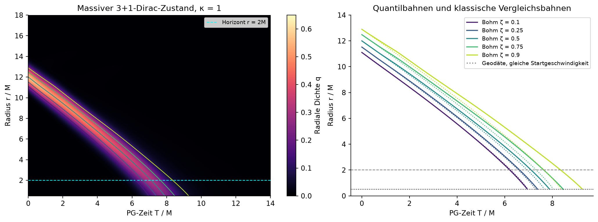

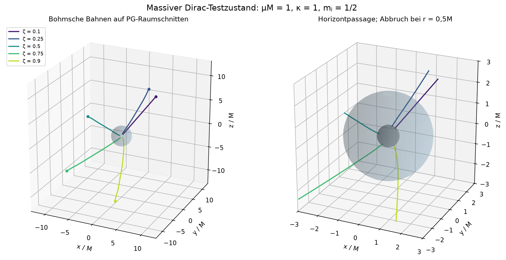

Die dreidimensionale Abbildung stellt $x=r\sin\theta\cos\phi$, $y=r\sin\theta\sin\phi$, $z=r\cos\theta$ auf den räumlich flachen PG-Schnitten dar. Die transparent gezeichnete Kugel ist der Horizont $r=2M$; die kleine graue Kugel markiert den Abschneider $r=0{,}5M$. Die fünf Anfangswinkel sind fest vorgegebene Beispiele, keine Monte-Carlo-Auswahl aus der Born-Verteilung. Ihre Radialmarken sind $\zeta=0{,}1;0{,}25;0{,}5;0{,}75;0{,}9$. Die Winkelbewegung stammt aus dem vollständigen Diracstrom; die Grafik ist keine Einbettung der Raumzeitkrümmung.

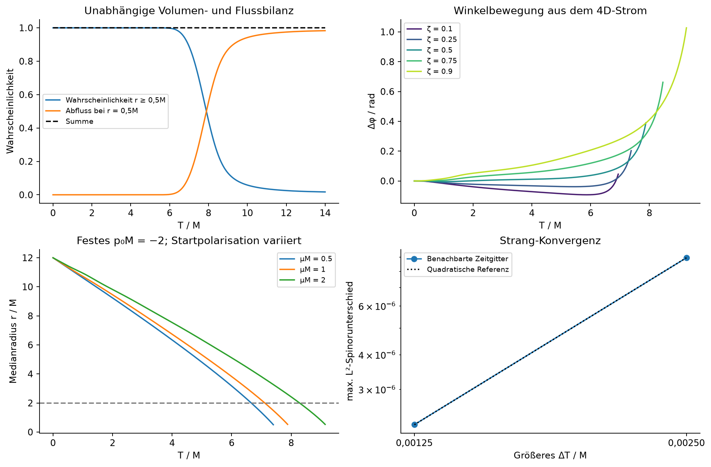

Der Massenvergleich $\mu M=0{,}5;1;2$ hält $p_0M=-2$ und die Ortsamplitude fest, verwendet aber jeweils die oben definierte massenabhängige Spinorpolarisation. Damit ändert sich auch die anfängliche lokale Geschwindigkeit. Er ist kein isolierter Massentest bei identischer Anfangsgeschwindigkeit.

Die [Prüfsuite](work/massive_suite.py), das [numerische Protokoll](work/massive_bohm_20261018_final.json) und die [Roharrays](work/massive_bohm_20261018_final.npz) enthalten die vollständige Parametrisierung. Ein [unabhängiges DG-Verfahren](work/massive_independent.py) diskretisiert die Ableitungsoperatoren mit Polynomgrad fünf, Upwind-Flüssen und einer dünn besetzten Matrixexponentialentwicklung. Damit werden weder die Charakteristikinterpolation noch die Strang-Zeitzerlegung des Hauptsolvers übernommen. Der [Methodenvergleich](work/massive_independent_comparison_20261018.json) bindet beide tatsächlichen Datensätze. Die Daten maskieren nach dem Abschneider beendete Bahnen; sie extrapolieren diese nicht bis $r=0$.

### 21.7 Formale und unabhängige Nachweise

Die fünf Module [MassiveComponents.lean](work/lean/MassiveComponents.lean), [MassiveCausality.lean](work/lean/MassiveCausality.lean), [MassiveQuantile.lean](work/lean/MassiveQuantile.lean), [MassiveHamiltonian.lean](work/lean/MassiveHamiltonian.lean) und [MassiveAngular.lean](work/lean/MassiveAngular.lean) enthalten **49 benannte Sätze**. Der Offline-Kernlauf mit Lean 4.30.0 akzeptiert **64 auditierte Theorem-Konstanten**. Zulässig sind ausschließlich `propext`, `Classical.choice` und `Quot.sound`; [Prüfbeleg](work/lean/massive_proof_verification.json) und [Formalisierungsnotiz](work/massive_formal_notes.md) dokumentieren die Aussagen und Quellenhashes.

Formal geprüft werden die tatsächlichen Ableitungsbilanzen der reellen Dirackomponenten einschließlich Masse und Winkelkopplung, die radialen Kegelgrenzen und Horizontzeichen, die vollständige Metriknorm des festgelegten Winkelkanals, die Quantil-Kettenregel sowie die klassische Hamiltonerhaltung. Die Quantilsätze setzen die integrierte Kontinuitätsbilanz und gemeinsame Differenzierbarkeit ausdrücklich voraus. Die Winkeltrennung des vierdimensionalen Operators und die beiden inneren Zeitprimitiven werden analytisch und mit dem [symbolischen Prüfbeleg](work/massive_symbolic_20261018.json) abgesichert. Die Lean-Sätze sind keine bereits formalisierte globale PDE-Existenztheorie oder Fortsetzung durch die Singularität.

Der [Gesamtaudit](work/massive_independent_verification_20261018.json) kontrolliert die Hashbindungen, rekonstruierte Messgrößen, frühere Forschungsartefakte, Literaturverweise und Formelsyntax. Kapitel 1–20 bleiben unverändert; die frühere Fassung steht im [Snapshot](snapshots/Publikation-vor-massiver-bohm-bahn-20261018.md). Die [Theorienotiz](work/massive_theory_notes.md) ordnet die Primärtexte den verwendeten Gleichungen zu.

Neue numerische Läufe verwenden einen frischen Tag:

```powershell
python work/massive_bohm.py --tag neuer_massiver_lauf
python work/verify_massive_research.py --output-tag neue_massive_pruefung
```

Der zweite Befehl prüft die fest benannten archivierten Referenzläufe. Der Lean-Prüfer ist `python work/lean/check_massive_proofs.py`; vor Wiederholung ist sein fest benannter Beleg zur Erhaltung historischer Hashbindungen zu archivieren.

## 22. Massive Dirac-Rückwirkung

### 22.1 Modell und Quellenwahl

Ein geschlossen lösbarer Sektor des Einstein–Dirac-Systems erlaubt jetzt eine tatsächliche Rückwirkung: Zwei massive klassische Diracfelder erzeugen gemeinsam eine kugelsymmetrische Quelle; ihre Zeitentwicklung und die Innengeometrie werden gekoppelt bestimmt. Für die unten angegebene Familie bleibt eine Krümmungssingularität in endlicher Eigenzeit bestehen. Die Quelle verändert die Längsmetrik, während die Gleichung des Kugelradius ein exaktes erstes Integral besitzt. Dieser Befund folgt aus den gekoppelten Gleichungen und einer Fortsetzungsabschätzung, nicht aus einer Extrapolation der Testbahnen aus Kapitel 21.

Die Verwendung zweier Winkelpartner zur Herstellung eines kugelsymmetrischen Dirac-Stresstensors ist in der Einstein–Dirac-Literatur etabliert [Finster1999pair]. Blázquez-Salcedo und Knoll behandeln auch die zeitabhängige Erweiterung solcher besetzten Winkelmultipletts [BlazquezKnoll2020]. Hier wird die konkrete homogene Innenreduktion zusätzlich direkt mit dem vierdimensionalen Diracoperator und sämtlichen Stresskomponenten geprüft.

Die Quelle ist die Summe der Stresstensoren zweier unabhängiger komplexwertiger klassischer Spinorfelder. Sie ist weder ein punktförmiger Stress an den Bohmschen Positionen noch der absolute renormierte Erwartungswert eines quantisierten Diracfeldes. Letzterer benötigt einen Hadamard-Zustand, eine lokale Subtraktion und festgelegte endliche gravitative Kopplungen [DHP2009]. Auch die Normalordnungsannahme in quantisierten Einstein–Dirac-Modellen ersetzt diese vollständige lokale Renormierung nicht [Kain2023]. Der folgende Singularitätssatz betrifft deshalb den genau definierten klassischen Einstein–Dirac-Sektor mit zugehöriger Bohmscher Einzelstromführung. Die Singularitätsfrage für die vollständige renormierte Quantenfeldquelle wird dadurch nicht entschieden.

Wir verwenden $c=\hbar=1$, Signatur $(-+++)$ und die Kantowski–Sachs-Metrik

$$ds^2=-dt^2+A(t)^2dz^2+B(t)^2d\Omega^2,\qquad A>0,\quad B>0.$$

$t$ ist die Eigenzeit der mitbewegten Beobachter, $B$ der Flächenradius. Die homogene Koordinate $z$ erhält zur Normierung eine feste Periode $L$ mit periodischer Spinstruktur; der longitudinale Impuls ist null. Die lokale Geometrie hängt nicht von einer Wahl des Ursprungs von $z$ ab. Bei $\gamma=0$ ist sie lokal das kontrahierende Schwarzschild-Innere. Für $\gamma>0$ wird ein Anfangswertproblem innerhalb des gefangenen Bereichs gelöst. Ein asymptotisch flaches Außenstück, eine Kollapsentstehung und ein globaler Ereignishorizont werden hier nicht konstruiert. Insbesondere sind diese homogenen Anfangsdaten ein anderes Feldmodell als das lokalisierte Testpaket aus Kapitel 21.

### 22.2 Vierdimensionale Quelle

Seien $\tau_i$ und $\sigma_i$ zwei Sätze von Pauli-Matrizen. Im orthonormalen Rahmen wählen wir die hermiteschen Hamiltonmatrizen

$$\alpha_z=\tau_2\otimes I,\qquad
\alpha_\theta=\tau_1\otimes\sigma_1,\qquad
\alpha_\phi=\tau_1\otimes\sigma_2,\qquad
\beta=\tau_3\otimes I.$$

Der intrinsische Diracoperator der Einheitskugel ist

$$D_{S^2}=-i\left[\sigma_1\left(\partial_\theta+\frac12\cot\theta\right)
+\sigma_2\csc\theta\,\partial_\phi\right].$$

In der üblichen lokalen Spinbasis besitzen seine beiden niedrigsten Partner

$$\eta_+=\frac{e^{i\phi/2}}{\sqrt{4\pi}}
\begin{pmatrix}\cos(\theta/2)\\i\sin(\theta/2)\end{pmatrix},\qquad
\eta_-=\frac{e^{-i\phi/2}}{\sqrt{4\pi}}
\begin{pmatrix}\sin(\theta/2)\\-i\cos(\theta/2)\end{pmatrix}$$

den Eigenwert $\kappa=1$. Die Halbwinkelphasen sind lokale Spinorkomponenten; die Bilineare sind global wohldefiniert. Es gelten $\eta_\pm^\dagger\eta_\pm=1/(4\pi)$ und $\sum_\pm\eta_\pm\eta_\pm^\dagger=I/(4\pi)$. Mit einer gemeinsamen normierten Zeitamplitude $\chi^\dagger\chi=1$ setzen wir

$$\Psi_\pm=\sqrt{\frac{\nu}{LAB^2}}\,\chi(t)\otimes\eta_\pm,
\qquad \nu>0.$$

Jedes Feld hat auf einer periodischen Raumzelle die erhaltene Norm $\nu$; $\nu=1$ liefert Einheitsnorm. Die beiden Quellen werden addiert, ohne Interferenz zwischen den unabhängigen Feldern. Der Faktor $(AB^2)^{-1/2}$ entfernt den zeitlichen Spinverbindungsterm. Die vollständige Feldgleichung reduziert sich exakt auf

$$i\dot\chi=\left(\mu\tau_3+\frac{\kappa}{B}\tau_1\right)\chi,
\qquad \mu>0,\quad\kappa=1.$$

Mit $S_i=\chi^\dagger\tau_i\chi$ folgen

$$S_1^2+S_2^2+S_3^2=1,$$
$$\dot S_1=-2\mu S_2,\qquad
\dot S_2=2\mu S_1-\frac{2\kappa}{B}S_3,\qquad
\dot S_3=\frac{2\kappa}{B}S_2.$$

Definiere $H_A=\dot A/A$, $H_B=\dot B/B$ und

$$E=\mu S_3+\frac{\kappa S_1}{B},\qquad
\rho=\frac{E}{AB^2},\qquad
p_z=0,\qquad p_\Omega=\frac{\kappa S_1}{2AB^3}.$$

Der physikalische Paarstress lautet

$$T_{\hat a\hat b}=\frac{\nu}{2\pi L}
\operatorname{diag}(\rho,0,p_\Omega,p_\Omega).$$

Alle Nichtdiagonalkomponenten verschwinden. Das setzt keinen verschwindenden longitudinalen Diracstrom voraus: Im Energiefluss tritt der Antikommutator von $\tau_2$ mit $\mu\tau_3+\kappa\tau_1/B$ auf, und dieser ist null. Die eigentliche Quellenkontinuität folgt aus der Feldentwicklung:

$$\dot E=-\frac{\kappa S_1\dot B}{B^2},\qquad
\dot\rho+(H_A+2H_B)\rho+2H_Bp_\Omega=0.$$

Die dimensionsbehaftete Kopplung ist $\gamma=4G\nu/L$ mit $[\gamma]=\mathrm L$; damit ist $8\pi G T_{\hat a\hat b}=\gamma\operatorname{diag}(\rho,0,p_\Omega,p_\Omega)$. Bei $[z]=[t]=[B]=\mathrm L$ ist $A$ dimensionslos und $[\mu]=\mathrm L^{-1}$. Die Größen $\rho,p_\Omega$ enthalten den konstanten Normierungsfaktor noch nicht und haben Dimension $\mathrm L^{-3}$; der physikalische Stress hat Dimension $\mathrm L^{-4}$.

### 22.3 Gekoppelte Geometrie

Die vollständigen unabhängigen Einstein-Gleichungen der Reduktion sind

$$2H_AH_B+H_B^2+B^{-2}=\gamma\rho,$$
$$2\frac{\ddot B}{B}+H_B^2+B^{-2}=0,$$
$$\frac{\ddot A}{A}+\frac{\ddot B}{B}+H_AH_B=-\gamma p_\Omega.$$

Der verschwindende longitudinale Druck erzwingt ein erstes Integral:

$$C=\frac{B}{2}(1+\dot B^2),\qquad
\dot C=\frac{\dot B}{2}(1+\dot B^2+2B\ddot B)=0.$$

$C$ ist die geometrische Misner–Sharp-Masse dieses sphärischen Innenraums. Für $C>0$, $0<B_0<2C$ und anfängliche Kontraktion gilt während der regulären Entwicklung

$$q=\sqrt{\frac{2C}{B}-1},\qquad
\dot B=-q,\qquad \ddot B=-\frac{C}{B^2}<0.$$

Damit kann der Kugelradius auf diesem Zweig nicht umkehren. Diese Aussage verwendet $p_z=0$, also eine konkrete Eigenschaft des festgelegten Feldsektors; sie ist kein Satz für beliebige Diraczustände mit longitudinalen Gradienten.

Der skalierte Anfangsconstraint

$$N=2B\dot B\dot A+A(1+\dot B^2)-\gamma E$$

erfüllt unter den beiden räumlichen Einstein-Gleichungen und der Diracentwicklung exakt $\dot N=0$. Anfangsdaten mit $N=0$ bleiben daher auf dem Constraint. Für den unskalierten Rest $\mathcal C=G_{\hat0\hat0}-\gamma\rho=N/(AB^2)$ gilt äquivalent $\dot{\mathcal C}=-(H_A+2H_B)\mathcal C$.

Mit $f=A/q$ liefert der Constraint die erste Ordnung

$$\frac{df}{dB}=\frac{\gamma E}{2Bq^3}.$$

Zusammen mit der Diracentwicklung und $\dot B=-q$ ist dies ein geschlossenes System. Die zweite Gleichung für $A$ folgt auf $\dot B\ne0$ durch Differenzieren des Constraints und Quellenkontinuität; sie wird außerdem separat aus dem vierdimensionalen Einstein-Tensor und durch eine unabhängige Integration beider räumlicher Einstein-Gleichungen geprüft.

### 22.4 Fortsetzung bis zum Endpunkt

Eine reguläre Parametrisierung unterscheidet die divergierende Geometrie von ihrer wohldefinierten reduzierten Dynamik. Setze

$$x=\sqrt B,\qquad W=\sqrt{2C-x^2},\qquad A=\frac{Wf}{x}.$$

Für abnehmendes $x$ wächst die physikalische Zeit. Die Gleichungen lauten

$$t_x=-\frac{2x^2}{W},\qquad
\chi_x=\frac{2i}{W}(\kappa\tau_1+\mu x^2\tau_3)\chi,$$
$$f_x=\frac{\gamma(\kappa S_1+\mu x^2S_3)}{W^3}.$$

Auf $0\le x\le\sqrt{B_0}<\sqrt{2C}$ ist das lineare Spinorsystem glatt, besitzt eine eindeutige Fortsetzung bis $x=0$ und erhält die Norm. Anschließend ist $f$ das Integral einer glatten rechten Seite. Mit $f_0=A_0/q_0$, $\delta=2C-B_0>0$ und $\gamma\ge0$ erhält man aus $|S_i|\le1$ die explizite Schranke

$$|f(x)-f_0|\le D,\qquad
D=\frac{\gamma}{\delta^{3/2}}
\left(|\kappa|\sqrt{B_0}+\frac{|\mu|B_0^{3/2}}3\right).$$

**Fortsetzungssatz.** Ist $f_0>D$, dann gilt $f\ge f_{\min}=f_0-D>0$ einschließlich $x=0$. Folglich existiert die gekoppelte Lösung für jeden $0<B\le B_0$ mit $A>0$. Ein früherer Nullpunkt von $A$ wird durch diese Abschätzung ausgeschlossen. Sie ist eine hinreichende Bedingung; für stärkere Kopplungen wird keine entsprechende Fortsetzung behauptet.

Die verbleibende geometrische Eigenzeit ist exakt

$$t_*-t_0=\int_0^{B_0}\sqrt{\frac{B}{2C-B}}\,dB
=2C(\eta_0-\sin\eta_0\cos\eta_0),$$
$$\eta_0=\arcsin\sqrt{\frac{B_0}{2C}}.$$

Für $B_0=C$, $A_0=1$, $\mu C=\kappa=1$ folgt $D=4\gamma/(3C)$; jede Kopplung $0\le\gamma/C<3/4$ erfüllt die positive Marge. Die Endzeit ist dann $(t_*-t_0)/C=\pi/2-1$. Die Lösung des regulären Spinorsystems bei $x=0$ bedeutet keine reguläre Fortsetzung der Raumzeit durch $B=0$.

### 22.5 Singularitätssatz

Die direkte vierdimensionale Riemann-Rechnung ergibt

$$\begin{aligned}
K=R_{abcd}R^{abcd}
&=4\left[\left(\frac{\ddot A}{A}\right)^2
+2\left(\frac{\ddot B}{B}\right)^2
+2(H_AH_B)^2\right]\\
&\quad+4\left(\frac{1+\dot B^2}{B^2}\right)^2.
\end{aligned}$$

Alle hier auftretenden Beiträge sind nichtnegativ. Bereits die beiden rein radial bestimmten Terme ergeben

$$\boxed{K\ge\frac{24C^2}{B^6}}.$$

**Singularitätssatz.** Für $C>0$, $0<B_0<2C$, kontrahierende Anfangsdaten und $f_0>D$ divergiert $K$ bei $t\uparrow t_*$ in endlicher geometrischer Eigenzeit. Ein Energiebedingungssatz wird dafür nicht benötigt. Die mitbewegten Kurven $z,\theta,\phi=\mathrm{const.}$ sind zeitartige Geodäten, da sämtliche $\Gamma^i_{00}$ verschwinden. Sie sind in der konstruierten Raumzeit zukünftig unvollständig; eine reguläre $C^2$-Fortsetzung durch ihren krümmungsdivergenten Endpunkt ist ausgeschlossen. Beide zukünftigen radialen Nullrichtungen $\partial_t\pm A^{-1}\partial_z$ haben Expansion $2\dot B/B<0$: Die Kugeln bleiben gefangen. Dies ist eine lokale geometrische Aussage und keine zusätzliche Konstruktion eines globalen Ereignishorizonts.

Die positive Endpunktmarge liefert sogar den exakten führenden Koeffizienten. Aus der glatten Fortsetzung von $f$ und $f(0)>0$ folgen

$$a_1=\frac{xA_x}{A}\longrightarrow-1,\qquad
a_2=\frac{x^2A_{xx}}A\longrightarrow2.$$

Damit gilt

$$B^3\frac{\ddot A}{A}
=\frac{W^2a_2-(x^2+2W^2)a_1}{4}\longrightarrow2C,$$
$$B^3H_AH_B=\frac{W^2a_1}{2}\longrightarrow-C,$$
$$\boxed{\lim_{B\downarrow0} B^6K=48C^2}.$$

Die Quelle verschwindet dabei nicht. Die exakten Ricci-Invarianten sind

$$R=\frac{\gamma\mu S_3}{AB^2},\qquad
R_{ab}R^{ab}=\gamma^2(\rho^2+2p_\Omega^2).$$

Aus $A\sim\sqrt{2C}f(0)B^{-1/2}$ und beschränktem $S$ folgt $\rho,p_\Omega=O(B^{-5/2})$, somit $R_{ab}R^{ab}=O(B^{-5})$. Dieser Beitrag ist gegenüber $K\sim48C^2B^{-6}$ von niedrigerer Ordnung. Die Rückwirkung ändert also die Geometrie und erzeugt Ricci-Krümmung, beseitigt aber in dieser Familie nicht die führende Krümmungsdivergenz. Eine überall positive Massenspur wird nicht vorausgesetzt; $S_3$ darf das Vorzeichen wechseln.

### 22.6 Führung der De-Broglie-Bohm-Theorie

Für jedes der beiden unabhängigen Spinorfelder ergibt die tatsächliche Viererstromrekonstruktion

$$\frac{J_\pm^{\hat a}}{J_\pm^{\hat0}}
=(1,S_2,0,\pm S_1\sin\theta).$$

Die Führung auf der rückgekoppelten Geometrie lautet deshalb

$$\dot z=\frac{S_2}{A},\qquad
\dot\theta=0,\qquad
\dot\phi=\pm\frac{S_1}{B}.$$

Der Paarstrom besitzt keine Winkelkomponente, die einzelnen Ströme dagegen schon. Die Tangentennorm erfüllt exakt

$$-1+S_2^2+S_1^2\sin^2\theta
=-S_3^2-S_1^2\cos^2\theta\le0.$$

Die Führung ist daher kausal. Die Masse allein erzwingt keine punktweise strikte Zeitartigkeit. Wo die Kurve zeitartig ist, gilt

$$\frac{d\tau}{dt}=\sqrt{S_3^2+S_1^2\cos^2\theta}.$$

In der regulären Variablen werden auch die Bahngleichungen regulär:

$$z_x=-\frac{2S_2x^3}{fW^2},\qquad
\phi_x=\mp\frac{2S_1}{W}.$$

Unter der positiven Marge besitzen $z$ und der stetig abgewickelte Winkel $\phi$ endliche Grenzwerte. Insbesondere

$$|\Delta\phi|\le2\arcsin\sqrt{\frac{B_0}{2C}},$$
$$|\Delta z|\le\frac{2C\log(2C/(2C-B_0))-B_0}{f_{\min}}.$$

Auch die gesamte Bahn-Eigenzeit ist höchstens $t_*-t_0$. Die endlichen Koordinatengrenzen ändern den invarianten Singularitätsbefund nicht. Diese Aussagen gelten je unabhängigem klassischem Feld; ein antisymmetrischer Zweifermion-Zustand mit seiner gemeinsamen Bohmschen Konfigurationsraumführung wird hier nicht berechnet.

### 22.7 Numerische Prüfung

Die [Hauptrechnung](work/diracback_numerics.py) integriert den komplexen Spinor, $f$, $t$ und die Führung im regulären Parameter $x$ bis einschließlich $x=0$. Für die Auswertung der Metrik und Krümmung bleiben ausschließlich positive Radien $10^{-12}\le B/C\le1$ auf 801 logarithmisch verteilten Punkten. DOP853 verwendet relative Toleranz $2\times10^{-12}$, absolute Toleranz $3\times10^{-14}$ und maximale Schrittweite $0{,}025$ in Einheiten $\sqrt C$. Die Anfangsdaten sind

$$B_0/C=A_0=\mu C=\kappa=1,\qquad
\chi_0=\begin{pmatrix}\cos(\pi/8)\\\sin(\pi/8)\end{pmatrix},$$
$$t_0=z_0=\phi_0=\tau_0=0,\qquad\theta=\pi/3.$$

Der anfängliche Spinor ist der positive Eigenzustand des momentanen reduzierten Hamiltonian. Die vier Kopplungen sind $\gamma/C=0,0{,}1,0{,}3,0{,}6$. In den Plots bezeichnet die Legende $\gamma$ jeweils diesen dimensionslosen Zahlenwert. Die Zeile $\gamma=0$ ist die Schwarzschild-Testfeldreferenz beziehungsweise der Grenzfall verschwindender Quellenintensität; bei exakt $\nu=0$ wird keine Führung aus dem Nullfeld definiert.

| $\gamma/C$ | Bewiesene Untergrenze für $f$ | $f(0)$ | $z(t_*)/C$ |
|---:|---:|---:|---:|
| $0$ | $1$ | $1$ | $-0{,}034386315$ |
| $0{,}1$ | $0{,}866666667$ | $0{,}947296827$ | $-0{,}035402932$ |
| $0{,}3$ | $0{,}600000000$ | $0{,}841890480$ | $-0{,}037648880$ |
| $0{,}6$ | $0{,}200000000$ | $0{,}683780960$ | $-0{,}041685481$ |

Dabei bezeichnet $f(0)$ den Grenzwert bei $x=0$, nicht den Anfangswert bei $t=0$. Alle mit $t_*$ bezeichneten Bahngrößen sind linksseitige Grenzwerte bei $t\uparrow t_*$; der Endpunkt ist kein regulärer Raumzeitpunkt. Für alle vier Fälle sind

$$t_*/C=0{,}570796327,\qquad
\phi_+(t_*)=1{,}236965302,\qquad
\tau(t_*)/C=0{,}421210645.$$

Die gemeinsamen Spin- und Winkelverläufe sind eine exakte Eigenschaft dieses Sektors: $B(t)$ und der normierte reduzierte Hamiltonian hängen bei festem $C$ nicht von $A$ oder $\gamma$ ab. Die Rückwirkung auf $A$ verändert jedoch die longitudinale Führung. Für $\gamma/C=0{,}6$ ergibt sich am kleinsten ausgewerteten Radius $B^6K/C^2=47{,}999987225$, konsistent mit dem analytischen Grenzwert 48.

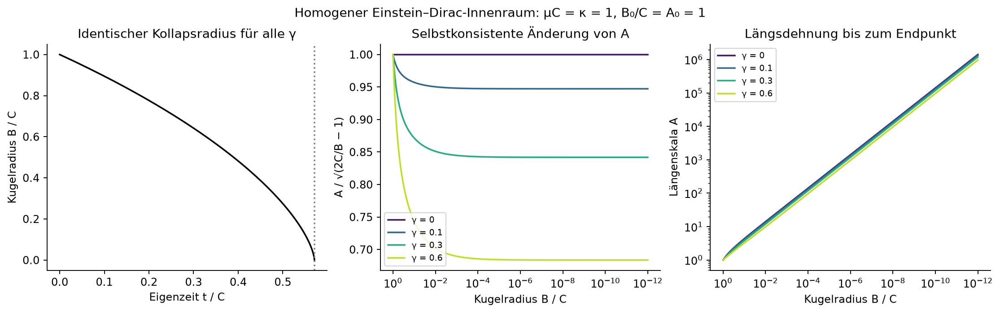

*Abbildung 22.1: Gemeinsame Kontraktion des Kugelradius, Änderung von $f=A/q$ und longitudinale Dehnung. Die vier Kurven gehören zu unterschiedlichen selbstkonsistenten Quellenintensitäten mit identischem $C$ und identischen normierten Spinor-Anfangsdaten.*

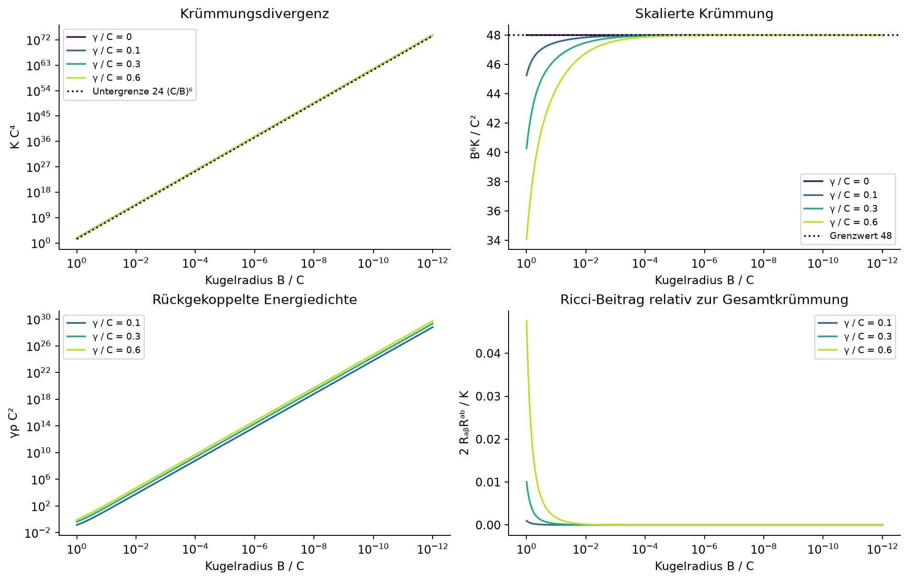

*Abbildung 22.2: Krümmung mit bewiesener Untergrenze, skalierter Grenzwert, rückgekoppelte Energiedichte und relativer Ricci-Beitrag. Die endlichen Radien im Plot illustrieren den analytischen Singularitätssatz; sie ersetzen dessen Grenzwertbeweis nicht.*

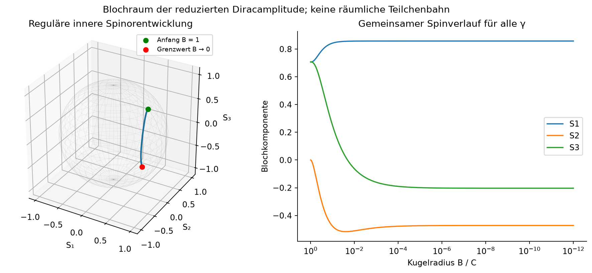

*Abbildung 22.3: Dreidimensionale Darstellung der normierten Blochamplitude und ihrer Komponenten. Die Kugel ist Zustandsraum des reduzierten Spinors, keine räumliche Abbildung des schwarzen Lochs und keine Teilchenbahn.*

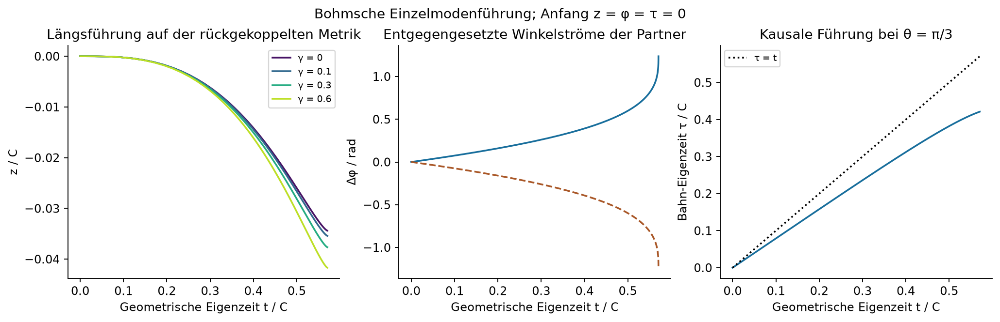

*Abbildung 22.4: Longitudinale Führung, entgegengesetzte Winkelbewegung der beiden Partner und Bahn-Eigenzeit. Die Anfangsorte und $\theta=\pi/3$ sind in allen Fällen gleich.*

Der maximale Normfehler der Hauptrechnung ist $1{,}12\times10^{-14}$. Die aus der glatten Lösung algebraisch ausgewerteten, mit $B^3$ skalierten Einstein-Residuen liegen unter $6{,}11\times10^{-16}$. Diese Residuen prüfen die Implementierung der rekonstruierten Geometrie; eine eigenständige dynamische Kontrolle liefert die [unabhängige Rechnung](work/diracback_independent.py). Sie integriert beide räumlichen Einstein-Gleichungen zusammen mit den reellen Blochkomponenten und verwendet den Constraint nur zur Festlegung der Anfangsdaten. Bis $B/C=10^{-6}$ bleiben dessen relativer Rest unter $1{,}66\times10^{-11}$, die Drift von $C$ unter $4{,}15\times10^{-14}$ und der Blochnormfehler unter $2{,}32\times10^{-13}$. Der Vergleich auf 201 exakt gemeinsamen Radien benötigt keine Interpolation. Über alle vier Kopplungen betragen die größten Unterschiede $4{,}89\times10^{-13}$ in einer Blochkomponente, $1{,}057\times10^{-11}$ relativ in $A$, $2{,}108\times10^{-11}$ relativ in $K$ und $5{,}18\times10^{-14}C$ in der Zeit. Der [direkte Methodenvergleich](work/diracback_compare.py) besteht **38 Kontrollen**.

Ein analytischer massloser Kontrollfall mit $\mu=0$, $S_1=1$ besitzt

$$A(B)=\left(A_0-\frac{\gamma\kappa}{2C}\right)\frac{q(B)}{q_0}
+\frac{\gamma\kappa}{2C}.$$

Er wird bis auf $2{,}34\times10^{-15}$ relativen Fehler reproduziert. Der Vakuumfall erfüllt $B^6K/C^2=48$ bis auf $1{,}43\times10^{-14}$. Eine Toleranzverfeinerung auf $2\times10^{-13}$ beziehungsweise $3\times10^{-15}$ ändert den Spinor um höchstens $1{,}05\times10^{-14}$; dies ist ein numerischer Konsistenzvergleich, keine rigorose Intervallfehlerschranke. Eine gesonderte Quadratur der Führung auf der gespeicherten glatten Lösung bestätigt die drei integrierten Endpunktgrößen bis $2{,}06\times10^{-15}$.

### 22.8 Beweise und Reproduzierbarkeit

Die [vierdimensionale Quellenprüfung](work/diracback_source.py) kontrolliert den tatsächlichen Tetraden-Diracoperator, beide Winkelspinoren, alle 16 Komponenten des Paarstresses, die Einzelströme und die Quellenkontinuität: **30 Prüfgruppen mit 220 verschwindenden skalaren Residuen**. Eine davon getrennte Tensorrechnung prüft Christoffelsymbole, Riemann- und Einstein-Tensor sowie die kovariante Quellenbilanz in **17 symbolischen Prüfungen**. Die zugehörige unabhängige Integration besteht **34 numerische Kontrollen**; die Hauptrechnung besteht **14 Kontrollen**. Diese Überprüfungen verwenden keine experimentellen Daten: Sie validieren ein mathematisches Anfangswertproblem und dessen numerische Lösung.

Die drei neuen Lean-Dateien [DiracBackMatter.lean](work/lean/DiracBackMatter.lean), [DiracBackGeometry.lean](work/lean/DiracBackGeometry.lean) und [DiracBackRegularity.lean](work/lean/DiracBackRegularity.lean) enthalten **32 benannte Sätze und 66 auditierte Theoremkonstanten** einschließlich erzeugter Hilfssätze. Der Kernel-Lauf mit Lean 4.30.0 und Mathlib-Revision `c5ea00351c28e24afc9f0f84379aa41082b1188f` ist vollständig akzeptiert. Transitiv werden nur `propext`, `Classical.choice` und `Quot.sound` verwendet.

Formalisiert sind tatsächliche Ableitungen der Spinornorm und Blochgrößen unter der angegebenen Komponentenentwicklung, der Quellenergie und Quelldichte; das radiale erste Integral samt Intervallerhaltung; die Einstein-Constraint-Erhaltung; der reduzierte Energiefluss-Antikommutator; die reguläre Constraint-Transformation; die aus Ableitungsmonotonie gewonnene Vergleichsschranke mit ausdrücklich positiver Anfangsmarge; die rekonstruierte Stromkausalität; sowie $K\ge24C^2/B^6$ und der echte Divergenzgrenzwert dieser Untergrenze. Die vierdimensionale Winkel- und Spinverbindungsrechnung, die lineare ODE-Fortsetzung, die geschlossene Endzeit und der stärkere Koeffizient $\lim B^6K=48C^2$ sind die oben ausgeführten analytischen beziehungsweise symbolisch geprüften Ergebnisse. Sie werden nicht als vom Lean-Kernel formalisiert ausgegeben.

Die Rohdaten und sämtliche vier Abbildungen liegen als [Numerikbeleg](work/diracback_numerics_20261018_final.json), [NPZ-Arrays](work/diracback_numerics_20261018_final.npz), PNG und SVG vor. Die dimensionslos beschriftete Krümmungsabbildung wird aus denselben Rohdaten [separat reproduziert](work/diracback_verification_figure.py) und durch einen [Abbildungsbeleg](work/diracback_figure_20261018_verified.json) gebunden. Ergänzend stehen die [unabhängige Integration](work/diracback_independent_20261018_final.json), der [Methodenvergleich](work/diracback_comparison_20261018.json), der [Quellenbeleg](work/diracback_source_verification_20261018.json) und der [Lean-Beleg](work/lean/diracback_proof_verification.json) zur Verfügung. Der [Gesamtprüfer](work/verify_diracback_research.py) kontrolliert Rohdaten, Quellen- und Prüferhashes, die früheren Forschungsartefakte und die Manuskriptintegration; sein [Prüfbericht](work/diracback_independent_verification_20261018.json) bindet den abgeschlossenen Stand.

## 23. Reguläre massive Teilchenbahnen

### 23.1 Voraussetzungen eines regulären Übergangs

Eine singularitätsfreie Fortsetzung ist mathematisch möglich, wenn die Geometrie und ihre Quelle geändert werden. Auf der im Folgenden festgelegten regulären Black-bounce-Geometrie existiert eine globale unitäre massive Diracentwicklung in der verwendeten Zeitkoordinate. Die berechneten Bohmschen Bahnen durchqueren den positiven Minimalradius, passieren den zweiten Horizont und gelangen in das andere Außengebiet. Das Teilchen verschwindet dabei nicht; sein Flächenradius nimmt nach dem Minimum wieder zu.

Dieser Vorgang lässt sich nicht innerhalb des unveränderten Quellenmodells aus Kapitel 22 erzwingen. Dessen verschwindender longitudinaler Druck liefert

$$2B\ddot B+\dot B^2+1=0.$$

An einem hypothetischen positiven Minimum mit $\dot B=0$ müsste daher $\ddot B=-1/(2B)<0$ gelten. Ein regulärer Bounce ist in diesem homogenen Dirac-Alleinquellensektor ausgeschlossen. Die folgende Konstruktion beantwortet deshalb ausdrücklich die Frage nach einer Teilchenbahn **unter einer regulären alternativen Geometrie**. Sie ist keine Herleitung dieser Geometrie aus der absoluten renormierten Diracquelle.

### 23.2 Black-bounce-Geometrie

Wir verwenden die von Simpson und Visser eingeführte Familie [SimpsonVisser2019] mit $M>0$, $0<a<2M$ und einer signierten Koordinate $r\in\mathbb R$:

$$R(r)=\sqrt{r^2+a^2},\qquad F(r)=1-\frac{2M}{R(r)}.$$

Der physikalische Flächenradius ist $R$, nicht $r$. Er erfüllt

$$R\ge a>0,\qquad R'=\frac rR,\qquad R''=\frac{a^2}{R^3}>0.$$

Aus der statischen Darstellung $ds^2=-Fdt^2+F^{-1}dr^2+R^2d\Omega^2$ ergibt die lokale Transformation $dT=dt+v\,dr/F$, $v=\sqrt{2M/R}$, die horizonreguläre Form

$$ds^2=-dT^2+(dr+v\,dT)^2+R^2d\Omega^2.$$

Diese Metrik wird über ganz $r\in\mathbb R$ glatt definiert. Ihre Determinante ist $-R^4\sin^2\theta$, und der Zeitkovektor erfüllt $g^{-1}(dT,dT)=-1$. Die üblichen Polarkoordinatenpole werden durch andere Kugelkarten abgedeckt. Die Horizonte liegen bei

$$r=\pm r_h,\qquad r_h=\sqrt{4M^2-a^2}.$$

Die radialen Nullgeschwindigkeiten sind $dr/dT=\pm1-v$. Zwischen den Horizonten sind beide negativ. Die zukünftige Bewegung läuft dort zu kleinerem $r$; bei $r=0$ wird $R=a$ erreicht, danach wächst $R$ auf dem negativen Zweig wieder. Die beiden Enden $r\to\pm\infty$ sind asymptotisch flache Außengebiete dieses Modellansatzes. Für festes $r\ne0$ geht die Geometrie bei $a\downarrow0$ lokal in die entsprechende Schwarzschildform über; der regulierende Grenzübergang ist am Hals nicht gleichmäßig.

Eine direkte vierdimensionale Riemann-Rechnung liefert vier Krümmungskoeffizienten

$$\mathcal A=\frac{M(2r^2-a^2)}{R^5},\qquad
\mathcal B=-\frac{Mr^2}{R^5},$$
$$\mathcal C=\frac{M(2a^2-r^2)-a^2R}{R^5},\qquad
\mathcal D=\frac{2Mr^2+a^2R}{R^5},$$

mit

$$K=4(\mathcal A^2+2\mathcal B^2+2\mathcal C^2+\mathcal D^2).$$

Da $0\le r^2/R^2\le1$ und $R\ge a$, folgt die globale, nicht scharfe Schranke

$$0\le K\le4\left[\frac{6M^2}{a^6}
+3\left(\frac{2M}{a^3}+\frac1{a^2}\right)^2\right].$$

Am Hals ist

$$K(0)=\frac{36M^2}{a^6}-\frac{32M}{a^5}+\frac{12}{a^4}.$$

Für $a=M$ gilt $K(0)M^4=16$. Die glatte nichtentartete PG-Metrik und ihre glatten Tetraden begründen die lokale Regularität an Hals und Horizonten; sie wird nicht allein aus einem endlichen skalaren Invariant gefolgert. Die verwendete Karte genügt für den berechneten durchquerenden Ast. Eine maximale Erweiterung sämtlicher anderer Horizontzweige und die geodätische Vollständigkeit dieser gesamten Erweiterung sind kein Ergebnis dieser Rechnung.

### 23.3 Erforderliche Quelle

Der Quellenbedarf lässt sich unabhängig von einem am Horizont ungeeigneten statischen Beobachterrahmen prüfen. Für die glatten radialen Nullvektoren

$$k_\pm=\partial_T+(-v\pm1)\partial_r$$

ergibt der tatsächliche vierdimensionale Einstein-Tensor

$$G_{ab}k_\pm^ak_\pm^b=-\frac{2a^2}{R^4}(-v\pm1)^2.$$

Insbesondere ist $G_{ab}k_-^ak_-^b<0$ überall, einschließlich beider Horizonte. Eine Einsteinquelle dieser Metrik verletzt daher die Nullenergiebedingung. Im zeitartigen Innenrahmen gilt am Hals $\ddot R=(2M/a-1)/a>0$; der nötige longitudinale Druck ist

$$8\pi Gp_\parallel(0)=\frac{a-4M}{a^3}<0.$$

Der massive homogene Dirac-Paarsektor des vorherigen Kapitels hat dagegen $p_z=0$. Er ist also keine vollständige Quelle dieses Übergangs. Die regularisierende Materie wird hier durch den vorgegebenen geometrischen Ansatz festgelegt; der nachfolgende massive Diraczustand ist ein Testfeld. Eine bloße Definition $T_{\rm extra}=G/(8\pi G)-T_{\rm Dirac}$ würde ein konserviertes Quellenbudget liefern, aber ohne eigenständige Materiedynamik keine neue geschlossene Rückwirkungstheorie.

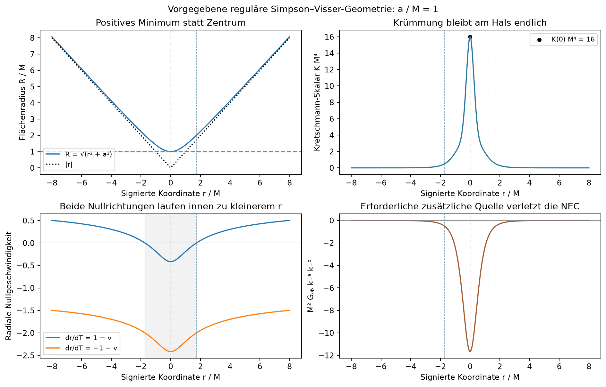

*Abbildung 23.1: Positiver Minimalradius, endliche Krümmung, beide radialen Nullrichtungen und die erforderliche negative Nullkontraktion der Quelle. Die gestrichelten vertikalen Linien markieren die Horizonte, die punktierte Linie den Hals.*

### 23.4 Massive Diracentwicklung

Wir benutzen den echten vierdimensionalen Winkelkanal $\kappa=1$, $j=m_j=1/2$, und reskalieren die radiale Spinoramplitude mit $R$. Die vollständige Tetradenrechnung auf den räumlich gekrümmten PG-Schnitten liefert in der verbindlich gewählten Zweikomponentenbasis

$$i\partial_T\psi=H\psi,\qquad
\psi=\begin{pmatrix}u\\d\end{pmatrix},$$
$$H=-i(\sigma_3-vI)\partial_r+\frac{i v'}2I
+\mu\sigma_1-\frac{\kappa}{R}\sigma_2.$$

Die radialen Spinverbindungsterme mit $R'/R$ heben sich nach der $1/R$-Reskalierung auf. Der Term $iv'/2$ bleibt für den korrekten Dichtetransport notwendig. Die Reduktion und das Vorzeichen des Winkelterms werden unmittelbar aus den vierdimensionalen Matrizen und ihrer Basistransformation geprüft; es wird kein flacher PG-Raumschnitt vorausgesetzt.

Mit

$$q=|u|^2+|d|^2,\qquad
j=(1-v)|u|^2-(1+v)|d|^2$$

gilt exakt

$$\partial_Tq+\partial_rj=0,\qquad
\int_{\mathbb R}q(T,r)\,dr=1.$$

Die Winkelmode ist auf der Kugel normiert; ihre volle Dichte ist $q/(4\pi R^2)$. Da $R\ge a$, erzeugt die Rückskalierung am Hals keinen divergierenden Faktor.

**Globale Feldentwicklung in PG-Zeit.** Die Transportgeschwindigkeiten $c_\pm=\pm1-v$ sind glatt und beschränkt, mit beschränkten Ableitungen. Ihre reellen Flüsse $\Phi_\pm(T,r)$ existieren für alle endlichen Zeiten, auch an ihren Fixpunkten. Die Transportoperatoren

$$U_{0,\pm}(T)f(r)=
\sqrt{\partial_r\Phi_\pm(-T,r)}\,f(\Phi_\pm(-T,r))$$

sind wegen der Variablentransformation unitär auf $L^2(dr)$. Der verbleibende Multiplikationsoperator

$$V=\mu\sigma_1-\frac{\kappa}{R}\sigma_2,\qquad
\|V\|\le\sqrt{\mu^2+\kappa^2/a^2}$$

ist beschränkt und hermitesch. Die zeitgeordneten Integrale im Wechselwirkungsbild werden zunächst auf jedem Hilbertraumvektor definiert. Für den Term der Ordnung $n$ gilt $\|D_n(T)\|\le(\|V\||T|)^n/n!$. Die Dyson-Reihe konvergiert somit auf jedem endlichen Zeitintervall in Operatornorm und liefert eine eindeutige unitäre Gesamtentwicklung. Beschränkte Koeffizientenableitungen sichern zudem durch die differenzierten Energieabschätzungen die Erhaltung von $H^3$ auf jedem endlichen Zeitintervall. Die Feldgleichung ergibt $\psi\in C(H^3)\cap C^1(H^2)\cap C^2(H^1)$; die eindimensionalen Sobolev-Einbettungen liefern die benötigte gemeinsame $C^2$-Regularität. Die hier gewählten kompakten $C^3$-Anfangsdaten liegen in $H^3$. Die Punktregularität wird somit zusätzlich zur $L^2$-Unitarität begründet. Es wird keine absorbierende innere Grenze eingeführt.

Für anfängliche Unterstützung $[r_-,r_+]$ gilt zudem die endliche Ausbreitungsschranke

$$\operatorname{supp}\psi(T)\subset
\left[r_--\left(1+\sqrt{2M/a}\right)T,\;r_++T\right],\qquad T\ge0.$$

Diese analytische Feldfortsetzung besagt nicht, dass die Raumzeitquelle selbst stabil oder quantengravitativ hergeleitet wäre. Auch die Existenz einer lokalen Bohmschen Führung setzt weiterhin $q>0$ voraus; eine beliebige Knotenvermeidung wird nicht aus geometrischer Regularität abgeleitet.

### 23.5 Was mit dem Teilchen geschieht

Setze $z=u^*d$. Der vollständige Viererstrom ergibt

$$\dot r=\frac jq,\qquad
\dot\theta=0,\qquad
\dot\phi=-\frac{2\operatorname{Im}z}{Rq}.$$

Für die mit $T$ parametrisierte Tangente gilt

$$g(\dot X,\dot X)
=-\frac{4[(\operatorname{Re}z)^2+(\operatorname{Im}z)^2\cos^2\theta]}{q^2}\le0.$$

Damit bleibt die Führung kausal; der Winkelstrom ist vollständig berücksichtigt. Die Bahn-Eigenzeit erfüllt

$$\frac{d\tau}{dT}=\frac{2}{q}
\sqrt{(\operatorname{Re}z)^2+(\operatorname{Im}z)^2\cos^2\theta}.$$

Wähle einen kompakten Innenkern $0<r_c<r_h$ und setze

$$v_c=\sqrt{\frac{2M}{\sqrt{r_c^2+a^2}}}>1.$$

Auf jeder dort existierenden Führungsbahn mit $q>0$ folgt

$$\dot r\le1-v\le1-v_c<0.$$

Durch Integration erhält man einen echten Durchquerungsvergleich: Die Bahn kann bei fortgesetzter Führung höchstens $2r_c/(v_c-1)$ innerhalb des Kerns bleiben. Ein Halten am Minimalradius oder eine Umkehr der signierten Koordinate im Kern ist ausgeschlossen. Für $a=M$ und $r_c=M$ beträgt diese konservative obere Schranke $2M/(2^{1/4}-1)$.

Am Hals selbst ist $\dot r<0$, während

$$\frac{dR}{dT}=\frac rR\dot r=0,\qquad
\left.\frac{d^2R}{dT^2}\right|_{r=0}=\frac{\dot r^2}{a}>0.$$

Das ist der präzise Sinn des Radius-Bounce: Die Bahn läuft glatt durch $r=0$, und die Fläche der zugehörigen Kugel wächst anschließend wieder. Es handelt sich um eine Passage in das andere geometrische Gebiet, nicht um eine Reflexion zurück ins ursprüngliche Außengebiet.

Die Kontinuitätsgleichung liefert mit

$$\mathcal F(T,r)=\int_{-\infty}^r q(T,s)\,ds$$

die Identität $\partial_T\mathcal F=-j$ und entlang einer regulären Bahn $d\mathcal F/dT=0$. Daher kann sie unabhängig als Quantil $\mathcal F(T,r(T))=\zeta$ rekonstruiert werden. Am Hals gibt es weder einen Wahrscheinlichkeitsabfluss aus der Raumzeit noch eine vorgeschriebene Neuerzeugung des Teilchens. Seine Position, sein Winkel und seine Eigenzeit werden mit derselben Diracentwicklung weitergeführt.

Die Kernschranke erzwingt keine endliche Austrittszeit jeder möglichen Bahn am zweiten Horizont. Tatsächlich besitzt die gegenläufige Charakteristik dort

$$c_+'(-r_h)=-\frac{r_h}{8M^2}<0.$$

Ein kleiner Wellenanteil kann nahe diesem Fixpunkt stark komprimiert werden. Die Rechnung weist deshalb die konkrete Durchquerung der ausgewählten Bahnen und die Wahrscheinlichkeitsverteilung in einem ausdrücklich festgelegten endlichen Zeitfenster nach. Eine asymptotische vollständige Transmission oder eine stabile selbstkonsistente Rückwirkung aller komprimierten Moden wird daraus nicht gefolgert.

### 23.6 Numerische Bahnen

Die Anfangsdaten entsprechen dem kompakten massiven Paket aus Kapitel 21, jetzt auf der regulären Geometrie:

$$a/M=\mu M=\kappa=1,\qquad p_0M=-2,\qquad
r_0/M=12,\qquad\sigma/M=3.$$

Die Amplitude ist proportional zu $[1-((r-r_0)/\sigma)^2]_+^4$, mit Normierungsfaktor $[\sigma\,\mathrm B(1/2,9)]^{-1/2}$, Phase $e^{ip_0(r-r_0)}$ und der positiven flachen Polarisation des Hamiltonian $p_0\sigma_3+\mu\sigma_1$. Dies ist keine Projektion auf ausschließlich positive globale Killingfrequenz. Die Unterstützung ist $[9,15]$.

Der [Hauptsolver](work/nonsing_bohm.py) verwendet lokale unitäre Spinorrotationen und charakteristischen Transport einschließlich des tatsächlichen halben Fluss-Jakobians, kombiniert durch Strang-Splitting. Der Rechenbereich ist $-35\le r/M\le34$, das Auswertungsfenster $0\le T/M\le16$. Die analytische Frontschranke hält das Feld während dieses gesamten Fensters von beiden äußeren Rändern fern. Ein innerer Abschneider fehlt vollständig.

Die nichtnegative kumulative Dichte wird durch Vierpunkt-Gaußintegration des Betragsquadrats eines kubischen Spinorinterpolanten gewonnen. Jede Zellenmasse ist nichtnegativ; das Integral ist für diesen Interpolanten exakt. Es wird keine überlebende Wahrscheinlichkeit nachträglich auf eins renormiert. Gesonderte ODE-Integration von $(r,\phi,\tau)$ prüft die Quantilführung. Alle dargestellten Bahnen liegen in der Äquatorebene $\theta=\pi/2$.

Das Hauptgitter verwendet $\Delta r/M=0{,}005$, $\Delta T/M=0{,}000625$ und 13 801 Raumpunkte. Die fünf Anfangsquantile $\zeta=0{,}10;0{,}25;0{,}50;0{,}75;0{,}90$ durchlaufen beide Horizonte und den Hals. Die direkt integrierten Ereignisse lauten:

| Quantil $\zeta$ | Eintritt $T_+/M$ | Hals $T_0/M$ | Austritt $T_-/M$ | Eigenzeit am Hals $\tau_0/M$ |
|---|---:|---:|---:|---:|
| 0,10 | 6,38525 | 7,27169 | 8,15792 | 3,44351 |
| 0,25 | 6,80210 | 7,70650 | 8,60234 | 3,98749 |
| 0,50 | 7,29071 | 8,21405 | 9,13472 | 4,48509 |
| 0,75 | 7,82561 | 8,80206 | 9,76255 | 4,90946 |
| 0,90 | 8,55583 | 9,65204 | 10,74094 | 5,51453 |

Hier bezeichnet Eintritt $r=+r_h$, Hals $r=0$ und Austritt $r=-r_h$. Für die Medianbahn beträgt die fortgesetzte Eigenzeit am zweiten Horizont $5{,}01646M$. Die kleinste numerisch erfasste Dichte entlang der fünf Bahnen ist $qM>0{,}04097$; die Rechnung nähert sich dort keinem Spinorknoten. Der Flächenradius wird niemals kleiner als $M$.

Bei $T=16M$ liegen **98,26408 Prozent** der Gesamtwahrscheinlichkeit im linken Außengebiet $r<-r_h$, **0,46804 Prozent** zwischen den Horizonten und **1,26788 Prozent** im rechten Außengebiet $r>r_h$. Das sind die Gebietsanteile dieses Anfangszustands zu diesem Zeitpunkt. Die fünf ausgewählten Bahnen befinden sich dann sämtlich im linken Außengebiet; bei diesem Paket ist die Passage somit unmittelbar berechnet.

Der maximale Normfehler beträgt $1{,}090\times10^{-8}$, der maximale Fehler der integrierten Flussbilanz an Hals und Horizonten $1{,}438\times10^{-7}$. Direkt integrierte Radialbahnen und konstante Quantile unterscheiden sich um höchstens $5{,}824\times10^{-6}M$. Die Zeitschrittfolge $\Delta T/M=0{,}0025;0{,}00125;0{,}000625$ bei festem Raumgitter vermindert die maximale $L^2$-Spinordifferenz von $2{,}152\times10^{-5}$ auf $5{,}023\times10^{-6}$. Eine zusätzliche Halbierung des Raumabstands bei festem kleinstem Zeitschritt ergibt $2{,}569\times10^{-6}$. Alle elf Hauptprüfungen sind bestanden. Diese Verfeinerungsdifferenzen sind empirische Konvergenzbefunde, keine rigorosen Fehlerschranken der kontinuierlichen Lösung.

Ein [unabhängiges Verfahren](work/nonsing_independent.py) entwickelt denselben vollen Operator mit einem ungesplitteten dünnbesetzten Matrixexponentialoperator und einem SBP/DG-Raumverfahren fünften Grades. Es verwendet 758 beziehungsweise 1515 Zellen auf $[-62M,46M]$ und verfeinert lokal um den negativen Horizont. Auf dem feineren Gitter betragen die Zellweiten rund $0{,}0125M$ bis $0{,}07492M$; es importiert keinen Schritt des Hauptsolvers. Sein maximaler Normfehler beträgt $1{,}062\times10^{-12}$, der explizit bilanzierte numerische Sprungverlust $7{,}715\times10^{-13}$ und der integrierte Bilanzrest $2{,}905\times10^{-13}$. Die maximale $L^2$-Änderung der neun Feldprofile bei eigener Gitterverfeinerung beträgt $3{,}656\times10^{-6}$. Alle neun Prüfungen des [DG-Belegs](work/nonsing_independent_20261018_final.json) sind bestanden.

Der [direkte Methodenvergleich](work/nonsing_compare.py) wertet die tatsächlichen DG-Zellpolynome an allen Hauptgitterpunkten zu **321 exakt gemeinsamen Ausgabezeiten** aus. Die maximale Spinor-$L^2$-Differenz beträgt $2{,}817\times10^{-6}$, die Dichte-$L^1$-Differenz $9{,}414\times10^{-7}$. Die radialen Quantile unterscheiden sich um höchstens $1{,}578\times10^{-6}M$; die direkte Haupt-ODE und die DG-Quantile um $4{,}398\times10^{-6}M$. Für die fünfzehn Horizont- und Halsereignisse beträgt die größte Zeitdifferenz $2{,}260\times10^{-6}M$. Alle **23 Vergleichsprüfungen** sind bestanden.

Der Vergleich erfasst auch den Winkelstrom und die Eigenzeit: Ihre maximalen Differenzen sind $4{,}514\times10^{-5}$ Radiant beziehungsweise $7{,}857\times10^{-6}M$. Die unabhängige zeitliche Nachintegration verwendet den Ausgabeabstand $0{,}05M$; eine Kontrollvergröberung auf $0{,}10M$ ändert Winkel beziehungsweise Eigenzeit um bis zu $4{,}031\times10^{-4}$ Radiant und $1{,}502\times10^{-4}M$. Diese Quadraturkontrolle begrenzt die daraus ableitbare Genauigkeitsaussage. Die Eigenzeitintegration behandelt Nullstellen von $\operatorname{Re}(u^*d)$ durch getrennte Integration des Betrags der glatten vorzeichenbehafteten Rate.

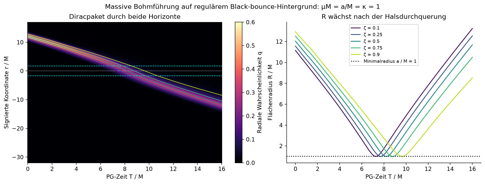

*Abbildung 23.2: Dichteentwicklung und fünf direkt integrierte Bohmsche Bahnen. Die signierte Koordinate nimmt ab; der Flächenradius erreicht $a$ und wächst danach. Beide Horizonte werden auf dem berechneten Ast regulär passiert.*

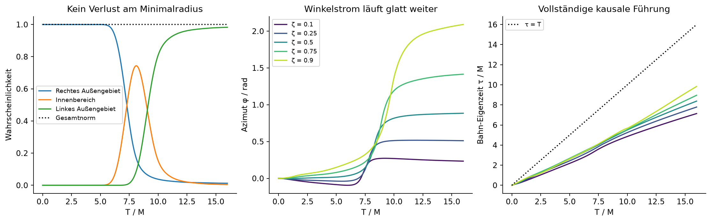

*Abbildung 23.3: Wahrscheinlichkeitsanteile der beiden Außengebiete und des Innenbereichs sowie fortgesetzte Winkel- und Eigenzeitentwicklung. Die Gesamtwahrscheinlichkeit bleibt erhalten; die angegebenen Gebietsanteile sind Werte im endlichen Rechenfenster.*

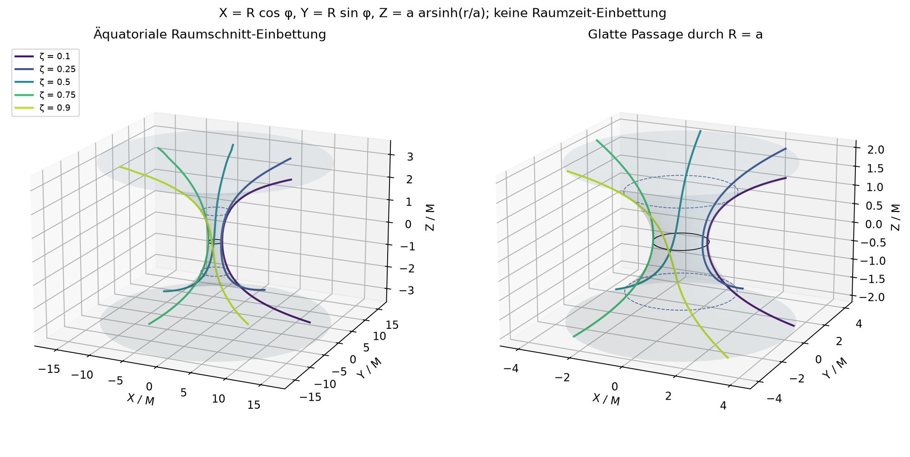

*Abbildung 23.4: Räumliche Projektion der Bahnen auf die isometrische Einbettung des äquatorialen PG-Raumschnitts. Die Darstellung verwendet $X=R\cos\phi$, $Y=R\sin\phi$, $Z=a\operatorname{arsinh}(r/a)$. Tatsächlich ist $dX^2+dY^2+dZ^2=dr^2+R^2d\phi^2$, da $(R')^2+(Z')^2=1$. Es ist eine Einbettung eines zweidimensionalen Raumschnitts, keine Einbettung der gesamten Raumzeit. Konstante Azimutversätze der fünf Anfangsorte dienen ihrer räumlichen Trennung.*

### 23.7 Formale und unabhängige Prüfung

Die [unabhängige symbolische Rechnung](work/nonsing_symbolic.py) kontrahiert den tatsächlichen vierdimensionalen Riemann-Tensor, berechnet den Einstein-Tensor in der regulären PG-Karte und rekonstruiert den vollen Tetraden-Diracoperator samt Strömen. **35 Prüfgruppen mit 231 skalaren Nullresiduen** bestätigen Geometrie, Quellenbedarf, Winkelreduktion und Kausalität. Die [Geometrieabbildung](work/nonsing_geometry.py) wird separat aus den geprüften analytischen Ausdrücken erzeugt.

Die Module [NonSingGeometry.lean](work/lean/NonSingGeometry.lean), [NonSingFlow.lean](work/lean/NonSingFlow.lean) und [NonSingCrossing.lean](work/lean/NonSingCrossing.lean) enthalten **23 benannte Sätze und 36 auditierte Theoremkonstanten**. Alle wurden mit Lean 4.30.0 und Mathlib-Revision `c5ea00351c28e24afc9f0f84379aa41082b1188f` vom Kernel akzeptiert. Transitiv treten ausschließlich `propext`, `Classical.choice` und `Quot.sound` auf.

Formalisiert sind die tatsächlichen ersten beiden Radiusableitungen, das positive Minimum, die uniforme Schranke des expliziten Krümmungsausdrucks, die negative reguläre Nullkontraktion, das Null-Druck-Hindernis des vorherigen Modells, tatsächliche Ableitungen der Diracstrombilanz und lokalen Kopplungsnorm, die volle kausale Norm sowie der aus Ableitungen bewiesene bedingte Durchquerungsvergleich. Die Identifikation mit den vierdimensionalen Tensoren und die globale unitäre Feldkonstruktion sind die separat ausgeführten symbolischen beziehungsweise analytischen Ergebnisse. Der Lean-Kernel wird nicht als Beweis einer vollständigen renormierten Rückwirkung, globaler Knotenvermeidung oder maximaler Raumzeiterweiterung ausgegeben.

Der [Numerikbeleg](work/nonsing_bohm_20261018_verified.json), seine [Roharrays](work/nonsing_bohm_20261018_verified.npz), der [unabhängige Methodenvergleich](work/nonsing_comparison_20261018.json), der [Symbolbeleg](work/nonsing_symbolic_20261018.json) und der [Lean-Beleg](work/lean/nonsing_proof_verification.json) dokumentieren die abgeschlossene Rechnung. Der [Gesamtprüfer](work/verify_nonsing_research.py) mit [Prüfbericht](work/nonsing_independent_verification_20261018_release.json) kontrolliert zusätzlich Dateihashes, frühere Forschungsartefakte, lokale Verweise und Formeln. Das Ergebnis ist eine verifizierte reguläre Testteilchenpassage auf einem expliziten alternativen Hintergrund mit notwendiger Zusatzquelle; es entscheidet nicht, ob ein astrophysikalisches schwarzes Loch diese Geometrie entwickelt.

## 24. Quantenfeld und Raumkrümmung

### 24.1 Zwei Richtungen der Wechselwirkung

Die Raumzeit wirkt auf das Diracfeld durch Tetrade, Spinverbindung und die räumlich veränderlichen Transport- und Winkelkoeffizienten. Das Feld wirkt auf die Geometrie durch seinen Spannungsenergie-Erwartungswert. Diese beiden Richtungen werden hier für Schwarzschild und für die reguläre Geometrie aus Kapitel 23 getrennt untersucht. Der neue Vergleich bestimmt einen **endlichen renormierten Anregungstensor**, seine Energiearbeit und die daraus folgenden Anforderungen an eine Rückwirkung. Er verwendet die tatsächliche vierdimensionale massive Diracmode $\kappa=1$, $j=m_j=1/2$.

Auf beiden Hintergründen gilt

$$ds^2=-dT^2+(dr+v\,dT)^2+R^2d\Omega^2,\qquad v=\sqrt{2M/R}.$$

Für Schwarzschild ist $R=r>0$; für den regulären Vergleich ist $R=\sqrt{r^2+a^2}$, $r\in\mathbb R$ und $0<a<2M$. Die gemeinsame reskalierte Feldgleichung lautet

$$i\partial_T\psi=H\psi,\qquad
H=-iC\partial_r-\frac i2C'+V,$$
$$C=\sigma_3-vI,\qquad V=\mu\sigma_1-w\sigma_2,
\qquad w=\frac\kappa R.$$

Insbesondere bleibt die Kopplung auf Schwarzschild wirksam, obwohl dessen Ricci-Tensor verschwindet: Der Riemann-Tensor ist nicht null, und $K=48M^2/r^6$. Ein verschwindender Ricci-Skalar ist daher kein Argument für freie flache Feldentwicklung.

### 24.2 Eine endliche Quantenfeldquelle

Für diesen Vergleich wählen wir glatte kompakte Anfangsdaten

$$b(z)=\begin{cases}e^{-1/(1-z^2)},&|z|<1,\\0,&|z|\ge1,\end{cases}$$
$$\psi(0,r)=C_b\,b((r-r_0)/\sigma)e^{ip_0(r-r_0)}\chi_0,$$
$$C_b^{-2}=\sigma\int_{-1}^1e^{-2/(1-z^2)}\,dz,\qquad
\chi_0=\begin{pmatrix}\sqrt{(E_0+p_0)/(2E_0)}\\
\sqrt{(E_0-p_0)/(2E_0)}\end{pmatrix},\qquad E_0=\sqrt{p_0^2+\mu^2}.$$

Alle Ableitungen verschwinden an den Trägerenden. Der vollständige Spinormodus $\Psi$ besitzt die Cauchynorm eins. Die positive flache Polarisation $\chi_0$ wird nicht mit einer globalen Killing-Positivfrequenzprojektion gleichgesetzt.

Eine explizite Zustandskonstruktion macht die Quantenfeldinterpretation dennoch möglich. Sei $\mathsf P$ die Besetzungsprojektion eines reinen Hadamardzustands auf dem Hilbertraum der Dirac-Cauchydaten. Solche Zustände und die benötigte Abbildung glatter kompakter Daten auf glatte Daten sind durch die Konstruktion von Gérard und Stoskopf gesichert, insbesondere Propositionen 3.4, 3.5, 3.8 und Theorem 7.2 [GerardStoskopf2022]. Setze $b_\perp=(I-\mathsf P)\Psi$ und $B=\|b_\perp\|$.

Falls $B>0$, definiere

$$g=b_\perp/B,\qquad
\mathsf P_1=\mathsf P+|g\rangle\langle g|,\qquad
\mathsf P_0=\mathsf P_1-|\Psi\rangle\langle\Psi|.$$

Wegen $\mathsf Pg=0$, $\|g\|=1$ und $\mathsf P_1\Psi=\Psi$ sind beide Operatoren orthogonale Projektionen. Falls $B=0$, genügt $\mathsf P_1=\mathsf P$ und $\mathsf P_0=\mathsf P-|\Psi\rangle\langle\Psi|$. In beiden Fällen gilt

$$\mathsf P_0\Psi=0,\qquad
\mathsf P_1-\mathsf P_0=|\Psi\rangle\langle\Psi|.$$

Die Änderungen haben endlichen glatten Rang. Ihre Diracentwicklung liefert glatte Bisolutionen, welche die Hadamard-Wellenfrontstruktur nicht verändern. Die Projektionsidentitäten sichern zugleich die CAR-Positivität und Reinheit. Somit existieren zwei zulässige Hadamardzustände, die sich genau durch die zusätzliche Besetzung dieses Modus unterscheiden. Auf Schwarzschild gilt die Konstruktion auf einer glatten globalhyperbolischen Region ohne Singularitätsrand; die Cauchyfläche kann auf dem für den Vergleich benötigten Anfangsgebiet mit dem PG-Blatt übereinstimmen und außerhalb zu einer glatten Cauchyfläche ergänzt werden. Die Daten werden dort glatt mit null fortgesetzt. Der numerische Ausflussrand ist kein Bestandteil der Zustandsdefinition.

Bei gleicher Geometrie und gleichen endlichen Renormierungskoeffizienten fallen die gemeinsamen lokalen Hadamard- und Krümmungsterme in der Differenz weg [DHP2009]. Daher ist

$$\Delta\langle T_{ab}\rangle_{\rm ren}
=\langle T_{ab}\rangle_{1,\rm ren}-\langle T_{ab}\rangle_{0,\rm ren}
=T_{ab}[\Psi],\qquad \nabla^aT_{ab}[\Psi]=0.$$

Die rechte Seite ist der symmetrische Dirac-Bilineartensor, einschließlich aller Ableitungs- und Spinverbindungsbeiträge. Dies ist eine exakte endliche Quantenfeldquelle. Der konstruierte Referenzzustand hängt vom Paket ab; seine absolute Vakuumpolarisation wird nicht berechnet und er wird keinem der speziellen Boulware-, Unruh- oder Hartle–Hawking-Zustände gleichgesetzt. Die beiden Geometrien erhalten jeweils ein eigenes Zustandspaar. Ihre absoluten Vakuumpolarisationen können nicht geometrieübergreifend gegeneinander weggekürzt werden.

### 24.3 Energie, Druck und Drehimpuls

Für die frei fallende PG-Beobachterfamilie $n=\partial_T-v\partial_r$ und den räumlichen Einheitsvektor $e_r=\partial_r$ definieren wir

$$q=\psi^\dagger\psi,\qquad s_i=\psi^\dagger\sigma_i\psi,$$
$$\Pi=\operatorname{Im}(\psi^\dagger\partial_r\psi),\qquad
P=\operatorname{Im}(\psi^\dagger\sigma_3\partial_r\psi),\qquad
W=\mu s_1-ws_2.$$

Die direkte vierdimensionale Tetradenrechnung ergibt die folgenden Rahmenprojektionen:

$$4\pi R^2\Delta\rho=P+W=:e,\qquad
4\pi R^2\Delta T(n,e_r)=-\Pi,$$
$$4\pi R^2\Delta p_r=P,\qquad
4\pi R^2\Delta p_\theta=4\pi R^2\Delta p_\phi
=-\frac{w s_2}{2}=:p_t.$$

Die Energie ist also nicht einfach $\mu q$. Räumliche Gradienten, Winkelkopplung und Spinorinterferenz tragen zu Quelle und Druck bei. Die Spur erfüllt

$$\Delta\langle T^a{}_a\rangle_{\rm ren}
=-\frac{\mu s_1}{4\pi R^2}=-\mu\overline\Psi\Psi.$$

Die geometrische Spuranomalie verschwindet in dieser Zustandsdifferenz; sie verschwindet damit nicht im absoluten Erwartungswert.

Die einzelne $m_j=1/2$-Mode ist keine vollständige kugelsymmetrische Quelle. Die zusätzlich berechneten Komponenten $T(n,e_\phi)$ und $T(e_r,e_\phi)$ sind im Allgemeinen nicht null. Beispielsweise gilt

$$4\pi R^2\Delta T(n,e_\phi)
=\frac{\sin\theta}{4R}\left[-3q+(Rs_1)'\right].$$

Der zu $\partial_\phi$ gehörende axiale Noetherstrom besitzt nach Winkelintegration die Dichte

$$\mathcal J_z=\frac q2-\frac{(Rs_1)'}6.$$

Für verschwindende Randterme ergibt sich $\Delta J_z=1/2$. Die angeregte Mode liefert also auch eine Drehimpulsquelle. Eine rein kugelsymmetrische Rückwirkung setzt beispielsweise die passende Besetzung beider $m_j$-Partner voraus. Die nachfolgenden radialen Energiebilanzen bleiben für die einzelne axialsymmetrische Mode exakt, da der Winkelenergiefluss keine Winkeldivergenz beiträgt.

### 24.4 Geometrische Arbeit und Erhaltung

Aus dem tatsächlichen Diractensor und unabhängig aus der Feldgleichung folgen

$$\partial_T\Pi+\partial_r(P-v\Pi)
=v'\Pi+2\frac{R'}R p_t,$$
$$\partial_Te+\partial_r(\Pi-ve)
=v'P+2v\frac{R'}R p_t=:\mathcal W.$$

Die zweite Gleichung beschreibt die Änderung der von $n$ gemessenen Energie durch radiale und tangentiale Spannungsarbeit. Die Größe $\mathcal W$ ist kugelintegriert; die entsprechende lokale Arbeitsdichte ist $\mathcal W/(4\pi R^2)$. Ihr Vorzeichen hängt sowohl von der Geometrie als auch vom Feldzustand ab.

Der stationäre Killingvektor ist dagegen $\xi=\partial_T=n+ve_r$. Seine Energiedichte und sein radialer Fluss lauten

$$\varepsilon=e-v\Pi=\operatorname{Re}(\psi^\dagger H\psi),$$
$$\mathcal F_K=(1+v^2)\Pi-v(e+P)
=\operatorname{Re}(\psi^\dagger C H\psi).$$

Sie erfüllen exakt

$$\partial_T\varepsilon+\partial_r\mathcal F_K=0.$$

Lokale geometrische Arbeit und Erhaltung der stationären Energie sind somit vereinbar: Die beiden Aussagen beziehen sich auf unterschiedliche Beobachter und Energieprojektionen. Für ein Rechenintervall $[L,U]$ gilt mit $\mathcal F_n=\Pi-ve$

$$E_n(T)-E_n(0)+\int_0^T[\mathcal F_n(t,U)-\mathcal F_n(t,L)]\,dt
=\int_0^T\!\int_L^U\mathcal W\,dr\,dt,$$
$$E_K(T)-E_K(0)+\int_0^T[\mathcal F_K(t,U)-\mathcal F_K(t,L)]\,dt=0.$$

Dabei sind $E_n=\int_L^Ue\,dr$ und $E_K=\int_L^U\varepsilon\,dr$. Ein Energieabfall in einem offenen Rechengebiet wird deshalb nicht als Energievernichtung interpretiert.

### 24.5 Singularitätsgrenze und regulärer Hals

Auf Schwarzschild ist die geometrische Arbeit

$$\mathcal W_{\rm S}=-\frac{v}{2r}P-\frac{v\kappa}{r^2}s_2.$$

Die Koeffizienten skalieren bei $r\downarrow0$ wie $r^{-3/2}$ beziehungsweise $r^{-5/2}$. Auch $w=\kappa/r$ und die Riemannkrümmung werden unbeschränkt. Dies beweist keine universell divergierende Feldenergiedichte: Der konkrete Grenzwert hängt zusätzlich von der Lösung und ihren Ableitungen ab. Die vorgegebene Schwarzschild-Geometrie bleibt aber singulär; eine glatte Feldquelle an jedem positiven Radius entfernt diesen Endpunkt nicht.

Im regulären Modell gilt dagegen

$$\mathcal W_{\rm B}=-\frac{vr}{2R^2}P-\frac{v\kappa r}{R^3}s_2.$$

Wegen $R\ge a>0$ sind alle Koeffizienten beschränkt. Insbesondere

$$|w|\le\frac{|\kappa|}{a},\qquad
|w'|\le\frac{|\kappa|}{a^2},\qquad
|v'|\le\frac{\sqrt{2M/a}}{4a}.$$

Am symmetrischen Hals $r=0$ verschwinden die beiden lokalen Arbeitskoeffizienten exakt. Das Feld kann dort dennoch zeitlich variieren, weil der Energiefluss räumlich variiert. Die Winkelkopplung $\kappa/a$ und die Krümmung bleiben endlich und im Allgemeinen ungleich null.

Die in Kapitel 23 begründeten Sobolev-Abschätzungen sichern auf jedem endlichen Zeitintervall $[0,T_*]$ räumliche Supremumsschranken $\sup_{0\le T\le T_*}\|\psi(T)\|_{L^\infty}\le A$ und $\sup_{0\le T\le T_*}\|\partial_r\psi(T)\|_{L^\infty}\le B$. Mit $\Omega=\sqrt{\mu^2+\kappa^2/a^2}$ folgen unmittelbar

$$|\Delta\rho|\le\frac{AB+\Omega A^2}{4\pi a^2},\qquad
|\Delta p_r|\le\frac{AB}{4\pi a^2},\qquad
|\Delta p_t|\le\frac{|\kappa|A^2}{8\pi a^3}.$$

Auch die übrigen Tensorprojektionen sind unter denselben Voraussetzungen endlich. Es handelt sich um Regularität auf jedem endlichen Zeitintervall, nicht um eine zeituniforme Stabilitätsbehauptung. Der Tensor enthält keine Division durch $q$ und bleibt daher auch an einem Spinorknoten glatt; die Existenz einer Bohmschen Führungsbahn am Knoten ist eine davon getrennte Frage.

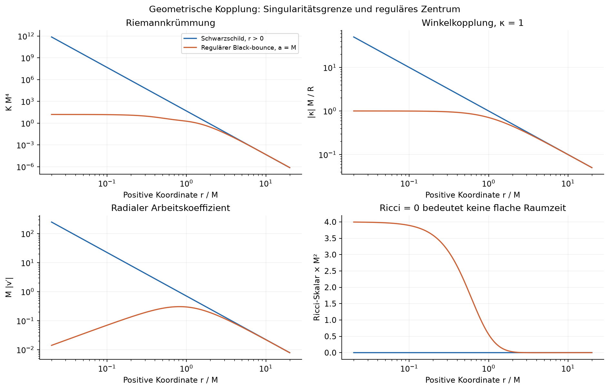

*Abbildung 24.1: Derselbe geometrische Diracoperator auf zwei Hintergründen. Die Schwarzschild-Koeffizienten werden zum Zentrum unbeschränkt. Im regulären Modell bleiben sie endlich; am Hals verschwindet $v'$. Der Ricci-Skalar allein erfasst die Schwarzschild-Krümmung nicht.*

### 24.6 Numerischer Feldvergleich

Die neuen glatten Pakete verwenden $\mu M=1$, $p_0M=-2$, $r_0/M=12$, $\sigma/M=3$ und $\kappa=1$. Der reguläre Fall hat $a/M=1$. Identisch sind die reskalierten radialen Anfangsdaten und die Winkelmode; die physikalische Dichte wird jeweils mit dem tatsächlichen Flächenmaß berechnet. Es gilt $C_b^{-2}/M=0{,}399258362535$. Diese neuen Zustände sind von den früheren $C^3$-Paketen der Kapitel 21 und 23 zu unterscheiden.

Der [neue Numerikvergleich](work/fieldcurv_numerics.py) entwickelt beide Felder mit zwei getrennten Verfahren: einem ungesplitteten SBP/DG-Verfahren fünften Grades mit dünnbesetztem Matrixexponential und einem Charakteristikverfahren mit lokaler unitärer Rotation. Die eingefrorenen räumlichen Kerne der vorherigen Kapitel werden wiederverwendet und über ihre Hashes gebunden. Stress und Arbeit werden aus tatsächlichen Spinor- und Polynomableitungen berechnet.

Das Zeitfenster ist $0\le T/M\le12$, der Ausgabeabstand $0{,}025M$. Schwarzschild verwendet $0{,}5\le r/M\le30$ mit reinem Ausfluss am inneren Rand; der reguläre Fall verwendet $-30\le r/M\le30$. Die äußeren Ränder liegen jenseits der kausalen Paketfronten. Die DG-Gitter haben 320/640 beziehungsweise 633/1266 Zellen. Das unabhängige Charakteristikgitter hat $\Delta r/M=0{,}005$ und $\Delta T/M=0{,}000625$.

| Größe | Schwarzschild, Gebiet $r\ge0{,}5M$ | Regulär, $a=M$ |
|---|---:|---:|
| $ME_n(0)$ | 2,236068 | 2,236068 |
| $ME_K(0)$ | 3,054790 | 3,053333 |
| $ME_n(12M)$ | −0,002516 | 2,055947 |
| $ME_K(12M)$ | −0,000257 | 3,053333 |
| $M\int\mathcal W\,dr\,dT$ | −0,196578 | −0,180121 |
| Norm im Rechengebiet bei $12M$ | 0,0105743 | 1,0000000 |
| Maximaler Killingbilanzrest, in $M^{-1}$ | $1{,}101\times10^{-6}$ | $7{,}140\times10^{-10}$ |
| Maximaler Eulerbilanzrest, in $M^{-1}$ | $5{,}292\times10^{-7}$ | $1{,}068\times10^{-8}$ |

Im regulären Fall erklärt die integrierte Spannungsarbeit die Änderung der Euler-Energie, während die Killingenergie erhalten bleibt. Auf Schwarzschild ist der Großteil des Pakets durch den Rechenrand abgeflossen. Die kleinen negativen eingeschlossenen Energiereste sind Werte der vorzeichenbehafteten Anregungsdifferenz; sie bedeuten keine negative Teilchenmasse. Die Randflüsse schließen beide Energiebilanzen.

Alle **15 Prüfungen je Geometrie** sind bestanden. Die maximale $L^2$-Differenz der unabhängig berechneten Spinoren beträgt $6{,}934\times10^{-7}$ beziehungsweise $1{,}057\times10^{-6}$, die $L^1$-Differenz der reduzierten Energiedichten $5{,}411\times10^{-7}$ beziehungsweise $1{,}007\times10^{-6}$. Die eigene DG-Verfeinerung ändert diese Energiedichte um $1{,}527\times10^{-6}$ beziehungsweise $4{,}225\times10^{-6}$. Eine Vergröberung der zeitlichen Bilanzquadratur auf $0{,}05M$ ändert die integrierten Größen maximal um rund $1{,}175\times10^{-5}/M$ beziehungsweise $1{,}715\times10^{-7}/M$. Dies sind numerische Konvergenzkontrollen, keine rigorosen Fehlerintervalle.

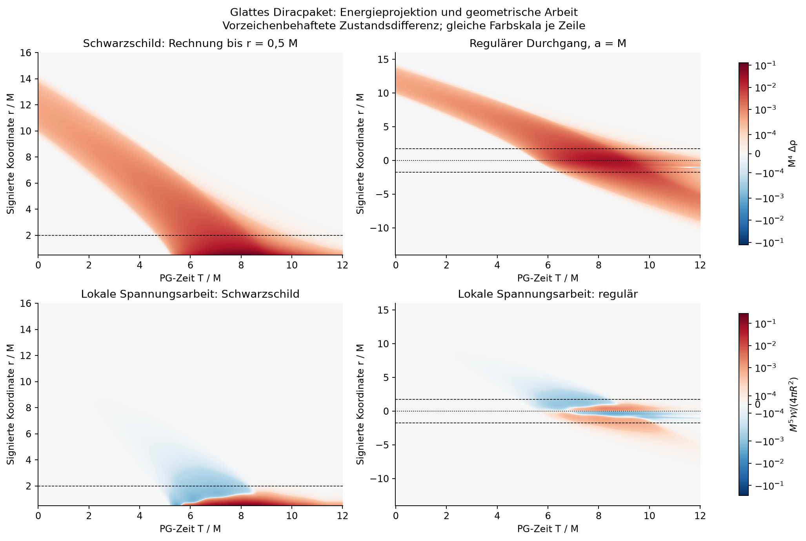

*Abbildung 24.2: Lokale Euler-Energie und Spannungsarbeit desselben glatten Paketansatzes auf beiden Geometrien. Die Farbskalen sind innerhalb jeder Zeile identisch und berücksichtigen beide Vorzeichen. Der Schwarzschild-Ausschnitt endet bei $0{,}5M$; der reguläre Ausschnitt enthält den Hals und das zweite Außengebiet.*

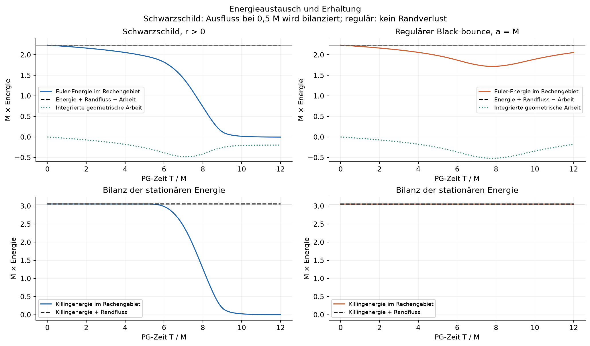

*Abbildung 24.3: Unterschied zwischen eingeschlossener Energie, geometrischer Arbeit und Energieabfluss. Die korrigierten Bilanzen bleiben konstant. Im regulären Fall ist der äußere Randfluss vernachlässigbar; auf Schwarzschild ist der innere Fluss wesentlich.*

### 24.7 Was daraus für die Rückwirkung folgt

In der hier gewählten semiklassischen Kopplung muss die Metrik zusammen mit dem vollständigen Erwartungswert bestimmt werden:

$$G_{ab}[g]+\Lambda g_{ab}+c_1I_{ab}[g]+c_2J_{ab}[g]
=8\pi G\left(\langle T_{ab}\rangle_{0,g,\rm ren}
+\Delta T_{ab}[g]+T^{\rm extra}_{ab}\right).$$

Dabei bezeichnen $I_{ab},J_{ab}$ die festgelegten lokalen höheren Krümmungsterme; die Referenzquelle und gegebenenfalls die zusätzliche Materie besitzen eine eigene metrische Abhängigkeit. Die abgeschlossene Rechnung liefert $\Delta T_{ab}$ auf den beiden Hintergrundmetriken. Eine neue selbstkonsistente Metrik würde zusätzlich die absolute Referenzquelle und deren Reaktion auf eine Metrikänderung benötigen. Die Bohmsche Führungsposition des Modus wird in dieser Kopplungswahl nicht als zusätzliche Punktquelle zum bereits verwendeten Feldstress addiert.

Der Quellenunterschied ist bereits am Anfang exakt sichtbar. Auf Schwarzschild gilt für $r>0$ $G_{ab}=0$; ein nichtverschwindender Anregungstensor ändert deshalb die Quellengleichung. Im regulären Modell ist für $k_-=n-e_r$

$$G_{ab}k_-^ak_-^b=-\frac{2a^2}{R^4}(1+v)^2<0.$$

Das anfängliche Paket mit Träger $[9M,15M]$ und sämtliche Ableitungen verschwinden hingegen am Hals. Dort ist $\Delta T_{ab}(0,0)=0$. Die regularisierende Quelle kann also nicht aus genau dieser zusätzlichen Anregung allein stammen. Ein späterer negativer Wert einer einzelnen Anregungs-Nullkontraktion würde weder das gesamte Tensorprofil noch dessen selbstkonsistente Dynamik ersetzen.

Für die gewählten dimensionslosen Parameter ist $\Delta E_K$ von der Ordnung $M^{-1}$. Die zusätzliche gravitative Energieskala relativ zu $M/G$ ist

$$\eta_{\rm test}=\frac{G|\Delta E_K|}{M}
\simeq 3{,}05\frac{G}{M^2}.$$

Die Darstellung $M=1$ setzt $G/M^2$ nicht gleich eins. Für $M\gg\sqrt G$ kann der einzelne Zusatzmodus schwach gravitieren; dies kontrolliert weder die unbekannte absolute Referenzquelle noch gleichmäßig die Singularitätsgrenze. Der bereits selbstkonsistent gelöste homogene Paarsektor aus Kapitel 22 bleibt ein eigener Befund: Dort erzwingt $p_z=0$ weiterhin den singulären Endpunkt. Der neue Feldvergleich hebt dieses Ergebnis nicht auf.

Damit ist die Wechselwirkung im festgelegten Umfang bestimmt: Bei der singulären Geometrie werden die inneren Kopplungen unbeschränkt und keine Feldfortsetzung durch das Zentrum gewonnen. Bei der regulären Geometrie laufen Feld, endliche Anregungsquelle und Energiefluss durch den Hals weiter. Die Regularität erfordert weiterhin eine tragende Hintergrundquelle; sie entsteht nicht automatisch durch die endliche Quantenanregung.

### 24.8 Mathematische Nachweise

Die [vollständige symbolische Quellenprüfung](work/fieldcurv_symbolic.py) berechnet alle zehn unabhängigen Komponenten des symmetrischen Rahmentensors aus dem tatsächlichen vierdimensionalen Tetraden-Diracoperator. Der [Beleg](work/fieldcurv_symbolic_20261018_verified.json) dokumentiert **36 bestandene Prüfgruppen mit 69 verschwindenden skalaren Residuen**, einschließlich beider Energiebilanzen, radialer Impulsbilanz, axialer Komponenten und geometrischem Quellenbedarf.

Die Module [FieldCurvEnergy.lean](work/lean/FieldCurvEnergy.lean), [FieldCurvBounds.lean](work/lean/FieldCurvBounds.lean) und [FieldCurvProjector.lean](work/lean/FieldCurvProjector.lean) enthalten **36 benannte Sätze und 56 auditierte Theoremkonstanten**. Alle wurden mit Lean 4.30.0 und Mathlib-Revision `c5ea00351c28e24afc9f0f84379aa41082b1188f` vom Kernel akzeptiert; der [Kernel-Beleg](work/lean/fieldcurv_proof_verification.json) enthält transitiv ausschließlich `propext`, `Classical.choice` und `Quot.sound`.

Formalisiert sind tatsächliche polarisierte Strom-, Killingenergie-, Impuls- und Arbeitsableitungen unter den expliziten lokalen Diracgleichungen, punktweise Bilinear- und Stressschranken, reale Kopplungsableitungen, die reguläre Gradientenschranke und der einseitige singuläre Kopplungsgrenzwert. Drei Matrixsätze prüfen die tatsächliche zweidimensionale Projektionsalgebra einer Modeneinfügung. Die vierdimensionale Tensoridentifikation, globale Feldentwicklung und vollständige Hadamard-Zustandskonstruktion sind die getrennt ausgeführten symbolischen beziehungsweise analytischen Beweise. Die formalen Sätze behaupten keine absolute renormierte Rückwirkungsquelle.

Die [Schwarzschild-Rohdaten](work/fieldcurv_20261018_review_a0.npz) mit [Prüfbeleg](work/fieldcurv_20261018_review_a0.json) und die [regulären Rohdaten](work/fieldcurv_20261018_review_a1.npz) mit [Prüfbeleg](work/fieldcurv_20261018_review_a1.json) enthalten beide unabhängigen Methoden und die Verfeinerungsläufe. Der [Figurenerzeuger](work/fieldcurv_figures.py) liest ausschließlich diese gebundenen Daten. Der [Gesamtprüfer](work/verify_fieldcurv_research.py) und sein [Prüfbericht](work/fieldcurv_independent_verification_20261018.json) kontrollieren Rohbilineare, Bilanzintegrale, Quellenhashes, Vorgängerartefakte und Manuskriptverweise.

## 25. Absolute Quantenquelle

### 25.1 Zustand und Renormierung

Die endliche Anregungsquelle aus Kapitel 24 lässt den absoluten Referenzanteil offen. Hier wird dieser Schritt in einem exakt lösbaren massiven Sektor vollzogen und mit zwei unabhängigen Schwarzlochprüfungen verbunden: einer zustandsunabhängigen Spurbedingung für masslose Diracfelder und der führenden massiven Vakuumpolarisation samt ihrer ersten Metrikantwort. Der reguläre exakte Sektor ist de Sitter; seine Identifikation mit dem Inneren eines asymptotisch flachen schwarzen Lochs wird nicht vorausgesetzt.

Für ein freies Diracfeld der Masse $\mu$ bezeichnet die absolute Quelle den gesamten lokalen renormierten Erwartungswert in einem festgelegten Hadamardzustand $\omega$. Schematisch ist

$$\langle T_{ab}\rangle_{\omega,\mathrm{ren}}
=\lim_{x'\to x}D_{ab}(S_\omega-H_\ell)+Q_{ab}.$$

$S_\omega$ enthält die globalen Zustandsinformationen, $H_\ell$ den lokalen Kurzdistanzabzug und $Q_{ab}$ den zur gewählten Vorschrift gehörenden lokalen geometrischen Beitrag. Die verbleibenden zulässigen endlichen Verschiebungen sind Linearkombinationen von

$$\mu^4g_{ab},\qquad \mu^2G_{ab},\qquad I_{ab},\qquad J_{ab},$$

wobei $I_{ab}$ und $J_{ab}$ die metrischen Variationen der Wirkungen mit $\mathcal R^2$ beziehungsweise $R_{cd}R^{cd}$ sind [DHP2009]. Ihre Koeffizienten gehören zusammen mit $G$ und $\Lambda$ zur Festlegung der semiklassischen Theorie. Ein Wechsel des Subtraktionsrezepts bei kompensierender Verschiebung dieser Gravitationskopplungen lässt die Feldgleichung unverändert. Nur den Quellenwert zu verschieben, ohne die Kopplungen anzupassen, würde ein anderes Modell ergeben.

Im Folgenden gelten $\hbar=c=1$, Signatur $(-,+,+,+)$ und gegebenenfalls $N$ identische unabhängige vierkomponentige Diracfelder. Die Bohmsche Interpretation fügt dem hier gewählten Erwartungswert der Feldquelle keine zweite Punktquelle an den Teilchenpositionen hinzu. Eine eigene Bohmsche Gravitationstheorie mit einer anderen Kopplungsregel wäre gesondert zu definieren.

### 25.2 Exakte Schwarzlochprüfung

Zunächst sei $\mu=0$, $\Lambda=0$ und keine weitere Materie vorhanden. Mit $C_{abcd}$ als Weyltensor und

$$E_4=R_{abcd}R^{abcd}-4R_{ab}R^{ab}+\mathcal R^2$$

lautet die vollständige lokale Dirac-Spuranomalie

$$\langle T^a{}_a\rangle_{\mathrm{ren}}
=\frac{N}{5760\pi^2}
\left(18C_{abcd}C^{abcd}-11E_4+b\Box\mathcal R\right).$$

Hier ist $b$ ein beliebiger fester endlicher Koeffizient nach Zusammenfassung der quadratischen Gravitationsbeiträge in der Spurgleichung. Die reine Hadamard-Konvention in [DHP2009, Abschnitt 4.3] entspricht vor einer solchen zusätzlichen Verschiebung $b=-12$. Der Weylquadrat-Gegenbeitrag ist spurfrei. Deshalb muss jede Lösung notwendig

$$\mathcal E_b:=\mathcal R+
\frac{NG}{720\pi}
\left(18C_{abcd}C^{abcd}-11E_4+b\Box\mathcal R\right)=0$$

erfüllen. Diese Bedingung enthält die ganze absolute Spur; der zustandsabhängige spurfreie Tensoranteil bleibt daneben relevant.

**Schwarzschild.** Auf der unveränderten Metrik sind $\mathcal R=R_{ab}=0$ und $C^2=E_4=48M^2/r^6$. Damit gilt exakt

$$\langle T^a{}_a\rangle_{\mathrm{ren}}
=\frac{7NM^2}{120\pi^2r^6}>0,$$

$$\mathcal E_b=\frac{7NGM^2}{15\pi r^6}\ne0.$$

Kein zulässiger Zustand und kein fester endlicher quadratischer Gegenparameter macht die unveränderte Schwarzschild-Geometrie zu einer Lösung dieses reinen masslosen Quellenmodells. Auf dem festen Hintergrund divergiert außerdem die absolute Spur für $r\to0^+$. Daher können nicht alle orthonormalen Stresskomponenten dort beschränkt bleiben. Das ist stärker als die bloße Koeffizientendivergenz aus Kapitel 24, bestimmt aber noch nicht die Singularitätsstruktur einer neu rückgekoppelten Geometrie.

**Black-bounce.** Schreibe den regulären Hintergrund aus Kapitel 23 auf einer äußeren Seite in seinem Kugelradius $R=\sqrt{r^2+a^2}$:

$$ds^2=-f(R)dt^2+
\frac{dR^2}{f(R)(1-a^2/R^2)}+R^2d\Omega^2,
\qquad f(R)=1-\frac{2M}{R}.$$

Die direkte vierdimensionale Tensorrechnung ergibt

$$\mathcal R=\frac{2a^2(3M-R)}{R^5},$$

$$\begin{aligned}
18C^2-11E_4=\frac{8}{R^{10}}\big[&42M^2R^4+28Ma^2R^3\\
&+(12a^4-126M^2a^2)R^2\\
&-53Ma^4R+111M^2a^4\big],
\end{aligned}$$

$$\begin{aligned}
\Box\mathcal R=\frac{2a^2}{R^{10}}\big[&-12R^4+92MR^3\\
&+(16a^2-150M^2)R^2\\
&-115Ma^2R+180M^2a^2\big].
\end{aligned}$$

Somit ist für jedes feste endliche $b$

$$\boxed{\lim_{R\to\infty}R^4\mathcal E_b=-2a^2.}$$

**Beweis.** Die klassische Spur besitzt einen nichtverschwindenden Term der Ordnung $R^{-4}$. Beide Quantenpolynome beginnen erst bei $R^{-6}$. Nach Multiplikation mit $R^4$ verschwinden daher sämtliche Quanten- und Gegenparameterbeiträge. Für $a>0$ ist der verbleibende Grenzwert ungleich null. Eine auf einem äußeren Halbstrahl identisch erfüllte Feldgleichung hätte dagegen Grenzwert null.

Die konkrete Simpson–Visser-Familie kann folglich ebenfalls nicht allein von dieser absoluten masslosen Diracquelle getragen werden, selbst wenn ihre lokale Krümmung überall endlich ist. Der Ausschluss gilt für diese Metrikfamilie, nicht für alle regulären Raumzeiten.

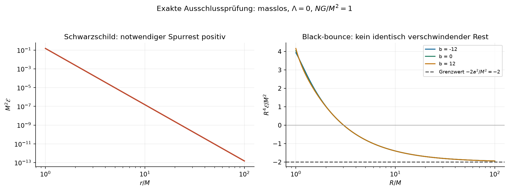

Bei $\mu>0$ tritt zusätzlich das zustandsabhängige renormierte Kondensat auf. In der zu Kapitel 24 passenden Konvention lautet die Spur $-\mu\langle\bar\psi\psi\rangle_{\mathrm{ren}}+\mathcal A_\mu$, einschließlich der festgelegten lokalen Massenterme in $\mathcal A_\mu$. In dieser Formel bezeichnen Kondensat und $\mathcal A_\mu$ jeweils die Summe über alle $N$ Felder. Die Einstein-Spur verlangt dann

$$\mu\langle\bar\psi\psi\rangle_{\mathrm{ren}}
=\frac{\mathcal R}{8\pi G}+\mathcal A_\mu.$$

Diese Gleichung ist eine notwendige Anforderung an den Zustand, keine Konstruktion dieses Kondensats. Die masslosen Ausschlusssätze dürfen daher nicht ohne weitere Rechnung auf das massive Feld übertragen werden.

### 25.3 Absolute massive Vakuumquelle

Ein vollständiger massiver Vergleich ist im de-Sitter-invarianten Hadamardzustand möglich. Seine Moden entsprechen dem Bunch–Davies-Zustand mit $E_k=1$, $F_k=0$ in [delRio2014, Abschnitt V.1]. Die vierte adiabatische Subtraktion jener Arbeit legt das verwendete Rezept fest. Die Minkowski-Vakuumenergie ist null; die Terme proportional zu $\mu^4g_{ab}$ und $\mu^2G_{ab}$ sind zusammen mit den renormierten Werten von $\Lambda$ und $G$ festgelegt.

Mit $x=\mu/H>0$ lautet die **exakte absolute Quelle** für ein Feld

$$\langle T_{ab}\rangle_{\mathrm{ren}}
=-\rho_1(H,\mu)g_{ab},\qquad p_1=-\rho_1,$$

$$\rho_1(H,\mu)=\frac{H^4}{960\pi^2}F(x),$$

$$F(x)=11+10x^2+
120x^2(1+x^2)\left[\log x-\operatorname{Re}\psi(1+ix)\right].$$

$\psi$ ist hier die Digammafunktion. Gleichung (96) von [delRio2014] verwendet $130x^2$ und $\psi(-1+ix)$; die Rekursion

$$\operatorname{Re}\psi(-1+ix)
=\operatorname{Re}\psi(1+ix)+\frac{1}{1+x^2}$$

liefert die angegebene Form. Der Wechsel von der dortigen Signatur $(+,-,-,-)$ erklärt das Minuszeichen vor $\rho_1g_{ab}$ in unserer Konvention. Die Dichte selbst behält ihr physikalisches Vorzeichen.

Diese Quelle enthält die gesamte massenabhängige Vakuumpolarisation und alle Impulse des vierdimensionalen Feldes. Sie ist weder eine Zustandsdifferenz noch allein aus der masslosen Anomalie rekonstruiert. Ihre Konservierung folgt aus $\nabla_ag_{bc}=0$ und konstantem $H$. Auf de Sitter gelten $R_{ab}=3H^2g_{ab}$ und $\mathcal R=12H^2$; beide quadratischen Variationstensoren $I_{ab},J_{ab}$ verschwinden für jedes $H$ exakt. Deren endliche Kopplungen ändern deshalb die nachfolgende algebraische Gleichung nicht.

Die reelle Reihendarstellung

$$\operatorname{Re}\psi(1+ix)
=-\gamma+\sum_{n=1}^{\infty}\frac{x^2}{n(n^2+x^2)}$$

zeigt die stetige Fortsetzung $F(0)=11$. Die schwere-Masse-Entwicklung liefert hingegen

$$F(x)=-\frac{31}{21x^2}-\frac{41}{42x^4}+O(x^{-6}),$$

$$\rho_1=-\frac{31H^6}{20160\pi^2\mu^2}
+O(H^8/\mu^4).$$

Die absolute Dichte ist folglich nicht durchgehend positiv. Die numerische Nullstelle bei $x\simeq0{,}4865373992$ bezeichnet einen nachgewiesenen Vorzeichenwechsel; eine globale Eindeutigkeit aller Nullstellen wird daraus nicht abgeleitet.

### 25.4 Selbstkonsistenter regulärer Zweig

Für $N$ identische Felder reduziert die maximale Symmetrie die **gesamte** Einstein-Gleichung auf

$$3H^2=\Lambda+8\pi GN\rho_1(H,\mu).$$

Die Quelle wird dabei auf derselben gesuchten Geometrie ausgewertet. Für $\Lambda=0$ und $\eta=NG\mu^2>0$ ist dies äquivalent zu

$$\boxed{\eta F(x)=360\pi x^2,\qquad H=\mu/x.}$$

**Existenzsatz.** Für jedes $\eta>0$ existiert mindestens eine Lösung $0<x<1$ und damit eine selbstkonsistente massive de-Sitter-Lösung.

**Beweis.** Die Funktion $F$ ist nach Fortsetzung bei null auf $[0,1]$ stetig. Aus der positiven Digammareihe folgt

$$F(1)<21+240\left(\frac{29}{50}
-\sum_{n=1}^{20}\frac{1}{n(n^2+1)}\right)<-0{,}7628.$$

Die verwendete obere Schranke $\gamma<29/50$ folgt beispielsweise aus der Euler–Maclaurin-Abschätzung $\gamma<H_2-\log2-1/4+1/48$ und der positiven Reihe $\log2>56/81$; daraus erhält man $\gamma<751/1296<29/50$. Die endliche rationale Summe wird zusätzlich exakt in Lean geprüft. Nun ist $\eta F(x)-360\pi x^2$ bei $x=0$ positiv und bei $x=1$ negativ. Der Zwischenwertsatz liefert einen inneren Nullpunkt. Dort ist $F(x)>0$, und Einsetzen von $H=\mu/x$ erfüllt die volle Tensorfeldgleichung.

Die globale Raumzeit kann als

$$ds^2=-dt^2+H^{-2}\cosh^2(Ht)d\Omega_3^2,
\qquad -\infty<t<\infty$$

geschrieben werden. Sie besitzt

$$\mathcal R=12H^2,\qquad
R_{abcd}R^{abcd}=24H^4$$

und ist geodätisch vollständig. Ein direkter Beweis verwendet den Hyperboloid $X\cdot X=H^{-2}$ im fünfdimensionalen Minkowski-Raum: Für eine affin parametrisierte Geodäte mit konstantem Tangentennormwert $\varepsilon$ ist $X''=-\varepsilon H^2X$. Die hyperbolischen, linearen beziehungsweise trigonometrischen Lösungen für zeitartige, nullartige und raumartige Geodäten existieren für jeden affinen Parameter. Die Aussage betrifft die globale de-Sitter-Erweiterung, nicht nur ihren ebenen expandierenden Koordinatenbereich.

Für eine zusätzliche positive kosmologische Konstante setzen wir $h=H/\mu$ und $\ell=\Lambda/\mu^2$. Die vollständige Gleichung ist

$$3h^2-\ell-\frac{\eta h^4}{120\pi}F(1/h)=0.$$

Zwei konkret berechnete Lösungen bei $\eta=1$ sind:

| Größe | $\ell=0$ | $\ell=0{,}03$, niedriger Krümmungszweig |
|---|---:|---:|
| $H/\mu$ | 11,04934717456 | 0,09999999343001 |
| $NGH^2$ | 122,0880729839 | 0,0099999986860 |
| $\rho_1/\mu^4$ | 14,57319023 | $-1{,}5684691001\times10^{-10}$ |

Der erste Zweig wird bei $\Lambda=0$ allein durch die renormierte Feldquelle getragen. Für $N=1$ ist er Planckskalig; mathematische Existenz beweist hier keine kontrollierte Näherung an eine vollständige Quantengravitation. Beim zweiten Zweig ist die Quelle negativ und senkt $H$ relativ zum klassischen Wert $\sqrt{\Lambda/3}=0{,}1\mu$ um etwa $6{,}57\times10^{-8}$ relativ. Für beispielsweise $N=100$ ist dort $GH^2\simeq10^{-4}$. Weder die algebraische Lösung noch diese Skala beweist dynamische Stabilität oder eine Kontrolle sämtlicher Stressfluktuationen.

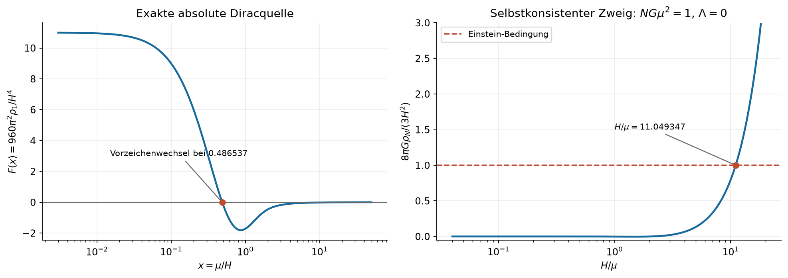

### 25.5 Massive Schwarzschild-Rückwirkung

Für das schwarze Loch lässt sich ein anderer präziser Schritt abschließen: die lokale Schwinger–DeWitt-Quelle der Ordnung $\mu^{-2}$ und ihre erste Rückwirkung. Die nachfolgenden Komponenten sind Gleichungen (46)–(48) von [Matyjasek2000] bei verschwindender elektrischer Ladung. Für ein Feld definiere

$$P(r)=\frac{M^2}{20160\pi^2\mu^2r^9}.$$

Dann gilt in dieser führenden Näherung

$$T^t{}_t=P(2384M-1080r),$$

$$T^r{}_r=P(504r-784M),$$

$$T^\theta{}_\theta=T^\phi{}_\phi=P(3536M-1512r).$$

Die statische äußere Energiedichte ist $\rho=-T^t{}_t$. Diese Quelle ist lokal, absolut im festgelegten Großmassenrezept und aus der effektiven Wirkung gewonnen. Sie ist jedoch keine vollständige zustandsabhängige Schwarzschild-Modensumme. Insbesondere fehlen nichtlokale Zustandsanteile und höhere Ordnungen in $\mu^{-2}$.

Mit $f_0=1-2M/r$ erfüllt sie exakt

$$\frac{dT^r{}_r}{dr}
+\frac{f_0'}{2f_0}(T^r{}_r-T^t{}_t)
+\frac2r(T^r{}_r-T^\theta{}_\theta)=0,$$

$$\frac{T^r{}_r-T^t{}_t}{f_0}
=\frac{11M^2}{140\pi^2\mu^2r^8}.$$

Der zweite Ausdruck besitzt eine glatte Horizontfortsetzung. Für die gravitative Antwort werden $\Lambda=0$ und die physikalischen quadratischen Gravitationskopplungen im angezeigten Rezept auf null gesetzt. Die Gleichungen werden in der Quellstärke bis zur ersten Ordnung gelöst. Beliebige feste nichtverschwindende quadratische Kopplungen würden zusätzliche lineare Antwortterme erzeugen, obwohl ihre Tensoren auf dem Ricci-flachen Ausgangshintergrund selbst verschwinden.

Schreibe

$$ds^2=-e^{2\chi(r)}F_g(r)dt^2+
F_g(r)^{-1}dr^2+r^2d\Omega^2,$$

$$F_g=1-\frac{2m_g(r)}r,\qquad m_g=M+\delta m.$$

Bei $m_g(\infty)=M$ und $\chi(\infty)=0$ ergeben die beiden radialen Einstein-Gleichungen

$$\delta m'=-4\pi GN r^2T^t{}_t,\qquad
\chi'=\frac{4\pi GN r}{f_0}(T^r{}_r-T^t{}_t).$$

Ihre Lösungen sind

$$\boxed{\delta m(r)=
\frac{NGM^2(149M-81r)}{1890\pi\mu^2r^6},}$$

$$\boxed{\chi(r)=-\frac{11NGM^2}{210\pi\mu^2r^6}.}$$

Die unabhängige vierdimensionale Rechnung bestätigt auch die Winkelgleichung in derselben Ordnung. Die Metrik ist also eine selbstkonsistente erste Antwort auf diese führende Quelle; das Einsetzen der korrigierten Metrik in die Quelle würde erst zur nächsten Rückwirkungsordnung beitragen.

Aus $F_g(r_H)=0$ und $\kappa=e^{\chi(r_H)}F_g'(r_H)/2$ folgen

$$\delta r_H=-\frac{13NG}{60480\pi\mu^2M^3},\qquad
\delta\kappa=-\frac{NG}{241920\pi\mu^2M^5}.$$

Dies sind geometrische Horizont- und Oberflächengravitationskorrekturen. Ein vollständiger Hawkingfluss wurde damit nicht berechnet. Für $\mu M=10$, $NG/M^2=0{,}01$ beträgt $\epsilon=NG/(\mu^2M^4)=10^{-4}$ und

$$\frac{\delta r_H}{M}=-6{,}8419784\times10^{-9}.$$

Die Expansion verlangt kleine lokale Krümmungs- und Ableitungsskalen gegenüber der Masse sowie kleine Metrikänderungen. Ein notwendiger Krümmungsindikator ist

$$\eta_{\mathrm{curv}}(r)=\frac{\sqrt K}{\mu^2}
=\frac{4\sqrt3M}{\mu^2r^3},\qquad
\eta_{\mathrm{curv}}(2M)=\frac{\sqrt3}{2(\mu M)^2}.$$

Er beträgt im Beispiel am Horizont etwa $0{,}00866$, wächst aber zum Zentrum unbegrenzt. Weder dieser einzelne Indikator noch die numerische Integrationsgenauigkeit ist eine Fehlerschranke für die ausgelassenen Zustandsbeiträge. Die formalen Divergenzen der korrigierten Ausdrücke bei $r=0$ liegen außerhalb ihrer zulässigen Interpretation und beweisen keine erhaltene Singularität der vollständigen massiven Theorie.

Die lokale Quelle legt auch den globalen Zustand nicht fest. Die Horizontdivergenz eines Boulware-Zustands wird durch diesen regulären lokalen Ausdruck nicht erfasst. Ein Hartle–Hawking-Zustand enthält andererseits eine thermische Quelle bei Unendlichkeit, auch wenn sie für schwere Felder stark unterdrückt ist. Die hier verwendeten asymptotisch flachen Randbedingungen gelten für den algebraischen Großmassensektor; sie sind keine Konstruktion eines exakten globalen Hartle–Hawking-Gleichgewichts.

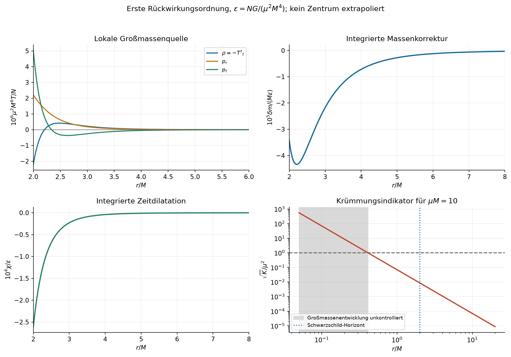

### 25.6 Direkte numerische Quellenprüfung

Die [Python-Rechnung](work/absource_numerics.py) prüft die exakte de-Sitter-Dichte unabhängig durch die renormierten Impulsintegrale aus [delRio2014, Gleichungen 85–96]. Mit $z=k/(aH)$ und $\nu=1/2-ix$ werden die normierten Moden

$$u=\frac{i\sqrt{\pi z}}2e^{\pi x/2}H^{(1)}_\nu(z),\qquad
v=\frac{\sqrt{\pi z}}2e^{\pi x/2}H^{(1)}_{\nu-1}(z)$$

direkt ausgewertet. Setze $s_1=2\operatorname{Re}(u^*v)$, $s_3=|u|^2-|v|^2$ und $w=\sqrt{z^2+x^2}$. Die nackten dimensionslosen Integranden sind $q_\rho=-2(xs_3+zs_1)$ und $q_p=-2zs_1/3$. Subtrahiert werden

$$q_0=-2w,\qquad q_2=\frac{x^2}{4w^3}-\frac{x^4}{4w^5},$$

$$q_4=\frac{105x^8}{64w^{11}}-
\frac{119x^6}{32w^9}+\frac{165x^4}{64w^7}
-\frac{x^2}{2w^5}.$$

Damit ist

$$\frac{\rho_1}{H^4}=\frac1{2\pi^2}
\int_0^\infty z^2(q_\rho-q_0-q_2-q_4)\,dz.$$

Die Drucksubtraktionen folgen als $zq_n'/3$ aus der Modenbilanz und werden mit dem direkt aus $u,v$ berechneten Druck verglichen. Die gemeinsame Subtraktion erfolgt vor der Integration mit 55 Dezimalstellen. Je Teilintervall werden 32 und 64 Gaußpunkte verglichen. Für $x\simeq0{,}090503$ und $x=1$ sind die oberen Grenzen $Z=128,256,512$; für $x=10$ werden $Z=256,512,1024$ verwendet.

Die passende Randpotenz wird eigenständig hergeleitet. Für die positive Modenenergie $E=xs_3+zs_1$ geben die Blochgleichungen

$$z^2E'''+zE''+4(z^2+x^2)E'-4zE=0.$$

Der Bunch–Davies-Hankelzweig besitzt die asymptotische Entwicklung $E=z\sum_{j\ge0}c_jz^{-2j}$ mit

$$c_0=1,\qquad
c_{j+1}=\frac{(1-2j)(j^2+x^2)}{2(j+1)}c_j.$$

Nach der Subtraktion beginnt der Modenrest bei $45x^2/(16z^7)$. Der fehlende integrierte Dichteschwanz ist deshalb

$$\frac{\rho_{\mathrm{tail}}}{H^4}
=\frac{45x^2}{128\pi^2Z^4}
-\frac{7x^2(205x^2+144)}{384\pi^2Z^6}
+O(Z^{-8}).$$

Die zwei feinsten Abschneider werden daher mit vierter Potenz extrapoliert. Dies ist eine asymptotische Fehlerverbesserung mit tatsächlichem Abschneidervergleich, keine rigorose Gesamtrestschranke. Der [unabhängige UV-Nachweis](work/absource_theory_uv_verification.json) enthält 21 exakte symbolische Kontrollen.

| $x=\mu/H$ | Relative Dichteabweichung | Relative Druckabweichung von $p_1=-\rho_1$ |
|---|---:|---:|
| 0,09050308441 | $1{,}56\times10^{-15}$ | $6{,}66\times10^{-16}$ |
| 1 | $6{,}32\times10^{-13}$ | $1{,}90\times10^{-12}$ |
| 10 | $6{,}74\times10^{-9}$ | $2{,}02\times10^{-8}$ |

Der relative Unterschied beim Wechsel von 32 auf 64 Gaußpunkte bleibt unter $2{,}05\times10^{-11}$. Eine zweite Auswertung mit der positiven Digammareihe und Integraltest-Schranken kontrolliert zusätzlich die geschlossene Formel. Die Nullstellen werden mit 55 Stellen durch Bisektion berechnet und unabhängig mit 80 Stellen geprüft. Die angezeigten Dezimalzahlen sind numerische Werte; der Existenzsatz stammt aus dem Vorzeichenbeweis.

Für Schwarzschild stimmen eine Quadratur ab Unendlich und eine DOP853-Integration der beiden Metrikgleichungen mit den analytischen Ausdrücken überein. Die maximalen absoluten Abweichungen der dimensionslosen, durch $\epsilon$ geteilten Korrekturen betragen $5{,}43\times10^{-20}$ beziehungsweise $2{,}83\times10^{-17}$. Eine getrennte Fünfpunktableitung der Ward-Identität zeigt die erwartete Konvergenz. Der [maßgebliche numerische Beleg](work/absource_numerics_20261018_release.json) enthält 15 bestandene Prüfungen und bindet die [Roharrays](work/absource_numerics_20261018_release.npz) an Skript und Primärtexte.

### 25.7 Formale und physikalische Folgerungen

Die [unabhängige Geometrieprüfung](work/absource_symbolic.py) konstruiert Christoffel-, Riemann- und Ricci-Tensor erneut und bestätigt die Spurausschlüsse in [36 exakten Prüfungen](work/absource_symbolic_20261018_verified.json). Der [Schwarzschild-Audit](work/absource_schwarzschild_audit.py) überprüft alle vierdimensionalen Einstein-Komponenten bis zur ersten Rückwirkungsordnung sowie Quelle, Randwerte und Horizontkorrekturen; sein [Beleg](work/absource_schwarzschild_audit_20261018.json) enthält 45 bestandene exakte Kontrollen.

Die Module [AbsoluteSourceTrace.lean](work/lean/AbsoluteSourceTrace.lean), [AbsoluteSourceRenormalization.lean](work/lean/AbsoluteSourceRenormalization.lean), [AbsoluteSourceDeSitter.lean](work/lean/AbsoluteSourceDeSitter.lean) und [AbsoluteSourceSchwarzschild.lean](work/lean/AbsoluteSourceSchwarzschild.lean) enthalten **43 benannte Theoreme und 155 auditierte Theoremkonstanten**. Lean 4.30.0 mit Mathlib-Revision `c5ea00351c28e24afc9f0f84379aa41082b1188f` akzeptiert alle Beweise; der [Offline-Kernelbeleg](work/lean/absource_proof_verification.json) enthält ausschließlich `propext`, `Classical.choice` und `Quot.sound`.

Formalisiert sind die tatsächlichen rationalen Spurgrenzwerte, die Ausschlüsse auf äußeren Halbstrahlen, die Renormierungskovarianz und die tatsächlichen radialen Ableitungen der führenden Schwarzschild-Gleichungen. Der de-Sitter-Existenzsatz verwendet den Zwischenwertsatz unter den ausdrücklich angegebenen analytischen Eigenschaften von $F$; die endliche rationale Endpunktschranke wird exakt geprüft. Die Digamma-Reihendarstellung, der Euler–Maclaurin-Rest, die Herleitung des renormierten Modenintegrals und die globale Geometrie sind die gesonderten analytischen Nachweise. Diese Beweisgrenzen sind in den [Formalisierungsnotizen](work/absource_formal_notes.md) festgehalten.

Die Ergebnisse unterscheiden drei Aussagen. Erstens müssen sowohl die unveränderte singuläre Schwarzschild-Metrik als auch die konkrete reguläre Black-bounce-Familie im reinen masslosen Diracmodell geändert werden. Zweitens existiert für das massive Feld eine exakt berechnete absolute Quelle mit einer vollständig selbstkonsistenten, geodätisch vollständigen de-Sitter-Lösung. Drittens besitzt die massive Schwarzschild-Vakuumpolarisation eine explizite, in ihrer Ordnung konsistente Metrikantwort. Diese Antwort verliert vor einer Schlussfolgerung über $r=0$ ihre Großmassenkontrolle. Die globale massive Schwarzloch-Modensumme, ihre vollständige Rückkopplung und eine mögliche Verbindung des Außenraums mit einem regulären Kern bleiben dadurch unbestimmt. Weder das Fortbestehen noch die Beseitigung der Singularität der vollständigen massiven Schwarzlochlösung ist hier bewiesen.

Der [Gesamtprüfer](work/verify_absource_research.py) und sein [Prüfbericht](work/absource_independent_verification_20261018.json) verbinden Quellenprovenienz, Rohdaten, Formalbelege, Figuren und die unveränderten Vorgängerkapitel. Der [Figurenerzeuger](work/absource_figures.py) verwendet ausschließlich die zugeordneten geprüften Daten und geometrischen Ausdrücke.

## 26. Gemeinsame Quantendynamik

### 26.1 Geometrie und Feld als Konfiguration

Eine gemeinsame Gleichung muss die Raumgeometrie und das Quantenfeld zusammen entwickeln. Die bisherigen semiklassischen Quellen bestimmen einen Erwartungswert auf einer klassischen Geometrie. Die Bohmsche Führung bestimmt dagegen eine tatsächliche Konfiguration. Der folgende Ansatz verbindet beides auf der kanonischen Ebene: Ein gemeinsamer Zustand führt sowohl die räumliche Metrik als auch das Feld. Anschließend wird eine vollständig lösbare homogene Reduktion mit selbstkonsistenter Rückwirkung konstruiert. Sie besitzt einen regulären und einen singulären Bohmschen Entwicklungszweig innerhalb derselben Dynamik.

Wir verwenden $\hbar=c=1$, Signatur $(-,+,+,+)$ und $\kappa=8\pi G$. Für ein reelles Skalarfeld $\Phi$ ist die klassische Ausgangswirkung

$$I[g,\Phi]=\int d^4x\,\sqrt{-g}
\left[\frac{\mathcal R-2\Lambda}{2\kappa}
-\frac12 g^{\mu\nu}\partial_\mu\Phi\partial_\nu\Phi-V(\Phi)\right].$$

In der ADM-Zerlegung seien $h_{ij}$ die räumliche Metrik, $N>0$ der Lapse und $N^i$ der Shift. Die DeWitt-Metrik lautet

$$\mathcal G_{ijkl}
=\frac{h_{ik}h_{jl}+h_{il}h_{jk}-h_{ij}h_{kl}}{2\sqrt h}.$$

Die gemeinsame Zustands- und Führungsgleichung lässt sich als System schreiben:

$$\begin{aligned}
\widehat{\mathcal H}_{\perp}(x)\Psi[h,\Phi]&=0,
&\widehat{\mathcal H}_i(x)\Psi[h,\Phi]&=0,\\
\dot h_{ij}-\mathcal L_{\vec N}h_{ij}
&=4\kappa N\mathcal G_{ijkl}\frac{\delta S}{\delta h_{kl}},\\
\dot\Phi-N^i\partial_i\Phi
&=\frac{N}{\sqrt h}\frac{\delta S}{\delta\Phi},
&\Psi&=R e^{iS}.
\end{aligned}$$

Die klassischen Hamilton- und Impulsconstraints sind dabei diejenigen der angegebenen Wirkung. Dieser kanonische Rahmen wird in [GoldsteinTeufel1999, PNS2002, Struyve2024Time] begründet; die Faktoren hier verwenden $\kappa=8\pi G$. Die funktionalen Operatoren erfordern eine festgelegte Regularisierung und Ordnung. Die symbolische Gleichung allein legt deren Kontinuumsgrenzwert noch nicht fest.

Für eine endliche regulierte Konfiguration $q^A$, ein positives Maß $\mu(q)$ und eine inverse Konfigurationsmetrik $\Gamma^{AB}$ wird der Zusammenhang präzise:

$$\widehat C
=-\frac{1}{2\mu}\partial_A\left(\mu\Gamma^{AB}\partial_B\right)+U,
\qquad \widehat C\Psi=0.$$

Auf einem knotenfreien Gebiet folgen aus Real- und Imaginärteil exakt

$$\begin{aligned}
C(q,\partial S)+Q_\Psi&=0,\\
Q_\Psi&=-\frac{1}{2\mu R}
\partial_A\left(\mu\Gamma^{AB}\partial_B R\right),\\
\partial_A\left(\mu R^2\Gamma^{AB}\partial_B S\right)&=0,\\
\dot q^A&=N\Gamma^{AB}\partial_B S.
\end{aligned}$$

Somit entsteht der Quantenbeitrag aus demselben Zustand, der Feld und Geometrie führt. Die gemeinsame zustandsabhängige Wirkung

$$I_Q=\int dt\left[p_A\dot q^A-N(C+Q_\Psi)\right]$$

erhält den Führungsgraphen $p_A=\partial_A S$: Differenziert man $C(q,\partial S)+Q_\Psi=0$ nach $q^A$, erhält man gerade die Hamilton-Gleichung für $\partial_A S$ entlang der Führung. Hier wird $Q_\Psi(q)$ bei festem Zustand variiert, bevor eine Bahn eingesetzt wird.

Verschwinden mehrere Constraints auf demselben glatten Graphen $p=dS$, verschwinden dort auch ihre Poissonklammern. Aus $H_{q^A}+H_{p_B}S_{BA}=0$ und der entsprechenden Gleichung für $K$ folgt

$$\{H,K\}\big|_{p=dS}
=H_{p_B}K_{p_A}(S_{AB}-S_{BA})=0.$$

Das ist ein schwacher Konsistenzsatz auf dem Führungsgraphen. Die spezifische lokale Hypersurflächenalgebra der ART folgt daraus nicht; ihre Prüfung aus Kapitel 13 bleibt für eine inhomogene Theorie erforderlich. Eine zeitabhängige positive Umparametrisierung $N(t)$ ist entsprechend von einer räumlich variierenden Foliationsänderung zu unterscheiden [Struyve2024Time].

### 26.2 Eine gekoppelte Feld-Geometrie-Gleichung

Wir reduzieren die Wirkung auf eine räumlich flache FLRW-Geometrie und den homogenen Modus eines masslosen Skalarfeldes. Mit komovierendem Bezugsvolumen eins, $\Lambda=0$ und $V=0$ setzen wir

$$ds^2=-N(t)^2dt^2+e^{2\alpha(t)}d\mathbf x^2,
\qquad a=e^\alpha,
\qquad \beta=\frac\kappa6,
\qquad \phi=\sqrt\beta\,\Phi.$$

Nach Entfernung des üblichen gravitativen Randterms lautet die reduzierte Lagrangefunktion

$$L_{\rm cl}=\frac{e^{3\alpha}}{2\beta N}
\left(-\dot\alpha^2+\dot\phi^2\right).$$

Daraus folgen die Impulse und der Hamiltonconstraint:

$$\begin{aligned}
p_\alpha&=-\frac{e^{3\alpha}}{\beta N}\dot\alpha,
&p_\phi&=\frac{e^{3\alpha}}{\beta N}\dot\phi,\\
H_{\rm cl}&=N\beta e^{-3\alpha}C,
&C&=\frac{-p_\alpha^2+p_\phi^2}{2}.
\end{aligned}$$

Wir wählen die Laplace–Beltrami-Ordnung der zweidimensionalen Konfigurationsmetrik $M_{AB}=\beta^{-1}e^{3\alpha}\operatorname{diag}(-1,1)$. Weil $\sqrt{|\det M|}\,M^{AB}=\operatorname{diag}(-1,1)$, entstehen keine zusätzlichen ersten Ableitungen. Die Quantisierung $-\Delta_M/2$ führt daher exakt auf

$$\left(\partial_\alpha^2-\partial_\phi^2\right)\Psi=0.$$

Diese Gleichung und die folgende Führung sind die vollständig festgelegte gemeinsame Dynamik des reduzierten Modells [PNF2013]:

$$\begin{aligned}
Q&=\frac{R_{\alpha\alpha}-R_{\phi\phi}}{2R},
&\frac{-S_\alpha^2+S_\phi^2}{2}+Q&=0,\\
\dot\alpha&=-\beta N e^{-3\alpha}S_\alpha,
&\dot\phi&=\beta N e^{-3\alpha}S_\phi.
\end{aligned}$$

Andere Operatorordnungen sind damit nicht als äquivalent vorausgesetzt. Im Folgenden bezeichnet $N=1$ kosmische Eigenzeit und $H=\dot\alpha$ die Hubble-Rate.

### 26.3 Rückwirkung und Energieaustausch

Die gemeinsame reduzierte Wirkung lautet

$$L_Q=L_{\rm cl}-\beta N e^{-3\alpha}Q(\alpha,\phi).$$

Ihre Variation nach $N$, $\alpha$ und $\phi$ liefert zusammen

$$\begin{aligned}
H^2&=\dot\phi^2+2\beta^2e^{-6\alpha}Q,\\
\dot H+3H^2&=\beta^2e^{-6\alpha}Q_\alpha,\\
\ddot\phi+3H\dot\phi&=-\beta^2e^{-6\alpha}Q_\phi.
\end{aligned}$$

Dabei sind $Q_\alpha$ und $Q_\phi$ partielle Ableitungen bei festgehaltener jeweils anderer Konfiguration. Die daraus abgelesenen Dichten und Drücke sind

$$\begin{aligned}
\rho_{\rm F}=p_{\rm F}&=\frac{\dot\phi^2}{2\beta},\\
\rho_Q&=\beta e^{-6\alpha}Q,\\
p_Q&=\beta e^{-6\alpha}\left(Q-\frac{Q_\alpha}{3}\right).
\end{aligned}$$

Damit gelten beide unabhängigen Einstein-Gleichungen,

$$H^2=2\beta\rho_{\rm tot},
\qquad \dot H=-3\beta(\rho_{\rm tot}+p_{\rm tot}),$$

und die tatsächlichen Energieaustauschgleichungen

$$\begin{aligned}
\dot\rho_{\rm F}+3H(\rho_{\rm F}+p_{\rm F})
&=-\beta e^{-6\alpha}\dot\phi Q_\phi,\\
\dot\rho_Q+3H(\rho_Q+p_Q)
&=+\beta e^{-6\alpha}\dot\phi Q_\phi.
\end{aligned}$$

Die Summe ist exakt erhalten. Dies schließt die Erhaltungslücke, die beim alleinigen Einsetzen des tatsächlichen klassischen Feldtensors als Einstein-Quelle auftreten würde. Keine Formel dividiert durch $H$; sie gelten auch an einer Umkehrstelle. Der Quantenbeitrag enthält die gemeinsame Geometrie-Feld-Interferenz und ist keine zusätzliche unabhängige Materiesorte.

Die Rückwirkung ist hier vollständig im homogenen quantisierten Sektor berechnet. $Q$ ist nicht die absolute renormierte vierdimensionale Erwartungswertquelle aus Kapitel 25. Deren Addition zu $\rho_Q$ ohne eine gemeinsame Grenzherleitung würde dieselben Freiheitsgrade möglicherweise doppelt zählen.

### 26.4 Ein exakter gemeinsamer Zustand

Für $\sigma>0$ definieren wir

$$f(s)=\frac1{\sigma-is},
\qquad
\Psi_0(\alpha,\phi)=f(\phi+\alpha)+f(\phi-\alpha).$$

Jeder Summand erfüllt die Wheeler–DeWitt-Gleichung. Der gemeinsame Zustand ist keine Produktfunktion von Geometrie- und Feldvariable. Mit $u=\phi+\alpha$, $v=\phi-\alpha$ und

$$D=(\sigma^2+u^2)(\sigma^2+v^2)
=(\sigma^2+\alpha^2-\phi^2)^2+4\sigma^2\phi^2$$

gilt

$$\Psi_0=\frac{2(\sigma-i\phi)}{(\sigma-i\phi)^2+\alpha^2},
\qquad R_0^2=\frac{4(\sigma^2+\phi^2)}D.$$

Da $D>0$ und der Zähler nie verschwindet, besitzt dieser Zustand auf der reellen Konfigurationsebene keine Knoten. Seine Phasengradienten $P_\alpha=S_\alpha$ und $P_\phi=S_\phi$ sind

$$\begin{aligned}
P_\alpha&=-\frac{4\sigma\alpha\phi}{D},\\
P_\phi&=\frac{\sigma[(\sigma^2+\phi^2)^2
+4\alpha^2\phi^2-\alpha^4]}{(\sigma^2+\phi^2)D}.
\end{aligned}$$

Die direkte zweite Ableitung der Amplitude bestätigt unabhängig

$$\frac{R_{0,\alpha\alpha}-R_{0,\phi\phi}}{2R_0}
=\frac{P_\alpha^2-P_\phi^2}{2}.$$

Das Paket enthält ausschließlich positive Spektralfrequenzen von $-i\partial_\phi$, denn

$$f(s)=\int_0^\infty e^{-\sigma k}e^{iks}\,dk.$$

Bei unitärer Fouriertransformation in $\alpha$ folgt

$$\widehat\Psi_0(p,\phi)
=\sqrt{2\pi}\,e^{-\sigma|p|}e^{i|p|\phi}.$$

Das Quadrat der Cauchy-$L^2$-Norm und der integrierte Skalaruhrstrom sind endlich:

$$\int_{\mathbb R}R_0^2\,d\alpha=\frac{2\pi}{\sigma},
\qquad
\int_{\mathbb R}J^\phi\,d\alpha=\frac{\pi}{\sigma^2},
\qquad J^\phi=R_0^2P_\phi.$$

Unsere Stromkonvention ist $J^\phi=\operatorname{Im}(\Psi_0^*\partial_\phi\Psi_0)$; die häufige Klein–Gordon-Konvention enthält zusätzlich den Faktor zwei. Mit $\Psi=(\sigma/\sqrt\pi)\Psi_0$ ist der hier definierte Gesamtfluss eins. Eine positive spektrale Frequenz garantiert keine punktweise positive Stromdichte: Bei $\phi=0$ ist $J^\phi$ für $|\alpha|>\sigma$ negativ. Deshalb wird die Skalaruhr im nächsten Abschnitt auf eine nachweislich positive invariante Stromröhre eingeschränkt. Die Unterscheidung zwischen Hilbertnorm, lokalem Strom und kosmologischer Wahrscheinlichkeitsinterpretation ist wesentlich [PNF2013, Abschnitt 5.2].

### 26.5 Globale reguläre Lösung

Definiere

$$G(s)=\frac{s}{2\sigma(\sigma^2+s^2)}
+\frac{\arctan(s/\sigma)}{2\sigma^2},
\qquad G'(s)=\frac{\sigma}{(\sigma^2+s^2)^2}>0,$$

und die Stromfunktion

$$F(\alpha,\phi)=G(\phi+\alpha)-G(\phi-\alpha)
+\frac{2\sigma\alpha}{D}.$$

Direktes Differenzieren liefert

$$F_\alpha=R_0^2P_\phi,
\qquad F_\phi=R_0^2P_\alpha,
\qquad \frac{dF}{dt}=0.$$

Damit ist $F$ für jeden positiven Lapse ein exaktes Bahninvariant. Für festes $\phi$ und $\alpha>0$ steigt $F$ zunächst von null an. Seine einzige positive kritische Stelle ist

$$\alpha_{\rm crit}^2
=2\phi^2+\sqrt{\sigma^4+2\sigma^2\phi^2+5\phi^4}.$$

Anschließend fällt $F$ strikt gegen $L=\pi/(2\sigma^2)$. Das Maximum liegt daher oberhalb von $L$. Zu jedem $c\in(0,L)$ gibt es genau eine positive Lösung $\alpha_c(\phi)$ von $F=c$. Sie liegt vor dem Maximum, sodass $F_\alpha>0$ und $P_\phi>0$ auf der gesamten Bahn gelten. Der implizite Funktionensatz liefert eine glatte globale Kurve mit

$$\frac{d\alpha_c}{d\phi}=-\frac{P_\alpha}{P_\phi}.$$

Die Kurve ist gerade in $\phi$ und für $\phi>0$ strikt steigend. Ihr einziges Minimum liegt bei $\phi=0$. Für die numerische Darstellung wählen wir $\sigma=\beta=1$ und $\alpha_0=1/2$. Dann ist

$$c=F(1/2,0)=\frac{26}{25}+\arctan(1/2)
\simeq1{,}503647609<\frac\pi2.$$

Diese Ungleichung hängt nicht von einer Dezimalprüfung ab. Aus $\arctan(2)=\pi/4+\arctan(1/3)$, $\pi>3$ und $\arctan(1/3)>26/81$ folgt $\arctan(2)>347/324>26/25$. Zusammen mit $\arctan(2)+\arctan(1/2)=\pi/2$ ergibt sich die Behauptung.

**Satz.** Die so konstruierte Geometrie besitzt einen regulären Bounce, beschränkte Krümmung und ist zeit- und nullgeodätisch vollständig.

**Beweis.** Die minimale Geometrievariable ist $\alpha_0>0$. Am Minimum gilt für allgemeine $0<\alpha_0<\sigma$

$$\begin{aligned}
P_\alpha&=0,
&P_\phi&=\frac{\sigma^2-\alpha_0^2}{\sigma(\sigma^2+\alpha_0^2)},\\
H&=0,
&\dot H&=\frac{4\beta^2\alpha_0(\sigma^2-\alpha_0^2)e^{-6\alpha_0}}
{(\sigma^2+\alpha_0^2)^3}>0.
\end{aligned}$$

Für $\phi\to+\infty$ erzwingt die feste Stromhöhe $c>0$, dass $\alpha_c\to\infty$. Setze $u=\phi+\alpha_c\to\infty$ und $v=\phi-\alpha_c$. Eine Folge $v\to+\infty$ würde $F\to0$ ergeben, eine Folge $v\to-\infty$ dagegen $F\to L$. Beides widerspricht $0<c<L$. Somit bleibt $v$ beschränkt, und jeder Häufungswert löst

$$G(v_\infty)=\frac{\pi}{4\sigma^2}-c.$$

Wegen $G'>0$ ist diese Lösung eindeutig. Daher gilt

$$\alpha_c(\phi)=\phi-v_\infty+o(1),
\qquad
P_\phi\longrightarrow\frac{\sigma}{\sigma^2+v_\infty^2}>0.$$

Die Eigenzeitableitung $dt/d\phi=e^{3\alpha_c}/(\beta P_\phi)$ hat deshalb zu beiden Enden ein divergierendes Integral; für die Vergangenheit gilt die gerade Symmetrie. Kosmische Eigenzeit überstreicht also ganz $\mathbb R$.

Für explizite Krümmungsschranken setze $g(s)=\sigma/(\sigma^2+s^2)$. Die exakten Phasenidentitäten

$$P_\alpha=g(u)-g(v),
\qquad P_\phi=g(u)+g(v)-g(\phi)$$

geben $|P_\alpha|\le1/\sigma$, $|P_\phi|\le2/\sigma$ und $|Q_\alpha|\le6/\sigma^3$. Damit sind

$$\begin{aligned}
|H|&\le\frac{\beta e^{-3\alpha_0}}\sigma,\\
|\dot H|&\le\beta^2e^{-6\alpha_0}
\left(\frac6{\sigma^3}+\frac3{\sigma^2}\right)
\end{aligned}$$

auf der gesamten Bahn beschränkt. Folglich bleiben

$$\mathcal R=6(\dot H+2H^2),
\qquad K=12[(\dot H+H^2)^2+H^4]$$

endlich; an beiden Zeitenden gehen sie gegen null. Die Geodätenvollständigkeit folgt zusätzlich aus $a\ge e^{\alpha_0}>0$: Für einen zeitartigen Geodätenimpuls $P$ ist $d\tau/dt=(1+P^2/a^2)^{-1/2}$ positiv nach unten beschränkt. Nullgeodäten besitzen eine affine Länge proportional zu $\int a\,dt$. Beide Längen divergieren in beide Zeitrichtungen; die flachen räumlichen Schnitte sind vollständig. Damit ist auch ein endlicher affiner Endpunkt ausgeschlossen. $\square$

Am Bounce kompensieren sich Feld- und Quantendichte exakt, $\rho_Q=-\rho_{\rm F}$. Wegen $\dot H>0$ verletzt die gesamte effektive Quelle dort die Nullenergiebedingung:

$$\rho_{\rm tot}+p_{\rm tot}=-\frac{\dot H}{3\beta}<0.$$

Für die angegebenen Parameter sind $a_{\min}=e^{1/2}\simeq1{,}64872127$, $\dot H_0\simeq0{,}03823647$, $\mathcal R_0\simeq0{,}22941881$ und $K_0\simeq0{,}01754433$. Die Dichten betragen $\rho_{\rm F,0}=-\rho_{Q,0}\simeq0{,}0089616723$. Dies sind Größen der festgelegten natürlichen Modellskalierung, keine gemessenen kosmologischen Parameter.


**Abbildung 26.1.** Eigenzeitentwicklung des gekoppelten rationalen Zustands und Vergleich mit dem singulären Einzelzweig aus Abschnitt 26.6. Die Kurven stammen aus der impliziten Stromlösung und unabhängig integrierten Führungsgleichungen.


**Abbildung 26.2.** Feld- und Quantenquelle, Energieaustausch und Krümmung. Die negative Quantendichte ermöglicht die reguläre Umkehr; die Summe erfüllt den Erhaltungssatz entlang der tatsächlichen Bahn. In der Grafik bezeichnet $\rho_m$ die Felddichte $\rho_{\rm F}$; $D_m$ und $D_Q$ sind die linken Seiten der beiden Austauschgleichungen.

Eine positive bedingte Flussverteilung lässt sich ebenfalls exakt angeben. In der invarianten Röhre $0<\alpha<\alpha_c(\phi)$ gilt

$$\int_0^{\alpha_c(\phi)}J^\phi\,d\alpha=c,
\qquad \varrho_c=\frac{J^\phi}{c}>0.$$

Die Quantilbahnen sind durch $F(\alpha_q,\phi)=qc$, $0<q<1$, festgelegt. Die Kontinuitätsgleichung transportiert $\varrho_c$ mit $d\alpha/d\phi=-P_\alpha/P_\phi$ und erhält diese Quantile. Die Normierung des Gesamtzustands kürzt sich aus dem bedingten Quotienten heraus. Dies ist eine positive äquivariante Verteilung auf der ausgewählten Stromröhre, keine eindeutige globale Born-Vorschrift für alle Wheeler–DeWitt-Konfigurationen.


**Abbildung 26.3.** Dreidimensionale Darstellung von $|\Psi_0(\alpha,\phi)|^2$ mit Bohmschen Strombahnen. Die horizontalen Koordinaten sind die Geometrievariable und der homogene Feldwert; die Höhe zeigt die unnormierte Amplitude zum Quadrat. Die Fläche ist keine räumliche Einbettung einer Raumzeit und keine gemeinsame Born-Dichte.

### 26.6 Singuläre Lösung derselben Gleichung

Der einzelne chirale Zustand $\Psi_{\rm ch}=f(\phi+\alpha)$ hat ebenfalls endliche Cauchy-Norm, positive spektrale Frequenz und keine Knoten. Weil seine Amplitude nur von $\phi+\alpha$ abhängt, gilt exakt $Q=0$. Die Führung erhält $s_0=\phi+\alpha$ und damit

$$P_\alpha=P_\phi=k_{\rm eff},
\qquad k_{\rm eff}=\frac{\sigma}{\sigma^2+s_0^2}>0.$$

Die kontrahierende Geometrie ist deshalb

$$a(t)^3=a(0)^3-3\beta k_{\rm eff}t,
\qquad t_s=\frac{a(0)^3}{3\beta k_{\rm eff}}.$$

Sie erreicht $a=0$ in endlicher Eigenzeit. Mit $\Delta=t_s-t$ lauten die exakten Invarianten

$$H=-\frac1{3\Delta},
\qquad \mathcal R=-\frac2{3\Delta^2},
\qquad K=\frac{20}{27\Delta^4}.$$

Dies ist die klassische masslose Skalarfeldlösung als exakter $Q=0$-Sektor der gemeinsamen Quantendynamik. Die Singularität verschwindet also nicht zustandsunabhängig: Der Einzelzweig bleibt singulär, während die nachgewiesene Interferenzbahn geodätisch vollständig ist.

### 26.7 Numerische und formale Prüfung

Das [Numerikskript](work/unify_numerics.py) leitet $Q$ direkt aus der Amplitude ab. Es vergleicht die implizite Stromlösung, die phasengeführte Bewegung, eine getrennte kanonische Evolution der Impulse und eine Integration in kosmischer Eigenzeit. Die kanonische Rechnung setzt die Impulse nur am Anfang gleich den Phasengradienten; deren spätere Übereinstimmung wird geprüft. Der [numerische Beleg](work/unify_numerics_20261018_release.json) bindet die [Roharrays](work/unify_numerics_20261018_release.npz) an Skript und Primärtexte und enthält 18 bestandene Prüfungen.

| Unabhängiger Vergleich | Maximaler Fehler |
|---|---:|
| Implizite Stromkurve gegen Phasen-ODE, $\alpha$ | $1{,}51\times10^{-14}$ |
| Kanonische Evolution gegen Stromkurve, $\alpha$ | $2{,}76\times10^{-14}$ |
| Kanonische Impulse gegen Führungsgraph | $2{,}39\times10^{-14}$ |
| Kanonischer Hamiltonconstraint | $2{,}22\times10^{-14}$ |
| Eigenzeit- gegen Skalaruhrintegration, $0\le\phi\le1$ | $4{,}62\times10^{-13}$ |
| Skalierte Einstein- und Austauschresiduen | $5{,}63\times10^{-15}$ |

Die letzten Residuen werden auf einem zweidimensionalen Konfigurationsgitter geprüft, nicht nur auf der ausgewählten Bahn. Eine getrennte Fünfpunktableitung der Dichten liefert bei Halbierung der Schrittweite Fehler von $2{,}12\times10^{-12}$, $1{,}32\times10^{-13}$ und $8{,}35\times10^{-15}$. Die Cauchy-Norm, der Gesamtfluss und die positive Röhrennorm werden separat quadraturbasiert bestätigt. Eine [weitere unabhängige Auswertung](work/unify_independent_main_review.py) integriert alle 13 Quantilbahnen mit den vereinfachten Phasenformeln erneut und rekonstruiert Quellen und Krümmung ohne Import des Hauptskripts. Ihr [Beleg mit fünf bestandenen Prüfungen](work/unify_independent_main_review_20261018.json) liefert maximal $6{,}67\times10^{-14}$ Bahnabweichung und $3{,}34\times10^{-16}$ Abweichung der gespeicherten Größen. Eine unabhängige Eigenzeitquadratur bis $\phi=6$ stimmt bis auf einen skalierten Fehler von $1{,}58\times10^{-14}$ überein. Der numerische Bereich $-6\le\phi\le6$ illustriert den analytischen globalen Satz; er ersetzt seinen Beweis nicht.

Die [unabhängige Paketprüfung](work/unify_independent_symbolic.py) enthält [29 exakte symbolische Identitäten und neun Gesamtprüfungen](work/unify_independent_verification_20261018.json). Die [Wirkungsprüfung](work/unify_theory_symbolic.py) bestätigt [13 weitere exakte Identitäten](work/unify_theory_symbolic_20261018.json) für ein allgemeines $Q(\alpha,\phi)$, einschließlich Energieaustausch, Druckvariation und Erhaltung des Führungsgraphen. Diese Prüfungen importieren die Hauptnumerik nicht.

Die Lean-Module [UnifiedWard.lean](work/lean/UnifiedWard.lean), [UnifiedConstraints.lean](work/lean/UnifiedConstraints.lean) und [UnifiedBounce.lean](work/lean/UnifiedBounce.lean) formalisieren die tatsächlichen Ableitungsidentitäten des Energieaustauschs, den Übergang von Hamilton–Jacobi und Führung zu den Einstein-Gleichungen, schwache Graphkonsistenz sowie rationale Strom- und Bounce-Identitäten. Insgesamt werden **39 benannte Theoreme und 58 Theoremkonstanten** von Lean 4.30.0 mit Mathlib-Revision `c5ea00351c28e24afc9f0f84379aa41082b1188f` akzeptiert; das Axiomenaudit enthält ausschließlich `propext`, `Classical.choice` und `Quot.sound`. Der [Offline-Kernelbeleg](work/lean/unify_proof_verification.json) und die [Formalisierungsnotizen](work/unify_formal_notes.md) legen Annahmen und geprüfte Theoreme offen. Die globale implizite Existenz, die asymptotische Eigenzeit und die Geodätenvollständigkeit sind die oben angegebenen analytischen Beweise; sie werden nicht als vollständig in Lean formalisiert ausgegeben.

Der [Gesamtprüfer](work/verify_unify_research.py) und sein [Beleg](work/unify_research_verification_20261018.json) prüfen zusätzlich Quellenprovenienz, Figuren, Rohdaten und die unveränderten Vorgängerkapitel. Der [Figurenerzeuger](work/unify_figures.py) verarbeitet die geprüften Daten reproduzierbar.

### 26.8 Bedeutung für die Vereinheitlichung

Das abgeschlossene Ergebnis ist ein gemeinsamer Constraint mit Bohmscher Führung von Feld und Geometrie, dessen reduzierte Rückwirkung aus einer einzigen Wirkung folgt. Die tatsächliche Gesamtquelle ist erhalten; der klassische ART-Sektor und eine reguläre Bohmsche Bahnfamilie sind explizit nachgewiesen. Damit besteht eine konkrete mathematische Vereinbarkeit im vollständig behandelten homogenen Modell.

Der Anschluss an Quantenfeldtheorie auf einer annähernd klassischen Raumzeit erfolgt über eine bedingte WKB-/Born–Oppenheimer-Reduktion des gemeinsamen Zustands. Die Phase des dominanten Geometriezweigs definiert dabei die Zeitentwicklung des bedingten Feldzustands [Struyve2024Time, Gleichungen 36–38]. Das ist eine Grenzvoraussetzung, keine automatische Identifikation von $Q$ mit einem renormierten Erwartungswert.

Für eine vollständige vierdimensionale vereinheitlichte Theorie fehlen weiterhin die regulatorunabhängige lokale Constraintalgebra, die renormierte Dynamik der inhomogenen Feldmoden und die kontrollierte Herleitung der semiklassischen Quelle aus dem gemeinsamen Zustand. Der vorliegende Satz entscheidet weder über die Singularität eines massiven schwarzen Lochs noch über eine Verbindung zu seinem Außenraum. Er liefert dafür einen überprüfbaren gemeinsamen Dynamikansatz und zeigt bereits exakt, warum die Singularitätsfrage von Zustand und Rückwirkung gemeinsam abhängt.


## 27. Lokale Algebra und Feldmoden

### 27.1 Starke lokale Konsistenz

Die gemeinsame homogene Dynamik aus Kapitel 26 enthält nur einen Hamiltonconstraint. Der Übergang zu räumlich inhomogenen Geometrien verlangt dagegen eine lokale Familie von Constraints. Hier werden drei zusammenhängende Fragen vollständig geprüft: die zulässigen Koeffizienten einer lokalen Zweitableitungsfamilie, der nichtlokale Zusatz des freien Bohmschen Feldvakuums und die Renormierung desselben inhomogenen Modenspektrums. Die Rechnung liefert eine konkrete Einschränkung des Vereinheitlichungsansatzes und einen endlichen Quellentensor; sie setzt keine bereits gelöste funktionale Wheeler–DeWitt-Theorie voraus.

Sei die Cauchyfläche kompakt und randlos. Es gelten die kanonischen Poissonklammern für $(h_{ij},\pi^{ij})$ und $(\varphi,\Pi)$. Mit $\kappa=8\pi G$, $\pi=h_{ij}\pi^{ij}$ und der räumlichen Krümmung ${}^{(3)}R$ definieren wir

$$\begin{aligned}
T_g&=\frac{2\kappa}{\sqrt h}
\left(\pi^{ij}\pi_{ij}-\frac12\pi^2\right),
&V_R&=-\frac{\sqrt h}{2\kappa}\,{}^{(3)}R,\\
T_\varphi&=\frac{\Pi^2}{2\sqrt h},
&V_\nabla&=\frac{\sqrt h}{2}h^{ij}\partial_i\varphi\partial_j\varphi.
\end{aligned}$$

Für konstante reelle Koeffizienten $A,B,C,D$ und eine glatte Funktion $U$ sei

$$H[N]=\int d^3x\,N
\left(A T_g+B V_R+C T_\varphi+D V_\nabla+\sqrt h\,U(\varphi)\right).$$

Die unveränderten räumlichen Constraints sind

$$\begin{aligned}
\mathcal D_g[v]&=\int d^3x\,v^i(-2h_{ij}\nabla_k\pi^{jk}),\\
\mathcal D_\varphi[v]&=\int d^3x\,v^i\Pi\partial_i\varphi,
\qquad \mathcal D=\mathcal D_g+\mathcal D_\varphi.
\end{aligned}$$

**Lokaler Konsistenzsatz.** In dieser fest normierten Familie gilt auf dem gesamten Phasenraum

$$\begin{aligned}
\{H[N],H[M]\}
&=AB\,\mathcal D_g[w]+CD\,\mathcal D_\varphi[w],\\
w^i&=h^{ij}(N\partial_jM-M\partial_jN).
\end{aligned}$$

Die klassische Lorentzsche Hypersurflächenalgebra ist daher genau dann erhalten, wenn

$$AB=CD=1.$$

**Beweis.** Der einzige Anteil der Krümmungsvariation, der Lapse-Ableitungen enthält, lautet

$$\frac{\delta V_R[M]}{\delta h_{ij}}
\supset\frac{\sqrt h}{2\kappa}
\left(h^{ij}\Delta M-\nabla^i\nabla^jM\right).$$

Seine Kontraktion mit der Impulsableitung des kinetischen Terms verwendet in drei Raumdimensionen

$$\left(\pi_{ij}-\tfrac12\pi h_{ij}\right)
\left(h^{ij}\Delta M-\nabla^i\nabla^jM\right)
=-\pi_{ij}\nabla^i\nabla^jM.$$

Nach Antisymmetrisierung und partieller Integration ergibt sich $AB\mathcal D_g[w]$. Produkte erster Lapse-Ableitungen kürzen sich wegen der Symmetrie von $\pi^{ij}$. Für den Skalarsektor sind die tatsächlichen Funktionalableitungen

$$\begin{aligned}
\frac{\delta H[N]}{\delta\varphi}
&=-D\partial_i(N\sqrt h h^{ij}\partial_j\varphi)
+N\sqrt h\,U'(\varphi),\\
\frac{\delta H[N]}{\delta\Pi}&=\frac{CN\Pi}{\sqrt h}.
\end{aligned}$$

Sie liefern $CD\mathcal D_\varphi[w]$. Die verbleibenden gemischten Beiträge enthalten nur das symmetrische Produkt $NM$ und verschwinden bei der Antisymmetrisierung. Die beiden anderen Hypersurflächenklammern folgen aus der Dichtewichtung und der unveränderten räumlichen Diffeomorphismuserzeugung. Die unabhängig variierbaren gravitativen und skalaren Impulsconstraints erzwingen schließlich $AB=CD=1$. $\square$

Bei unveränderten kinetischen Termen $A=C=1$ dürfen also innerhalb dieser Familie weder der Krümmungs- noch der Feldgradientenkoeffizient verschoben werden. Die ultralokale Funktion $U$ bleibt frei. Reziproke Änderungen sind dagegen verträglich: Eine kovariante konstante Feldnormierung $Z>0$ erzeugt $C=1/Z$, $D=Z$; die Änderung $\kappa\mapsto\kappa_R$ erzeugt $A=\kappa_R/\kappa$, $B=\kappa/\kappa_R$. Beide Produkte bleiben eins.

Dies ist eine direkte Klassifikation der ausdrücklich angegebenen Familie. Höhere Krümmungsableitungen, nichtminimale Kopplungen und zusätzliche kanonische Freiheitsgrade fallen nicht darunter. Auch folgt aus einer zulässigen Funktion $U$ noch nicht, dass sie als Quantenpotential eines tatsächlichen Zustands entsteht. Die allgemeinere Rekonstruktionsfrage behandeln [PNS1999, Gleichungen 54–60]. Der Satz verstärkt hier die schwache Graphkonsistenz aus Kapitel 26 zu einer überprüften starken Identität in einem festgelegten lokalen Sektor.

### 27.2 Das inhomogene Vakuum

Wir betrachten nun ein freies reelles Skalarfeld mit $m>0$ auf $\mathbb R\times\mathbb T_L^3$, wobei alle drei räumlichen Perioden $L$ betragen. Die positive Masse vermeidet das infrarote Nullmodenproblem des masslosen kompakten Vakuums. In natürlichen Einheiten definieren wir

$$\mathsf K=\sqrt{-\Delta+m^2},
\qquad \mathbf k_{\mathbf n}=\frac{2\pi}{L}\mathbf n,
\qquad \omega_{\mathbf n}=\sqrt{|\mathbf k_{\mathbf n}|^2+m^2}.$$

Zunächst wird auf den reellen Fourier-Modenraum $|n_i|\le K$ projiziert. Die kanonischen Modenkoordinaten $q_a$ beziehen sich auf eine bezüglich $\int d^3x$ orthonormale reelle Basis. Das normierbare Vakuum ist

$$R_K(q)=\mathcal N_K
\exp\left(-\frac12\sum_a\omega_a q_a^2\right),
\qquad S_K=-E_{0,K}t,
\qquad E_{0,K}=\frac12\sum_a\omega_a.$$

Die endliche Ortsdarstellung der Amplitude ist proportional zu $\exp[-\tfrac12\int\varphi\mathsf K\varphi\,d^3x]$. Ihre lokale zweite Funktionalableitung ergibt

$$\begin{aligned}
Q_K[N]&=c_K[N]-\frac12\int d^3x\,N(\mathsf K\varphi)^2,\\
c_K[N]&=\frac12\int d^3x\,N\mathsf K_K(x,x),\\
\frac{\delta Q_K[N]}{\delta\varphi}
&=-\mathsf K(N\mathsf K\varphi).
\end{aligned}$$

Alle Feldableitungen auf dem endlichen Modenraum enthalten die zugehörigen Fourierprojektoren; sie sind in den Operatorausdrücken mitgemeint. Für konstanten Lapse $N=1$ kompensiert das Quantenpotential den klassischen Konfigurationsanteil vollständig:

$$Q_K[1]=E_{0,K}-V_K,
\qquad
V_K=\frac12\int d^3x\left[(\nabla\varphi)^2+m^2\varphi^2\right].$$

Das ist die globale Vakuumkompensation aus Kapitel 12. Sie impliziert keine entsprechende lokale Identität für räumlich veränderliches $N$. Mit

$$\mathsf A_N=-\nabla\cdot(N\nabla)+Nm^2$$

lautet der quantenmodifizierte Materiehamiltonian

$$H_Q[N]=\frac12\int d^3x\left[
N\Pi^2+\varphi\mathsf A_N\varphi
-N(\mathsf K\varphi)^2\right]+c_K[N].$$

Seine lokale Kraft ist daher

$$\dot\Pi=(\mathsf K N\mathsf K-\mathsf A_N)\varphi.$$

Der feldunabhängige Vakuumterm beeinflusst diese Ableitung nicht. Die nichtlokale Struktur des freien Gaußvakuums und ihre Auswirkung auf die Deformationsalgebra sind bereits in [PNS2002, Gleichungen 3.37–3.46] hergeleitet. Die folgende Rechnung wertet diesen Mechanismus auf einem dreidimensionalen Torus mit positiven Lapsen exakt aus.

### 27.3 Ein bleibender lokaler Defekt

Für glatte unprojizierte Feldkonfigurationen ergibt sich folgende kanonische Poissonklammer. Bei einem endlichen Modenregulator gilt diese Form nur dann unverändert, wenn die benötigten Produktmoden vollständig enthalten sind und die zwischengeschalteten Projektoren wirkungslos bleiben. Genau dies wird für die nachfolgenden Testkonfigurationen sichergestellt:

$$\begin{aligned}
\{H_Q[N],H_Q[M]\}
&=\mathcal D_\varphi[N\nabla M-M\nabla N]+\Omega[N,M],\\
\Omega[N,M]&=\int d^3x\,\Pi
\left[N\mathsf K(M\mathsf K\varphi)
-M\mathsf K(N\mathsf K\varphi)\right].
\end{aligned}$$

Der Zusatz entsteht durch den Kommutator von $\mathsf K$ mit räumlich veränderlichen Multiplikationsoperatoren. Setze $L=2\pi$ und wähle für eine ganzzahlige Wellenzahl $k\ge1$

$$N=1,\qquad M=1+\epsilon\cos(kx),
\qquad\varphi=\cos(kx),\qquad\Pi=1,
\qquad0<\epsilon<1.$$

Beide Lapsen sind positiv. Die Testkonfiguration ist in den anderen beiden Raumrichtungen konstant, bleibt aber eine Konfiguration im dreidimensionalen Modenraum. Sobald der Abschneider $K\ge2k$ ist, enthält er alle benötigten Produktmoden. Mit $\mathcal V=L^3$ und $\omega_k=\sqrt{k^2+m^2}$ ergeben die tatsächlichen Raumintegrale

$$\begin{aligned}
\frac{\mathcal D_\varphi[w]}{\mathcal V}
&=\frac{\epsilon k^2}{2},\\
\frac{\Omega[N,M]}{\mathcal V}
&=\frac{\epsilon\omega_k(m-\omega_k)}2<0,\\
\frac{\{H_Q[N],H_Q[M]\}}{\mathcal V}
&=\frac{\epsilon m(\omega_k-m)}2.
\end{aligned}$$

Das Verhältnis zur verlangten klassischen Klammer ist folglich

$$r_k=\frac{m}{\omega_k+m},\qquad0<r_k<\frac12.$$

Für $m=1$ beträgt es bei $k=1$ ungefähr $0{,}4142135624$, bei $k=2$ dagegen $0{,}3090169944$. Ein zusätzlicher konstanter lokaler Gradientenkoeffizient $\delta D$ verschiebt beide Verhältnisse um denselben Wert. Die erforderlichen Korrekturen $\delta D=1-r_k$ unterscheiden sich; schon diese beiden Moden lassen sich dadurch nicht gleichzeitig reparieren. Ein ultralokales Massenpotential verschwindet in der antisymmetrisierten Klammer und hilft ebenfalls nicht. Jede feldunabhängige Verschiebung von $c_K[N]$ lässt $\Omega$ unverändert.

Die Rechnung betrifft die starke Algebra außerhalb des Führungsgraphen. Die Wahl $\Pi=1$ ist hierfür zulässig, obwohl das stationäre Vakuum selbst $\Pi=\delta S_K/\delta\varphi=0$ führt. Auf diesem Graphen ist der Zusatz null, im Einklang mit der schwachen Aussage aus Kapitel 26. Der feste Hintergrund-Feldhamiltonian allein ist kein vollständiger ART-Constraint. Ausgeschlossen wird sein ungeprüfter Einbau mit genau diesem Quantenpotential als bereits refoliationsverträgliche lokale Quelle; ein gemeinsamer metrisch-feldabhängiger oder einbettungsabhängiger Zustand wird nicht ausgeschlossen.


**Abbildung 27.1.** Die bare Vakuumenergie wächst mit dem Fourierabschneider, während der nichtlokale Zusatz bei festgehaltenen Testmoden unverändert bleibt. Die divergente Konstante und der Algebrafehler sind unterschiedliche Beiträge. Die mittlere Kurve zeigt die unsubtrahierte endliche Summe; die renormierte Casimirquelle wird mit dem lokalen Subtraktionsverfahren aus Abschnitt 27.4 bestimmt.

Eine vollständig dreidimensionale Prüfung folgt direkt aus den Fouriermultiplikatoren. Für eine Feldmode $e^{i\mathbf k\cdot\mathbf x}$ und eine Lapse-Mode $e^{i\mathbf p\cdot\mathbf x}$ ist der Koeffizient der Kraftdifferenz

$$d(\mathbf k,\mathbf p)
=\omega_{\mathbf k}\omega_{\mathbf k+\mathbf p}
-[\mathbf k\cdot(\mathbf k+\mathbf p)+m^2].$$

Die exakte Rationalisierung liefert

$$d(\mathbf k,\mathbf p)=
\frac{m^2|\mathbf p|^2+|\mathbf k\times\mathbf p|^2}
{\omega_{\mathbf k}\omega_{\mathbf k+\mathbf p}
+\mathbf k\cdot(\mathbf k+\mathbf p)+m^2}.$$

Für $m>0$ ist der Nenner positiv: Cauchy–Schwarz für die Vektoren $(m,\mathbf k)$ und $(m,\mathbf k+\mathbf p)$ erlaubt keine negative Proportionalität bei gleichem positivem ersten Eintrag. Somit gilt $d>0$ für jede nichtkonstante Lapse-Mode $\mathbf p\ne0$, während $d(\mathbf k,0)=0$. Reelle Sinus- und Kosinusproben folgen durch Linearkombination. Der Test mit $\mathbf k=(1,2,0)$ und $\mathbf p=(1,0,1)$ prüft zusätzlich nichtkollineare Moden in allen drei Raumrichtungen.


**Abbildung 27.2.** Impulsraumfläche des positiven Multiplikators für $m=1$, $\mathbf p=(1,0,0)$ und $k_z=0$. Die glatte Fläche interpoliert die algebraische Funktion; auf dem endlichen Torus sind die erlaubten Impulse diskret. Sie stellt eine Operatorabweichung dar, keine geometrische Raumzeitoberfläche.

### 27.4 Renormierte inhomogene Quelle

Die lokale Renormierung wird so festgelegt, dass der Vakuumtensor auf dem nichtkompakten Minkowski-Raum verschwindet. Sie entfernt nicht die gesamte Energie jedes kompakten Raums gesondert. Der Unterschied zwischen lokaler Subtraktion und zustands- beziehungsweise topologieabhängigem Rest ist für eine gravitative Quelle wesentlich [Moretti2003].

Der zugrunde liegende Zustand besitzt eine positive Zweipunktfunktion, distributionell gegeben durch

$$\begin{aligned}
W_T(\Delta t,\Delta\mathbf x)
&=\frac1{L^3}\sum_{\mathbf n\in\mathbb Z^3}
\frac{e^{-i\omega_{\mathbf n}\Delta t+i\mathbf k_{\mathbf n}\cdot\Delta\mathbf x}}
{2\omega_{\mathbf n}}\\
&=\sum_{\boldsymbol\ell\in\mathbb Z^3}
W_M(\Delta t,\Delta\mathbf x+L\boldsymbol\ell).
\end{aligned}$$

Die positiven Modengewichte sichern die Zustandspositivität. In einer hinreichend kleinen Umgebung der Koinzidenz sind alle Nichtnullbilder raumartig getrennt. Für $m>0$ konvergieren ihre Ableitungen wegen des exponentiellen massiven Abfalls lokal gleichmäßig. Nur das Nullbild trägt deshalb die lokale Hadamard-Singularität; $W_T-W_M$ ist dort glatt. Diese Aussage rechtfertigt die lokale Subtraktion, ohne punktweise Konvergenz der ursprünglichen Frequenzsumme oder globale Glattheit an Bildlichtkegeln zu behaupten.

Für den massiven Torus-Grundzustand ist die vollständige renormierte Dichte eines einzelnen reellen Skalarfeldes

$$\rho_C(m,L)=-\frac{m^2}{4\pi^2L^2}
\sum_{\mathbf n\in\mathbb Z^3\setminus\{0\}}
\frac{K_2(mL|\mathbf n|)}{|\mathbf n|^2}.$$

Hier bezeichnet $K_\nu$ die modifizierte Besselfunktion, nicht den Modenabschneider. Die Formel entspricht der kubischen Spezialisierung von [AggarwalBarnich2024, Gleichung 3.24]. Der dort zusätzlich behandelte komplexe Skalar besitzt einen anderen Entartungsfaktor, der hier nicht übernommen wird.

Zur Herleitung wird die Differenz zwischen diskreter Vakuumenergie und nichtkompaktem Referenzintegral in einer gemeinsamen Proper-Time-Darstellung gebildet. Nach Poisson-Summation ist das entfernte Nullbild genau die Minkowski-Subtraktion. Es bleibt

$$\rho_C=-\frac1{32\pi^2}
\sum_{\mathbf n\ne0}\int_0^\infty
\frac{ds}{s^3}
\exp\left[-m^2s-\frac{L^2|\mathbf n|^2}{4s}\right].$$

Die Bessel-Integralidentität ergibt die angegebene Summe. Die positive Masse kontrolliert das große $s$, die Nichtnullbilder kontrollieren das kleine $s$. Nach Subtraktion sind die Summanden betragsweise positiv, sodass Tonelli und die exponentiell konvergente Besselsumme die Vertauschungen rechtfertigen. Es handelt sich um eine unendliche Modensumme mit festgelegter endlicher Normierung.

Kubische Symmetrie macht den räumlichen Druck isotrop. Aus der Gesamtenergie $E_C=L^3\rho_C$ folgt bei festgehaltener Masse

$$p_C=-\frac1{3L^2}\frac{dE_C}{dL}
=-\rho_C-\frac L3\frac{\partial\rho_C}{\partial L}.$$

Mit $z=mL$, $r=|\mathbf n|$ und $K_2'(x)=-K_1(x)-2K_2(x)/x$ erhält man

$$\begin{aligned}
p_C&=-\frac{m^2}{12\pi^2L^2}
\sum_{\mathbf n\ne0}
\left[\frac{K_2(zr)}{r^2}+\frac{zK_1(zr)}r\right],\\
\rho_C+p_C&=-\frac{m^2}{12\pi^2L^2}
\sum_{\mathbf n\ne0}
\left[\frac{4K_2(zr)}{r^2}+\frac{zK_1(zr)}r\right]<0.
\end{aligned}$$

Die strikte Negativität folgt aus $K_\nu(x)>0$ für $x>0$. Die Ableitung unter der Summe ist auf kompakten positiven $m,L$-Intervallen durch exponentielle Majoranten gerechtfertigt. Der konstante diagonale Erwartungstensor $\langle T^\mu{}_\nu\rangle=\operatorname{diag}(-\rho_C,p_C,p_C,p_C)$ ist auf der statischen flachen Geometrie erhalten.

**Rückwirkungsausschluss.** Ein statischer flacher Torus mit ausschließlich dieser Casimirquelle und einer kosmologischen Konstante ist keine selbstkonsistente Lösung der Einstein-Gleichung. Denn $G_{\mu\nu}=0$ verlangt in Summe aus Zeit- und Raumkomponente $\rho_C+p_C=0$. Jede Verschiebung von $\Lambda$ hat selbst $\rho_\Lambda+p_\Lambda=0$ und kann den strikt negativen Rest nicht beseitigen. Lokale Krümmungsgegenbeiträge verschwinden auf diesem flachen Hintergrund ebenfalls.

Dieser Ausschluss bestimmt einen tatsächlichen Rückwirkungsbedarf, aber noch keine neue dynamische Geometrie. Insbesondere wird die statische Formel nicht ungeprüft als $\rho_C(L(t))$ eingesetzt: Bei einer zeitabhängigen Geometrie müssen Zustand und Moden mitentwickelt und der Tensor erneut renormiert werden.

### 27.5 Kontrolle des unendlichen Restes

Für die numerische Auswertung werden Bilder mit $\|\mathbf n\|_\infty\le J$ summiert. Die Schale $\|\mathbf n\|_\infty=s$ enthält genau $24s^2+2\le26s^2$ Gitterpunkte. Aus der positiven Integraldarstellung und $\cosh u\ge1+u^2/2$ folgt

$$K_2(x)\le\sqrt{\frac{2\pi}{x}}\,
e^{-x+2/x},\qquad K_1(x)\le K_2(x).$$

Setze $a=J+1$, $q=e^{-z}$ und

$$B=26\sqrt{\frac{2\pi}{za}}\,e^{2/(za)-za}.$$

Die entfernten dimensionslosen Summenanteile sind dann durch

$$\begin{aligned}
\left|L^4\delta\rho_C\right|
&\le\frac{z^2}{4\pi^2}\frac{B}{1-q},\\
\left|L^4\delta p_C\right|
&\le\frac{z^2B}{12\pi^2}
\left[\frac{1+za}{1-q}+\frac{zq}{(1-q)^2}\right]
\end{aligned}$$

beschränkt. Dies sind analytische Abschneiderschranken; Rundungsfehler und Quadraturfehler sind davon getrennt zu behandeln. Die unabhängige Gegenrechnung verwendet die Jacobi-Theta-Darstellung des Heatkernels ohne Besselfunktionen. Für $z=0{,}5,1,2,4,8,12$ stimmen beide Verfahren bei Dichte und Druck bis auf höchstens $4{,}45\times10^{-16}$ überein. Die analytischen Summenreste liegen bei den gewählten Abschneidern unter $10^{-13}$; die adaptive Gegenquadratur ist keine Intervallarithmetik.

| $mL$ | $L^4\rho_C$ | $L^4p_C$ |
|---:|---:|---:|
| 0,5 | $-0{,}615231134092$ | $-0{,}270234538821$ |
| 1 | $-0{,}444137259316$ | $-0{,}246806432039$ |
| 2 | $-0{,}222043344213$ | $-0{,}180127585828$ |
| 4 | $-0{,}049327338521$ | $-0{,}067852371045$ |

Der [Casimirprüfer](work/inhom_casimir.py), sein [Beleg mit 34 bestandenen Kontrollen](work/inhom_casimir_verification.json) und die [Rohdaten](inputs/inhom_casimir_data.npz) enthalten zusätzlich eine unabhängige thermodynamische Druckableitung und direkte dreidimensionale Modensummen.

### 27.6 Erwartungswert und tatsächliches Feld

Die endliche renormierte Erwartungsquelle definiert noch kein separates punktweises Quantenpotential auf einer typischen Bohmschen Kontinuumskonfiguration. Dies lässt sich bereits für die integrierte klassische Potentialenergie beweisen.

Die unabhängigen reellen Vakuumkoordinaten besitzen unter $|R_K|^2$ die Momente

$$\mathbb E[q_a^2]=\frac1{2\omega_a},
\qquad\mathbb E[q_a^4]=\frac3{4\omega_a^2}.$$

Für $V_K=\tfrac12\sum_a\omega_a^2q_a^2$ ergeben sich daher exakt

$$\mathbb E[V_K]=\frac14\sum_a\omega_a,
\qquad\operatorname{Var}(V_K)=\frac18\sum_a\omega_a^2.$$

Die kubische Auswahl $|n_i|\le K$ zählt die reellen Sinus- und Kosinusfreiheitsgrade durch alle ganzzahligen $\mathbf n$ korrekt. Ihre endliche Quadratsumme liefert

$$\operatorname{Var}(V_K)=\frac{(2K+1)^3}{8}
\left[m^2+\left(\frac{2\pi}{L}\right)^2K(K+1)\right].$$

Insbesondere gilt

$$\operatorname{Var}(V_K)\ge
\left(\frac{2\pi}{L}\right)^2K^5
\longrightarrow\infty.$$

Eine deterministische Nullpunktverschiebung verändert die Varianz nicht. In der gemeinsamen projektiven Vakuumwahrscheinlichkeit ist die Folge $V_K-\mathbb E[V_K]$ daher nicht $L^2$-beschränkt und kann nicht im mittleren Quadrat konvergieren. Dasselbe Hindernis betrifft das entsprechend zentrierte separate $Q_K$. Es handelt sich um einen präzisen Ausschluss dieser Subtraktionskonstruktion, nicht um einen Ausschluss aller distributionswertigen oder zusätzlich verschmierten Kompositgrößen.

Gleichzeitig gilt für jeden endlichen Regulator die exakte kombinierte Identität

$$V_K+Q_K-E_{0,K}=0.$$

Die beiden divergenten Konfigurationsanteile dürfen somit nicht unabhängig durch einen endlichen Erwartungswert ersetzt werden. Eine künftige gemeinsame Renormierung muss gerade die gekoppelten Identitäten und lokalen Funktionalableitungen kontrollieren. Funktionale Bohmsche Feldmodelle und die notwendige Regulatorbehandlung werden in [Struyve2010] beschrieben; der hier angegebene Varianzsatz ist die explizite Rechnung für das vorliegende massive Modenspektrum.


**Abbildung 27.3.** Links der endliche renormierte Casimirtensor, rechts die divergente Varianz des zentrierten separaten Potentialterms bei $m=1$, $L=2\pi$. Der Vergleich illustriert zwei verschiedene mathematische Grenzwertfragen, ohne eine Divergenz des bereits renormierten Erwartungstensors zu behaupten.

### 27.7 Unabhängige und formale Nachweise

Die [symbolische Algebrarechnung](work/local_algebra_symbolic.py) enthält [22 exakte Kontrollen](work/local_algebra_symbolic_20261018.json), darunter die dreidimensionale metrische Hessian-Kontraktion, skalare Eulerableitungen, tatsächliche endliche Poissonklammern und periodische Integrale des Torusbeispiels. Die geometrische Variationsrechnung aus Abschnitt 27.1 bleibt der zugehörige analytische Nachweis.

Die [Hauptnumerik](work/local_numerics.py) verwendet dreidimensionale Fouriergitter mit $13^3$ bis $49^3$ Punkten. Ihr [Beleg](work/local_numerics_20261018_release.json) enthält elf bestandene Prüfungen und bindet die [Roharrays](work/local_numerics_20261018_release.npz). Die 15 Kombinationen aus drei Testwellenzahlen und fünf Abschneidern stimmen mit der exakten Klammer bis auf $8{,}89\times10^{-16}$ überein. Eine gerichtete Energiedifferenz prüft die Poissonklammer zusätzlich unmittelbar aus dem Hamiltonfunktional. Die nichtkollineare dreidimensionale Kraftprobe bestätigt den Multiplikator bis auf $5{,}21\times10^{-14}$.

Die [unabhängige Nachrechnung](work/local_algebra_independent_review.py) verwendet eine dünnbesetzte Fourier-Koeffizientenfaltung ohne FFT und ohne Import der Hauptimplementierung. Ihr [Beleg mit elf bestandenen Prüfungen](work/local_algebra_independent_review_20261018.json) reproduziert die Klammern und den dreidimensionalen Kraftschnitt. Die Vergleichsfehler sind numerische Implementierungskontrollen; die exakte Nichtnullaussage folgt aus den vorstehenden Formeln.

Die Module [LocalDispersion.lean](work/lean/LocalDispersion.lean), [LocalGaussian.lean](work/lean/LocalGaussian.lean), [LocalBracket.lean](work/lean/LocalBracket.lean), [LocalRenormalization.lean](work/lean/LocalRenormalization.lean) und [LocalVariance.lean](work/lean/LocalVariance.lean) enthalten **59 benannte Theoreme und 78 auditierte Theoremkonstanten**. Lean 4.30.0 mit Mathlib-Revision `c5ea00351c28e24afc9f0f84379aa41082b1188f` akzeptiert sämtliche Beweise; im Axiomenaudit treten ausschließlich `propext`, `Classical.choice` und `Quot.sound` auf. Die [Kernelbelege](work/lean/local_proof_verification.json) sichern endliche Ableitungs- und Algebraidentitäten, die Positivität des Fourierdefekts, die Unmöglichkeit eines gemeinsamen konstanten Gradientenkoeffizienten für zwei Frequenzen, Druck- und Einstein-Komponenten sowie die Cutoff-Varianz. Die [Formalisierungsnotizen](work/local_formal_notes.md) unterscheiden diese Aussagen von der analytischen Funktionalvariation, der Bessel-/Heatkernel-Renormierung und dem Aufbau des unendlichdimensionalen Gaußmaßes.

Der [Gesamtprüfer](work/verify_local_research.py) und sein [Prüfbericht](work/local_research_verification_20261018.json) verbinden Manuskript, Primärtexte, Suchprovenienz, Rohdaten, Beweise und Figuren. Der [Figurenerzeuger](work/local_figures.py) verarbeitet ausschließlich die zugeordneten geprüften Daten.

### 27.8 Folgerung für die gemeinsame Theorie

Die untersuchten Hindernisse lassen sich jetzt getrennt benennen und prüfen. Erstens verlangt die starke lokale Algebra in der festgelegten Zweitableitungsfamilie gekoppelte Koeffizientenänderungen; eine beliebige zusätzliche Gradientenkorrektur ist unzulässig. Zweitens bleibt der konkrete nichtlokale Vakuumdefekt auch nach Entfernung der divergenten Energiekonstante bestehen. Drittens existiert für dasselbe inhomogene Spektrum ein vollständig bestimmter endlicher renormierter Erwartungstensor, dessen Rückwirkung den statischen flachen Ausgangsraum ausschließt. Viertens besitzt der separat zentrierte tatsächliche Konfigurationsterm keinen $L^2$-Grenzwert unter bloßer Nullpunktverschiebung.

Damit ist der Ansatz „Hintergrund-Vakuumquantenpotential plus renormierte Energiekonstante“ als vollständige lokale Vereinheitlichung ausgeschlossen. Die gemeinsamen geometrischen und feldabhängigen Beiträge müssen bereits auf Ebene der regulierten Constraints zusammen konstruiert werden. Eine foliationserhaltende Bohmsche Theorie oder eine erweiterte Zustands- und Einbettungsdynamik bleibt durch diese Rechnung möglich. Die allgemeine vierdimensionale Constraintalgebra und die gemeinsame renormierte Rückwirkung sind weiterhin nicht vollständig gelöst; die vorstehenden Sätze legen dafür konkrete notwendige Prüfungen und einen reproduzierbaren Gegenvergleich fest.


## 28. Zustand, Führung und physikalische Zeit

### 28.1 Welche Integrabilität wird benötigt?

Die Rechnungen der Kapitel 26 und 27 unterscheiden bereits eine gemeinsame Quantisierung von Geometrie und Materie von einer nachträglich eingesetzten Hintergrundquelle. Für den nächsten Schritt muss auch die Rolle der Zeit präzisiert werden. Drei Forderungen sind mathematisch verschieden: die widerspruchsfreie Entwicklung des Quantenzustands, der Transport seiner Gleichgewichtsverteilung und die Unabhängigkeit jeder tatsächlichen Konfiguration von der Reihenfolge lokaler Zeitentwicklungen. Die ersten beiden implizieren die dritte nicht. Dieser Abschnitt beweist das an einem vollständig zeitabhängigen, verschränkten Gaußzustand und konstruiert gleichzeitig dessen globale Führung für eine festgelegte gemeinsame Uhr.

Die Mehrzeit-Konsistenz auf Zustandsebene ist in [LPT2017, Abschnitt 3] formuliert. Eine kovariant aus dem Zustand bestimmte Foliation wird in [DGNSZ2014] untersucht; eine gemeinsame Bohmsche Geometrie- und Materiedynamik mit Foliationsabhängigkeit behandeln [DS2020]. Die folgende eigene Gaußrechnung ist eine endliche, nichtrelativistische Konsistenzdiagnose. Ihre beiden Zeitparameter sind keine vollständigen räumlichen Einbettungen. Sie prüft genau den Schluss, dass die konsistente Zustandsentwicklung schon eine foliationunabhängige tatsächliche Führung gewährleisten würde.

### 28.2 Ein exakt entwickelter Gaußzustand

Wir setzen $\hbar=m_1=m_2=1$ und betrachten auf $L^2(\mathbb R^2)$

$$H_1=-\frac12\partial_{q_1}^2,\qquad H_2=-\frac12\partial_{q_2}^2,\qquad i\partial_{t_i}\Psi=H_i\Psi.$$

Die selbstadjungierten freien Hamiltonoperatoren wirken in verschiedenen Tensorfaktoren. Ihre unitären Gruppen kommutieren stark. Für den Anfangszustand wählen wir

$$A_0=\begin{pmatrix}a&b\\b&c\end{pmatrix},\qquad a>0,\quad c>0,\quad d=ac-b^2>0,$$

$$\Psi_0(q)=\frac{d^{1/4}}{\sqrt\pi}\exp\!\left(-\frac12q^{\mathsf T}A_0q\right).$$

Für $b\ne0$ ist dieser Zustand bezüglich der beiden Koordinaten verschränkt: Die gemischte Ableitung von $\log\Psi_0$ ist $-b$, während sie bei einer nichtverschwindenden Produktfunktion null wäre. Mit $T=\operatorname{diag}(t_1,t_2)$ lautet die exakte Lösung

$$W=(A_0^{-1}+iT)^{-1},\qquad \Psi(q;t_1,t_2)=\frac{d^{1/4}}{\sqrt\pi}\frac{\exp(-q^{\mathsf T}Wq/2)}{\sqrt{\det(I+iTA_0)}}.$$

Der Wurzelzweig ist durch stetige Fortsetzung vom Wert $1$ bei $t_1=t_2=0$ festgelegt. Er ist global wählbar: $A_0^{-1}+iT$ ist für alle reellen Zeiten invertierbar, denn ein komplexer Nullvektor $z$ würde $\operatorname{Re}[z^*(A_0^{-1}+iT)z]=z^*A_0^{-1}z=0$ verlangen. Außerdem ist der Zeitparameterraum einfach zusammenhängend. Explizit gilt

$$\Delta=1-dt_1t_2+i(at_1+ct_2),\qquad W=\frac1\Delta\begin{pmatrix}a+idt_2&b\\b&c+idt_1\end{pmatrix},$$

$$E=|\Delta|^2=(1-dt_1t_2)^2+(at_1+ct_2)^2>0.$$

Auch unmittelbar folgt die letzte Ungleichung: Aus $at_1+ct_2=0$ ergäbe sich $1-dt_1t_2=1+(da/c)t_1^2>0$. Für die Projektoren $E_i$ auf die jeweilige Koordinate ergeben tatsächliche Ableitungen

$$\partial_{t_i}W=-iWE_iW,\qquad \partial_{t_i}\log C=-\frac i2W_{ii},$$

wobei $C$ der Vorfaktor der Exponentialfunktion ist. Einsetzen der konstanten und quadratischen Koeffizienten beweist beide Schrödingergleichungen. Es wird kein Vakuumkern bei einer Änderung der Zeitparameter eingefroren.

Schreiben wir $W=B+iC_W$, so ist die normierte Dichte

$$\rho(q;t_1,t_2)=\frac{\sqrt{\det B}}{\pi}\exp(-q^{\mathsf T}Bq),$$

mit der Kovarianzmatrix

$$\Sigma=\frac12B^{-1}=\frac12(A_0^{-1}+TA_0T),\qquad \det\Sigma=\frac{E}{4d}.$$

Für jeden reellen Zeitwert ist $\Sigma$ positiv definit, weil $A_0^{-1}>0$ und $TA_0T\ge0$. Die Wellenfunktion hat daher keine Knoten oder endlichen Zeitpole. Der Endzustand hängt ausschließlich von $(t_1,t_2)$ ab, nicht vom Weg zwischen den Anfangs- und Endzeiten.

### 28.3 Die Führung besitzt eine Krümmung

Aus $\Psi=Re^{iS}$ folgen die beiden Geschwindigkeiten und partiellen Quantenpotentiale

$$v_i=\partial_{q_i}S=-(C_Wq)_i,\qquad Q_i=-\frac{\partial_{q_i}^2R}{2R}=\frac12B_{ii}-\frac12(Bq)_i^2.$$

Jede Schrödingergleichung liefert separat

$$\partial_{t_i}S+\frac12v_i^2+Q_i=0,\qquad \partial_{t_i}\rho+\partial_{q_i}(\rho v_i)=0.$$

Die Transportfelder im erweiterten Zeit- und Konfigurationsraum seien $X_i=\partial_{t_i}+v_i\partial_{q_i}$. Die Symmetrie $\partial_{q_j}v_i=\partial_{q_i}v_j$ und die partielle Hamilton-Jacobi-Gleichung ergeben für $i\ne j$

$$X_i(v_j)=-\partial_{q_j}Q_i,\qquad [X_1,X_2]=(\partial_{q_1}Q_2)\partial_{q_1}-(\partial_{q_2}Q_1)\partial_{q_2}.$$

Am Anfang sind beide Geschwindigkeiten null, doch ihre Kreuz-Zeitableitungen sind es nicht. Mit

$$Q_1=\frac a2-\frac12(aq_1+bq_2)^2,\qquad Q_2=\frac c2-\frac12(bq_1+cq_2)^2$$

erhält man exakt

$$[X_1,X_2]_{t_1=t_2=0}=(Kq)\cdot\nabla_q,\qquad K=\begin{pmatrix}-b^2&-bc\\ab&b^2\end{pmatrix},$$

$$\det K=b^2d,\qquad K^2=-b^2d\,I.$$

Für $b\ne0$ ist $K$ invertierbar. Ein lokaler zweimal differenzierbarer Graph $q(t_1,t_2)$, der gleichzeitig beide Transportvorschriften $\partial_{t_i}q=E_iv$ erfüllt, müsste wegen der Gleichheit gemischter Ableitungen $Kq(0,0)=0$ erfüllen. Möglich ist somit nur der Anfangspunkt $q=0$, dessen gesamte Bahn tatsächlich stationär bleibt. Dieser einzelne Punkt hat unter der kontinuierlichen Anfangsdichte Maß null. Für fast jede Anfangskonfiguration existiert deshalb kein solcher wegunabhängiger Zweizeitgraph. Für $b=0$ faktorisiert dagegen der Zustand; beide Führungen sind voneinander unabhängig und kommutieren.

Als exakter Zeuge genügt $a=c=2$, $b=1$. Dann ist $K(1,0)^{\mathsf T}=(-1,2)^{\mathsf T}$. Bezeichnen $F_{12}(h)$ und $F_{21}(h)$ die linearen Bahnabbildungen von $(0,0)$ nach $(h,h)$ mit zuerst erster beziehungsweise zweiter Uhr, so gilt

$$F_{12}(h)-F_{21}(h)=h^2K+O(h^4).$$

Die gerade Potenzentwicklung folgt hier aus den glatten, unter gemeinsamer Zeitumkehr ungeraden Geschwindigkeiten beziehungsweise direkt aus den unten angegebenen Gaußtransportformeln. Damit ist die fehlende Integrabilität weder ein Diskretisierungsfehler noch eine Folge eines festgehaltenen Zustands.

### 28.4 Vorwärts laufende Uhren und globale Bahnen

Die Abhängigkeit besteht auch ohne ruhende oder rückwärts laufende Teiluhr. Für $0\le s\le1$ wählen wir

$$t_1(s)=s+\frac\eta\pi\sin(\pi s),\qquad t_2(s)=s-\frac\eta\pi\sin(\pi s),\qquad |\eta|<1.$$

Beide Ableitungen sind mindestens $1-|\eta|>0$. Alle Wege beginnen bei $(0,0)$ und enden bei $(1,1)$. Die Führung lautet

$$\frac{dq}{ds}=-\operatorname{diag}(t'_1,t'_2)\operatorname{Im}W(t_1,t_2)\,q.$$

Sie ist eine lineare gewöhnliche Differentialgleichung mit auf jedem kompakten Zeitintervall glatten Koeffizienten. Jeder festgelegte glatte Zeitweg besitzt deshalb eine eindeutige globale Bahn auf seinem Definitionsintervall und eine invertierbare Flussmatrix. Für $A_0=\left(\begin{smallmatrix}2&1\\1&2\end{smallmatrix}\right)$ und $q_0=(0{,}7,-0{,}2)$ ergibt die numerisch integrierte und unabhängig geprüfte Führung:

| Uhrenweg | $q_1(1)$ | $q_2(1)$ |
|---|---:|---:|
| $\eta=+0{,}6$ | $1{,}436926378313$ | $0{,}239691133423$ |
| $\eta=0$ | $1{,}426965518110$ | $0{,}154173311974$ |
| $\eta=-0{,}6$ | $1{,}411892022676$ | $0{,}068103107236$ |

Der Abstand der ersten und dritten Endkonfiguration beträgt $0{,}173404641498$ in den gewählten dimensionslosen Einheiten. Die Schrödingergleichungen und ihr Endzustand sind für alle drei Rechnungen identisch.


Für die synchrone Wahl $t_1=t_2=t$ ist die Bahn sogar geschlossen lösbar. Diagonalisiere $A_0=O\operatorname{diag}(\lambda_1,\lambda_2)O^{\mathsf T}$ mit $\lambda_j>0$ und setze $z=O^{\mathsf T}q$. Dann

$$\frac{dz_j}{dt}=\frac{\lambda_j^2t}{1+\lambda_j^2t^2}z_j,\qquad z_j(t)=z_j(0)\sqrt{1+\lambda_j^2t^2}.$$

Die beiden Eigenwerte im Beispiel sind $1$ und $3$. Jede Bahn existiert für alle $t\in\mathbb R$; die Streckfaktoren sind mindestens $1$ und bei jedem endlichen $t$ endlich. Eine gemeinsame Umparametrisierung $t=f(s)$ multipliziert die rechte Seite lediglich mit $f'(s)$ und beschreibt dieselbe Kurve. Sie ist mathematisch etwas anderes als eine Änderung des Wegs $(t_1,t_2)$.

Diese Regularität betrifft ein freies Konfigurationsmodell. Sie ist keine Aussage über geodätische Vollständigkeit oder die Krümmung eines schwarzen Lochs; eine Raumzeitmetrik wird in dieser Rechnung nicht dynamisch bestimmt.

### 28.5 Gleiche Dichte trotz verschiedener Bahnen

Die separaten Kontinuitätsgleichungen ergeben für jeden gewählten Zeitweg durch die Kettenregel

$$\frac{d\rho}{ds}+\sum_i\partial_{q_i}\bigl(\rho\,t'_iv_i\bigr)=0.$$

Folglich erfüllt jede Flussmatrix $F_\Gamma$ die exakte Äquivarianzidentität

$$F_\Gamma\Sigma_0F_\Gamma^{\mathsf T}=\Sigma(t_1,t_2),\qquad \Sigma_0=\frac12A_0^{-1}.$$

Eine vom komplexen Gaußkern unabhängige Konstruktion macht dies unmittelbar überprüfbar. Wird nur $t_i$ verändert, bleibt $q_j$ fest. Schreibe die bedingte Gaußverteilung von $q_i$ bei festem $q_j$ mit $\beta=\Sigma_{ij}/\Sigma_{jj}$ und Varianz $\det\Sigma/\Sigma_{jj}$. Die Erhaltung ihrer kumulierten Wahrscheinlichkeit gibt für ein beliebig langes einzelnes Uhrenstück exakt

$$q_i'=\beta' q_j+\sqrt{\frac{\det\Sigma'}{\det\Sigma}}\,(q_i-\beta q_j),\qquad q_j'=q_j.$$

Hier bleibt $\Sigma_{jj}$ unverändert, weil nur die andere Zeit entwickelt wird. Hintereinanderausführen dieser bedingten Transporte liefert für das obige Beispiel von $(0,0)$ nach $(1,1)$

$$F_{12}=\begin{pmatrix}\sqrt5&(\sqrt5-1)/2\\\sqrt5/2&(\sqrt5+7)/4\end{pmatrix},\qquad F_{21}=JF_{12}J,\qquad J=\begin{pmatrix}0&1\\1&0\end{pmatrix}.$$

Obwohl diese Matrizen verschieden sind, transportieren beide $\Sigma_0$ auf

$$\Sigma(1,1)=\begin{pmatrix}4/3&1/3\\1/3&4/3\end{pmatrix}.$$

Auch die infinitesimale Krümmung erhält das Maß: $K\Sigma_0+\Sigma_0K^{\mathsf T}=0$ und $\nabla_q\cdot(\rho_0Kq)=0$. Für zwei beliebige Wege zum selben Endzustand erhält die relative Abbildung $H=F_B^{-1}F_A$ die Anfangskovarianz. Nach Normierung der Anfangskovarianz,

$$U=\Sigma_0^{-1/2}H\Sigma_0^{1/2},$$

gilt deshalb $UU^{\mathsf T}=I$. Da die Flüsse stetig bei der Einheitsmatrix beginnen, ist $\det U=1$. In zwei Dimensionen ist $U$ somit eine Rotation. Für die beiden glatten Wege mit $\eta=\pm0{,}6$ beträgt ihr Winkel $0{,}119732076927$ Radiant. Die nichttriviale Bahnänderung lässt die Endverteilung unverändert.


Die Oberfläche stellt eine normierte Dichte im zweidimensionalen Konfigurationsraum dar; ihre Höhe ist keine räumliche Koordinate. Unterschiedliche Konfigurationsbahnen sind hier nachgewiesen, eine unterschiedliche Messstatistik ist es nicht. Eine Aussage über Messungen würde auch die Dynamik des Messgeräts benötigen.

### 28.6 Eine kovariante physikalische Uhr

Die endliche Rechnung motiviert eine präzisere Ausgangsannahme: Eine Bohmsche Theorie darf eine physikalisch bestimmte Synchronisation enthalten. Diese kann kovariant transformieren, obwohl andere Synchronisationen andere tatsächliche Bahnen ergeben. Eine zustandsabhängige Vorschrift wie in [DGNSZ2014] und eine zusätzliche dynamische Uhr sind dabei verschiedene Möglichkeiten; die Gaußrechnung leitet keine von ihnen eindeutig ab.

Für die dynamische Möglichkeit existiert eine konkrete allgemein kovariante Konstruktion. Auf einem Raumzeitgebiet mit Signatur $(-,+,+,+)$ sei $T$ ein Skalar mit zeitartigem Gradienten. Definiere

$$X=-g^{\mu\nu}\nabla_\mu T\nabla_\nu T>0,\qquad u_\mu=-\frac{\nabla_\mu T}{\sqrt X},\qquad u_\mu u^\mu=-1.$$

Die Blätter $T=\mathrm{const}$ bilden die physikalische Foliation. Unter $T\mapsto f(T)$ mit $f'>0$ bleibt $u_\mu$ unverändert; die Beschriftung derselben Blätter trägt keine zusätzliche Physik. Da $T$ ein Skalar und $u_\mu$ ein Kovektor sind, ist diese Auswahl mit Koordinatenkovarianz vereinbar. Eine ausgearbeitete klassische Realisierung ist die hypersurflächenorthogonale Uhrtheorie von [Jacobson2010]. In unseren Signaturkonventionen kann ihre lokale Wirkung geschrieben werden als

$$I=\frac1{2\kappa}\int\!d^4x\sqrt{-g}\,[R-2\Lambda+\mathcal L_u]+I_{\mathrm m},$$

$$\begin{aligned}\mathcal L_u={}&-c_1(\nabla_\mu u_\nu)(\nabla^\mu u^\nu)-c_2(\nabla_\mu u^\mu)^2\\&-c_3(\nabla_\mu u_\nu)(\nabla^\nu u^\mu)+c_4a_\mu a^\mu,\qquad a_\mu=u^\nu\nabla_\nu u_\mu.\end{aligned}$$

Dabei wird $u_\mu=u_\mu(T,g)$ vor der Variation eingesetzt. Diese Theorie ist daher von einer Variation eines uneingeschränkten unabhängigen Einheitsvektorfeldes zu unterscheiden. Die angegebenen Terme beschreiben eine mögliche geänderte Gravitationstheorie; es wird keine Stabilität für beliebige Kopplungen $c_i$ behauptet.

Die entscheidende Konsistenzbedingung folgt bereits ohne Wahl dieser Kopplungen. Für eine diffeomorphismeninvariante lokale Zusatzwirkung $I_{\mathrm{ex}}[g,\phi,T]$ definieren wir

$$\delta I_{\mathrm{ex}}=\int\!d^4x\sqrt{-g}\left[\frac12\mathcal T^{\mu\nu}\delta g_{\mu\nu}+E_\phi\delta\phi+E_T\delta T\right].$$

Eine kompakt getragene infinitesimale Diffeomorphie erzeugt $\delta g_{\mu\nu}=2\nabla_{(\mu}\xi_{\nu)}$, $\delta\phi=\xi^\nu\nabla_\nu\phi$ und $\delta T=\xi^\nu\nabla_\nu T$. Partielle Integration und die Beliebigkeit von $\xi^\nu$ liefern die Ward-Identität

$$\boxed{\nabla_\mu\mathcal T^\mu{}_{\nu}=E_\phi\nabla_\nu\phi+E_T\nabla_\nu T.}$$

Damit ist die Gesamtquelle erhalten, wenn beide Feldgleichungen gelten. Umgekehrt erzwingen die Einstein-Gleichung mit dieser Gesamtquelle, die Bianchi-Identität und $E_\phi=0$ bei $X>0$ auch $E_T=0$: Kontraktion mit $\nabla^\nu T$ ergibt $-XE_T=0$. Die Uhrgleichung ist folglich Teil der Rückwirkungskonsistenz. Eine beliebige externe Uhr darf in diesem dynamischen Modell nicht an ihre Stelle treten.

Für eine Zusatzwirkung, in der $T$ ausschließlich über $u_\mu(T,g)$ auftritt, lässt sich die eigentliche Uhrvariation ebenfalls angeben. Setze $P_\nu{}^\mu=\delta_\nu{}^\mu+u_\nu u^\mu$ und bezeichne die Variation vor Einsetzen von $u(T)$ mit $E_u^\nu=(\sqrt{-g})^{-1}\delta I_{\mathrm{ex}}/\delta u_\nu$. Bei festgehaltener Metrik folgt

$$\delta_Tu_\nu=-X^{-1/2}P_\nu{}^\mu\nabla_\mu\delta T,\qquad E_T=\nabla_\mu\!\left(X^{-1/2}P_\nu{}^\mu E_u^\nu\right).$$

Dies ist die projizierte Uhrgleichung aus [Jacobson2010], Gleichungen (17)–(19), in der hier gewählten Signatur. Sie zeigt konkret, wie eine physikalische Foliation mit einer Variationsgleichung verbunden werden kann. Die vollständige Herleitung einschließlich der Lapsevariation in $T=t$ steht in den [Grundlagennotizen](work/found_theory_notes.md).

Diese Ward-Identität ist für die angegebene lokale klassische Wirkung hergeleitet. Eine zustandsabhängige Quantenwirkung muss zusätzlich die Transformation und gegebenenfalls Variation ihres Zustands enthalten. Die Identität darf daher nicht ohne diese Beiträge auf ein extern festgehaltenes $\Psi$ übertragen werden. Genau diese Unterscheidung zwischen gemeinsamer Dynamik und einer nur eingesetzten Materiequelle wird auch in [DS2020] ausgearbeitet.

### 28.7 Nachrechnung und formale Reichweite

Die [Hauptrechnung](work/found_numerics.py) verwendet den komplexen inversen Gaußkern und DOP853 für die tatsächlichen Bahnabbildungen. Ihr [Prüfbeleg](work/found_numerics_20261018_release.json) bindet die [Roharrays](work/found_numerics_20261018_release.npz) und enthält **35 bestandene symbolische und numerische Prüfungen**. Dazu gehören beide Schrödingergleichungen auf Koeffizientenebene, Kovarianztransport, strikte Positivität der verwendeten Uhrenraten, getrennte Toleranzrechnungen, der unverschränkte Kontrollfall und die globale synchrone Lösung. Die größte Abweichung im Kovarianztransport der drei glatten Wege beträgt $1{,}56\times10^{-11}$.

Die [unabhängige Rechnung](work/found_gaussian_independent.py) verwendet explizite reelle Kovarianzen, rationale Geschwindigkeiten und die bedingten Gaußtransporte. Sie importiert die Hauptimplementierung nicht. Ihr [Beleg](work/found_gaussian_independent_20261018.json) enthält **67 bestandene Prüfungen, darunter 18 exakte symbolische Identitäten**, und bindet eigene [Rohdaten](inputs/found_gaussian_independent_20261018.npz). Sämtliche gespeicherten glatten Flüsse werden bis auf höchstens $1{,}55\times10^{-11}$ reproduziert. Die beiden rechteckigen Flüsse werden zusätzlich durch ihre geschlossenen Wurzelformeln geprüft. Damit sind Zustandsintegrabilität, fehlende Konfigurationsintegrabilität und Äquivarianz durch unterschiedliche Rechenwege gegeneinander kontrolliert.


Die Module [FoundGaussian.lean](work/lean/FoundGaussian.lean), [FoundGuidance.lean](work/lean/FoundGuidance.lean) und [FoundSynchronous.lean](work/lean/FoundSynchronous.lean) enthalten **60 benannte Theoreme und 85 auditierte Theoremkonstanten**. Lean 4.30.0 mit Mathlib-Revision `c5ea00351c28e24afc9f0f84379aa41082b1188f` akzeptiert sämtliche Beweise; ihre Abhängigkeiten enthalten ausschließlich `propext`, `Classical.choice` und `Quot.sound`. Die [Kernelbelege](work/lean/found_proof_verification.json) sichern die endlichen Gaußableitungen, die Quantenpotentiale, die anfänglichen Kreuz-Zeitableitungen, die nichtverschwindende Führungskrümmung, ihre Erhaltung der Gaußdichte sowie die globale synchrone Bahn und ihre Umparametrisierung. Die [Formalisierungsnotizen](work/found_formal_notes.md) nennen die genauen Voraussetzungen. Die vollständige Mehrzeit-PDE als Operatorproblem, die Raumzeit-Ward-Identität und eine vierdimensionale Quantenrenormierung sind damit nicht als Lean-Theoreme ausgewiesen; ihre jeweiligen analytischen Aussagen und Grenzen sind oben getrennt angegeben.

Eine weitere [unabhängige symbolische Rechnung](work/found_theory_symbolic.py) prüft [18 exakte Identitäten](work/found_theory_symbolic_20261018.json), darunter die normierte Uhrvariation, die räumliche Lapsevariation und die Ward-Identität an einem expliziten vierdimensionalen kanonischen Skalarfeld. Diese Kontrollen ergänzen die allgemeine analytische Variationsherleitung.

Der [Figurenerzeuger](work/found_figures.py) liest die geprüften Rohdaten. Der [Gesamtprüfer](work/verify_found_research.py) mit [Prüfbericht](work/found_research_verification_20261018.json) bindet Quellen, lokale SearXNG-Belege, Manuskript, unabhängige Rechnungen, Lean-Belege und Abbildungen durch Prüfsummen. Die Kapitel 1–27 und ihre zugeordneten Prüfartefakte bleiben erhalten.

### 28.8 Konsequenz für den Ausgangsansatz

Der untersuchte Schluss ist widerlegt: Selbst eine exakt konsistente, vollständig zeitabhängige verschränkte Wellenfunktion erzeugt nicht automatisch eine von allen Synchronisationswegen unabhängige Bohmsche Konfiguration. Gleichzeitig ist eine eindeutige globale und äquivariante Führung für eine festgelegte Uhr ausdrücklich konstruiert. Die endliche Rechnung gibt deshalb einen Grund, die physikalische Zeitwahl als eigenständigen Bestandteil des gemeinsamen Modells zu behandeln.

Für die weitere Verbindung mit Gravitation sind zwei unterschiedliche Ziele zu unterscheiden. Wird die unveränderte starke Hypersurflächenalgebra auf dem bisherigen Phasenraum verlangt, bleiben die Bedingungen und Gegenbeispiele aus Kapitel 27 maßgeblich. Wird eine physikalische Foliation eingeführt, müssen ihre Auswahl, ihre Koordinatentransformation und bei einer dynamischen Uhr ihre Variationsgleichung samt Quellenbeitrag festgelegt werden. Die bewiesene Ward-Identität gibt dafür eine konkrete Rückwirkungsprüfung. Das bloße Hinzufügen einer Uhr beseitigt jedoch weder die dort nachgewiesene UV-Varianz noch definiert es eine absolute renormierte Konfigurationsquelle.

Damit liegt ein überprüfter alternativer Ausgangspunkt vor: Zustandskonsistenz und Gleichgewichtstransport werden erhalten, während die zusätzliche Forderung beliebiger tatsächlicher Synchronisationsunabhängigkeit durch eine explizite physikalische Zeitvorschrift ersetzt werden kann. Die Wahl einer solchen Vorschrift und ihre gemeinsame vierdimensionale Renormierung sind zusätzliche physikalische Aufgaben. Aus dem hier abgeschlossenen Gauß- und Ward-Befund folgt noch keine Entscheidung über die Singularität eines selbstkonsistenten schwarzen Lochs.

### 28.9 Die York-Zeit als ausgezeichnete Foliation

Die York-Zeit ist der Parameter proportional zur mittleren Krümmung der Hyperflächen und ausgezeichnet durch die damit verbundene Foliation. Sie ist nicht selbst eine konstante Krümmung: Auf jeder Hyperfläche ist die mittlere Krümmung räumlich konstant (CMC-Foliation), und die York-Zeit parametrisiert die Familie der Schnitte über diese mittlere Krümmung. In Minisuperspace-Modellen wird die York-Zeit als

$$T \equiv \frac{p_a}{3a^2}$$

definiert, wobei $p_a$ der Impuls konjugiert zum Skalenfaktor ist. Sie ist die Rate der räumlichen Kontraktion des lokalen Volumenelements und wird durch die Geometrie ausgezeichnet, weil sie auf jeder Hyperfläche konstant ist. Der konjugierte Impuls ist $P_T = -a^3$. Im flachen Fall $k=0$ ist die York-Zeit im hier betrachteten Expansionszweig negativ, $T<0$; diese Voraussetzung wird im Folgenden benötigt. Die Newtonsche Gravitationskonstante wird in diesem Abschnitt als $G_{\mathrm N}$ bezeichnet, damit sie nicht mit einem Einstein-Tensor verwechselt wird.

Die Herleitung der York-Zeit-Dynamik geht von der ursprünglichen FLRW-Hamilton-Zwangsbedingung aus, statt den reduzierten Hamiltonian vorauszusetzen. Für ein räumlich flaches Universum ($k=0$) mit einem Skalarfeld $\varphi$ und Potential $V(\varphi)$ lautet der Hamilton-Zwang in den York-Variablen $(T,P_T)$ [RoserValentini2014]

$$\mathcal C(T,P_T,p_\varphi)=-\frac{p_\varphi^2}{2P_T}+6\pi G_{\mathrm N}T^2P_T-P_TV(\varphi)=0.$$

Dabei ist $p_\varphi=a^3\dot\varphi/N$ der zu $\varphi$ konjugierte Impuls, $N>0$ der Lapse, und der Zwang entsteht durch Variation von $N$. Der Zwang ist quadratisch in $P_T$; nach Multiplikation mit $2P_T$ ergibt sich

$$P_T^2\,A(T,\varphi)=p_\varphi^2,\qquad A(T,\varphi):=12\pi G_{\mathrm N}T^2-2V(\varphi).$$

Die Wurzeln lauten $P_T=\pm\,|p_\varphi|/\sqrt{A(T,\varphi)}$. Weil der konjugierte Impuls das negative räumliche Volumen ist, $P_T=-a^3<0$, wird die negative Wurzel gewählt, und der reduzierte (physikalische) Hamiltonian $H_T:=-P_T$ nimmt die allgemeine Form an

$$H_T=\frac{|p_\varphi|}{\sqrt{A(T,\varphi)}}.$$

Damit ist die Interpretation des Hamiltonians als räumliches Volumen, $a^3=H_T$, direkt aus der Definition $P_T=-a^3$ abgeleitet; sie verlangt $H_T>0$. Der Radikand muss strikt positiv sein, $A(T,\varphi)>0$; sonst ist der Hamiltonian nicht reell definiert. Diese Bedingung ist nach der Roser-Valentini-Arbeit äquivalent dazu, dass der kinetische Term $\dot\varphi^2$ positiv ist [RoserValentini2014].

Die absolute Wertstelle $|p_\varphi|$ teilt den reduzierten Phasenraum in zwei Impulszweige. Auf dem im Folgenden verwendeten Zweig $p_\varphi<0$ gilt $|p_\varphi|=-p_\varphi$, und es entsteht der reduzierte Hamiltonian

$$H_T=-\frac{p_\varphi}{\sqrt{A(T,\varphi)}}.$$

Die Hamilton-Gleichungen ergeben sich durch unabhängige Differentiation. Da $A$ nur über $V(\varphi)$ vom Feld abhängt, ist $\partial_\varphi A=-2V'(\varphi)$ und

$$\partial_\varphi A^{-1/2}=-\tfrac12 A^{-3/2}\,\partial_\varphi A=+\frac{V'(\varphi)}{A^{3/2}}.$$

Auf dem Zweig $p_\varphi<0$ folgt daraus

$$\varphi'(T)=\frac{\partial H_T}{\partial p_\varphi}=-\frac{1}{\sqrt{A(T,\varphi)}},\qquad
p_\varphi'(T)=-\frac{\partial H_T}{\partial\varphi}=+\frac{p_\varphi\,V'(\varphi)}{A(T,\varphi)^{3/2}}.$$

Das zweite Vorzeichen ist das Ergebnis der unabhängigen Differentiation: $-\partial_\varphi H_T=-\left(-p_\varphi V'(\varphi)/A^{3/2}\right)=+p_\varphi V'(\varphi)/A^{3/2}$. Auf dem anderen Zweig $p_\varphi>0$ gilt $H_T=+p_\varphi/\sqrt{A}$, und beide Vorzeichen kehren um,

$$\varphi'(T)=+\frac{1}{\sqrt{A(T,\varphi)}},\qquad p_\varphi'(T)=-\frac{p_\varphi\,V'(\varphi)}{A(T,\varphi)^{3/2}}.$$

Mit $\sigma:=\mathrm{sgn}(p_\varphi)$ fassen sich beide Zweige zusammen: $\varphi'=\sigma/\sqrt{A}$ und $p_\varphi'=-\sigma\,p_\varphi V'(\varphi)/A^{3/2}$. Die in der Quelle gedruckte Form der zweiten Hamilton-Gleichung (Gl. (3.11) dort) trägt in der ausgezogenen Fassung ein Minuszeichen; da die unabhängige Differentiation des dortselbst gegebenen Hamiltonians (Gl. (3.9)) das hier abgeleitete Pluszeichen liefert, wird sie hier als Vorzeichendiffatum gewertet und in Abschnitt 29.15 entsprechend korrigiert.

Diese Differentiation ist inzwischen formal gesichert. In [work/lean/YorkCanonicalPair.lean](work/lean/YorkCanonicalPair.lean) sind beide partiellen Ableitungen des reduzierten Hamiltonians $H_\sigma=\sigma p_\varphi/\sqrt{A}$ als `HasDerivAt`-Sätze bewiesen, und zwar ohne Verwendung der Zwangsgleichung: $\partial H_\sigma/\partial p_\varphi=\sigma/\sqrt A$ und $\partial H_\sigma/\partial\varphi=\sigma p_\varphi V'(\varphi)/(A\sqrt A)$. Dasselbe Modul beweist aus den Definitionen $T=p_a/(3a^2)$ und $P_T=-a^3$ durch Differenzieren nach beiden Variablen die Kanonizität $\{T,P_T\}=+1$ für $a\ne0$; der Vorfaktor $3$ in der Definition von $T$ ist gerade die Normierung, die diesen Wert ergibt. Die Zweiggleichung $P_T=-p_\varphi/\sqrt A$ wird dort zusätzlich durch Einsetzen in den Zwang verifiziert. Aussagen, Voraussetzungen und Grenzen stehen in Abschnitt 31.5.

Der Spezialfall $p_\varphi=0$ gehört nicht zum regulären reduzierten Phasenraum: Die Funktion $|p_\varphi|$ ist an null nicht differenzierbar (die einseitigen Ableitungen sind $-1$ und $+1$), der Hamiltonian entartet zu $H_T=0$, und die Volumenidentifikation $a^3=H_T$ würde den unphysikalischen Nullvolumen-Zustand liefern. Die Hamilton-Gleichungen sind dort undefiniert, und der Fall ist als Grenzpunkt des reduzierten Phasenraums gesondert zu behandeln. Im unreduzierten $(a,p_a)$-System entspricht $p_\varphi=0$ dem momentanen Versiegen der Feldgeschwindigkeit, $\dot\varphi=0$, bei endlichem Skalenfaktor.

Für das freie masslose Feld mit $V(\varphi)=0$ und $T<0$ vereinfacht sich dies zu

$$\varphi'(T) = -\frac{1}{\sqrt{12\pi G_{\mathrm N}\,T^2}} = -\frac{1}{\sqrt{12\pi G_{\mathrm N}}\,|T|} = -\frac{1}{\sqrt{12\pi G_{\mathrm N}}\,(-T)} = \frac{1}{\sqrt{12\pi G_{\mathrm N}}\,T}.$$

Die Geschwindigkeit der Feldkonfiguration bezüglich der Koordinatenzeit besitzt negatives Vorzeichen im gewählten Zweig $p_\varphi<0$; ihre positive Kontraktionsrate ist $v_\varphi(T):=-\varphi'(T)=1/[\sqrt{12\pi G_{\mathrm N}}\,(-T)]$. Das Vorzeichen hängt von der Orientierung des Impulses $p_\varphi$ beziehungsweise der Expansionsrichtung ab und ist keine freie Zusatzannahme. Durch Differentiation und Integration ergibt sich unabhängig die Lösung

$$\varphi(T) = \frac{1}{\sqrt{12\pi G_{\mathrm N}}}\ln(-T) + \varphi_{-1}.$$

und die York-Zeit-Dynamik ist äquivalent zur Standard-Friedmann-Lemaitre-Dynamik und zur Klein-Gordon-Gleichung, wie im Anhang der Roser-Valentini-Arbeit gezeigt wird [RoserValentini2014].

Mit der Normierung $G_{\mathrm N}=1$ und der positiven Kontraktionsrate $v_\varphi(T)=1/[\sqrt{12\pi}(-T)]$ ergeben sich für $T=-1,-2,-3,-5$ die Werte $0.162868$, $0.081434$, $0.054289$ und $0.032574$. Die früher angegebene Potenz $(-T)^{-1/2}$ und die daraus folgenden Zahlen waren keine Folgerung des reduzierten Hamiltonian. Der [unabhängige symbolische Konsistenztest](work/york_hamilton_symbolic.py) mit [Bericht](work/york_hamilton_symbolic.json) reproduziert die obige Differentiation auf beiden Impulszweigen, die Herleitung aus dem FLRW-Zwang und die vier Ratenwerte exakt (vierzehn Prüfungen, alle bestanden). Die Herleitung liefert für das freie masslose Feld im flachen York-Minisuperspace-Modell eine klassische Kontrollgleichung; sie ist kein Beweis für eine allgemeine relativistische Bohmsche Feldtheorie.

Die York-Zeit wird im betrachteten Minisuperspace-Modell als Zeitwahl behandelt. Die CMC-Foliation ist durch eine auf jeder Hyperfläche konstante mittlere Krümmung charakterisiert (der Wert der mittleren Krümmung parametrisiert die Schnitte) und liefert unter geeigneten Existenz- und Regularitätsvoraussetzungen eine Zugangsweise zum Initial-Value-Problem der Allgemeinen Relativitätstheorie [York1971]. Roser und Valentini verwenden York-Zeit als Zeitwahl in einem speziellen homogenen Modell [RoserValentini2014]; Roser untersucht die zugehörige Quantisierung auf York-Schnitten [Roser2016]. Daraus folgt weder eine globale eindeutige CMC-Foliation noch eine allgemeine Lösung des Problem of Time. Eine solche universelle Foliation bleibt eine offene, modellabhängige Frage.

## 29. Der Weg zur verallgemeinerten Gleichung

Die verallgemeinerte Gleichung wird hier als Forschungsprogramm dargestellt, nicht als fertig bewiesene logische Kette. Das Kapitel führt die Grundform der Führung ein, trennt die Wheeler-DeWitt-Zwangsbedingungen von einer gewöhnlichen Evolutionsgleichung, formuliert Feld- und Geometrieführung als Ansätze, definiert Energie-Impuls-Tensor und Einstein-Gleichung und entwickelt anschließend drei Stufen. Dabei wird ausdrücklich unterschieden, was definitorisch festgelegt, aus Quellen übernommen, numerisch kontrolliert oder formal im angegebenen endlichen Bereich bewiesen ist. Die frühere Behauptung, aus der Zustandsgleichung folge die Phase, aus der Phase die Führung, daraus die Feldkonfiguration, daraus die Quelle und schließlich die Geometrie, wird nicht aufrechterhalten; die Herleitungen dieser Beziehungen bleiben offen.

### 29.1 Die Grundform der Führung

Die De-Broglie-Bohm-Theorie ordnet einem nichtrelativistischen Ein-Teilchen-System eine reale Konfiguration $q$ und eine Wellenfunktion $\psi$ zu. In diesem Kapitel bezeichnet $S$ die Wirkung mit der Dimension einer Wirkung; die dimensionslose Phase ist $\theta=S/\hbar$. Ausnahmslos wird daher
$$\psi(q)=R(q)\,e^{iS(q)/\hbar}$$
geschrieben. Wird im Folgenden von natürlichen Einheiten mit $\hbar=1$ Gebrauch gemacht, so wird dies an der betreffenden Stelle ausdrücklich angegeben; die Kurzform $e^{iS}$ ist dann nur als Konvention $\hbar=1$ zu lesen.

Die Führung eines Teilchens der Masse $m_p$ lautet
$$v(q)=\frac{\nabla_q S(q)}{m_p}.$$
Der Index $p$ bei $m_p$ unterscheidet die Teilchenmasse ausdrücklich von der Masse $m_\Phi$ des später betrachteten Skalarfeldes. Das Quantenpotential des Ein-Teilchen-Modells ist
$$Q(q)=-\frac{\hbar^2\Delta_q R(q)}{2m_p R(q)},$$
wobei $\Delta_q$ der Laplace-Operator auf dem Konfigurationsraum ist. Diese Form gilt für das nichtrelativistische Ein-Teilchen-Modell und ist nicht automatisch auf die Feld- und Geometriewellenfunktion in den folgenden Abschnitten übertragbar. Die Phase bestimmt dort nicht allein die gesamte Dynamik; Führung und Quantenpotential hängen von der jeweiligen Strom- und Hamilton-Jacobi-Struktur ab.

### 29.2 Die Zustandsgleichung

Für die gemeinsame Quantendynamik der räumlichen Geometrie und des Materiefeldes werden die beiden kanonischen Zwangsbedingungen angesetzt:
$$\widehat{\mathcal H}_{\perp}(x)\Psi[h,\Phi]=0,\qquad
\widehat{\mathcal H}_{i}(x)\Psi[h,\Phi]=0.$$
Dabei ist $h$ die räumliche Metrik $h_{ij}$, $\Phi$ eine Feldkonfiguration und $\Psi$ ein Funktional auf dem geeigneten Konfigurationsraum. $\widehat{\mathcal H}_{\perp}$ ist der Hamilton-Zwangsoperator; $\widehat{\mathcal H}_{i}$ ist die Impuls-Zwangsbedingung. Beide sind Bedingungen an den Zustand, nicht die gewöhnlichen zeitabhängigen Schrödinger-Gleichungen der nichtrelativistischen Quantenmechanik.

Eine belastbare Definition von $\widehat{\mathcal H}_{\perp}$ muss mindestens festlegen, wie der geometrische und der Materieanteil des Operators zerlegt sind, welche DeWitt-Supermetrik und funktionalen Ableitungen verwendet werden, welche Operatorordnung gilt, wie die ultraviolette Regularisierung und der Definitionsbereich des Operators behandelt werden und welche Rand- beziehungsweise Zustandsbedingungen zum physikalischen Hilbertraum gehören. Ohne diese Angaben legt die Zwangsbedingung im Allgemeinen keine eindeutige Wellenfunktion und keine eindeutige Phase fest. Die Zerlegung $\Psi=R e^{iS/\hbar}$ ist zusätzlich nur dort mit einer reellen Phase $S$ verträglich, wo $R>0$ ist; an Nullstellen von $R$ ist die Phase nicht global eindeutig. Die Wheeler-DeWitt-Gleichung darf deshalb nicht als gewöhnliche Evolutionsgleichung für $S$ ausgegeben werden. Die konkrete Lösung und die Phase sind offene Modellbedingungen.

### 29.3 Die Amplitude-Phase-Zerlegung

Mit derselben Konvention wie in Abschnitt 29.1 schreiben wir
$$\Psi[h,\Phi]=R[h,\Phi]\,e^{iS[h,\Phi]/\hbar},$$
wobei $R=|\Psi|$ die nichtnegative Amplitude und $S$ die Wirkung ist. Die dimensionslose Phase ist $\theta=S/\hbar$. Für $R>0$ ist $S$ lokal bis auf eine addierte Konstante $2\pi\hbar$ festgelegt; globale Phasen können durch topologische Hindernisse zusätzlich eingeschränkt sein. An Nullstellen von $R$ ist die Zerlegung nicht eindeutig, sodass eine vollständige Phase nur unter entsprechenden Regularitätsvoraussetzungen existiert.

Die Phase allein legt die Feldkonfiguration nicht fest. Für die Führung sind zusätzlich der zugehörige Wahrscheinlichkeitsstrom, die Dichte und die Hamilton-Jacobi-Beziehung des betrachteten Modells erforderlich. Diese Trennung wird in den folgenden Abschnitten ausdrücklich beibehalten.

### 29.4 Die Führung der Feldkonfiguration

Für die Feldführung wird folgender Ansatz verwendet:
$$\dot\Phi(x)=\frac{N(x)}{\sqrt{h(x)}}\frac{\delta S}{\delta\Phi(x)}+N^i(x)\partial_i\Phi(x).$$
Dabei sind $\Phi(x)$ die tatsächliche Feldkonfiguration, $\dot\Phi(x)$ ihre Koordinatenzeit-Ableitung, $N(x)>0$ der ADM-Lapse, $N^i(x)$ der Shift und $h(x)>0$ die Determinante der räumlichen Metrik $h_{ij}(x)$. Die funktionale Ableitung $\delta S/\delta\Phi(x)$ ist bei festgehaltener räumlicher Metrik, festgehaltenem Lapse und festgehaltenem Shift zu bilden; der frühere Zusatz $|_{\Phi=\Phi}$ bedeutete die Auswertung an der tatsächlichen Konfiguration und war keine zusätzliche Gleichung. Der Faktor $\sqrt{h}$ ist ein Dichtegewicht; bei einer anderen ADM-Normierung ändert sich die Faktorisierung entsprechend.

Wir verwenden die Shift-Konvention, in der die Koordinatenzeit-Ableitung die Form
$$\dot\Phi=N\,\dot\Phi_{\mathrm n}+N^i\partial_i\Phi$$
besitzt, wobei $\dot\Phi_{\mathrm n}$ die Ableitung entlang der Normale ist. Mit dem kanonischen Impuls $\pi_\Phi:=\delta S/\delta\Phi$ ist die Feldführung eine Hamilton-Jacobi-Beziehung. Sie ist ausdrücklich ein Ansatz, keine Folge der Wheeler-DeWitt-Gleichung allein. Eine echte Herleitung würde zusätzlich die Definition der Wahrscheinlichkeitsdichte, die Kontinuitätsgleichung, die Stromform und die Erhaltung der Verteilung für das vollständige Modell benötigen. Diese Herleitung ist für das gekoppelte Geometrie-Feld-System offen.

### 29.5 Der Energie-Impuls-Tensor

Für ein klassisches reelles Skalarfeld $\Phi$ mit Masse $m_\Phi$ verwenden wir die Signatur $(-,+,+,+)$ und die Modellwirkung
$$S_\Phi=-\frac12\int \sqrt{-g}\left(g^{\alpha\beta}\partial_\alpha\Phi\partial_\beta\Phi+m_\Phi^2\Phi^2\right)\mathrm d^4x.$$
Der daraus definierte klassische Energie-Impuls-Tensor ist

$$T_{\mu\nu}[\Phi]=\partial_\mu\Phi\partial_\nu\Phi-\frac12 g_{\mu\nu}\left[(\partial\Phi)^2+m_\Phi^2\Phi^2\right],\qquad (\partial\Phi)^2:=\partial_\alpha\Phi\partial^\alpha\Phi.$$

Die Masse $m_\Phi$ ist die Masse dieses Feldes und nicht mit der Teilchenmasse $m_p$ aus Abschnitt 29.1 zu identifizieren. Das Vorzeichen des ersten Terms und der Faktor $1/2$ folgen aus der Variationsableitung der angegebenen Wirkung nach $g^{\mu\nu}$.

$T_{\mu\nu}[\Phi]$ ist eine tensorielle Modellgröße, die an einer tatsächlichen Feldkonfiguration ausgewertet wird; sie ist nicht automatisch die renormierte Quantenquelle eines quantisierten Feldes. Bei einem quantisierten Feld ist $\langle\hat T_{\mu\nu}\rangle$ beziehungsweise der renormierte Tensor eine eigene, von der Regularisierung und dem Zustand abhängige Größe. Die Aussage, aus der Feldkonfiguration folge unmittelbar eine eindeutige Materiequelle, ist daher eine definitorische Modellannahme und keine allgemeine physikalische Folgerung.

### 29.6 Die Einstein-Gleichung

Mit dem Einstein-Tensor $G_{\mu\nu}:=R_{\mu\nu}-\frac12R\,g_{\mu\nu}$, der Metrik $g_{\mu\nu}$ und der kosmologischen Konstante $\Lambda$ lautet die klassische Einstein-Skalarfeld-Gleichung

$$G_{\mu\nu}+\Lambda g_{\mu\nu}=8\pi G_{\mathrm N}T_{\mu\nu}[\Phi].$$

Hier ist $G_{\mathrm N}$ die Newtonsche Gravitationskonstante und $G_{\mu\nu}$ der Einstein-Tensor; die beiden Größen werden in dieser Darstellung ausdrücklich unterschieden. Die Konstante $\kappa:=8\pi G_{\mathrm N}$ wird in der ADM-Führung verwendet. Die Signatur- und Vorzeichenkonvention ist dieselbe wie in Abschnitt 29.5; $T_{\mu\nu}[\Phi]$ enthält die Metrik $g_{\mu\nu}$ und hängt über die Feldableitungen zusätzlich vom Feld ab.

Die Einstein-Gleichung ist ein nichtlineares Differentialgleichungssystem. Die Quelle bestimmt die Geometrie nicht allein und eindeutig: Anfangs- und Randbedingungen, die vier Zwangsbedingungen der ADM-Zerlegung, die gewählte Eichung und die Kompatibilität der Quelle mit der Bianchi-Identität $\nabla^\mu G_{\mu\nu}=0$ müssen berücksichtigt werden. Im vollständigen quantenmechanischen Modell ist die klassische Einstein-Gleichung nicht als exakte Gleichung gesetzt; sie kann höchstens als klassische Grenze oder als semiklassische Näherung wiedergewonnen werden. Die Behauptung, aus der Quelle folge unmittelbar die eindeutig bestimmte Geometrie, wird daher nicht aufrechterhalten.

### 29.6.1 ADM-Hamilton-Zwangsdichte aus der Einstein-Hilbert-Wirkung

Die Einstein-Hilbert-Wirkung mit dem Gibbons-Hawking-York-Randterm lautet bei Konvention $\kappa=8\pi G_{\mathrm N}$, $c=1$ und Signatur $(-+++)$

$$S_{\mathrm{EH}}=\frac{1}{2\kappa}\int_{\mathcal M}\mathrm d^4x\,\sqrt{-g}\,\left(R-2\Lambda\right),\qquad
S_{\mathrm{GHY}}=\frac{1}{\kappa}\int_{\partial\mathcal M}\mathrm d^3x\,\sqrt{|h|}\,K,$$

wobei $K=h^{ij}K_{ij}$ die Spur der extrinsischen Krümmung der Grenze ist. Der Randterm sorgt dafür, dass die Variation nach $g^{\mu\nu}$ keine Normalderivate des Metrikvariations auf dem Rand enthält: die Eichung lautet $\mathrm{sign}(\xi)=(-+++)$ mit äußerer Randnormale $n^\mu$ (auf raumartigen Grenzen zeitartig, zukunftsgerichtet) und $K=\nabla_\mu n^\mu$. Der Randterm trägt das Vorzeichen so, dass er den Divergenzterm der ADM-Dekomposition (unten) aufhebt.

Für die ADM-Zerlegung wird die vierdimensionale Metrik in Lapse $N$, Verschiebung $N^i$ und dreidimensionale Metrik $h_{ij}$ zerlegt:

$$\mathrm ds^2=-N^2\mathrm dt^2+h_{ij}\left(\mathrm dx^i+N^i\mathrm dt\right)\left(\mathrm dx^j+N^j\mathrm dt\right),\qquad
\sqrt{-g}=N\sqrt h.$$

Die extrinsische Krümmung der $t=\mathrm{const}$-Hyperschichten ist

$$K_{ij}=\frac{1}{2N}\left(\dot h_{ij}-\mathcal L_{\vec N}h_{ij}\right),\qquad
K=h^{ij}K_{ij}.$$

Der Ricci-Skalar zerfällt nach der ADM-Dekomposition in

$$R={}^{(3)}R+K_{ij}K^{ij}-K^2+2\nabla_\mu\left(n^\mu K-n^\nu\nabla_\nu n^\mu\right),$$

wobei der letzte Term ein reiner Grenzterm ist, der durch $S_{\mathrm{GHY}}$ aufgehoben wird. Die Volumenwirkung reduziert sich daher auf

$$S=\frac{1}{2\kappa}\int\mathrm dt\,\mathrm d^3x\,N\sqrt h\left({}^{(3)}R+K_{ij}K^{ij}-K^{2}-2\Lambda\right)+S_{\mathrm{matter}}.\qquad \text{(29.6.1a)}$$

Der Term $-2\Lambda$ ist gegenüber einer früheren Fassung dieses Abschnitts ergänzt: die Einstein-Hilbert-Wirkung enthält durchgehend $R-2\Lambda$, und die ADM-Dekomposition multipliziert den Skalar nur mit $\sqrt{-g}=N\sqrt h$, ohne die Konstante anzutasten. Er bleibt bis zum Schluss sichtbar und liefert den Beitrag $+\sqrt h\,\Lambda/\kappa$ zur Hamilton-Zwangsdichte in Gl. (29.6.1g). Da er weder von $K_{ij}$ noch von $\dot h_{ij}$ abhängt, ändert er weder das kanonische Momentum noch die Legendre-Struktur, sondern nur die Potentialseite des Zwangs; eine andere Vorzeichenkonvention für $K_{ij}$ lässt ihn unverändert.

Der dem Zeitderivat $\dot h_{ij}$ konjugierte Impuls folgt aus

$$\pi^{ij}:=\frac{\delta S}{\delta\dot h_{ij}}
=\frac{\sqrt h}{2\kappa}\left(K^{ij}-h^{ij}K\right).$$

Die Spur ist ($h^{ij}h_{ij}=\delta^i_i=3$)

$$\pi=h_{ij}\pi^{ij}=\frac{\sqrt h}{2\kappa}\left(K-3K\right)=-\frac{\sqrt h}{\kappa}K,$$

und die Umkehr ergibt mit hochgestelltem Index (die Kontraktion der Spur nutzt $h^{ij}$, nicht $h_{ij}$)

$$K^{ij}=\frac{2\kappa}{\sqrt h}\left(\pi^{ij}-\tfrac12h^{ij}\pi\right),\qquad
K=-\frac{\kappa}{\sqrt h}\pi.$$

**Legendre-Transformation einschließlich des Shift-Terms.** Es sei $\mathcal L$ die Lagrange-Dichte der reinen Gravitation,

$$\mathcal L=\frac{N\sqrt h}{2\kappa}\left({}^{(3)}R-2\Lambda\right)+L_{\mathrm{kin}},
\qquad
L_{\mathrm{kin}}:=\frac{N\sqrt h}{2\kappa}\left(K_{ij}K^{ij}-K^{2}\right).
\qquad \text{(29.6.1b)}$$

Der entscheidende Punkt, der in einer früheren Fassung dieses Abschnitts falsch war: $L_{\mathrm{kin}}$ ist **nicht** quadratisch in $\dot h_{ij}$ allein, sondern quadratisch in der Kombination $\dot h_{ij}-\mathcal L_{\vec N}h_{ij}=2NK_{ij}$. Das Euler-Theorem für homogene Funktionen darf deshalb nur auf diese Kombination angewendet werden. Man geht zweckmäßig von der Definitionsgleichung (oben) aus, die nach $\dot h_{ij}$ aufgelöst

$$\dot h_{ij}=\mathcal L_{\vec N}h_{ij}+2N K_{ij}
\qquad \text{(29.6.1c)}$$

ergibt. Kontraktion mit $\pi^{ij}=\frac{\sqrt h}{2\kappa}(K^{ij}-h^{ij}K)$ liefert die beiden Identitäten

$$\pi^{ij}K_{ij}=\frac{\sqrt h}{2\kappa}\left(K_{ij}K^{ij}-K^{2}\right)=\frac{L_{\mathrm{kin}}}{N},
\qquad \text{(29.6.1d)}$$

$$\pi^{ij}\left(\dot h_{ij}-\mathcal L_{\vec N}h_{ij}\right)
=2N\,\pi^{ij}K_{ij}=2L_{\mathrm{kin}}.
\qquad \text{(29.6.1e)}$$

Gl. (29.6.1d) ist die korrekte Beziehung. Die früher behauptete Gleichung $\pi^{ij}K_{ij}=2L_{\mathrm{kin}}$ war um den Faktor $N$ falsch; sie wäre mit (29.6.1d) nur für $N=\tfrac12$ verträglich und ist mit der kanonischen Endformel unvereinbar. Richtig angewendet liefert das Euler-Theorem bei festgehaltenem $N$ und $N^i$, weil $L_{\mathrm{kin}}$ als Funktion von $\dot h_{ij}$ homogen vom Grad 2 ist,

$$\pi^{ij}\dot h_{ij}
=\frac{\partial L_{\mathrm{kin}}}{\partial\dot h_{ij}}\dot h_{ij}
=2L_{\mathrm{kin}}+\pi^{ij}\mathcal L_{\vec N}h_{ij},$$

was mit (29.6.1c) und (29.6.1e) übereinstimmt — und eben nicht $\pi^{ij}K_{ij}=2L_{\mathrm{kin}}$.

Um die Legendre-Transformation auszuführen, braucht man $L_{\mathrm{kin}}$ als Funktion von $\pi^{ij}$. Aus $\pi_{ij}=\frac{\sqrt h}{2\kappa}(K_{ij}-h_{ij}K)$ und $h^{ij}h_{ij}=3$ folgt durch direktes Ausmultiplizieren

$$\pi^{ij}\pi_{ij}=\frac{h}{4\kappa^{2}}\left(K_{ij}K^{ij}+K^{2}\right),
\qquad
\pi^{2}=\frac{h}{\kappa^{2}}K^{2},
\qquad\Longrightarrow\qquad
\pi^{ij}\pi_{ij}-\tfrac12\pi^{2}=\frac{h}{4\kappa^{2}}\left(K_{ij}K^{ij}-K^{2}\right),$$

also äquivalent

$$L_{\mathrm{kin}}=N\,\frac{2\kappa}{\sqrt h}\left(\pi^{ij}\pi_{ij}-\tfrac12\pi^{2}\right)
=N\,\pi^{ij}K_{ij}.
\qquad \text{(29.6.1f)}$$

Damit wird die kanonische Hamilton-Funktion, ohne jede Voraussetzung über die Gestalt der Zwangsdichte,

$$H=\int\mathrm d^{3}x\left(\pi^{ij}\dot h_{ij}-\mathcal L\right)
=\int\mathrm d^{3}x\left[\pi^{ij}\mathcal L_{\vec N}h_{ij}
+L_{\mathrm{kin}}-\frac{N\sqrt h}{2\kappa}\left({}^{(3)}R-2\Lambda\right)\right],$$

wobei das $\dot h_{ij}$-abhängige Stück mit (29.6.1c) in einen Lie-Anteil und einen rein kinetischen Anteil zerlegt wurde. Der Shift-Term wird partiell integriert. Mit der Symmetrie $\pi^{ij}=\pi^{ji}$, der Metrikverträglichkeit $\nabla_kh_{ij}=0$ und $\mathcal L_{\vec N}h_{ij}=2\nabla_{(i}N_{j)}$ ergibt sich

$$\pi^{ij}\mathcal L_{\vec N}h_{ij}=2\pi^{ij}\nabla_iN_j
=-2N_j\nabla_i\pi^{ij}+\partial_i\!\left(2\pi^{ij}N_j\right).$$

Der totale räumliche Divergenzterm wird auf den Rand gelegt (er liefert für geschlossene Raumräume keinen Beitrag und im asymptotisch flachen Fall die ADM-Masse, hier zusammengefasst in $H_{\mathrm{Boundary}}$). Übrig bleibt die kanonische Gestalt

$$H=\int\mathrm d^{3}x\left(N\mathcal H_\perp+N^{i}\mathcal H_i\right)+H_{\mathrm{Boundary}},$$

mit der **Hamilton-Zwangsdichte**

$$\mathcal H_\perp
=\frac{2\kappa}{\sqrt h}\left(\pi^{ij}\pi_{ij}-\tfrac12\pi^{2}\right)
-\frac{\sqrt h}{2\kappa}\left({}^{(3)}R-2\Lambda\right)
=\frac{2\kappa}{\sqrt h}\left(\pi^{ij}\pi_{ij}-\tfrac12\pi^{2}\right)
-\frac{\sqrt h}{2\kappa}\,{}^{(3)}R+\frac{\sqrt h\,\Lambda}{\kappa},
\qquad \text{(29.6.1g)}$$

und dem **Impuls-Zwang**

$$\mathcal H_i=-2\nabla_j\pi_i^{\phantom{i}j}.
\qquad \text{(29.6.1h)}$$

Der in Abschnitt 29.6 angekündigte Term $+\sqrt h\,\Lambda/\kappa$ ist damit nicht eingesetzt, sondern aus der Wirkung (29.6.1a) herausgerechnet: er stammt ausschließlich aus $-\frac{N\sqrt h}{2\kappa}(-2\Lambda)$ und trägt das Plus genau dann, wenn die Einstein-Hilbert-Wirkung $R-2\Lambda$ lautet. Bemerkenswert ist die Struktur: $H$ enthält kein $\dot h_{ij}$ mehr; der kanonische Hamiltonian ist eine reine Linearkombination der Zwangsbedingungen mit den Multiplikatoren $N$ und $N^i$. Genau deshalb ist die Dynamik der Allgemeinen Relativitätstheorie im kanonischen Formalismus eine Zwangsdynamik (Abschnitt 29.6.1, Dirac-Bergmann-Teil unten).

Für ein minimal gekoppeltes Skalarfeld $\Phi$ (Konvention aus Abschnitt 29.5, $m_\Phi$ die Feldmasse)

$$S_\Phi=-\tfrac12\int_{\mathcal M}\mathrm d^4x\,\sqrt{-g}\left(g^{\alpha\beta}\partial_\alpha\Phi\,\partial_\beta\Phi+m_\Phi^2\Phi^2\right)$$

lautet der kanonische Impuls (Dichtegewicht $\sqrt h$)

$$\pi_\Phi=\frac{\sqrt h}{N}\left(\dot\Phi-N^i\partial_i\Phi\right),$$

der Materiebeitrag zur Hamilton-Zwangsdichte

$$\mathcal H_\perp^{[m]}=\frac{\pi_\Phi^2}{2\sqrt h}+\frac{\sqrt h}{2}\left(h^{ij}\partial_i\Phi\partial_j\Phi+m_\Phi^2\Phi^2\right),$$

und der Materiebeitrag zum Impuls-Constraint $\mathcal H_i^{[m]}=\pi_\Phi\partial_i\Phi$. Die vollständigen Zwangsbedingungen sind demnach

$$\begin{aligned}
\mathcal H_\perp&=\mathcal H_\perp^{[g]}+\mathcal H_\perp^{[m]},\\
\mathcal H_\perp^{[g]}&=\frac{2\kappa}{\sqrt h}\left(\pi^{ij}\pi_{ij}-\tfrac12\pi^2\right)-\frac{\sqrt h}{2\kappa}\left({}^{(3)}R-2\Lambda\right),\\
\mathcal H_i&=-2\nabla_j\pi_i^{\phantom{j}j}+\pi_\Phi\partial_i\Phi.
\end{aligned}$$

**Dirac-Bergmann-Struktur: Primär- und Sekundärzwänge.** Die bisherige Rechnung hat die kanonische Hamilton-Funktion ohne jede Annahme über ihre Gestalt ermittelt; sie enthält kein $\dot h_{ij}$ mehr. Das ist kein Rechenresultat unter vielen, sondern folgt strukturell daraus, dass $N$ und $N^i$ in (29.6.1a) ohne Zeitableitungen auftreten. Definiert man die zu Lapse und Shift konjugierten Impulse wie zu allen anderen Geschwindigkeiten,

$$\pi_N:=\frac{\delta S}{\delta\dot N}\equiv0,
\qquad
\pi_{i}:=\frac{\delta S}{\delta\dot N^{i}}\equiv0,
\qquad \text{(29.6.1i)}$$

so verschwinden sie **identisch**, nicht erst auf Lösungen. Damit ist die Legendre-Transformation von $(N,\dot N,N^i,\dot N^i)$ nach $(N,\pi_N,N^i,\pi_i)$ nicht umkehrbar: Der Phasenraum ist eine echte Teilmenge des Kotangentialbündels, und (29.6.1i) sind die **Primärzwangsbedingungen** im Sinne von Dirac. Sie sind zueinander und zu allen anderen Zwängen schwach gleich null, geschrieben $\approx$, weil mit schwachen Gleichheiten erst nach der Klammerbildung gerechnet werden darf. Der kanonische Hamiltonian aus dem obigen Legendre-Schritt ist

$$H_{\mathrm{can}}[h_{ij},\pi^{ij},\Phi,\pi_\Phi;N,N^i]
=\int\mathrm d^{3}x\left(N\mathcal H_\perp+N^{i}\mathcal H_i\right)+H_{\mathrm{Boundary}}[h_{ij}],$$

und weil er die velocities von $N$ und $N^i$ nicht enthält, ist er **nicht** der Hamiltonian der Zeitentwicklung. Der korrekte Ausgangspunkt der Dynamik ist der **totale Hamiltonian**

$$H_{\mathrm{T}}=H_{\mathrm{can}}+\int\mathrm d^{3}x\left(u\,\pi_N+u^{i}\pi_{i}\right),
\qquad \text{(29.6.1j)}$$

mit vier unbestimmten Multiplikatoren $u(x)$, $u^{i}(x)$, die erst durch Eichfixierung oder durch Erhaltung der Zwänge festgelegt werden. Die Erhaltung der Primärzwänge ist nicht automatisch erfüllt:

$$\dot\pi_N=\{\pi_N,H_{\mathrm{T}}\}=-\mathcal H_\perp\approx0,
\qquad
\dot\pi_i=\{\pi_i,H_{\mathrm{T}}\}=-\mathcal H_i\approx0.
\qquad \text{(29.6.1k)}$$

Die Konsistenzbedingung erzeugt also — ohne sie vorauszusetzen — genau die beiden **Sekundärzwangsbedingungen**, die Hamilton- und die Impuls-Zwangsdichte. Die Kette bricht hier ab: die weitere Zeitableitung von $\mathcal H_\perp$ und $\mathcal H_i$ bestimmt nur die Multiplikatoren (beziehungsweise Randbedingungen), denn die Zwänge bilden eine abgeschlossene Algebra, die Hypersurface-Deformation-Algebra, die in Abschnitt 29.6.4 explizit aufgeführt ist. Das System hat damit pro Raumpunkt $20$ kanonische Dimensionen ($h_{ij},\pi^{ij}$ je $6$, dazu $N,\pi_N,N^i,\pi_i$) und $8$ Zwangsbedingungen.

Alle acht Zwänge sind **erstere Klasse**, das heißt ihre (verschmierten) Poisson-Klammern untereinander sind schwach Linearkombinationen der Zwänge selbst; das ist genau die Aussage der Algebra in Abschnitt 29.6.4. Erstere Klasse bedeutet physikalisch Eichfreiheit: Der erzeugte Fluss verändert den Zustand innerhalb einer Äquivalenzklasse, nicht den physikalischen Zustand. Konkret erzeugt $\mathcal H_i[\vec N]$ die dreidimensionalen Diffeomorphismen der Hyperfläche und die Kombination aus $\mathcal H_\perp[N]$ und $\mathcal H_i[\vec N]$ die vier-dimensionalen Raumzeit-Diffeomorphismen; Normalen- und Tangentialverschiebung sind damit Eichengrade, keine Dynamik. Die Freiheitsgradzählung pro Raumpunkt ist

$$20-2\times8=4 \;\text{Phasenraumdimensionen} \;\Longleftrightarrow\; 2 \;\text{Konfigurationsfreiheitsgrade},$$

also genau die beiden Polarisationen der freien Gravitationswelle. $N$ und $N^i$ selbst tragen keine Freiheitsgrade: Sie sind Lagrange-Multiplikatoren, deren „Bewegungsgleichungen" die Zwangsbedingungen sind. Eine Wahl wie $N=1$ (kosmische Eigenzeit) oder $N=\alpha/\sqrt h$ (York-Zeit-artig) ist eine Eichfixierung und keine neue physikalische Bedingung; sie muss mit den Zwängen verträglich sein, was im York-Fall die Regularitätsfrage in Abschnitt 29.15 ist.

**Unterschied zur FLRW-Reduktion.** Bei der Reduktion auf ein homogenes isotropes Minisuperspace-Modell wird nicht eine Lösung der vollen Theorie ausgewählt, sondern die Konfigurationsraum-Dimension selbst eingeschränkt (Symmetriereduktion). Von den $8$ Zwängen pro Punkt überlebt nach Integration über das komovierende Gebiet und Ausnutzen der Homogenität ein einziger Skalarzwang; der Impuls-Zwang verschwindet auf dem homogenen Sektor identisch, wie in Abschnitt 29.6.2 im Einzelnen hergeleitet wird. Die Dirac-Bergmann-Analyse reduziert sich dann auf eine endliche Zahl von Freiheitsgraden mit einem Zwang, und die Frage nach der Erhaltung dieses Zwangs wird zur gewöhnlichen Differentialgleichung $\dot C=-3HC$, deren analytische Lösung Gegenstand von Abschnitt 29.6.2 ist. Diese Reduktion überträgt keine Aussage über die volle Constraint-Algebra; sie ist vielmehr der Ort, an dem die in Abschnitt 29.6.2 bewiesene Erhaltung als Endlich-Dimensional-Analogon der Algebra-Konsistenz steht.

Der kinetische Teil des Hamiltonians ist gemäß (29.6.1f)

$$H_{\mathrm{kin}}=\frac{2\kappa}{\sqrt h}\left(\pi^{ij}\pi_{ij}-\tfrac12\pi^2\right)=\pi^{ij}K_{ij}=\frac{L_{\mathrm{kin}}}{N},
\qquad \pi:=h_{ij}\pi^{ij}.
\qquad \text{(29.6.1l)}$$

Der letzte Ausdruck ist die in (29.6.1d) gewonnene Identität; er ersetzt die frühere, um den Faktor $N$ falsche Gleichsetzung von $\pi^{ij}K_{ij}$ mit $2L_{\mathrm{kin}}$. Die Hamiltonsche Ableitung ergibt

$$\frac{\partial H_{\mathrm{kin}}}{\partial\pi^{ij}}
=\frac{4\kappa}{\sqrt h}\left(\pi_{ij}-\tfrac12h_{ij}\pi\right)=2K_{ij},\qquad
\dot h_{ij}-\mathcal L_{\vec N}h_{ij}
=\frac{4\kappa N}{\sqrt h}\left(\pi_{ij}-\tfrac12h_{ij}\pi\right),
\qquad \text{(29.6.1m)}$$

wobei die zweite Gleichung mit (29.6.1c) identisch ist — die kanonische Bewegungsgleichung reproduziert also genau die Definition der extrinsischen Krümmung und enthält keine zusätzliche Physik.

Die DeWitt-Supermetrik mit Dichtegewicht $1/\sqrt h$ ist

$$G_{ijkl}=\frac{h_{ik}h_{jl}+h_{il}h_{jk}-h_{ij}h_{kl}}{2\sqrt h},
\qquad \text{(29.6.1n)}$$

und ihre Kontraktion mit $\pi^{kl}$ erzeugt die Spurprojektion

$$G_{ijkl}\pi^{kl}=\frac{1}{\sqrt h}\left(\pi_{ij}-\tfrac12h_{ij}\pi\right),
\qquad \text{(29.6.1o)}$$

also $4\kappa G_{ijkl}\pi^{kl}=\partial H_{\mathrm{kin}}/\partial\pi^{ij}$; die Geometrieführung in den Abschnitten 29.7, 29.14 und 29.15 wird durchgehend auf (29.6.1n) und (29.6.1o) zurückgeführt und dort nicht erneut hergeleitet. Die algebraischen Identitäten dieses Abschnitts — Spur $\pi=-\sqrt h\,K/\kappa$, Umkehrung mit $h^{ij}$, Zusammensetzung beider Richtungen, spurförmiger und spurloser Grenzfall, DeWitt-Kontraktion (29.6.1o), Hamiltonsche Ableitung (29.6.1m) sowie die Legendre-Identitäten (29.6.1d), (29.6.1e) und (29.6.1f) — sind in [work/lean/ADMConstraintLegendre.lean](work/lean/ADMConstraintLegendre.lean) mit $3\times3$-Matrizen über `Matrix (Fin 3) (Fin 3) ℝ` formal bewiesen; der Axiomenstatus ist in Abschnitt 29.16 zusammengestellt. Eine frühere, numerisch-symbolische Kontrolle derselben Identitäten (Spurumkehr, ROUND-TRIP, DeWitt-Kontraktion) liegt in [work/adm_constraint_symbolic.py](work/adm_constraint_symbolic.py) mit Bericht [work/adm_constraint_symbolic.json](work/adm_constraint_symbolic.json) und einer separaten Vorzeichenprüfung der kosmologischen Konstante in [work/lambda_friedmann_symbolic.py](work/lambda_friedmann_symbolic.py) mit Bericht [work/lambda_friedmann_symbolic.json](work/lambda_friedmann_symbolic.json); diese Skripte gehören zum früheren Arbeitsstand und werden hier nicht erneut ausgeführt.

### 29.6.2 Klassische Validierung der gekoppelten Einstein-Skalarfeld-Theorie

Bevor eine Bohmsche Feldführung an die Theorie angeschlossen werden kann, muss das klassische gekoppelte System selbst nachweislich verträglich sein: Evolutionsgleichungen, Zwangsbedingungen und Erhaltungsaussagen dürfen einander nicht widersprechen. Diese Verträglichkeit wird im folgenden auf dem FLRW-Minisuperspace exakt geprüft; sie ersetzt nicht den in Abschnitt 29.7 offenen Grenzübergang vom Quantenzustand.

**Krümmungskonvention, Referenzmetrik und komovendes Gebiet.** Für allgemeines $k$ wird die räumliche Metrik nicht als $a^{2}\delta_{ij}$ angesetzt, sondern als konforme Skalierung einer Referenzmetrik $\gamma_{ij}$ konstanter Krümmung,

$$h_{ij}=a^{2}\gamma_{ij},\qquad
{}^{(\gamma)}R_{ijkl}=k\left(\gamma_{ik}\gamma_{jl}-\gamma_{il}\gamma_{jk}\right),
\qquad \text{(29.6.2a)}$$

mit der Konvention, dass $k$ auf $\{-1,0,+1\}$ normiert ist; ein Krümmungsradius wird in die komovenden Koordinaten absorbiert. Aus (29.6.2a) folgt ${}^{(\gamma)}R_{ij}=2k\gamma_{ij}$ und ${}^{(\gamma)}R=6k$. Unter der konformen Skalierung $h_{ij}=a^{2}\gamma_{ij}$ im dreidimensionalen Raum skalieren

$${}^{(3)}R=a^{-2}\,{}^{(\gamma)}R=\frac{6k}{a^{2}},
\qquad
\sqrt h=a^{3}\sqrt\gamma.
\qquad \text{(29.6.2b)}$$

Als Integrationsgebiet dient ein festes komovendes Gebiet $U$ mit Referenzvolumen

$$V_{0}:=\int_{U}\sqrt\gamma\,\mathrm d^{3}x.$$

Im flachen Fall wird $\gamma_{ij}=\delta_{ij}$ gesetzt — ausschließlich dort — und $U$ als Kompartiment ohne Randbeitrag gewählt, etwa $U=[0,1]^{3}$ mit $V_{0}=1$. Im geschlossenen Fall $k=+1$ ist $\gamma_{ij}$ die Standardmetrik der Einheits-$S^{3}$, $U=S^{3}$ und $V_{0}=2\pi^{2}$; für $k=-1$ ist $U$ ein Fundamentalgebiet einer Kompaktifizierung. Die folgende reduzierte Wirkung ist **pro Einheitsreferenzvolumen** geschrieben, also nach Division durch $V_{0}$. Das ist verlustfrei: $V_{0}$ erscheint in Wirkung, Impuls $p_{a}$ und Zwangsfunktion nur als positiver Gesamtfaktor, der Bewegungsgleichungen, Zwangsbedingungen und deren Erhaltung nicht verändert.

Aus der allgemeinen Wirkung (29.6.1a) mit der Materiewirkung aus Abschnitt 29.5 folgt die reduzierte Wirkung Schritt für Schritt. Mit $\mathcal L_{\vec N}h_{ij}=0$ (homogener Ansatz, kein Shift) ist

$$K_{ij}=\frac{1}{2N}\dot h_{ij}=\frac{a\dot a}{N}\,\gamma_{ij},
\qquad
K^{i}{}_{j}=\frac{\dot a}{Na}\,\delta^{i}_{j},
\qquad
K=\frac{3\dot a}{Na},$$

und wegen $h^{ij}=a^{-2}\gamma^{ij}$ beim Indeshochziehen

$$K_{ij}K^{ij}-K^{2}=\frac{3\dot a^{2}}{N^{2}a^{2}}-\frac{9\dot a^{2}}{N^{2}a^{2}}
=-\frac{6\dot a^{2}}{N^{2}a^{2}},
\qquad
\sqrt h\,N\left(K_{ij}K^{ij}-K^{2}\right)=-\frac{6a\dot a^{2}}{N}\sqrt\gamma.$$

Der Krümmungsterm ergibt $\sqrt h\,N\,{}^{(3)}R=6Nka\sqrt\gamma$, der kosmologische Term $\sqrt h\,N(-2\Lambda)=-2Na^{3}\Lambda\sqrt\gamma$. Die Materie liefert mit $g^{00}=-N^{-2}$ und $\partial_i\Phi=0$ den Dichteanteil $N\sqrt h\,\tfrac12(\dot\Phi^{2}/N^{2}-m_\Phi^{2}\Phi^{2})=\sqrt\gamma\,a^{3}\left(\dot\Phi^{2}/2N-N\,\tfrac12m_\Phi^{2}\Phi^{2}\right)$. Als Kontrollmodell dient damit die **eine** Wirkung mit Lapse $N(t)$, Skalenfaktor $a(t)$ und homogenem Feld $\Phi(t)$, geschrieben für ein allgemeines Potential $V(\Phi)$ (Massenfall: $V=\tfrac12m_\Phi^{2}\Phi^{2}$):

$$S[a,\Phi;N]=\int\mathrm dt\left\{\frac{1}{2\kappa}\left(6Nka-2Na^{3}\Lambda-\frac{6a\dot a^{2}}{N}\right)+\frac{a^{3}}{2}\left(\frac{\dot\Phi^{2}}{N}-2N V(\Phi)\right)\right\}.
\qquad \text{(29.6.2c)}$$

Der kinetische Term trägt den Faktor $a$ und nicht $a^{3}$ — das ist die Korrektur gegenüber einer früheren Fassung mit $-6a^{3}\dot a^{2}/N$, welche die Zwangserhaltung gebrochen hätte. Die Aussage $K_{ij}=(a\dot a/N)\delta_{ij}$, mit der diese Potenz früher begründet wurde, gilt nur für $k=0$; für allgemeines $k$ heißt sie $K_{ij}=(a\dot a/N)\gamma_{ij}$, und $\gamma_{ij}=\delta_{ij}$ wird ausschließlich im flachen Fall gesetzt. Am Ergebnis $\sqrt h\,N(K_{ij}K^{ij}-K^{2})=-6a\dot a^{2}/N$ ändert das nichts, weil die Indexzählung über $\gamma_{ij}\gamma^{ij}=3$ in jedem Krümmungsfall gleich ist. In allen drei Variablen von (29.6.2c) stehen dieselben Felder; eine zusätzliche Ad-hoc-Quelle tritt nicht auf. Die Variationen liefern

$$\begin{aligned}
\frac{\delta S}{\delta N}=0&\iff H^{2}=\frac{\Lambda}{3}-\frac{k}{a^{2}}+\frac{\kappa\rho_\Phi}{3},\qquad \rho_\Phi=\tfrac12\dot\Phi^{2}+V(\Phi),\\[2pt]
\frac{\delta S}{\delta\Phi}=0&\iff \ddot\Phi+3H\dot\Phi+V'(\Phi)=0,\\[2pt]
\frac{\delta S}{\delta a}=0&\iff 2a\ddot a+\dot a^{2}+k-\Lambda a^{2}+\frac{\kappa a^{2}}{2}\left(\dot\Phi^{2}-2V\right)=0,\\[2pt]
p_\Phi&=\frac{\partial L}{\partial\dot\Phi}=\frac{a^{3}\dot\Phi}{N},
\qquad
\pi^{ij}=-\frac{\sqrt h}{\kappa}\frac{\dot a}{Na}\,h^{ij}.
\end{aligned}
\qquad \text{(29.6.2d)}$$

Die dritte Gleichung ist die Raychaudhuri-Gleichung in der Form $\ddot a/a=-\kappa p_\Phi^{\mathrm{(Druck)}}+\Lambda/3-H^{2}-k/a^{2}$ mit dem Druck $p_\Phi^{\mathrm{(Druck)}}=\tfrac12\dot\Phi^{2}-V$; für das Massenpotential ist sie äquivalent zu $\ddot a=\left[-2k+\left(2\Lambda+\kappa m_\Phi^{2}\Phi^{2}-\kappa\dot\Phi^{2}\right)a^{2}-2\dot a^{2}\right]/(4a)$. Die erste Gleichung von (29.6.2d) ist die Friedmann-Gleichung, erhalten aus der Variation nach dem Lapse — sie ist wie in Abschnitt 29.6.1 eine Zwangsbedingung und keine Evolutionsgleichung.

**Warum der Impuls-Zwang im homogenen Sektor identisch verschwindet.** Der in Abschnitt 29.6.1 hergeleitete Impuls-Zwang lautet $\mathcal H_i=-2\nabla_j\pi_i^{\ j}+\pi_\Phi\partial_i\Phi$. Für den homogenen Ansatz ist $\pi^{ij}=f(t)\,h^{ij}$ mit $f(t)=-(\sqrt h/\kappa)(\dot a/Na)$, also $\pi_i^{\ j}=f(t)\,\delta_i^{j}$. Wegen Metrikverträglichkeit $\nabla_kh_{ij}=0$ und räumlicher Konstanz von $f$ gilt

$$\nabla_j\pi^{ij}=\left(\nabla_jh^{ij}\right)f+h^{ij}\partial_jf=0+0=0,$$

und mit $\Phi=\Phi(t)$ ist zusätzlich $\pi_\Phi\partial_i\Phi=0$. Der Impuls-Zwang verschwindet damit **stark**, nicht bloß schwach auf Lösungen: er ist im homogenen Sektor identisch erfüllt und trägt keine Bedingung bei. Genau das ist der Grund, warum von den acht Zwängen der vollen Theorie (Abschnitt 29.6.1) auf dem Minisuperspace nur ein einziger Skalarzwang verbleibt.

**Extrinsische Krümmung und Hubble-Rate.** Aus $K^{i}{}_{j}=(\dot a/Na)\delta^{i}_{j}$ folgt direkt aus der FLRW-Metrik

$$K=\frac{3\dot a}{Na}\;\overset{N=1}{=}\;3H,
\qquad\Longleftrightarrow\qquad
-3H=-K.
\qquad \text{(29.6.2e)}$$

Der Rechenschritt ist $K=h^{ij}K_{ij}=a^{-2}\gamma^{ij}(a\dot a/N)\gamma_{ij}=3\dot a/(Na)$; er hängt nicht davon ab, ob $\gamma_{ij}=\delta_{ij}$ ist. Eine frühere Fassung dieses Abschnitts gab $\lambda=-3H=-K/2$ an; das war um den Faktor $2$ falsch und mit der hier verwendeten Konvention $K_{ij}=\frac1{2N}(\dot h_{ij}-\mathcal L_{\vec N}h_{ij})$ unvereinbar. (Würde man $K_{ij}$ mit umgekehrtem Vorzeichen definieren, wäre $K=-3H$, aber niemals $K=6H$, wie es $\lambda=-K/2$ verlangen würde.)

**Analytische Herleitung der Zwangspropagation.** Es sei

$$C:=H^{2}-\frac{\Lambda}{3}+\frac{k}{a^{2}}-\frac{\kappa\rho_\Phi}{3},
\qquad
\rho_\Phi=\tfrac12\dot\Phi^{2}+V(\Phi).
\qquad \text{(29.6.2f)}$$

Die Behauptung ist nicht $C=0$, sondern eine Identität für die Ableitung von $C$ entlang jeder Lösung der beiden Evolutionsgleichungen. Differentiation mit der Kettenregel liefert drei Beiträge. Erstens, aus der Raychaudhuri-Gleichung in (29.6.2d),

$$\frac{\ddot a}{a}=-\frac{H^{2}}{2}-\frac{k}{2a^{2}}+\frac{\Lambda}{2}-\frac{\kappa}{4}\left(\dot\Phi^{2}-2V\right)
\;\Longrightarrow\;
\dot H=\frac{\ddot a}{a}-H^{2}=-\frac{3H^{2}}{2}-\frac{k}{2a^{2}}+\frac{\Lambda}{2}-\frac{\kappa}{4}\left(\dot\Phi^{2}-2V\right),$$

also

$$2H\dot H=-3H^{3}-\frac{Hk}{a^{2}}+H\Lambda-\frac{\kappa H}{2}\dot\Phi^{2}+\kappa HV.$$

Zweitens, $\dfrac{\mathrm d}{\mathrm dt}\dfrac{k}{a^{2}}=-\dfrac{2k\dot a}{a^{3}}=-\dfrac{2Hk}{a^{2}}$. Drittens, ausschließlich mit der Klein-Gordon-Gleichung $\ddot\Phi=-3H\dot\Phi-V'(\Phi)$,

$$\dot\rho_\Phi=\ddot\Phi\,\dot\Phi+V'(\Phi)\dot\Phi=\left(-3H\dot\Phi-V'\right)\dot\Phi+V'\dot\Phi=-3H\dot\Phi^{2}.$$

Zusammengenommen ($\Lambda$ ist konstant, trägt also keine Ableitung bei):

$$\dot C=-3H^{3}-\frac{3Hk}{a^{2}}+H\Lambda+\frac{\kappa H}{2}\dot\Phi^{2}+\kappa HV
=-3H\left[H^{2}+\frac{k}{a^{2}}-\frac{\Lambda}{3}-\frac{\kappa}{3}\left(\tfrac12\dot\Phi^{2}+V\right)\right].$$

Die Klammer ist genau $C$ nach (29.6.2f), womit

$$\frac{\mathrm dC}{\mathrm dt}=\lambda\,C,\qquad \lambda=-3H=-K,
\qquad
\frac{\partial\lambda}{\partial\Phi}=0,\quad\frac{\partial\lambda}{\partial\dot\Phi}=0.
\qquad \text{(29.6.2g)}$$

An jedem Schritt ist nur eingesetzt worden, was zur Verfügung steht: $\ddot a$ aus $\delta S/\delta a$, $\ddot\Phi$ aus $\delta S/\delta\Phi$, sonst nichts. Es wird weder $C=0$ vorausgesetzt noch der Ausbreitungsfaktor angenommen — er ergibt sich, und zwar materieunabhängig, weil die Feldvariable in $\lambda$ nicht vorkommt. Für $C=0$ reduziert sich (29.6.2g) auf die triviale Aussage $0=0$; der Gehalt der Rechnung liegt gerade darin, was für ein von null verschiedenes $C$ geschieht.

### 29.6.2a Der Erhaltungssatz des FLRW-Zwangs

Aus (29.6.2g) folgt ein exakter Erhaltungssatz, ohne weitere Näherung. Mit der Produktregel und $\dot a=aH$,

$$\frac{\mathrm d}{\mathrm dt}\left(a^{3}C\right)=3a^{2}\dot a\,C+a^{3}\dot C
=3a^{3}HC+a^{3}(-3HC)=a^{3}\left(\dot C+3HC\right)=0.
\qquad \text{(29.6.2h)}$$

Ist $I$ ein zusammenhängendes Zeitintervall, auf dem $a$ und $\Phi$ zweimal differenzierbar sind, $a(t)>0$ gilt und die beiden Evolutionsgleichungen erfüllt sind, so ist $a^{3}C$ auf $I$ konstant, also für alle $t,t_{0}\in I$

$$a(t)^{3}C(t)=a(t_{0})^{3}C(t_{0}),
\qquad\text{und für } a>0:\qquad
C(t)=C(t_{0})\left(\frac{a(t_{0})}{a(t)}\right)^{3}.
\qquad \text{(29.6.2i)}$$

**Satz (Erhaltung der klassischen FLRW-Zwangbedingung).** Erfüllt das klassische gekoppelte Einstein-Skalarfeld-System auf dem homogenen isotropen Minisuperspace mit Wirkung (29.6.2c) die Evolutionsgleichungen $\delta S/\delta a=0$ und $\delta S/\delta\Phi=0$ auf einem Intervall $I$ mit $a>0$, und gilt für ein $t_{0}\in I$ die Hamilton-Zwangbedingung $C(t_{0})=0$, so gilt $C(t)=0$ für alle $t\in I$.

**Beweis.** Nach (29.6.2h) ist $a^{3}C$ auf $I$ konstant; mit $C(t_{0})=0$ folgt $a(t)^{3}C(t)=0$ und wegen $a(t)>0$ sogar $a(t)^{3}>0$, also $C(t)=0$. $\blacksquare$

Der Satz ist exakt dieselbe Rechnung, die oben analytisch durchgeführt wurde; er ist in [work/lean/ConstraintPropagationFLRW.lean](work/lean/ConstraintPropagationFLRW.lean) für differenzierbare Funktionen $a,\Phi\colon\mathbb R\to\mathbb R$ mit `HasDerivAt` formal bewiesen, einschließlich der Konstanz von $a^{3}C$ auf einem Intervall und der Korollarformulierung.

**Geltungsbereich.** Der Satz betrifft das klassische FLRW-System mit den zwei Evolutionsgleichungen aus (29.6.2c) und dem einen reduzierten Zwang. Er ist kein Beweis der vollständigen ADM-Zwangsalgebra, nicht einmal in klassischer Theorie: dafür wären die verschmierten Funktionale $\mathcal H_\perp[N]$, $\mathcal H_i[\vec N]$ und deren Poisson-Klammern nötig (Abschnitt 29.6.4). Er sichert auch keine Existenz von Lösungen über $I$ hinaus, nichts über Knoten oder Kollapsstellen ($a\to0$) und nichts über die Quantentheorie. Was er leistet, ist die Aussage, dass auf dem Minisuperspace die Zwangsbedingung nicht als zusätzliche Dynamik verkleidet werden kann: sie ist eine Anfangsbedingung, deren Erfüllung erhalten bleibt.

Die Prüfung dieser Aussagen (sechs Prüfungen, alle bestanden) steht in [work/classical_validation_symbolic.py](work/classical_validation_symbolic.py) mit dem Prüfbericht [work/classical_validation_symbolic.json](work/classical_validation_symbolic.json) und gehört zum früheren, numerisch-symbolischen Arbeitsstand; sie wird hier nicht erneut ausgeführt. Der Test war nicht leerlaufend: eine vorangeende Fassung des Minisuperspace-Ansatzes mit dem kinetischen Term $-6a^{3}\dot a^{2}/N$ statt $-6a\dot a^{2}/N$ lieferte eine $\ddot a$-Gleichung, deren Einsetzen in $\mathrm dC/\mathrm dt$ einen nicht verschwindenden Rückstand ließ; erst die korrekte Potenz macht die Zwangserhaltung exakt. Damit ist der klassische Sektor, den eine Bohmsche Dynamik im Grenzfall reproduzieren muss, intern konsistent – offen bleibt weiterhin, ob und unter welchen Bedingungen die geführte Konfiguration diesen Grenzwert tatsächlich liefert (Abschnitt 29.7).

### 29.6.3 Das einheitliche Variationsprinzip und seine Konsequenzen

Die Abschnitte 29.5, 29.6, 29.6.1 und 29.6.2 verwenden durchgehend dieselbe Konventionen; hier wird ausdrücklich gemacht, woraus sie folgen, damit die klassische Theorie aus einem einzigen Variationsprinzip hervorgeht. Die Wirkung des gekoppelten Systems ist

$$S[g,\Phi]=\frac{1}{2\kappa}\int_{\mathcal M}\!\mathrm d^{4}x\,\sqrt{-g}\left(R-2\Lambda\right)
+\frac{1}{\kappa}\int_{\partial\mathcal M}\!\mathrm d^{3}x\,\sqrt{|h|}\,K
-\int_{\mathcal M}\!\mathrm d^{4}x\,\sqrt{-g}\left[\tfrac12 g^{\alpha\beta}\partial_\alpha\Phi\,\partial_\beta\Phi+U(\Phi)\right],
\qquad \text{(29.6.3a)}$$

mit Signatur $(-+++)$, $\kappa=8\pi G_{\mathrm N}$ und Potential $U$. Die Abschnitte 29.5 und 29.6 sind der Spezialfall $U(\Phi)=\tfrac12m_\Phi^{2}\Phi^{2}$; die FLRW-Rechnung in Abschnitt 29.6.2 ist derselbe Spezialfall nach Integration über das komovende Gebiet. Alle folgenden Konsequenzen sind Ableitungen aus (29.6.3a), keine unabhängigen Annahmen — mit einer einzigen Ausnahme, die unten als solche gekennzeichnet ist.

**Verwandte Grundidentitäten.** Für die Variationen werden benötigt

$$\delta\sqrt{-g}=-\tfrac12\sqrt{-g}\,g_{\mu\nu}\,\delta g^{\mu\nu},
\qquad
\delta\left(\sqrt{-g}\,R\right)=\sqrt{-g}\left(R_{\mu\nu}-\tfrac12Rg_{\mu\nu}\right)\delta g^{\mu\nu}+\text{Randterm},$$

wobei der Randterm gerade durch $S_{\mathrm{GHY}}$ kompensiert wird (Abschnitt 29.6.1), sowie $\nabla_\mu g_{\alpha\beta}=0$ und $\nabla_\mu\Phi=\partial_\mu\Phi$.

**(1) Einstein-Gleichung.** Variation von (29.6.3a) nach $g^{\mu\nu}$ liefert

$$\frac{1}{2\kappa}\sqrt{-g}\left(R_{\mu\nu}-\tfrac12Rg_{\mu\nu}+\Lambda g_{\mu\nu}\right)
-\tfrac12\sqrt{-g}\,T_{\mu\nu}=0
\;\Longleftrightarrow\;
G_{\mu\nu}+\Lambda g_{\mu\nu}=\kappa T_{\mu\nu},$$

mit dem durch $T_{\mu\nu}:=-\frac{2}{\sqrt{-g}}\frac{\delta S_{\Phi}}{\delta g^{\mu\nu}}$ definierten Energie-Impuls-Tensor. Das Vorzeichen des kosmologischen Terms folgt aus $\delta(-2\Lambda\sqrt{-g})/\delta g^{\mu\nu}=+\Lambda\sqrt{-g}\,g_{\mu\nu}$; es ist dasselbe Vorzeichen, das in Abschnitt 29.6.1 den Term $+\sqrt h\,\Lambda/\kappa$ im Hamilton-Zwang erzeugt — die beiden Stellen sind durch dieselbe Konvention festgelegt und können nicht unabhängig voneinander gewählt werden.

**(2) Energie-Impuls-Tensor.** Aus derselben Variation, explizit

$$T_{\mu\nu}[\Phi]=\partial_\mu\Phi\,\partial_\nu\Phi-g_{\mu\nu}\left[\tfrac12(\partial\Phi)^{2}+U(\Phi)\right],
\qquad (\partial\Phi)^{2}:=g^{\alpha\beta}\partial_\alpha\Phi\,\partial_\beta\Phi,$$

was für $U=\tfrac12m_\Phi^{2}\Phi^{2}$ mit Abschnitt 29.5 übereinstimmt. Auf einer FLRW-Hyperfläche ergeben sich daraus $\rho=T_{\mu\nu}n^\mu n^\nu=\tfrac12\dot\Phi^{2}+U$ und $p=\tfrac12\dot\Phi^{2}-U$, also genau die in (29.6.2d) verwendeten Größen.

**(3) Klein-Gordon-Gleichung.** Variation nach $\Phi$ gibt

$$0=\frac{\delta S}{\delta\Phi}=\int\!\mathrm d^{4}x\,\sqrt{-g}\left(\Box\Phi-U'(\Phi)\right)\delta\Phi
\;\Longrightarrow\;
\Box\Phi-U'(\Phi)=0,$$

nach Partialsintegration ohne Randbeitrag. Für $U=\tfrac12m_\Phi^{2}\Phi^{2}$ ist das $\Box\Phi-m_\Phi^{2}\Phi=0$ wie in Abschnitt 29.12; auf FLRW mit $N=1$ geht es wegen $\Box\Phi=-\ddot\Phi-3H\dot\Phi+\Delta\Phi$ und $\Delta\Phi=0$ in $\ddot\Phi+3H\dot\Phi+U'(\Phi)=0$ über, also in die zweite Gleichung von (29.6.2d).

**(4) On-Shell-Erhaltung der Quelle.** Für dieselbe Wirkung gilt die Identität

$$\nabla^{\mu}T_{\mu\nu}=\left(\Box\Phi-U'(\Phi)\right)\nabla_\nu\Phi,$$

deren vollständiger Beweis in Abschnitt 29.12 steht (Produktregel, metrische Verträglichkeit, Vertauschbarkeit zweiter kovarianter Ableitungen auf Skalaren); die Verallgemeinerung von $U=\tfrac12m_\Phi^{2}\Phi^{2}$ auf ein allgemeines $U$ ändert daran nur die Schreibweise. Damit ist die mit der Bianchi-Identität $\nabla^\mu G_{\mu\nu}=0$ verlangte Kompatibilität der Quelle **auf Lösungen** erfüllt — und nur dort, was für die Bohmsche Konfiguration ein offener Punkt bleibt (Abschnitt 29.12).

**(5) ADM-Zwangsbedingungen.** Dieselbe Wirkung, zerlegt nach Abschnitt 29.6.1, liefert ohne weiteren Input

$$\frac{1}{\sqrt h}\frac{\delta S}{\delta N}=-\mathcal H_\perp,
\qquad
\frac{1}{\sqrt h}\frac{\delta S}{\delta N^{i}}=-\mathcal H_i,$$

mit $\mathcal H_\perp=\mathcal H_\perp^{[g]}+\mathcal H_\perp^{[m]}$ aus Gl. (29.6.1g) und dem Materieanteil

$$\mathcal H_\perp^{[m]}=\frac{\pi_\Phi^{2}}{2\sqrt h}+\sqrt h\left[\tfrac12 h^{ij}\partial_i\Phi\,\partial_j\Phi+U(\Phi)\right],
\qquad
\mathcal H_i^{[m]}=\pi_\Phi\partial_i\Phi,$$

sowie dem kanonischen Feldimpuls $\pi_\Phi=\sqrt h(\dot\Phi-N^{i}\partial_i\Phi)/N$. Die Zwänge sind also die Bewegungsgleichungen zu den Eichvariablen $N$ und $N^i$ — das ist der Inhalt der Dirac-Bergmann-Analyse in Abschnitt 29.6.1, jetzt aus (29.6.3a) herausgelesen statt separiert angesetzt.

**(6) Kanonische Geometrieentwicklung.** Die Hamilton-Gleichung zu (29.6.1g),

$$\dot h_{ij}-\mathcal L_{\vec N}h_{ij}=\frac{\delta H}{\delta\pi^{ij}}=N\frac{\partial\mathcal H_\perp^{[g]}}{\partial\pi^{ij}}
=4\kappa NG_{ijkl}\pi^{kl},$$

ist nach Gl. (29.6.1m) und (29.6.1o) identisch mit der Definition von $K_{ij}$; sie enthält keine neue Physik, solange $\pi^{ij}$ als kanonischer Impuls gelesen wird.

**(7) Feldführung — die einzige nicht abgeleitete Zeile.** Ersetzt man in den Gleichungen (5) und (6) die kanonischen Impulse durch funktionale Ableitungen einer Phase, $\pi_\Phi\to\delta S/\delta\Phi$ und $\pi^{ij}\to\delta S/\delta h_{ij}$, so folgen die Führungsansätze aus Abschnitt 29.4 und 29.14,

$$\dot\Phi=\frac{N}{\sqrt h}\frac{\delta S}{\delta\Phi}+N^{i}\partial_i\Phi,
\qquad
\dot h_{ij}-\mathcal L_{\vec N}h_{ij}=4\kappa NG_{ijkl}\frac{\delta S}{\delta h_{kl}}.$$

Diese Ersetzung ist **keine** Folge der Wirkung (29.6.3a): sie ist die Hamilton-Jacobi-Übersetzung, die in der Bohmschen Theorie postuliert wird, und ihre Rechtfertigung erfordert Strom, Dichte, Kontinuitätsgleichung und Äquivarianz des quantisierten Modells (Abschnitte 29.13, 29.14 und unten Phase III). Alles andere in dieser Liste ist dagegen abgeleitet. Die folgende Tabelle fasst den Status zusammen.

| Konsequenz | Gleichung | Status |
|---|---|---|
| Einstein-Gleichung mit $\Lambda$ | $G_{\mu\nu}+\Lambda g_{\mu\nu}=\kappa T_{\mu\nu}$ | abgeleitet aus (29.6.3a) |
| Energie-Impuls-Tensor | Definition über $\delta S_\Phi/\delta g^{\mu\nu}$ | abgeleitet |
| Klein-Gordon-Gleichung | $\Box\Phi-U'(\Phi)=0$ | abgeleitet |
| $\nabla^\mu T_{\mu\nu}=0$ | on-shell | abgeleitet (Abschnitt 29.12) |
| ADM-Zwänge $\mathcal H_\perp,\mathcal H_i$ | (29.6.1g), (29.6.1h) | abgeleitet |
| Geometrieentwicklung | (29.6.1m) | abgeleitet, identisch zu $K_{ij}$ |
| Feld- und Geometrieführung | Abschnitt 29.4 / 29.14 | **Ansatz**, nicht abgeleitet |

### 29.6.4 Die Hypersurface-Deformation-Algebra

Die in Abschnitt 29.6.1 behauptete Erstklassigkeit der acht Zwänge ist eine Aussage über Poisson-Klammern verschmierter Funktionale, die hier explizit gemacht wird. Mit der kanonischen Klammer

$$\{F,G\}=\int\!\mathrm d^{3}x\left(\frac{\delta F}{\delta h_{ij}}\frac{\delta G}{\delta\pi^{ij}}
-\frac{\delta F}{\delta\pi^{ij}}\frac{\delta G}{\delta h_{ij}}\right),
\qquad
\{h_{ij}(x),\pi^{kl}(y)\}=\delta_{(i}^{k}\delta_{j)}^{l}\,\delta(x,y),$$

werden die Zwänge mit Testfunktionen verschmiert (kein Randbeitrag angenommen, $N$, $N^i$ und ihre Variationen von geeignetem Träger):

$$H[N]:=\int\!\mathrm d^{3}x\,N\mathcal H_\perp,
\qquad
D[\vec\xi]:=\int\!\mathrm d^{3}x\,\xi^{i}\mathcal H_i.
\qquad \text{(29.6.4a)}$$

Durch partielle Integration lässt sich $D[\vec\xi]=-2\int\xi^{i}\nabla_j\pi_i^{\ j}=2\int\pi^{ij}\nabla_i\xi_j$ schreiben; daraus liest man direkt ab

$$\{h_{ij}(x),D[\vec\xi]\}=\mathcal L_{\vec\xi}h_{ij},
\qquad
\{\pi^{ij}(x),D[\vec\xi]\}=\mathcal L_{\vec\xi}\pi^{ij},
\qquad \text{(29.6.4b)}$$

also: $D[\vec\xi]$ erzeugt die dreidimensionalen Diffeomorphismen, und zwar auf $\pi^{ij}$ als Dichte (das Zeichen folgt aus der Definition (29.6.4a) und ist Konventions-abhängig, wenn man die Klammer mit umgekehrtem Vorzeichen definiert).

**Erste Klammer, explizit.** Da $\{F,D[\vec\xi]\}=\mathcal L_{\vec\xi}F$ für die kanonischen Variablen gilt und die Lie-Ableitung auf beliebige Tensorfelder dieselbe Algebra realisiert, folgt mit der Jacobi-Identität in der Form

$$\big\{\mathcal L_{\vec\xi},\mathcal L_{\vec\eta}\big\}_{\mathrm{op}}F
=\mathcal L_{[\vec\xi,\vec\eta]}F
\;\Longrightarrow\;
\{F,\{D[\vec\xi],D[\vec\eta]\}\}=\{F,D[[\vec\xi,\vec\eta]]\}\ \text{für alle } F,$$

und weil ein Funktional durch seine Klammern mit allen kanonischen Variablen bis auf Konstanten bestimmt ist,

$$\{D[\vec\xi],D[\vec\eta]\}=D\big[[\vec\xi,\vec\eta]\big],
\qquad [\xi,\eta]^{i}=\xi^{j}\partial_j\eta^{i}-\eta^{j}\partial_j\xi^{i}.
\qquad \text{(29.6.4c)}$$

Das ist eine echte Lie-Algebra (Vektorfelder auf $\Sigma$). Die zweite Klammer folgt daraus, dass $\mathcal H_\perp$ ein Skalar-Dichte-Gewicht-1-Funktional ist:

$$\{D[\vec\xi],H[N]\}=H\big[\mathcal L_{\vec\xi}N\big]=H\big[\xi^{j}\partial_jN\big].
\qquad \text{(29.6.4d)}$$

**Die dritte Klammer und ihre Strukturfunktionen.** Die Klammer $\{H[N_1],H[N_2]\}$ ist die aufwendige: Sie enthält Terme, in denen zwei funktionale Ableitungen nach $\pi^{ij}$ auf das Produkt $\pi\pi$ wirken (diese liefern keinen Beitrag, weil sie symmetrisch gegen antisymmetrisch fallen), und Terme mit einer Ableitung nach $h_{ij}$ und einer nach $\pi^{kl}$, in denen die räumliche Ableitung des Lapse aus der Krümmung kommt. Das Ergebnis ist

$$\{H[N_1],H[N_2]\}=D\!\left[h^{ij}\left(N_1\partial_jN_2-N_2\partial_jN_1\right)\right],
\qquad \text{(29.6.4e)}$$

siehe [HojmanKucharTeitelboim1976] für die kanonische Herleitung und [HenneauxTeitelboim1992] für die systematische Dirac-Analyse. Der entscheidende Punkt ist der Faktor $h^{ij}$ vor der Ableitung: Er hängt vom Feld ab, ist also eine **Strukturfunktion** und keine Strukturkonstante. (29.6.4c)–(29.6.4e) bilden demnach keine Lie-Algebra im strengen Sinn, sondern eine Algebra mit ortsabhängigen Strukturkoeffizienten — die *Hypersurface-Deformation-Algebra*; ihre Klammer ist nur auf der Zwangsfläche schließend ($\approx$), und der Term (29.6.4e) verschwindet sogar, wenn beide Lapse proportional sind. Genau diese Struktur hat [HojmanKucharTeitelboim1976] bekanntlich benutzt, um die Form des Hamilton-Zwangs aus der Forderung nach Zeitumkehr-Invarianz der kanonischen Erzeugenden zu fixieren.

**Was auf dem Minisuperspace sichtbar ist.** Auf dem homogenen Sektor (Abschnitt 29.6.2) sind alle Felder räumlich konstant; die Ableitungen $\partial_jN$ verschwinden für konstante Lapse, und $h^{ij}$ wird durch $a^{-2}\gamma^{ij}$ ersetzt, dessen Raumabhängigkeit nach Integration über $U$ herausfällt. Die Algebra degeneriert damit zu einer kommutativen Struktur mit einem einzigen Zwang: Die nichttriviale Strukturfunktion (29.6.4e) ist auf dem Minisuperspace **nicht** darstellbar. Der in Abschnitt 29.6.2a bewiesene Erhaltungssatz $\dot C=-3HC$ ist das adäquate Endlich-Dimensional-Analogon der Konsistenzbedingung, aber kein Ersatz für (29.6.4c)–(29.6.4e).

**Bedeutung für die Bohmsche Geometrieführung.** Die Führungsgleichung (29.14) erklärt das Vektorfeld auf dem Konfigurationsraum, dessen Integralkurven die Metrik entwickeln: $\dot h_{ij}=4\kappa NG_{ijkl}(\delta S/\delta h_{kl})+(\mathcal L_{\vec N}h)_{ij}$. Damit diese Dynamik mit den Zwängen verträglich ist, muss sie **projizierbar** sein: entlang eines geführten Pfades müssen $\mathcal H_\perp$ und $\mathcal H_i$, angewandt auf den Zustand, erhalten bleiben. In klassischer Sprache ist genau das die Forderung, dass der Führungsvektorfeld die Zwangsfläche in sich abbildet — und wegen (29.6.4c)–(29.6.4e) hängt diese Forderung an der Strukturfunktion $h^{ij}$, also an der Metrik selbst. Ein Quantenterm, der in $\mathcal H_\perp$ ergänzt wird, darf die Erstklassigkeit nicht zerstören; andernfalls ist das geführte System nicht konsistent, unabhängig davon, wie plausibel der Term im Einzelnen wirkt. Diese Bedingung wird in Abschnitt 29.7 und Phase V als Selektionskriterium für zulässige Quantenkorrekturen benutzt.

### 29.7 Die universelle Feldgleichung

Die universelle Feldgleichung wird hier nicht als bewiesenes geschlossenes System ausgegeben. Stattdessen werden drei verschiedene Ebenen ausdrücklich getrennt. Im **vollen Quantenmodell** unterliegt $\Psi[h,\Phi]$ den beiden kanonischen Zwangsbedingungen und wird gemäß der Konvention aus Abschnitt 29.1 als $\Psi=R e^{iS/\hbar}$ zerlegt; die Führungsgleichungen werden als Ansätze angesetzt:

$$\begin{aligned}
\widehat{\mathcal H}_{\perp}(x)\Psi[h,\Phi] &= 0, \\
\widehat{\mathcal H}_{i}(x)\Psi[h,\Phi] &= 0, \\
\Psi &= R e^{iS/\hbar}, \\
\dot\Phi &= \frac{N}{\sqrt h}\frac{\delta S}{\delta\Phi}+N^i\partial_i\Phi, \\
\dot h_{ij}-\mathcal L_{\vec N}h_{ij} &= 4\kappa N G_{ijkl}\frac{\delta S}{\delta h_{kl}}.
\end{aligned}$$

Dabei ist $\kappa=8\pi G_{\mathrm N}$ und
$$G_{ijkl}=\frac{h_{ik}h_{jl}+h_{il}h_{jk}-h_{ij}h_{kl}}{2\sqrt h}$$
die korrekte DeWitt-Supermetrik mit Dichtegewicht $1/\sqrt h$. Der kinetische Teil des ADM-Hamiltonians lautet
$$H_{\mathrm{kin}}=\frac{2\kappa}{\sqrt h}\left(\pi^{ij}\pi_{ij}-\tfrac12\pi^2\right),\qquad\pi:=h_{ij}\pi^{ij},$$
und die kanonische Gleichung ergibt
$$\frac{\partial H_{\mathrm{kin}}}{\partial\pi^{ij}}=\frac{4\kappa}{\sqrt h}\left(\pi_{ij}-\tfrac12h_{ij}\pi\right),\qquad\dot h_{ij}-\mathcal L_{\vec N}h_{ij}=\frac{4\kappa N}{\sqrt h}\left(\pi_{ij}-\tfrac12h_{ij}\pi\right).$$
Die Spurprojektion der Supermetrik erzeugt durch Kontraktion mit $\pi^{kl}$
$$G_{ijkl}\pi^{kl}=\frac{1}{\sqrt h}\left(\pi_{ij}-\tfrac12h_{ij}\pi\right),$$
was die Konsistenz mit der Bewegungsgleichung zeigt. Die Herleitung setzt $\pi^{ij}=\delta S/\delta h_{ij}$ und die kanonische Hamilton-Jacobi-Beziehung voraus. In dieser Ebene ist die klassische Einstein-Gleichung nicht exakt enthalten. Quantenterme, Operatorordnung und die Erhaltung der Verteilung sind noch zu definieren und zu prüfen.

**Semiklassische Näherung.** Hier wird die Geometrie durch einen klassischen Hintergrund oder einen geeigneten Erwartungswert ersetzt und die Materiequelle durch einen renormierten Erwartungswert $\langle\hat T_{\mu\nu}\rangle$; mögliche Quantenkorrekturen zur Einstein-Gleichung bleiben zusätzliche Näherungsannahmen. Die semiklassische Gleichung ist nicht mit dem vollen Quantenzustand identisch.

**Klassische Grenztheorie.** Erst in dieser Ebene wird das klassische Einstein-Skalarfeld-System mit $T_{\mu\nu}[\Phi]$ und
$$G_{\mu\nu}+\Lambda g_{\mu\nu}=8\pi G_{\mathrm N}T_{\mu\nu}[\Phi]$$
als Grenzfall behandelt. Ein solcher Grenzübergang erfordert mindestens, dass der Quantenterm $Q[h,\Phi]$ in einem geeigneten Sinne verschwindet und dass die semiklassische Näherung samt ihrer Regularisierung kontrolliert ist. Diese Bedingungen sind hier nicht bewiesen; ihre Herleitung ist ein Forschungsziel.

Die Gleichungen sind daher nicht als geschlossenes und automatisch lösbares System zu bezeichnen. Die separate Datei [UniversalEquation.lean](work/lean/UniversalEquation.lean) formalisiert nur algebraische Schemata; ein Lean-Satz, der eine definierte Residualfunktion null setzt und daraus die Einstein-Gleichung algebraisch umstellt, ist kein Beweis für Feldführung, Energie-Impuls-Erhaltung, Existenz von Lösungen oder physikalische Geschlossenheit.

### 29.8 Die konditionierte Dichte und die Born-Regel

Die konditionierte Dichte ist zunächst eine Definitionsformel unter zusätzlichen Maß-, Messbarkeits- und Integrabilitätsannahmen; sie ist nicht automatisch normalisierbar. Wir halten die Metrik $g_{ij}=\bar g_{ij}$ fest und integrieren über die Feldvariable. Die feste Bedingungsvariable ist also die Metrik $g$, die Integrationsvariable ist eine Feldkonfiguration.

$$\rho(\varphi\mid g,t)=\frac{P(g,\varphi,t)}{\int_{\mathcal C_g}P(g,\tilde\varphi,t)\,\mu_g(\mathrm d\tilde\varphi)}.$$

Dabei ist $\varphi$ das Argument der konditionierten Feldvariable, $\tilde\varphi$ die unabhängige Integrationsvariable und $g$ die festgehaltene Metrik. $\mathcal C_g$ ist der zugelassene Feldkonfigurationsraum bei festem $g$, und $\mu_g$ ist ein dort definiertes Maß. Der Nenner muss endlich und strikt positiv sein; $P(g,\cdot,t)$ muss messbar und integrierbar sein, und die Vertauschung von Integralen beziehungsweise Grenzwerten muss unter den Fubini-Voraussetzungen zulässig sein.

Die Normalisierung erfolgt bei dieser Konditionierung über die Feldvariable, nicht über die Geometrievariable. Eine konditionierte Dichte auf das Feld würde stattdessen über die Geometrie integrieren und wäre ein anderes Modell. Das Symbol $\mathcal D\varphi$ ist in einem unendlichdimensionalen Feldkonfigurationsraum kein kanonisches Lebesgue-Maß; ohne ein definiertes Maß $\mu_g$ oder eine Regularisierung bleibt die Formel formal.

Die Normalisierbarkeit folgt nicht allein aus einer algebraischen Umformung. Sie ist eine zusätzliche Annahme über den Zustand, das Maß und die Konvergenz der Integrale. Die Dateien [ConditionalNormalization.lean](work/lean/ConditionalNormalization.lean), [FubiniConditions.lean](work/lean/FubiniConditions.lean) und [GeneralNormalization.lean](work/lean/GeneralNormalization.lean) enthalten endliche beziehungsweise abstrakte algebraische Schemata; sie beweisen keine allgemeine Normalisierbarkeit der konditionierten Dichte in der Quantengravitation. Eine Aussage über Normalisierbarkeit oder eine Born-Regel im vollen Modell bleibt daher offen.

### 29.9 Die Dirac-Observablen als physikalische Freiheitsgrade

Die Konditionierung hängt von der Wahl der ausgezeichneten Variablen ab; eine kovariante Konditionierung durch Dirac-Observablen ist ein Vorschlag, nicht bereits ein Beweis für Eindeutigkeit. Eine klassische Observable $O$ ist auf dem Phasenraum Dirac-observabel, wenn ihre Poisson-Klammer mit allen Zwangsbedingungen $C$ verschwindet: $\{O,C\}_{\mathrm{PB}}=0$. Für den quantisierten Operator $\hat O$ lautet die entsprechende Forderung $[\hat O,\hat C]=0$. Diese beiden Klammerarten sind nicht dasselbe, und die Gleichung ist kein Produkt zweier Observabler.

Außerdem sind starke und schwache Erfüllung der Zwangsbedingungen, Eichinvarianz und die Definition physikalischer Observabler auseinanderzuhalten. Selbst wenn eine Observablerklasse die Eichfreiheitsgrade reduziert, folgt daraus weder eine eindeutige Feldkonfiguration noch eine eindeutige konditionierte Wahrscheinlichkeitsverteilung. Die Datei [DiracObservables.lean](work/lean/DiracObservables.lean) formalisiert eine algebraische Implikation; sie löst das Konditionierungsproblem im Bohmschen Modell nicht. Die kovariante Konditionierung bleibt eine offene Forschungsfrage.

### 29.10 Die York-Zeit als ausgezeichnete Foliation

Die York-Zeit ist eine Zeitwahl im betrachteten Minisuperspace-Modell, nicht eine universell bewiesene Lösung des Problem of Time. Für das freie masslose Feld in einem räumlich flachen Universum mit $T<0$ folgt aus dem reduzierten Hamiltonian aus Abschnitt 28.9 die positive Kontraktionsrate

$$v_\varphi(T)=-\varphi'(T)=\frac{1}{\sqrt{12\pi G_{\mathrm N}}\,(-T)},\qquad T<0.$$

Bei natürlichen Einheiten mit $\hbar=1$ und der Normierung $G_{\mathrm N}=1$ sind die zugehörigen Werte für $T=-1,-2,-3,-5$ gleich $0.162868$, $0.081434$, $0.054289$ und $0.032574$.

Die korrigierte Kurve ist dargestellt:


Die positive Kontraktionsrate steigt mit $T<0$ monoton an und wächst bei Annäherung an $T=0$. Die CMC-Foliation ist durch eine auf jeder Hyperfläche konstante mittlere Krümmung charakterisiert (der Wert der mittleren Krümmung parametrisiert die Schnitte); [York1971] behandelt das Initial-Value-Problem, und [RoserValentini2014] verwendet York-Zeit in einem speziellen homogenen Modell. Daraus folgt weder eine global eindeutige CMC-Foliation noch eine allgemeine Lösung des Problem of Time. Ob eine solche Foliation existiert und welche Zeitwahl physikalisch ausgezeichnet ist, bleibt offen und modellabhängig.

### 29.11 Die Kausalität der universellen Feldgleichung

Die Führung als Stromform $v=j/\rho$ ist keine voraussetzungslose Aussage für beliebige Hamiltonoperatoren. Für ein konkretes Modell müssen mindestens die Wahrscheinlichkeitsdichte $\rho(q,t)=|\Psi(q,t)|^2$, der zugehörige Wahrscheinlichkeitsstrom $j(q,t)$, die Kontinuitätsgleichung $\partial_t\rho+\nabla\cdot j=0$ und die Führungsregel $v=j/\rho$ definiert sein. Nur wenn $\rho>0$ und die Kontinuitätsgleichung für die betrachtete Dynamik gilt, folgt die Stromform als Führung. Bei allgemeinen Hamiltonoperatoren hängen Strom und Erhaltungsbedingungen von den Rand- und Definitionsvoraussetzungen ab [StruyveValentini2009]. Die bloße Existenz eines Hamiltonoperators reicht nicht aus.

Nichtlokale Quantenkorrelationen sind von einer Signalübertragung zu unterscheiden; die Bohmsche Führung ist nicht durch eine Lichtkegel- oder Geschwindigkeitsbedingung begrenzt, und die Literatur diskutiert nichtlokale und relativistische Modelle [Nikolic2012]. Daraus folgt jedoch keine universelle Kausalitätsaussage für das gekoppelte Feld-Geometrie-System. Lokale Entwicklungsraten von Feldern und physikalische Teilchengeschwindigkeiten sind verschiedene Begriffe; die klassische York-Zeit-Gleichung beschreibt im freien masslosen Spezialfall nur eine Kontrollgleichung. Die vollständige Kausalität und die Foliationseigenschaften der verallgemeinerten Gleichung bleiben offen und sind nicht durch die klassische Grenzgleichung bewiesen.


### 29.12 Die offenen Punkte der universellen Feldgleichung

Die universelle Feldgleichung ist ein vorgeschlagenes gekoppeltes System; ein geschlossener und automatisch lösbarer Status wird nicht behauptet. Die folgenden offenen Punkte sind nach ihrer Funktion im Modell zu unterscheiden; keiner von ihnen ist durch die bisherigen algebraischen Lean-Schemata als physikalisch gelöst ausgewiesen.

Die Energie-Impuls-Erhaltung ist ein Kompatibilitätspunkt. Für das klassische massive Skalarfeld mit der Wirkung aus Abschnitt 29.5 lautet der Energie-Impuls-Tensor in kovarianter Form
$$T_{\mu\nu}[\Phi]=\nabla_{\mu}\Phi\,\nabla_{\nu}\Phi-\frac12 g_{\mu\nu}\,\mathcal K_{\Phi},\qquad
\mathcal K_{\Phi}:=(\nabla\Phi)^2+m_{\Phi}^2\Phi^2=\nabla_{\alpha}\Phi\nabla^{\alpha}\Phi+m_{\Phi}^2\Phi^2,$$
wobei $\mathcal K_{\Phi}$ den kombinierten kinetischen und massiven Ausdruck bezeichnet (das Symbol $Q$ ist für das Bohmsche Quantenpotential reserviert). Für ein Skalarfeld fallen partielle und kovariante Ableitungen ersten Rang zusammen, $\nabla_{\mu}\Phi=\partial_{\mu}\Phi$; die Divergenz erfordert jedoch kovariante Ableitungen zweiten Rang.

Unter der klassischen Klein-Gordon-Gleichung $\Box\Phi-m_{\Phi}^2\Phi=0$ folgt die Identität
$$\nabla^{\mu} T_{\mu\nu}[\Phi]=(\Box\Phi-m_{\Phi}^2\Phi)\nabla_{\nu}\Phi.$$

**Beweis.** Mit der Produktregel (Leibniz-Regel) für kovariante Ableitungen und der metrischen Verträglichkeit $\nabla^{\mu} g_{\mu\nu}=0$:
$$\nabla^{\mu} T_{\mu\nu}
=\nabla^{\mu}(\nabla_{\mu}\Phi\,\nabla_{\nu}\Phi)-\frac12(\nabla^{\mu} g_{\mu\nu})\mathcal K_{\Phi}-\frac12 g_{\mu\nu}\nabla^{\mu}\mathcal K_{\Phi}.$$
Der mittlere Term verschwindet durch metrische Verträglichkeit. Für den ersten Term gilt durch Leibniz-Regel:
$$\nabla^{\mu}(\nabla_{\mu}\Phi\,\nabla_{\nu}\Phi)
=(\nabla^{\mu}\nabla_{\mu}\Phi)\nabla_{\nu}\Phi+\nabla_{\mu}\Phi\,\nabla^{\mu}\nabla_{\nu}\Phi
=(\Box\Phi)\nabla_{\nu}\Phi+\nabla_{\mu}\Phi\,\nabla^{\mu}\nabla_{\nu}\Phi.$$
Für den dritten Term, mit $\nabla^{\mu}\mathcal K_{\Phi}=\nabla^{\mu}(\nabla_{\alpha}\Phi\nabla^{\alpha}\Phi+m_{\Phi}^2\Phi^2)$ und Leibniz-Regel:
$$\nabla^{\mu}\mathcal K_{\Phi}
=2\nabla_{\alpha}\Phi\,\nabla^{\mu}\nabla^{\alpha}\Phi+2m_{\Phi}^2\Phi\,\nabla^{\mu}\Phi.$$
Daher:
$$-\frac12 g_{\mu\nu}\nabla^{\mu}\mathcal K_{\Phi}
=-\nabla_{\alpha}\Phi\,g_{\mu\nu}\nabla^{\mu}\nabla^{\alpha}\Phi-m_{\Phi}^2\Phi\,g_{\mu\nu}\nabla^{\mu}\Phi
=-\nabla_{\alpha}\Phi\,\nabla_{\nu}\nabla^{\alpha}\Phi-m_{\Phi}^2\Phi\,\nabla_{\nu}\Phi,$$
wobei $g_{\mu\nu}\nabla^{\mu}=\nabla_{\nu}$ verwendet wurde. Zusammengefasst:
$$\nabla^{\mu} T_{\mu\nu}
=(\Box\Phi)\nabla_{\nu}\Phi+\nabla_{\mu}\Phi\,\nabla^{\mu}\nabla_{\nu}\Phi
-\nabla_{\alpha}\Phi\,\nabla_{\nu}\nabla^{\alpha}\Phi-m_{\Phi}^2\Phi\,\nabla_{\nu}\Phi.$$
Die beiden Mittelterme heben sich auf: Da $\Phi$ ein Skalarfeld ist, vertauschen sich zwei kovariante Ableitungen auf $\Phi$, und da die Levi-Civita-Verbindung torsionsfrei ist, gilt $\nabla^{\mu}\nabla_{\nu}\Phi=\nabla_{\nu}\nabla^{\mu}\Phi$. Also:
$$\nabla_{\mu}\Phi\,\nabla^{\mu}\nabla_{\nu}\Phi
=\nabla_{\mu}\Phi\,\nabla_{\nu}\nabla^{\mu}\Phi
=\nabla_{\alpha}\Phi\,\nabla_{\nu}\nabla^{\alpha}\Phi.$$
Es bleibt:
$$\nabla^{\mu} T_{\mu\nu}[\Phi]
=(\Box\Phi-m_{\Phi}^2\Phi)\nabla_{\nu}\Phi.$$

Die Identität ist unabhängig formalisiert und mit Lean 4.30.0 geprüft worden; die Datei [EnergyMomentumTensor.lean](work/lean/EnergyMomentumTensor.lean) enthält das endliche algebraische Schema für die Minkowski-Raumzeit. Der Kernelstatus war `KernelAccepted`; der Axiomenaudit war bestanden und enthält ausschließlich `propext`, `Classical.choice` und `Quot.sound`. Die formalisierte Aussage ist ein endliches algebraisches Schema; sie sichert nicht die mathematische Vollständigkeit oder die physikalische Gültigkeit des gekoppelten Modells.

Für $\Box\Phi-m_{\Phi}^2\Phi=0$ verschwindet die rechte Seite. Dies ist die On-Shell-Erhaltung der klassischen Klein-Gordon-Dynamik: Nur auf Lösungen der klassischen Feldgleichung gilt $\nabla^{\mu} T_{\mu\nu}=0$.

Die tatsächliche Bohmsche Feldkonfiguration $\Phi_B$ ist damit nicht automatisch gleichgesetzt mit der klassischen Lösung. Die Bohmsche Feldführung enthält im Allgemeinen einen Quantenterm, und eine geführte Konfiguration kann von der klassischen Klein-Gordon-Lösung abweichen. Dann ist $\Box\Phi_B-m_{\Phi}^2\Phi_B\neq0$ im Allgemeinen, und folglich ist $\nabla^{\mu} T_{\mu\nu}[\Phi_B]\neq0$ nicht ausgeschlossen. Die Energie-Impuls-Erhaltung für die Bohmsche Konfiguration ist bei nichtverschwindenden Quantentermen noch nicht bewiesen und muss als zusätzliche Bedingung begründet werden.
Die Bianchi-Identität $\nabla^\mu G_{\mu\nu}=0$ und die Einstein-Gleichung verlangen, dass die Quelle im vollständigen Modell mit der metrischen Divergenz verträglich ist. Für das klassische Klein-Gordon-Feld ist diese Erhaltung eine definitorische Folge der gewählten Wirkung. Für die quantenkorrigierte Führung oder für einen renormierten Erwartungswert ist sie keine automatische Folge und muss als zusätzliche Bedingung begründet werden. Bleibt $\nabla^\mu T_{\mu\nu}\neq0$, ist die unmodifizierte Einstein-Gleichung nicht exakt konsistent; dann sind Zusatzterme, eine andere Quelle oder eine erweiterte Theorie erforderlich.

Die Kompatibilität der Wheeler-DeWitt-Gleichung mit der Einstein-Gleichung ist ein offener Punkt. Die Wheeler-DeWitt-Gleichung ist eine kanonische Zwangsbedingung; die klassische Einstein-Gleichung beschreibt eine andere Ebene der Raumzeitdynamik. In einem endlichen Spielmodell mit einem Hamiltonoperator der Form $\hat H_{\perp}=-\frac{\hbar^2}{2}\Delta+V$ und $\Psi=R e^{iS/\hbar}$ ist der Quantenterm durch $Q=-\frac{\hbar^2}{2}\frac{\Delta R}{R}$ definiert. Im kontinuierlichen Gravitationsmodell ist $\Delta$ durch einen regularisierten funktionalen Laplace-Operator zu ersetzen; Operatorordnung und Regularisierung sind nicht eindeutig festgelegt. Die folgende Gleichung ist daher ein formales Schema:

$$\mathcal H_{\perp}\left[h,\Phi,\frac{\delta S}{\delta h},\frac{\delta S}{\delta\Phi}\right]+Q[h,\Phi]=0.$$

Dabei ist $Q[h,\Phi]$ die amplitudenabhängige Quantenkorrektur; eine vollständige Definition für das gekoppelte Feld-Geometrie-System erfordert eine festgelegte Operatorordnung, eine Regularisierung der funktionalen zweiten Ableitung und einen geeigneten Definitionsbereich.

Die klassische Einstein-Gleichung kann nur im klassischen Grenzfall wiedergewonnen werden. Dafür müsste $Q\to0$ in einem geeigneten Regularisierungs- und Skalenlimit gelten und die semiklassische Näherung müsste kontrolliert sein. Dieser Grenzübergang ist hier nicht bewiesen; seine Herleitung bleibt ein Forschungsziel. Die universelle Feldgleichung ist deshalb nicht als exakte quantenmechanische Gleichung zu interpretieren.

Die Universalität ist ein offener Punkt. Der Energie-Impuls-Tensor beschreibt zunächst ein einzelnes reelles Skalarfeld mit Masse $m_\Phi$. Elektromagnetische Felder, Eichfelder, Fermionen und die übrige Materiestruktur des Standardmodells sind damit nicht abgedeckt. Das Modell ist bis auf Weiteres ein Forschungsprogramm für ein Skalarfeld; der Begriff „universell“ ist ohne zusätzliche Materiesektoren und ohne deren gemeinsame Wirkung nicht nachgewiesen.

Die Lean-Formalisierung ist ein eigener offener Punkt. [UniversalEquation.lean](work/lean/UniversalEquation.lean) enthält korrigierte endliche algebraische Schemata für Feldführung, Geometrieführung und die tensorielle Einstein-Gleichung; der frühere Satz `universal_equation_consistent` war lediglich die algebraische Umstellung einer bereits vorausgesetzten Residualgleichung. Die aktuelle Prüfung mit Lean 4.30.0 und Mathlib-Revision `c5ea00351c28e24afc9f0f84379aa41082b1188f` endete mit Exitcode null und dem Kernelstatus `KernelAccepted`; der Axiomenaudit war bestanden und enthielt ausschließlich `propext`, `Classical.choice` und `Quot.sound`. Akzeptiert wurden die Aussagen `field_guidance_schema`, `geometry_guidance_schema` und `einstein_equation_algebraic`. Diese Aussagen sind endliche algebraische Schemata beziehungsweise Definitionen; sie sichern nicht die mathematische Vollständigkeit (Existenz-, Eindeutigkeits-, Regularitäts- und Kompatibilitätsaussagen) und nicht die physikalische Gültigkeit des gekoppelten Modells.

Die drei Stufen der Weiterentwicklung sind: Zuerst ein testbares Bohmsches Feldmodell auf einer festen klassischen Raumzeit (Stufe 01), dann die Gravitation kontrolliert hinzufügen mit den vollständigen kanonischen Zwangsbedingungen und der Bohmschen Geometriedynamik (Stufe 02), und schließlich die Universalität prüfen mit einem vereinfachten kosmologischen Modell (Stufe 03). Diese Stufen werden in den folgenden Abschnitten ausgearbeitet.

### 29.13 Stufe 01: Testbares Bohmsches Feldmodell

Die erste Stufe trennt drei verschiedene Objekte. Erstens gibt es ein klassisches reelles Skalarfeld $\Phi_{\mathrm{cl}}(x)$ auf einer festen Minkowski-Raumzeit, das die Klein-Gordon-Gleichung
$$\Box\Phi_{\mathrm{cl}}-m_\Phi^2\Phi_{\mathrm{cl}}=0,\qquad \Box=g^{ab}\nabla_a\nabla_b$$
erfüllt. Zweitens gibt es das quantisierte Feld mit einem Zustandsfunktional $\Psi[\Phi,t]$, das auf dem festen Hintergrund einer zeitabhängigen Schrödinger-Gleichung
$$i\hbar\partial_t\Psi[\Phi,t]=\hat H_\Phi\Psi[\Phi,t]$$
unterliegt. Drittens gibt es die tatsächliche Bohmsche Feldkonfiguration $\Phi_B(x,t)$, die durch die Phase $S$ geführt wird. Diese drei Objekte sind nicht identisch; die klassische Klein-Gordon-Gleichung allein begründet keine quantenmechanische Wellenfunktion und keine Bohmsche Führung.

Mit der Konvention aus Abschnitt 29.3 schreiben wir
$$\Psi[\Phi,t]=R[\Phi,t]\,e^{iS[\Phi,t]/\hbar}.$$
Auf der festen Minkowski-Raumzeit ist die ADM-Spezialisierung $N=1$, $N^i=0$, $h_{ij}=\delta_{ij}$ und $\sqrt h=1$, sofern die räumlichen Koordinaten die Einheitsmetrik tragen. Unter diesen Voraussetzungen lautet der Führungsansatz
$$\dot\Phi_B(x,t)=\frac{\delta S}{\delta\Phi(x)}\bigg|_{\Phi=\Phi_B}.$$
Die Führung folgt aus der Stromform und der Kontinuitätsgleichung nur unter den dort genannten Voraussetzungen; sie ist nicht allein aus der klassischen Feldgleichung ableitbar. Das Ziel dieser Stufe ist die interne mathematische Konsistenz und reproduzierbare Lösungen: Die Amplituden- und Phasengleichungen werden aus der quantisierten Feldgleichung hergeleitet, und die Bohmschen Bahnen werden mit der klassischen Lösung verglichen. Ein vollständiger Existenz- und Eindeutigkeitsbeweis für diese Felddynamik bleibt offen.

### 29.14 Stufe 02: Gravitation kontrolliert hinzufügen

Die zweite Stufe erweitert das Modell um die räumliche Metrik als dynamische Konfiguration. Die vollständigen kanonischen Zwangsbedingungen sind
$$\widehat{\mathcal H}_{\perp}(x)\Psi[h,\Phi]=0,\qquad
\widehat{\mathcal H}_{i}(x)\Psi[h,\Phi]=0.$$
Die Geometrieführung wird als Ansatz verwendet:
$$\dot h_{ij}-\mathcal L_{\vec N}h_{ij}=4\kappa N G_{ijkl}\frac{\delta S}{\delta h_{kl}},$$
mit $\kappa=8\pi G_{\mathrm N}$ und der korrekten DeWitt-Supermetrik
$$G_{ijkl}=\frac{h_{ik}h_{jl}+h_{il}h_{jk}-h_{ij}h_{kl}}{2\sqrt h}.$$
Die Herleitung aus dem ADM-Kinetic-Term setzt $\pi^{ij}=\delta S/\delta h_{ij}$ und die Hamilton-Jacobi-Beziehung voraus: Der kinetische Teil des Hamiltonians ist
$$H_{\mathrm{kin}}=\frac{2\kappa}{\sqrt h}\left(\pi^{ij}\pi_{ij}-\tfrac12\pi^2\right),\qquad\pi:=h_{ij}\pi^{ij},$$
und die Hamilton-Gleichung liefert
$$\frac{\partial H_{\mathrm{kin}}}{\partial\pi^{ij}}=\frac{4\kappa}{\sqrt h}\left(\pi_{ij}-\tfrac12h_{ij}\pi\right),\qquad\dot h_{ij}-\mathcal L_{\vec N}h_{ij}=\frac{4\kappa N}{\sqrt h}\left(\pi_{ij}-\tfrac12h_{ij}\pi\right).$$
Ohne diese Definitionen ist die Gleichung nur eine schematische Verknüpfung.

Die Zerlegung $\Psi=R e^{iS/\hbar}$ führt zu einem formalen Hamilton-Jacobi-Schema mit Quantenterm:
$$\mathcal H_{\perp}\left[h,\Phi,\frac{\delta S}{\delta h},\frac{\delta S}{\delta\Phi}\right]+Q[h,\Phi]=0.$$
Für das volle Modell sind die Zwangsbedingungen, die Geometrieentwicklung, der Quantenterm und die Kompatibilitätsbedingungen gemeinsam darzustellen. Dabei bleiben Operatorordnung, Regularisierung, Definitionsbereich und die Erhaltung der Verteilung offen. Das Ziel dieser Stufe ist gerade nicht, diese Fragen als bereits gelöst zu bezeichnen. Die klassische Einstein-Gleichung wird höchstens im klassischen Grenzfall wiedergewonnen; dieser Grenzübergang ist ein Forschungsziel.

### 29.15 Stufe 03: Universalität prüfen

Die dritte Stufe verwendet ein konkretes vereinfachtes Modell: ein homogenes Skalarfeld als Funktion der York-Zeit, $\Phi=\Phi(T)$, in einer flachen FLRW-Raumzeit. Als zugrunde liegende Geometrie wird die flache FLRW-Metrik in kosmischer Eigenzeit verwendet,
$$\mathrm ds^2=-\mathrm dt^2+a(t)^2\delta_{ij}\mathrm dx^i\mathrm dx^j.
\qquad \text{(29.15a)}$$

also die Eichfixierung $N=1$ (Lapse eins) und $N^i=0$. Die York-Zeit $T=p_a/(3a^2)<0$ ist proportional zur mittleren Krümmung der Hyperflächen und wird hier als unabhängige Zeitvariable gewählt. Sie ist nicht selbst eine konstante Krümmung, sondern parametrisiert eine CMC-Foliation, deren Schnitte durch den Wert der (räumlich konstanten) mittleren Krümmung ausgezeichnet werden. Sie ist von der kosmischen Zeit $t$ zu unterscheiden; die beiden sind nicht dasselbe.

Der Zusammenhang zwischen kosmischer Zeit $t$ und York-Zeit $T$ folgt aus dem FLRW-Hamilton-Zwang und der ersten Friedmann-Gleichung; die vollständige Herleitung — inklusive der für die Umkehrpunkt-Analyse nötigen Zeitableitung — steht wegen des dortigen Bedarfs in den Gl. (29.15b) und (29.15c) weiter unten und wird hier nicht vorweggenommen. Bei $N=1$ ist $p_\Phi=a^{3}\dot\Phi$, $P_T=-a^{3}$ und $H=\dot a/a$. Dieselbe Beziehung folgt unabhängig über den ADM-Impuls $p_a=-3a\,\dot a/(4\pi G_{\mathrm N})$ aus $T=p_a/(3a^{2})$; York-Definition und aufgelöster Zwang widersprechen einander also nicht.

Die Umparametrisierung $t\to T$ ist keine bloße Umbenennung, sondern eine Neuichtung der Foliation: In der $T$-Darstellung trägt dieselbe Geometrie den Lapse
$$N_T=\frac{\mathrm dt}{\mathrm dT},$$
ausdrücklich verschieden von $N=1$ in kosmischer Eigenzeit. Für das freie masslose Feld ($V=0$) mit $k=0$ und $\Lambda=0$ besitzt die Friedmann-Dynamik die Lösung $a(t)\propto t^{1/3}$, also $H=1/(3t)$ und $T(t)=-1/(12\pi G_{\mathrm N}t)$; die Umkehrung liefert
$$t=-\frac{1}{12\pi G_{\mathrm N}T},\qquad \frac{\mathrm dt}{\mathrm dT}=\frac{1}{12\pi G_{\mathrm N}T^2}.$$
Für die Ableitungen gilt deshalb stets die Kettenregel $\Phi'(T)=\dot\Phi\,\mathrm dt/\mathrm dT$; die Größen $\dot\Phi=\mathrm d\Phi/\mathrm dt$ und $\Phi'(T)=\mathrm d\Phi/\mathrm dT$ sind nicht gleich und werden in diesem Abschnitt nicht ohne die Kettenregel gleichgesetzt. In dem homogenen Minisuperspace-Modell fallen die konstanten-$T$-Schnitte wegen der Homogenität mit den konstanten-$t$-Schnitten zusammen, sodass die Umparametrisierung die Foliation nicht strukturell ändert; eine allgemeine CMC-Foliation folgt daraus nicht (Abschnitt 28.9). Die Herleitung, die Kehrwertrelation und die Kettenregel werden unabhängig symbolisch geprüft (sechzehn exakte Prüfungen, alle bestanden): [Test](work/york_cosmic_time_symbolic.py), [Bericht](work/york_cosmic_time_symbolic.json).

Mit der York-Zeit als unabhängiger Variable und dem reduzierten Hamiltonian aus Abschnitt 28.9 lauten die reduzierten Bewegungsgleichungen für ein Potential $V(\Phi)$ auf dem verwendeten Impulszweig $p_\Phi<0$
$$\Phi'(T)=\frac{\partial H}{\partial p_\Phi}=-\frac{1}{\sqrt{12\pi G_{\mathrm N}T^2-2V(\Phi)}},\qquad
p_\Phi'(T)=-\frac{\partial H}{\partial\Phi}=+\frac{p_\Phi}{\left(12\pi G_{\mathrm N}T^2-2V(\Phi)\right)^{3/2}}\frac{\partial V}{\partial\Phi}.$$
Das Pluszeichen der zweiten Gleichung folgt aus der unabhängigen Differentiation in Abschnitt 28.9; die frühere Fassung mit Minuszeichen war falsch. Auf dem anderen Zweig $p_\Phi>0$ kehren beide Vorzeichen um, $\Phi'(T)=+1/\sqrt{A}$ und $p_\Phi'(T)=-p_\Phi V'(\Phi)/A^{3/2}$ mit $A:=12\pi G_{\mathrm N}T^2-2V(\Phi)>0$.
Aus dem FLRW-Zwang in kosmischer Eigenzeit ($N=1$, $p_\Phi=a^3\dot\Phi$, $P_T=-a^3$) folgt die Identität
$$A(T,\Phi)=12\pi G_{\mathrm N}T^2-2V(\Phi)=\dot\Phi^2,$$
also ist der Radikand das Quadrat der kosmischen Feldgeschwindigkeit und daher automatisch nichtnegativ. Der Bereich $A<0$ ist ausgeschlossen und wird von keiner Bahn betreten, weil $A=\dot\Phi^2$ ein Quadrat ist.

**Herleitung von $T=-H/(4\pi G_{\mathrm N})$ und $\mathrm dT/\mathrm dt=\dot\Phi^{2}$.** Für $k=0$ und $\Lambda=0$ liefert der Zwang aus Abschnitt 28.9 nach Einsetzen von $P_T=-a^{3}$ die Beziehung $6\pi G_{\mathrm N}T^{2}=\rho+V$ mit $\rho=\tfrac12\dot\Phi^{2}$, während die Friedmann-Gleichung $H^{2}=\tfrac{8\pi G_{\mathrm N}}{3}(\rho+V)$ lautet. Division ergibt $T^{2}=H^{2}/(16\pi^{2}G_{\mathrm N}^{2})$, und auf dem Expansionszweig ($H>0$, dazu $T<0$)

$$T=-\frac{H}{4\pi G_{\mathrm N}},
\qquad\text{äquivalent}\qquad
K=3H=-12\pi G_{\mathrm N}T.
\qquad \text{(29.15b)}$$

Für die Zeitableitung genügen die aus (29.6.2d) folgende Beziehung $\dot H=-\tfrac32H^{2}-\tfrac{\kappa}{4}(\dot\Phi^{2}-2V)$ (spezialisiert auf $k=\Lambda=0$) und die Friedmann-Gleichung $H^{2}=\tfrac{\kappa}{3}(\tfrac12\dot\Phi^{2}+V)$; Einsetzen liefert

$$\dot H=-\frac{3}{2}\cdot\frac{\kappa}{3}\left(\tfrac12\dot\Phi^{2}+V\right)-\frac{\kappa}{4}\dot\Phi^{2}+\frac{\kappa}{2}V
=-\frac{\kappa}{2}\dot\Phi^{2},$$

also mit $\kappa=8\pi G_{\mathrm N}$ und (29.15b) die für die Umkehrbarkeit zentrale Identität

$$\frac{\mathrm dT}{\mathrm dt}=-\frac{\dot H}{4\pi G_{\mathrm N}}=\frac{\kappa\,\dot\Phi^{2}}{8\pi G_{\mathrm N}}=\dot\Phi^{2}=A(T,\Phi)\ \ge\ 0.
\qquad \text{(29.15c)}$$

Das Umkehrbarkeitskriterium ist damit exakt: $t\mapsto T$ ist genau dort ein lokaler Diffeomorphismus, wo $\dot\Phi\neq0$ gilt — nach (29.15c) dieselbe Bedingung wie $A>0$, also genau die Regularitätsvoraussetzung des reduzierten Hamiltonians aus Abschnitt 28.9. Die beiden Bedingungen sind keine unabhängigen Annahmen, sondern dieselbe Aussage in verschiedenen Variablen.

**Der Umkehrpunkt: drei getrennte Aussagen.** Ein Feldumkehrpunkt ist ein Ereignis $t_\ast$ mit $\dot\Phi(t_\ast)=0$ und generisch $\ddot\Phi(t_\ast)=-V'(\Phi(t_\ast))\neq0$, also eine Nullstelle von $A$. Dazu sind drei Aussagen zu trennen, die verschiedene Gründe und verschiedene Reichweite haben.

*(1) Die klassische FLRW-Raumzeit bleibt regulär.* An $t_\ast$ sind $a(t_\ast)>0$, $\Phi(t_\ast)$, $\dot\Phi=0$ und $\ddot\Phi=-V'$ endlich, also auch die Krümmungsgrößen der Metrik. Das kosmische System (29.6.2d) ist dort ein reguläres gewöhnliches Differentialgleichungssystem zweiter Ordnung mit glatten Koeffizienten; seine Lösung existiert und ist eindeutig durch $t_\ast$ hindurch. Von einer Raumzeit-Singularität kann keine Rede sein.

*(2) Die Reduktion auf York-Zeit degeneriert dort als glatte invertierbare Zeitkoordinate.* Nach (29.15c) verschwindet $\mathrm dT/\mathrm dt=\dot\Phi^{2}$ an $t_\ast$; die Abbildung $t\mapsto T$ hat dort eine kritische Stelle und ist nach dem Umkehrfunktionssatz nicht lokal invertierbar. Die Entwicklung lässt sich explizit angeben: mit $\dot\Phi(t)\approx\ddot\Phi_\ast(t-t_\ast)$ folgt

$$T(t)-T_\ast\approx\tfrac13\ddot\Phi_\ast^{2}(t-t_\ast)^{3},
\qquad
\Phi(t)-\Phi_\ast\approx\tfrac12\ddot\Phi_\ast(t-t_\ast)^{2},$$

und durch Elimination von $t-t_\ast$

$$\Phi(T)-\Phi_\ast\ \propto\ (T-T_\ast)^{2/3},
\qquad
A\ \propto\ |T-T_\ast|^{2/3},
\qquad
\left|\frac{\mathrm d\Phi}{\mathrm dT}\right|=\frac{1}{\sqrt A}\ \propto\ |T-T_\ast|^{-1/3}\xrightarrow[T\to T_\ast]{}\infty.
\qquad \text{(29.15d)}$$

Die York-Zeit-Bahn besitzt dort eine Spitze mit vertikaler Halbtangente. Das reduzierte Hamilton-System aus Abschnitt 28.9 ist dort keine reguläre gewöhnliche Differentialgleichung mehr: die rechte Seite $\Phi'(T)=-1/\sqrt{A(T,\Phi)}$ ist unbeschränkt, und Existenz sowie Eindeutigkeit im Sinne von Picard-Lindelöf sind an $T_\ast$ nicht gesichert. Dieselbe Degeneration zeigt sich algebraisch: Der Zwang ist quadratisch in $P_T$ mit den Wurzeln $P_T=\pm|p_\Phi|/\sqrt A$; für $A\to0$ fällt er wegen $p_\Phi=a^{3}\dot\Phi\to0$ zu der Bedingung $p_\Phi=0$ zusammen, die $P_T$ gar nicht mehr enthält — die reduzierte Beschreibung verliert dort die Fähigkeit, das Volumen $-P_T=a^{3}$ aus $(T,p_\Phi)$ zu rekonstruieren. Entlang physikalischer Bahnen ist der Quotient zwar wohldefiniert ($|p_\Phi|/\sqrt A=|a^{3}\dot\Phi|/|\dot\Phi|=a^{3}$), aber die Formel hat an $t_\ast$ den Wert $0/0$, und die Hamilton-Gleichungen divergieren.

*(3) Daraus folgt nicht, dass die geometrische CMC-Folierung verschwindet.* Nach (29.15b) ist $K=-12\pi G_{\mathrm N}T$. An einem Feldumkehrpunkt ist $H(t_\ast)$ generisch von null verschieden — der Skalenfaktor hat dort kein Extremum, sondern die Feldgeschwindigkeit —, also ist auch $K$ dort von null verschieden und die Niveaufläche $\{K=K(t_\ast)\}$ eine reguläre raumartige Hyperfläche durch das Ereignis. Was an $t_\ast$ scheitert, ist die *Rolle von $T$ als Evolutionsparameter der reduzierten Dynamik*, nicht die Existenz der CMC-Blätterung. Ein Schluss von (2) auf ein Versagen der CMC-Folierung wäre nur zulässig, wenn zusätzlich $K\to0$, das heißt $H\to0$ tritt — ein Umschlag der Expansion selbst, ein anderes Ereignis, das im betrachteten Modell an einem Feldumkehrpunkt gerade nicht vorliegt. Für Existenzaussagen zu CMC-Folierungen im allgemeinen Fall bleibt es bei dem in Abschnitt 28.9 ausgewiesenen Stand: modellspezifisch und offen. **Massenfall, korrigiert.** Für $V=\tfrac12m^{2}\Phi^{2}$ wird $A=12\pi G_{\mathrm N}T^{2}-m^{2}\Phi^{2}$, und die Umkehrkurve $A=0$ ist

$$|\Phi|=\frac{\sqrt{12\pi G_{\mathrm N}}}{m}\,|T|,$$

ein Geradenpaar durch den Ursprung des $(T,\Phi)$-Diagramms, kein geschlossener Zug. Eine frühere Fassung dieses Abschnitts schrieb, die Bahnen seien dort „ellipsenartig"; diese Aussage ist durch keine analytische Lösung des Modells gedeckt und wird gestrichen — die Umkehrkurve selbst ist bereits geradlinig, und für die Bahnen folgt aus dem System lediglich: Sie kehren um, wenn sie dieses Geradenpaar erreichen, und an der Umkehrstelle gilt (29.15d). Ob sie es erreichen, hängt von den Anfangsdaten ab. Für das freie masslose Feld ($V=0$) ist $A=12\pi G_{\mathrm N}T^{2}>0$ für jedes $T<0$; dort existiert kein Umkehrpunkt, und die in Abschnitt 28.9 angegebene Lösung $\Phi(T)\propto\ln(-T)$ ist auf ganz $(-\infty,0)$ regulär.

Die früheren Kontrollen dieser Aussagen — Detektion des Ereignisses $A\to0$ (Vorzeichenwechsel von $\dot\Phi$) entlang einer kosmischen Integration, Übereinstimmung der York- und der kosmischen Darstellung auf einem regulären Segment über die Kettenregel $\mathrm dT/\mathrm dt=A=\dot\Phi^{2}$, sowie eine Integration mit SciPy-Ereignisterminierung, bei der die kosmischen Gleichungen durch die Umkehrpunkte integriert werden und die York-Gleichungen nur auf Intervallen mit $A>0$ enden (sieben erkannte Ereignisse bei $m_\Phi=1$; maximale Residuen $2.7\cdot10^{-11}$ für den Friedmann-Zwang, $6.4\cdot10^{-12}$ für $A-\dot\Phi^{2}$, maximaler relativer Impulsfehler $7.8\cdot10^{-10}$ auf acht Vergleichsintervallen) — stehen in [work/york_turning_symbolic.py](work/york_turning_symbolic.py) mit Bericht [work/york_turning_symbolic.json](work/york_turning_symbolic.json) und in [work/york_massive_numerics.py](work/york_massive_numerics.py) mit Bericht [work/york_massive_numerics.json](work/york_massive_numerics.json). Sie gehören zum früheren Arbeitsstand und werden im Rahmen des analytischen Auftrags nicht erneut ausgeführt. Die Aussagen (29.15a)–(29.15d) hängen nicht an ihnen: sie folgen allein aus (29.6.2d), (29.6.2e) und der Friedmann-Gleichung, und die Umkehrbarkeitsbedingung ist damit analytisch entschieden.

Als Anfangsbedingungen sind ein $T_0<0$, ein Wert $\Phi(T_0)=\Phi_0$ und ein Impuls $p_\Phi(T_0)\neq 0$ mit strikt positivem Radikand $12\pi G_{\mathrm N}T_0^2-2V(\Phi_0)>0$ festzulegen; der entartete Fall $p_\Phi(T_0)=0$ liegt außerhalb des regulären reduzierten Phasenraums und wird in Abschnitt 28.9 gesondert behandelt. Für das freie masslose Feld $V=0$ gilt die Lösung aus Abschnitt 28.9,
$$\Phi(T)=\frac{1}{\sqrt{12\pi G_{\mathrm N}}}\ln(-T)+\Phi_{-1}.$$
Ein überprüfbares Vergleichskriterium ist die numerische Bahn $\Phi_B(T)$ der geführten Konfiguration im Intervall $[T_0,T_1]$ samt ihrer Normierungs- und Randbedingungen; als Kontrolle wird der Rückstand $\Phi_B(T)-\Phi_{\mathrm{cl}}(T)$ und die Positivität des Radikanden ausgewertet. In diesem freien Minisuperspace-Spezialfall kann die Bohmsche Bahn mit der klassischen Lösung zusammenfallen; daraus folgt keine Universalität für wechselwirkende Felder, andere Materiesektoren oder die volle Quantengravitation. Das Modell bleibt bis zur Erweiterung der Materiesektoren und der kontrollierten Kompatibilitätsprüfung ein Forschungsprogramm für ein Skalarfeld.

### 29.16 Kategorien des Prüfstatus

Die Aussagen dieses Kapitels werden abschließend nach ihrem Status geordnet. Als **bewiesene formale Aussagen** im angegebenen endlichen Geltungsbereich gelten die drei Lean-Schemata zur Feldführung, zur Geometrieführung und zur algebraischen Einstein-Umstellung; der Kernel hat sie akzeptiert, und der Axiomenaudit enthält nur die genannten Grundaxiome. Hinzu kommen die in Abschnitt 31.5 dokumentierten Module: die Legendre- und DeWitt-Algebra von Abschnitt 29.6.1 einschließlich des Gegenbeispiels zur früheren Identität $\pi^{ij}K_{ij}=2L_{\mathrm{kin}}$, die Zwangsausbreitung $\dot C=-3HC$ mit $(a^{3}C)'=0$ und Konstanz aus Abschnitt 29.6.2a, sowie die Kanonizität des York-Paares $\{T,P_T\}=+1$ und die unabhängige Differentiation des reduzierten York-Hamiltonians aus den Abschnitten 28.9 und 29.15. Als **definitorische Festlegung oder Modellannahme** gelten die Wirkungskonvention $S$ mit $\Psi=R e^{iS/\hbar}$, die Metrik- und Vorzeichenkonvention, die Definition von $T_{\mu\nu}[\Phi]$, die Wahl von $G_{\mathrm N}$ und $\kappa$, die Feldführungsansätze, die konditionierte Dichte samt Maßannahmen und der FLRW-Ansatz.

Als **aus Quellen übernommene Beziehungen** werden der reduzierte York-Hamiltonian und die freie Lösung nach [RoserValentini2014], die CMC-Zeitwahl nach [York1971], die Stromform-Diskussion nach [StruyveValentini2009], der Dirac-Observablen-Vorschlag nach [Gambini2009] und die kovariante Foliationsdiskussion nach [DGNSZ2014] eingeordnet; die jeweiligen Geltungsbereiche werden nicht über die Quellen hinaus erweitert. **Numerisch und symbolisch geprüft** sind die korrigierten York-Geschwindigkeiten, die unabhängige Differentiation des reduzierten Hamiltonians auf beiden Impulszweigen mit der Vorzeichenkorrektur der zweiten Hamilton-Gleichung, die Herleitung aus dem FLRW-Hamilton-Zwang sowie der Zusammenhang zwischen kosmischer Zeit und York-Zeit einschließlich der Kehrwertrelation und der Kettenregel; die exakten Rechnungen stehen im [Konsistenztest](work/york_hamilton_symbolic.py) mit [Bericht](work/york_hamilton_symbolic.json) (vierzehn exakte Prüfungen, alle bestanden) und im [Zeit-Umparametrisierungstest](work/york_cosmic_time_symbolic.py) mit [Bericht](work/york_cosmic_time_symbolic.json) (sechzehn exakte Prüfungen, alle bestanden). Die Regularitäts- und Umkehrpunktanalyse (proportionale Mittlere-Krümmungs-Zeit, $A=\dot\Phi^2$, Umkehrkurve im Massenfall, Ereignisdetektion $A\to0$) wird im [York-Regularitätstest](work/york_turning_symbolic.py) mit [Bericht](work/york_turning_symbolic.json) geprüft (fünfzehn exakte und numerische Prüfungen, alle bestanden). Die separate [Massive-York-Numerik](work/york_massive_numerics.py) mit [Bericht](work/york_massive_numerics.json) führt zusätzlich kosmische Zeitintegration, Ereigniserkennung, York-Integration zwischen Umkehrpunkten und reguläre Vergleichsprüfungen durch (neun Prüfungen, alle bestanden). Die klassische Validierung des gekoppelten Einstein-Skalarfeld-Systems (eine Wirkung, ihre drei Variationen, identisches Verschwinden des Impuls-Zwangs im homogenen FLRW und die geschlossen propagierte Hamilton-Zwangsdichte $\mathrm dC/\mathrm dt=-3H\,C$ mit geometrischem, materieunabhängigem Ausbreitungsfaktor) ist im [Klassische-Validierungstest](work/classical_validation_symbolic.py) mit [Bericht](work/classical_validation_symbolic.json) dokumentiert (sechs exakte Prüfungen, alle bestanden). Ergänzend sind das endliche Bohmsche Zweimoden-Feldmodell im [Bohmian-Feldmodell](Bohmian_Field_Model.py) mit [Bericht](Bohmian_Field_Results.md) (zehn Prüfungen, alle bestanden) sowie die formale ADM-Spurumkehr und die trigonometrische York-Reduktion in [work/lean/ADMDeWittYork.lean](work/lean/ADMDeWittYork.lean) geprüft; die Lean-Kernprüfung meldete `KernelAccepted` mit bestandenem Axiom-Audit. Die neu erzeugte Abbildung folgt aus dem dokumentierten Erzeugungscode; eine visuelle Modellprüfung der Abbildung war im laufenden Prüfweg nicht verfügbar und wird deshalb nicht als bestätigter Sichtbefund ausgegeben.

**Offen** bleiben die eindeutige Definition und Regularisierung des Wheeler-DeWitt-Operators, die Herleitung der Feldführung aus einer vollständigen Strom- und Verteilungsdynamik, die kontinuierliche Geometrieführung mit DeWitt-Supermetrik, die vollständige Definition von $Q[h,\Phi]$, der kontrollierte klassische Grenzübergang, die Energie-Impuls-Erhaltung für die geführte statt nur für die klassische Konfiguration, die Existenz eines geeigneten Ma\ss es im Feldkonfigurationsraum, die eindeutige Dirac-Konditionierung, eine universelle Kausalitätsaussage und die Universalität über das Skalarfeld hinaus. Diese Punkte bleiben Forschungsfragen; sie werden nicht durch die algebraischen Lean-Schemata geschlossen.

## 30. Grenzen der verallgemeinerten Gleichung

Kapitel 29 hat den Weg von der Grundform der Führung zur vorgeschlagenen verallgemeinerten Gleichung nachgezeichnet und die drei Problemgruppen präzisiert. Dieses Kapitel konzentriert sich auf die drei Grenzen, die trotz der dortigen Festlegungen verbleiben: die nicht festgelegte Konditionierung, die nicht universell begründete Kausalität und die Born-Regel-Problematik. Es wiederholt nicht die in Kapitel 29 ausführlich behandelten Punkte, sondern vertieft die verbleibenden Probleme und bezeichnet keine von ihnen als gelöst.

### 30.1 Die nicht festgelegte Konditionierung

Die konditionierte Dichte ist nur unter festgelegten Bedingungen definiert. Für ein Materiefeld auf einer festen klassischen Metrik gilt
$$\rho(\varphi\mid g,t)=\frac{P(g,\varphi,t)}{\int_{\mathcal C_g}P(g,\tilde\varphi,t)\,\mu_g(\mathrm d\tilde\varphi)}.$$
Dabei ist $g$ die festgehaltene Metrik, $\varphi$ das Argument der konditionierten Feldvariable und $\tilde\varphi$ die Integrationsvariable. Bei dieser Konditionierung wird über die Feldvariable integriert, nicht über die Geometrievariable. Eine Konditionierung auf das Feld würde stattdessen über die Geometrie integrieren und wäre ein anderes Modell.

Für eine wohldefinierte Dichte müssen der Nenner endlich und strikt positiv sein, $P(g,\cdot,t)$ messbar und integrierbar sein und ein Maß $\mu_g$ auf dem Feldkonfigurationsraum existieren. Das Symbol $D\varphi$ ist in einem unendlichdimensionalen Raum kein kanonisches Lebesgue-Maß; ohne Regularisierung bleibt die Formel formal. Die Datei [ConditionalNormalization.lean](work/lean/ConditionalNormalization.lean) enthält ein algebraisches Schema, aber die Fubini-Voraussetzungen sind explizite Annahmen und keine allgemeine Normalisierbarkeit der Quantengravitation.

Die eindeutige Festlegung der Konditionierung bleibt eine offene Frage. Ein Vorschlag ist die kovariante Konditionierung durch Dirac-Observablen: Gambini, Porto, Pullin und Torterolo untersuchen konditionierte Wahrscheinlichkeiten mit Dirac-Observablen im Kontext des Problem of Time [Gambini2009]. Für die Bohmsche Mechanik ist diese Anwendung noch nicht vollständig ausgearbeitet.

Dabei sind die klassische Poisson-Klammer $\{O,C\}_{\mathrm{PB}}=0$ und der Quantenkommutator $[\hat O,\hat C]=0$ verschiedene Bedingungen; die Poisson-Klammer ist kein Produkt zweier Observabler. Selbst wenn eine Observable mit allen Zwangsbedingungen verträglich ist, folgt daraus weder eine eindeutige Feldkonfiguration noch eine eindeutige konditionierte Dichte. Die algebraische Implikation in [DiracObservables.lean](work/lean/DiracObservables.lean) ist kein Beweis für eine eindeutige physikalische Konditionierung. Dieser Punkt bleibt offen.

### 30.2 Die nicht universell begründete Kausalität

Die Stromform $v=j/\rho$ setzt eine positive Dichte, einen definierten Wahrscheinlichkeitsstrom und die Kontinuitätsgleichung voraus. Die Diskussion beliebiger Hamiltonoperatoren [StruyveValentini2009] liefert keine voraussetzungslose Kausalitätsaussage für das gekoppelte Feld-Geometrie-System. Nichtlokale Quantenkorrelationen sind von einer Signalübertragung zu unterscheiden; die Bohmsche Führung ist nicht durch eine Lichtkegel- oder Geschwindigkeitsbedingung begrenzt. Daraus folgt jedoch kein Beweis für eine universelle kausale Interpretation der verallgemeinerten Gleichung.

Für das freie masslose Feld in der York-Zeit-Foliation ist die Führung ein Spezialfall einer klassischen Kontrollgleichung. Für wechselwirkende Felder und die Geometrie bleibt die Kausalität offen. Die Pilot-Wave-Dynamik ist nicht invariant unter beliebigen Foliationen [Shtanov1996]; daraus folgt eine zusätzliche modellabhängige Struktur, aber keine vollständige Klärung der Nichtlokalität. Ein Vorschlag ist die kovariante Bestimmung der Foliation durch die Wellenfunktion [DGNSZ2014]. Diese Zuordnung ist als Forschungsansatz zu behandeln: Sie ist nicht eindeutig festgelegt, ihre Existenz und Eindeutigkeit sind nicht allgemein bewiesen, und sie begründet allein keine universelle Kausalität der Bohmschen Feldgleichung.

### 30.3 Die Born-Regel-Problematik

Die konditionierte Dichte aus Abschnitt 29.8 ist nicht automatisch eine normalisierte Wahrscheinlichkeitsdichte und nicht automatisch mit $|\Psi|^2$ gleichzusetzen. Für ihre Definition sind ein endlicher positiver Normierungsnenner, ein geeignetes Maß im Feldkonfigurationsraum und Messbarkeits- beziehungsweise Integrabilitätsannahmen erforderlich. In der tiefen Quantengravitation kann das entsprechende Integral divergieren oder ohne Regularisierung undefiniert sein. Die Behauptung einer allgemeinen Born-Regel ist damit nicht bewiesen.

Das Quantengleichgewicht und die Quantenrelaxation [DGZ1992] liefern einen Vorschlag, wie die Born-Regel unter geeigneten Bedingungen entstehen kann. Die numerische Aussage aus Kapitel 26.4 bleibt eine modellspezifische Kontrolle der relativen Entropie; sie beweist keine allgemeine Born-Regel und keine Normalisierbarkeit im vollen Feldkonfigurationsraum. Ob Quantenrelaxation in der tiefen Quantengravitation zu einer Born-Regel führt, ist offen und hängt vom Maß, der Regularisierung und der Zustandsklasse ab.


## 31. Formale ADM-York-Sätze und endliche Feldtrajektorien

Dieser Abschnitt ergänzt die früheren Kapitel um zwei neu formal geprüfte Identitäten, ein vollständig ausgeführtes endliches Bohmsches Feldmodell und ein reduziertes Bohmsches FLRW-Modell. Die Ergebnisse sind bewusst von der vollständigen Wheeler-DeWitt-Theorie getrennt. Sie sichern jeweils den explizit angegebenen Modellrahmen, nicht die allgemeine Quantengravitation.

### 31.1 Die spurumgekehrte ADM-Abbildung in drei Dimensionen

In einem orthonormalen Rahmen einer dreidimensionalen Metrik kann ein symmetrischer Tensor als reelle $3\times3$-Matrix $A$ geschrieben werden. Für einen reellen Parameter $c$ wird die lineare Abbildung
\[
T_c(A)=A-c\,\operatorname{tr}(A)\,I
\]
betrachtet, wobei $I$ die Einheitsmatrix ist. Die physikalische Spurumkehr der ADM-Zerlegung entspricht dem Spezialfall $c=\tfrac12$. Sie ist die algebraische Struktur hinter der Umrechnung zwischen Extrinischer Krümmung und kanonischem Impuls in einem orthonormalen Rahmen.

**Satz.** Für jede reelle $3\times3$-Matrix $A$ gilt
\[
\operatorname{tr}(T_c(A))=(1-3c)\operatorname{tr}(A).
\]
Wenn zusätzlich $1-3c\ne0$ ist, lautet die Umkehrung
\[
A=T_c(A)+\frac{c}{1-3c}\operatorname{tr}(T_c(A))\,I.
\]
Für $c=\tfrac12$ wird der Vorfaktor $-1$; die Beziehung ist dann
\[
A=T_{1/2}(A)-\operatorname{tr}(T_{1/2}(A))\,I.
\]

**Beweis.** Die Spur ist linear. Daher ist
\[
\operatorname{tr}(T_c(A))=\operatorname{tr}(A)-c\operatorname{tr}(A)\operatorname{tr}(I).
\]
In drei Dimensionen hat $I$ die Spur $3$, woraus die erste Behauptung folgt. Ist $1-3c\ne0$, kann diese Gleichung nach $\operatorname{tr}(A)$ aufgelöst werden:
\[
\operatorname{tr}(A)=\frac{\operatorname{tr}(T_c(A))}{1-3c}.
\]
Einsetzen in die Definition von $T_c(A)$ liefert
\[
A=T_c(A)+c\,\operatorname{tr}(A)\,I
  =T_c(A)+\frac{c}{1-3c}\operatorname{tr}(T_c(A))\,I.
\]
Für $c=\tfrac12$ ist $c/(1-3c)=-1$, also folgt die letzte Gleichung. $\blacksquare$

Die Aussage ist in [work/lean/ADMDeWittYork.lean](work/lean/ADMDeWittYork.lean) unter den Namen `trace_reverse_with_trace`, `trace_reverse_with_invert` und `adm_trace_reverse_inverse` formalisiert. Die Lean-Prüfung meldete `KernelAccepted` mit bestandenem Axiom-Audit. Formal erfasst ist die spurumgekehrte Abbildung in einem orthonormalen Rahmen. Sie enthält nicht die allgemeine metrische Hebung und Senkung eines gekrümmten Konfigurationsraums, keine Faktorordnung und keine volle ADM-Randtermstruktur.

### 31.2 Trigonometrische Cardano-Reduktion für Yorks kubische Form

Die York-Massenformel führt häufig auf eine reduzierte kubische Gleichung der Gestalt $x^3+px+q=0$. Für $p<0$ definiere
\[
r=\sqrt{-\frac{p}{3}},\qquad x(\theta)=2r\cos\theta.
\]

**Satz.** Für $p<0$ und jedes reelle $\theta$ gilt
\[
x(\theta)^3+p\,x(\theta)=2r^3\cos(3\theta).
\]

**Beweis.** Aus $r^2=-p/3$ folgt $p=-3r^2$. Damit ist
\[
x^3+px=(2r\cos\theta)^3-3r^2(2r\cos\theta)
     =2r^3(4\cos^3\theta-3\cos\theta).
\]
Die Tripelwinkel-Identität $\cos(3\theta)=4\cos^3\theta-3\cos\theta$ liefert unmittelbar das Ergebnis. $\blacksquare$

Die beiden zugehörigen Lean-Sätze `york_cubic_trig` und `york_cubic_trig_add` sind in derselben Datei akzeptiert. Der Audit verwendete nur die Lean-Grundaxiome `propext`, `Classical.choice` und `Quot.sound`. Formal gesichert ist damit die trigonometrische Umformung des kubischen Terms. Die Auswahl der physikalischen Nullstellen, die Regularität der York-Fläche und die globale Gültigkeit der Zeitwahl bleiben eigene Modellfragen und werden durch dieses Lemma nicht entschieden.

Die erneute formale Prüfung des Moduls bestätigte neun akzeptierte Deklarationen. Der vollständige Beleg liegt im Lean-Rezept des Werkzeugauftrags; die mathematischen Kernaussagen sind die beiden obigen Sätze und ihre algebraischen Vorstufen.

### 31.3 Tatsächlich berechnete Bohmsche Feldtrajektorien

Das Skript [Bohmian_Field_Model.py](Bohmian_Field_Model.py) quantisiert ein Feld auf zwei Raumgitterpunkten. Seine zwei Konfigurationskoordinaten bilden $\mathbb R^2$. Nach Diagonalisierung der Kopplungsmatrix entsteht ein harmonischer Zweimoden-Oszillator mit Frequenzen $\Omega_+$ und $\Omega_-$. Der Hamiltonoperator ist auf $L^2(\mathbb R^2)$ definiert; die Bohmsche Führung ist
\[
\dot Q(t)=v(Q(t),t)=\frac{\operatorname{Im}(\overline{\Psi}\nabla\Psi)}{|\Psi|^2}.
\]
Die Tests prüfen nicht nur die Wellenfunktion, sondern die tatsächlich aus ihr berechneten Trajektorien, die Kontinuitätsgleichung, die Norm und die Äquivarianz der Born-Verteilung.

Der aktuelle Lauf enthält zehn bestandene Prüfungen. Im Grundzustand ist die Norm exakt $1$ und die Bohmsche Geschwindigkeit verschwindet, weil die Wellenfunktion reell ist. Der kohärente Zustand hat ein nichttriviales Quantenpotential; sein Quantenpotential-Maximum beträgt $4{,}5437$ gegenüber dem Grundzustandsanteil $0{,}5000$. Seine Trajektorie folgt der klassischen Normalmodenlösung mit einem Endpunktfehler von $4{,}441\cdot10^{-16}$, und das Ensemble reproduziert $|\Psi|^2$ mit einer relativen Abweichung von $0{,}0301$ in der $L^1$-Norm bei $12000$ Punkten.

Im gekoppelten Fall sind die Eigenfrequenzen $\Omega_+=1{,}22474487$ und $\Omega_-=0{,}70710678$; die Eigenwerte der Kopplungsmatrix sind $0{,}5$ und $1{,}5$. Der kohärente Zweimoden-Zustand bleibt normalisiert, das Kontinuitätsresiduum beträgt $2{,}258\cdot10^{-4}$, der Fehler eines Zentrums-Teilchens gegen die klassische Normalmoden-Dynamik beträgt $1{,}949\cdot10^{-13}$, und die $L^1$-Äquivarianzabweichung beträgt $0{,}0708$ bei $18000$ Punkten. Für die Superposition $|1_+0_-\rangle+|0_+1_-\rangle$ verschwindet die Dichte entlang Knotenlinien. Die Integration stoppt an erkannten Nullstellen, und die Kontinuitätskontrolle wird auf knotenferne Gebiete beschränkt; dort beträgt das Residuum $3{,}542\cdot10^{-5}$.

Diese Berechnungen belegen das endliche Modell. Sie beweisen weder ein vollständiges Maß auf dem unendlichdimensionalen Feldkonfigurationsraum noch Regularisierung des Wheeler-DeWitt-Operators noch globale Fortsetzbarkeit an allen Knotenmengen. Der vollständige Testbericht ist in [Bohmian_Field_Results.md](Bohmian_Field_Results.md) und im JSON-Bericht [work/bohmian_field_model.json](work/bohmian_field_model.json) dokumentiert.

### 31.4 Reduzierte Bohmsche FLRW-Dynamik

Das Skript [work/bohmian_flrw_model.py](work/bohmian_flrw_model.py) reduziert die Geometrie auf den Skalenfaktor $a>0$ und das homogene Skalarfeld $\phi$. Dies ist ein Minisuperspace-Modell. Es ersetzt nicht den vollständigen Metrik-Konfigurationsraum, definiert keinen Wheeler-DeWitt-Operator durch eine vollständige Regularisierung und liefert keine globale Lösungsaussage.

Der Hamilton-Zwang lautet in Einheiten $\kappa=1$

$$
H_C(a,\phi,p_a,p_\phi)=-\frac{p_a^2}{24a}+\frac{a p_\phi^2}{2}+a^3V(\phi)-ka+\frac{\Lambda a^3}{3}.
$$

Für die klassische Kontrolle werden die Hamilton-Gleichungen mit Lapse $N=1$ verwendet. Im flachen, masselosen Fall $k=\Lambda=V=0$ ist

$$
a(t)=a_0+\frac{t}{2\sqrt3},\qquad
p_a(t)=-\sqrt{12}\,a(t),\qquad
p_\phi=-1
$$

eine exakte Lösung des Zwangs $H_C=0$. Die numerische RK4-Rechnung hält das Constraint-Residuum bis $1{,}638\cdot10^{-14}$ und den Endpunktfehler bis $4{,}396\cdot10^{-14}$. Für ein konstantes Potential $V=1/2$ mit $p_\phi=0$ reproduziert die Integration den exponentiellen de-Sitter-artigen Zweig; das maximale Constraint-Drift beträgt $9{,}547\cdot10^{-12}$, und die bei Halbierung der Schrittweite gemessenen Konvergenzraten sind $3{,}99$ und $3{,}99$, also mit vierter RK4-Ordnung vereinbar.

Das quantisierte reduzierte Modell benutzt auf dem zweidimensionalen Superraum $(a,\phi)$ den Polaransatz

$$
\Psi=R e^{iS/\hbar},\qquad p_a=\partial_a S,\qquad p_\phi=\partial_\phi S,
$$

und führt die Führung über die partiellen Ableitungen des klassischen Zwangs ein:

$$
\dot a=-\frac{p_a}{12a},\qquad \dot\phi=a\,p_\phi.
$$

Das Quantenpotential wird mit der ausdrücklich einfachen Laplace-Struktur $\Delta_D=\partial_a^2+\partial_\phi^2$ definiert:

$$
Q=-\frac{\hbar^2}{2}\frac{\Delta_D R}{R},\qquad H_Q=H_C(a,\phi,\partial_a S,\partial_\phi S)+Q.
$$

Diese Definition ist eine klar benannte Modellwahl. Sie ist keine Aussage über die vollständige Faktorordnung der Wheeler-DeWitt-Gleichung, die DeWitt-Supermetrik-Determinante oder eine vollständige Regularisierung des Operators.

Für die Ebenezelle $R=1$ und $S=-\phi-\sqrt{12}\,a^2/2$ ist $Q=0$ identisch, und die Führung erzeugt genau die klassische lineare Entwicklung. Das maximale Residuum von $H_Q$ entlang der Integration beträgt $1{,}110\cdot10^{-16}$; der Endpunktfehler gegenüber der exakten Lösung beträgt $3{,}642\cdot10^{-14}$.

Für das glatte, positive Gauss-Paket wird die Phase $S=C\phi+b a^2/2$ verwendet. Die Zahl $b$ wird aus dem Anfangspunkt durch die Bedingung $H_Q=0$ bestimmt. Mit $C=-1$, $a_0=1$, $a_c=1$, $\phi_c=0$, $\sigma_a=0{,}5$, $\sigma_\phi=0{,}8$ und Integrationsdauer $T=0{,}2$ ergibt sich: 

| $\hbar$ | max Q | Trajektoriefehler gegen klassisch | Drift von $H_Q$ |
|---:|---:|---:|---:|
| $0{,}05$ | $3{,}477\cdot10^{-3}$ | $2{,}014\cdot10^{-4}$ | $2{,}505\cdot10^{-4}$ |
| $0{,}025$ | $8{,}691\cdot10^{-4}$ | $5{,}041\cdot10^{-5}$ | $6{,}247\cdot10^{-5}$ |
| $0{,}0125$ | $2{,}173\cdot10^{-4}$ | $1{,}261\cdot10^{-5}$ | $1{,}561\cdot10^{-5}$ |

Bei Halbierung von $\hbar$ fallen Quantenpotential, Trajektoriefehler und Constraint-Drift jeweils mit der Rate $2{,}00$. Das ist die erwartete Größenordnung für einen $\hbar^2$-geführten klassischen Grenzfall in diesem Modell. Die Prüfung ist jedoch auf das endliche, glatte und knotenfreie Modell beschränkt. Kontinuität, Äquivarianz, Maßtheorie und globale Fortsetzbarkeit sind für diese konkrete Superraum-Amplitude nicht als Wheeler-DeWitt-Aussage bewiesen.

### 31.5 Formale Sätze zur Legendre-Struktur, zur Zwangsausbreitung und zum York-Paar

Dieser Abschnitt dokumentiert drei neue Lean-Module, die im Rahmen des vorliegenden Auftrags entstanden sind. Alle drei wurden mit Lean 4.30.0 und Mathlib `v4.30.0` durch `lake env lean <Datei>` kompiliert; der Kernel akzeptiert jede Datei ohne Fehlermeldung, und das transitive Axiomen-Audit (`#print axioms`) jedes einzelnen Satzes liefert ausschließlich `propext`, `Classical.choice` und `Quot.sound`. Es gibt in allen drei Dateien keinen `sorry`, kein zusätzliches Axiom und keine als Beweis deklarierte Definitionsentfaltung. Gemäß der Vorgabe dieses Auftrags wurden dafür keine numerischen Skripte geschrieben oder ausgeführt; die Prüfung besteht allein in Kernel-Kompilierung und Axiomenaudit.

**(a) Legendre-Struktur und Zwangsalgebra im orthonormalen Rahmen** ([work/lean/ADMConstraintLegendre.lean](work/lean/ADMConstraintLegendre.lean)). Formalisiert wird die Algebra von Abschnitt 29.6.1 in einem orthonormalen Rahmen, also als Rechnung mit reellen $3\times3$-Matrizen; die Verschiebung $\mathcal{L}_{\vec N}h$ ist ausdrücklich nicht Gegenstand der Formalisierung. Bausteine sind die Kontraktion $\operatorname{con}(A,B)=\operatorname{tr}(AB)$ mit ihren Linearitätsregeln, die spurumgekehrte Abbildung $\operatorname{traceReverse}_c(A)=A-c\,\mathrm{tr}(A)\,I$, der kanonische Impuls $\pi=c\,(K-\mathrm{tr}(K)\,I)$ und die kinetische Form $\operatorname{con}(K,K)-\mathrm{tr}(K)^2$. Die geprüften Kernaussagen sind:

| Satz | Inhalt | Voraussetzung |
|---|---|---|
| `trace_piOf` | $\mathrm{tr}(\pi)=-2c\,\mathrm{tr}(K)$ | keine |
| `piOf_roundtrip` | $c^{-1}\bigl(\pi-\tfrac12\mathrm{tr}(\pi)I\bigr)=K$ | $c\ne0$ |
| `quadForm_piOf` | $Q(\pi)=c^{2}Q(K)$ | keine |
| `dewittContract_eq_traceReverse` | $G^{ijkl}\pi_{kl}=\pi^{ij}-\tfrac12 h^{ij}\pi$ | $\pi$ symmetrisch |
| `euler_shiftFree` | $\pi^{ij}(2NK_{ij})=2L_{\mathrm{kin}}$ | $N\ne0$ |
| `piK_eq_lagrangian_div_N` | $\pi^{ij}K_{ij}=L_{\mathrm{kin}}/N$ | $N\ne0$ |
| `old_claim_is_false` | Gegenbeispiel zur früheren Behauptung $\pi^{ij}K_{ij}=2L_{\mathrm{kin}}$ | keine |

Zwei Ergebnisse verdienen den Weg ins Manuskript, weil sie keine Formalisierungsnebenprodukte sind. Erstens gilt die DeWitt-Kontraktion $G^{ijkl}\pi_{kl}=\pi^{ij}-\tfrac12 h^{ij}\pi$ **nur für symmetrische Tensoren**; der allgemein gültige eintragweise Ausdruck ist
\[
G^{ijkl}\pi_{kl}=\tfrac12\bigl(\pi_{ij}+\pi_{ji}\bigr)-\tfrac12 h_{ij}\,\mathrm{tr}(\pi),
\]
wie `dewittContract_apply` zeigt. Für nicht symmetrisches $\pi$ ist die früher ungeprüft verwendete Kurzform falsch. Zweitens liefert `old_claim_is_false` ein konkretes Gegenbeispiel zur alten Identität $\pi^{ij}K_{ij}=2L_{\mathrm{kin}}$: mit $N=2$, $c=1$ und $K=\delta$ wird $\pi^{ij}K_{ij}=-6$, während $2L_{\mathrm{kin}}=-24$ ist. Die korrigierten Beziehungen $\pi^{ij}K_{ij}=L_{\mathrm{kin}}/N$ und $\pi^{ij}\dot h_{ij}=2L_{\mathrm{kin}}$ (für $\dot h=2NK$) sind damit nicht nur behauptet, sondern als Sätze akzeptiert.

**(b) Zwangsausbreitung im FLRW-Minisuperspace** ([work/lean/ConstraintPropagationFLRW.lean](work/lean/ConstraintPropagationFLRW.lean)). Formalisiert wird Abschnitt 29.6.2 samt dem Satz in 29.6.2a. Die Restgröße `constraint` ist die definierte Funktion
\[
C(t)=H(t)^2-\frac{\Lambda}{3}+\frac{k}{a(t)^2}-\frac{\kappa}{3}\Bigl(\tfrac12\dot\Phi^{2}+V(\Phi)\Bigr),
\qquad H=\frac{\dot a}{a},
\]
und die Voraussetzungen stehen in der Struktur `Regular` (Punkt-für-Punkt-`HasDerivAt`-Aussagen für $a$, $\dot a$, $\Phi$, $\dot\Phi$ und $V$, dazu $a(t)\ne0$) sowie den beiden Evolutionsgleichungen `Raychaudhuri` und `KleinGordon`. Geprüft sind:

| Satz | Inhalt |
|---|---|
| `hasDerivAt_hubble` | $\dot H=\ddot a/a-H^{2}$, allein aus der Definition ohne Feldgleichung |
| `hasDerivAt_energyDensity` | $\dot\rho=\ddot\Phi\dot\Phi+V'(\Phi)\dot\Phi$ durch Kettenregel |
| `hasDerivAt_constraint` | $\mathrm{d}C/\mathrm{d}t=-3H\,C$ durch tatsächliche Differentiation von $C$ |
| `hasDerivAt_a3_constraint` | $(a^{3}C)'=0$ |
| `a3_constraint_const` | $a(s)^{3}C(s)=a(u)^{3}C(u)$ für alle $s,u$ |
| `constraint_eq_zero` | $C(t_0)=0\Rightarrow C(t)=0$ für alle $t$ |
| `constraint_evolution` | $C(t)=C(t_0)\,(a(t_0)/a(t))^{3}$ |

Der entscheidende Punkt ist die Beweisstruktur: `hasDerivAt_constraint` differenziert die definierte Restgröße mit Produkt-, Quotienten- und Kettenregel und setzt danach genau einmal Raychaudhuri (für $\ddot a$) und einmal Klein–Gordon (für $\ddot\Phi$) ein. Der Ausbreitungsfaktor $-3H$ ist Ergebnis der Rechnung, nicht Voraussetzung; $C=0$ wird nirgends angenommen. Die Konstanzaussage nutzt mit `is_const_of_deriv_eq_zero` das klassische Mittelwertsargument.

**(c) Das kanonische York-Paar und die reduzierte York-Dynamik** ([work/lean/YorkCanonicalPair.lean](work/lean/YorkCanonicalPair.lean)). Formalisiert werden die Abschnitte 28.9 und 29.15. Ausgehend vom kanonischen Paar $(a,p_a)$ werden $T=p_a/(3a^{2})$ und $P_T=-a^{3}$ nach **beiden** Variablen unabhängig differenziert; die vier partiellen Ableitungen sind eigene Sätze (`hasDerivAt_yorkTime_fst/snd`, `hasDerivAt_volMom_fst/snd`). Daraus folgt `york_pair_canonical`:
\[
\{T,P_T\}=\frac{\partial T}{\partial a}\frac{\partial P_T}{\partial p_a}-\frac{\partial T}{\partial p_a}\frac{\partial P_T}{\partial a}
=0-\frac{1}{3a^{2}}\bigl(-3a^{2}\bigr)=+1 \qquad (a\ne0).
\]
Der Vorfaktor $3$ in $T=p_a/(3a^{2})$ ist damit kein frei wählbares Detail: Nur er liefert den Wert $+1$. Weiter geprüft sind die Algebra des Hamilton-Zwangs (`two_mul_P_hamConstraint`: $2P_T\mathcal C=P_T^{2}A-p_\varphi^{2}$ mit $A=12\pi GT^{2}-2V$; `hamConstraint_eq_zero_iff` für $P_T\ne0$), die Verifikation, daß der Zweig $P_T=-p_\varphi/\sqrt A$ den Zwang tatsächlich erfüllt (`branch_core`, `hamConstraint_eq_zero_branch`, `hamConstraint_eq_zero_sqrt`), und die unabhängige Differentiation des reduzierten Hamiltonians $H_\sigma=\sigma p_\varphi/\sqrt A$:
\[
\frac{\partial H_\sigma}{\partial p_\varphi}=\frac{\sigma}{\sqrt A},
\qquad
\frac{\partial H_\sigma}{\partial\varphi}=\frac{\sigma\,p_\varphi V'(\varphi)}{A\sqrt A}.
\]
Damit ist das Vorzeichen der $p_\varphi$-Gleichung, nämlich $p_\varphi'=+\,p_\varphi V'/(A\sqrt A)$ auf dem Zweig $\sigma=-1$, unabhängig nachgerechnet; es stützt die in den Abschnitten 28.9 und 29.15 vorgenommene Bewertung des gedruckten Minuszeichens in Gl. (3.11) von [RoserValentini2014] als Vorzeichendiffatum. Für das freie masselose Feld sind `hasDerivAt_free_solution` ($\mathrm{d}/\mathrm{d}T\,[\ln(-T)/\sqrt{12\pi G}+c]=1/(\sqrt{12\pi G}\,T)$ für $T<0$), `free_branch_velocity` ($-1/\sqrt{12\pi GT^{2}}=1/(\sqrt{12\pi G}\,T)$) und `free_branch_dH_dphi` zusammen die formale Bestätigung der in Abschnitt 28.9 angegebenen Lösung und ihrer Geschwindigkeit.

**Geltungsgrenzen der drei Module.** Gemeinsam ist ihnen, daß sie Endlichdimensionales und Algebraisches sichern, keine Analysis auf Mannigfaltigkeiten. In (a) fehlt die Verschiebung $\mathcal{L}_{\vec N}h$ und damit die volle diffeomorphe Struktur; verschmierte Funktionale $H[N]$, $D[\vec N]$ und ihre Poisson-Klammern sind nicht formalisiert, also auch nicht die vollständige Hypersurface-Deformation-Algebra. In (b) ist nichts über die Existenz von Lösungen, über Kollapsstellen $a\to0$ und über die Quantentheorie ausgesagt; der Satz gilt unter der Punkt-für-Punkt-Differenzierbarkeitsannahme `Regular`. In (c) sind die Herleitung von $T=p_a/(3a^{2})$ aus der ADM-Zerlegung, die Existenz einer CMC-Foliation, die Identität $\mathrm{d}T/\mathrm{d}t=\dot\Phi^{2}$ und alle quantenmechanischen Fragen nicht enthalten. Der Fall $p_\varphi=0$ bleibt, wie in Abschnitt 28.9 ausgeführt, außerhalb des regulären reduzierten Phasenraums; die Sätze zu (c) setzen $A>0$ und, für die Äquivalenz des Zwangs, $P_T\ne0$ beziehungsweise $p_\varphi\ne0$ voraus.

## 32. Literatur und Daten

### 32.1 Fachliteratur

- **[Bohm1952a]** D. Bohm, *A Suggested Interpretation of the Quantum Theory in Terms of “Hidden” Variables. I*, Physical Review 85, 166–179 (1952). [DOI](https://doi.org/10.1103/PhysRev.85.166).
- **[Bohm1952b]** D. Bohm, *A Suggested Interpretation of the Quantum Theory in Terms of “Hidden” Variables. II*, Physical Review 85, 180–193 (1952). [DOI](https://doi.org/10.1103/PhysRev.85.180).
- **[DGZ1992]** D. Dürr, S. Goldstein, N. Zanghì, *Quantum Equilibrium and the Origin of Absolute Uncertainty*, Journal of Statistical Physics 67, 843–907 (1992). [DOI](https://doi.org/10.1007/BF01049004), [Autorenfassung](https://arxiv.org/abs/quant-ph/0308039).
- **[DGMZ1999]** D. Dürr, S. Goldstein, K. Münch-Berndl, N. Zanghì, *Hypersurface Bohm-Dirac models*, Physical Review A 60, 2729–2736 (1999). [DOI](https://doi.org/10.1103/PhysRevA.60.2729), [Autorenfassung](https://arxiv.org/html/quant-ph/9801070v2).
- **[DGNSZ2014]** D. Dürr, S. Goldstein, T. Norsen, W. Struyve, N. Zanghì, *Can Bohmian mechanics be made relativistic?*, Proceedings of the Royal Society A 470, 20130699 (2014). [DOI](https://doi.org/10.1098/rspa.2013.0699), [Autorenfassung](https://arxiv.org/html/1307.1714).
- **[TT2005]** S. Teufel, R. Tumulka, *Simple Proof for Global Existence of Bohmian Trajectories*, Communications in Mathematical Physics 258, 349–365 (2005). [DOI](https://doi.org/10.1007/s00220-005-1302-0), [Autorenfassung](https://arxiv.org/html/math-ph/0406030).
- **[Struyve2019]** W. Struyve, *Towards a novel approach to semi-classical gravity*. Beitrag in *The Philosophy of Cosmology*, Cambridge University Press (2017), S. 356–374; arXiv-Fassung 2019. [DOI](https://doi.org/10.1017/9781316535783.019), [Autorenfassung](https://arxiv.org/html/1902.02188v1).
- **[CHSH1969]** J. F. Clauser, M. A. Horne, A. Shimony, R. A. Holt, *Proposed Experiment to Test Local Hidden-Variable Theories*, Physical Review Letters 23, 880–884 (1969). [DOI](https://doi.org/10.1103/PhysRevLett.23.880).
- **[Hensen2015]** B. Hensen et al., *Loophole-free Bell inequality violation using electron spins separated by 1.3 kilometres*, Nature 526, 682–686 (2015). [DOI](https://doi.org/10.1038/nature15759), [ausgewertete Autorenfassung v1](https://arxiv.org/abs/1508.05949v1).
- **[Hensen2016]** B. Hensen et al., *Loophole-free Bell test using electron spins in diamond: second experiment and additional analysis*, Scientific Reports 6, 30289 (2016). [DOI](https://doi.org/10.1038/srep30289), [Autorenfassung](https://arxiv.org/abs/1603.05705). Die Einstellungszahlen der ersten Datenreihe wurden zusätzlich mit Tabelle 1 abgeglichen.

- **[Struyve2010]** W. Struyve, *Pilot-wave theory and quantum fields*, Reports on Progress in Physics 73, 106001 (2010). [DOI](https://doi.org/10.1088/0034-4885/73/10/106001), [Autorenfassung](https://arxiv.org/html/0707.3685).
- **[Struyve2011]** W. Struyve, *Pilot-wave approaches to quantum field theory*, Journal of Physics: Conference Series 306, 012047 (2011). [DOI](https://doi.org/10.1088/1742-6596/306/1/012047), [Autorenfassung](https://arxiv.org/html/1101.5819).
- **[GST2015]** S. Goldstein, W. Struyve, R. Tumulka, *The Bohmian Approach to the Problems of Cosmological Quantum Fluctuations*, arXiv:1508.01017 (2015). [Autorenfassung](https://arxiv.org/html/1508.01017).
- **[DGTZ2004]** D. Dürr, S. Goldstein, R. Tumulka, N. Zanghì, *Bohmian Mechanics and Quantum Field Theory*, Physical Review Letters 93, 090402 (2004). [DOI](https://doi.org/10.1103/PhysRevLett.93.090402), [Autorenfassung](https://arxiv.org/html/quant-ph/0303156v2).

- **[GoldsteinTeufel1999]** S. Goldstein, S. Teufel, *Quantum Spacetime without Observers: Ontological Clarity and the Conceptual Foundations of Quantum Gravity*, arXiv:quant-ph/9902018 (1999). [Autorenfassung v1](https://arxiv.org/html/quant-ph/9902018v1).
- **[Struyve2024Time]** W. Struyve, *The Bohmian Solution to the Problem of Time*, in *Physics and the Nature of Reality: Essays in Memory of Detlef Dürr*, Fundamental Theories of Physics, S. 203–215 (2024). [DOI](https://doi.org/10.1007/978-3-031-45434-9_15), [Autorenfassung](https://arxiv.org/abs/2307.07858).
- **[StruyveValentini2009]** W. Struyve, A. Valentini, *De Broglie-Bohm guidance equations for arbitrary Hamiltonians*, Journal of Physics A: Mathematical and Theoretical 42, 035301 (2009). [DOI](https://doi.org/10.1088/1751-8113/42/3/035301), [Autorenfassung](https://arxiv.org/abs/0808.0290).
- **[Nikolic2012]** H. Nikolić, *Relativistic Quantum Mechanics and Quantum Field Theory*, arXiv:1205.1992 (2012). [Autorenfassung](https://arxiv.org/abs/1205.1992).
- **[RoserValentini2014]** P. Roser, A. Valentini, *Classical and quantum cosmology with York time*, Classical and Quantum Gravity 31, 245001 (2014). [DOI](https://doi.org/10.1088/0264-9381/31/24/245001), [Autorenfassung](https://arxiv.org/abs/1406.2036).
- **[Gambini2009]** R. Gambini, R. A. Porto, J. Pullin, S. Torterolo, *Conditional probabilities with Dirac observables and the problem of time in quantum gravity*, Physical Review D 79, 041501 (2009). [DOI](https://doi.org/10.1103/PhysRevD.79.041501).
- **[Roser2016]** P. Roser, *Quantum mechanics on York slices*, Classical and Quantum Gravity 33, 065001 (2016). [DOI](https://doi.org/10.1088/0264-9381/33/6/065001), [Autorenfassung](https://arxiv.org/abs/1507.01556).
- **[York1971]** J. W. York, *Gravitational Degrees of Freedom and the Initial-Value Problem*, Physical Review Letters 26, 1656 (1971). [DOI](https://doi.org/10.1103/PhysRevLett.26.1656).
- **[HojmanKucharTeitelboim1976]** S. A. Hojman, K. Kuchař, C. Teitelboim, *Geometrodynamics Regained*, Annals of Physics 96, 88–135 (1976). [DOI](https://doi.org/10.1016/0003-4916(76)90112-3).
- **[HenneauxTeitelboim1992]** M. Henneaux, C. Teitelboim, *Quantization of Gauge Systems*, Princeton University Press, Princeton (1992). [Verlagsseite](https://press.princeton.edu/books/paperback/9780691037691/quantization-of-gauge-systems).
- **[PNS1999]** N. Pinto-Neto, E. Sergio Santini, *Must Quantum Spacetimes Be Euclidean?*, Physical Review D 59, 123517 (1999). [DOI](https://doi.org/10.1103/PhysRevD.59.123517), [Autorenfassung v2](https://arxiv.org/html/gr-qc/9811067v2).
- **[PNS2002]** N. Pinto-Neto, E. Sergio Santini, *The Consistency of Causal Quantum Geometrodynamics and Quantum Field Theory*, General Relativity and Gravitation 34, 505–532 (2002). [DOI](https://doi.org/10.1023/A:1015592724845), [Autorenfassung v3](https://arxiv.org/html/gr-qc/0009080v3).
- **[PNF2013]** N. Pinto-Neto, J. C. Fabris, *Quantum cosmology from the de Broglie-Bohm perspective*, Classical and Quantum Gravity 30, 143001 (2013). [DOI](https://doi.org/10.1088/0264-9381/30/14/143001), [Autorenfassung v1](https://arxiv.org/html/1306.0820v1).
- **[PN2021]** N. Pinto-Neto, *The de Broglie–Bohm Quantum Theory and Its Application to Quantum Cosmology*, Universe 7, 134 (2021). [DOI](https://doi.org/10.3390/universe7050134), [Autorenfassung v1](https://arxiv.org/html/2111.03057v1).
- **[deBarros1998]** J. Acacio de Barros, N. Pinto-Neto, M. A. Sagioro-Leal, *The Causal Interpretation of Dust and Radiation Fluids Non-Singular Quantum Cosmologies*, Physics Letters A 241, 229–239 (1998). [Autorenfassung v1](https://arxiv.org/html/gr-qc/9710084v1).
- **[Alvarenga2002]** F. G. Alvarenga, J. C. Fabris, N. A. Lemos, G. A. Monerat, *Quantum cosmological perfect fluid models*, General Relativity and Gravitation 34, 651–663 (2002). [DOI](https://doi.org/10.1023/A:1015986011295), [Autorenfassung v2](https://arxiv.org/html/gr-qc/0106051v2).
- **[PintoNetoStruyve2019]** N. Pinto-Neto, W. Struyve, *Bohmian quantum gravity and cosmology*, in *Applied Bohmian Mechanics: From Nanoscale Systems to Cosmology*, 607–656 (2019). [Autorenfassung](https://arxiv.org/abs/1801.03353).
- **[Shtanov1996]** Yu. V. Shtanov, *On Pilot Wave Quantum Cosmology*, Physical Review D 54, 2564–2570 (1996). [DOI](https://doi.org/10.1103/PhysRevD.54.2564), [Autorenfassung](https://arxiv.org/abs/gr-qc/9503005).

- **[GS2021]** H. Gottschalk, D. Siemssen, *The Cosmological Semiclassical Einstein Equation as an Infinite-Dimensional Dynamical System*, Annales Henri Poincaré 22, 3915–3964 (2021). [DOI](https://doi.org/10.1007/s00023-021-01060-1), [Autorenfassung v3](https://arxiv.org/html/1809.03812v3).
- **[MPS2021]** P. Meda, N. Pinamonti, D. Siemssen, *Existence and Uniqueness of Solutions of the Semiclassical Einstein Equation in Cosmological Models*, Annales Henri Poincaré 22, 3965–4015 (2021). [DOI](https://doi.org/10.1007/s00023-021-01067-8), [Autorenfassung v1](https://arxiv.org/html/2007.14665v1).
- **[Meda2026]** P. Meda, *The Semiclassical Einstein Equations in Cosmological Spacetimes*, International Journal of Theoretical Physics 65, 137 (2026). [DOI und Verlagsvolltext](https://doi.org/10.1007/s10773-026-06339-9).
- **[KF1993]** C.-I. Kuo, L. H. Ford, *Semiclassical gravity theory and quantum fluctuations*, Physical Review D 47, 4510–4519 (1993). [DOI](https://doi.org/10.1103/PhysRevD.47.4510), [Autorenfassung v1](https://arxiv.org/html/gr-qc/9304008v1).

- **[Starobinsky1980]** A. A. Starobinsky, *A New Type of Isotropic Cosmological Models Without Singularity*, Physics Letters B 91, 99–102 (1980). [DOI](https://doi.org/10.1016/0370-2693(80)90670-X).
- **[HHR2001]** S. W. Hawking, T. Hertog, H. S. Reall, *Trace anomaly driven inflation*, Physical Review D 63, 083504 (2001). [DOI](https://doi.org/10.1103/PhysRevD.63.083504), [Autorenfassung](https://arxiv.org/html/hep-th/0010232).
- **[GRS2023]** H. Gottschalk, N. Rothe, D. Siemssen, *Cosmological de Sitter Solutions of the Semiclassical Einstein Equation*, Annales Henri Poincaré 24, 2949–3029 (2023). [DOI](https://doi.org/10.1007/s00023-023-01315-z), [Autorenfassung v2](https://arxiv.org/html/2206.07774v2).
- **[Hirano2026]** S. Hirano, *From the Old to the New Starobinsky Inflation*, arXiv:2610.00401v1 (30.09.2026), Preprint YITP-26-131. [Autorenfassung v1](https://arxiv.org/html/2610.00401v1).
- **[GiuliniKiefer1994]** D. Giulini, C. Kiefer, *Wheeler-DeWitt metric and the attractivity of gravity*, Physics Letters A 193, 21–24 (1994). [DOI](https://doi.org/10.1016/0375-9601(94)90928-8), [Autorenfassung](https://arxiv.org/abs/gr-qc/9405040).

- **[BF1999]** R. Balbinot, A. Fabbri, *Hawking radiation by effective two-dimensional theories*, Physical Review D 59, 044031 (1999). [DOI](https://doi.org/10.1103/PhysRevD.59.044031), [Autorenfassung](https://arxiv.org/html/hep-th/9807123).
- **[BF1999reduction]** R. Balbinot, A. Fabbri, *4D quantum black hole physics from 2D models?*, Physics Letters B 459, 112–118 (1999). [DOI](https://doi.org/10.1016/S0370-2693(99)00687-5), [Autorenfassung](https://arxiv.org/html/gr-qc/9904034).
- **[TCH1998]** B. E. Taylor, C. M. Chambers, W. A. Hiscock, *Evaporation of a Kerr black hole by emission of scalar and higher spin particles*, Physical Review D 58, 044012 (1998). [DOI](https://doi.org/10.1103/PhysRevD.58.044012), [Autorenfassung v2](https://arxiv.org/html/gr-qc/9801044v2).
- **[Tumulka2010]** R. Tumulka, *Bohmian Mechanics at Space-Time Singularities. II. Spacelike Singularities*, General Relativity and Gravitation 42, 303–346 (2010). [DOI](https://doi.org/10.1007/s10714-009-0845-3), [Autorenfassung v2](https://arxiv.org/html/0808.3060v2).

- **[Fabbri2006]** A. Fabbri, S. Farese, J. Navarro-Salas, G. J. Olmo, H. Sanchis-Alepuz, *Semiclassical zero-temperature corrections to Schwarzschild spacetime and holography*, Physical Review D 73, 104023 (2006). [DOI](https://doi.org/10.1103/PhysRevD.73.104023), [Autorenfassung v2](https://arxiv.org/html/hep-th/0512167v2).
- **[ABCG2020]** J. Arrechea, C. Barceló, R. Carballo-Rubio, L. J. Garay, *Schwarzschild geometry counterpart in semiclassical gravity*, Physical Review D 101, 064059 (2020). [DOI](https://doi.org/10.1103/PhysRevD.101.064059), [Autorenfassung v2](https://arxiv.org/html/1911.03213v2).
- **[ABCG2023]** J. Arrechea, C. Barceló, R. Carballo-Rubio, L. J. Garay, *Asymptotically flat vacuum solutions in order-reduced semiclassical gravity*, Physical Review D 107, 085005 (2023). [DOI](https://doi.org/10.1103/PhysRevD.107.085005), [Autorenfassung v2](https://arxiv.org/html/2212.09375v2).
- **[delRio2025]** A. del Río, F. J. Marañón-González, J. Navarro-Salas, *Singularity resolution in spherically reduced 2D semiclassical gravity with negative central charge*, Physical Review D 111, 045025 (2025). [DOI](https://doi.org/10.1103/PhysRevD.111.045025), [Autorenfassung v3](https://arxiv.org/html/2411.10523v3).

- **[HM1995]** G. T. Horowitz, D. Marolf, *Quantum Probes of Spacetime Singularities*, Physical Review D 52, 5670–5675 (1995). [DOI](https://doi.org/10.1103/PhysRevD.52.5670), [Autorenfassung v3](https://arxiv.org/html/gr-qc/9504028v3).

- **[HoMatsuo2018]** P.-M. Ho, Y. Matsuo, *Static Black Holes With Back Reaction From Vacuum Energy*, Classical and Quantum Gravity 35, 065012 (2018). [DOI](https://doi.org/10.1088/1361-6382/aaac8f), [Autorenfassung v2](https://arxiv.org/html/1703.08662v2).

- **[TBO2022]** P. Taylor, C. Breen, A. Ottewill, *A mode-sum prescription for the renormalized stress energy tensor on black hole spacetimes*, Physical Review D 106, 065023 (2022). [DOI](https://doi.org/10.1103/PhysRevD.106.065023), [Autorenfassung v3](https://arxiv.org/html/2201.05174v3).
- **[LO2015]** A. Levi, A. Ori, *Pragmatic mode-sum regularization method for semiclassical black-hole spacetimes*, Physical Review D 91, 104028 (2015). [DOI](https://doi.org/10.1103/PhysRevD.91.104028), [Autorenfassung v2](https://arxiv.org/html/1503.02810v2).

- **[Lasenby2005]** A. Lasenby, C. Doran, J. Pritchard, A. Caceres, S. Dolan, *Bound states and decay times of fermions in a Schwarzschild black hole background*, Physical Review D 72, 105014 (2005). [DOI](https://doi.org/10.1103/PhysRevD.72.105014), [Autorenfassung v2](https://arxiv.org/html/gr-qc/0209090v2).
- **[Doran2005]** C. Doran, A. Lasenby, S. Dolan, I. Hinder, *Fermion absorption cross section of a Schwarzschild black hole*, Physical Review D 71, 124020 (2005). [DOI](https://doi.org/10.1103/PhysRevD.71.124020), [Autorenfassung v1](https://arxiv.org/html/gr-qc/0503019v1).
- **[DolanDempsey2015]** S. R. Dolan, D. Dempsey, *Bound states of the Dirac equation on Kerr spacetime*, Classical and Quantum Gravity 32, 184001 (2015). [DOI](https://doi.org/10.1088/0264-9381/32/18/184001), [Autorenfassung v2](https://arxiv.org/html/1504.03190v2).

- **[Finster1999pair]** F. Finster, J. Smoller, S.-T. Yau, *Particle-Like Solutions of the Einstein-Dirac Equations*, Physical Review D 59, 104020 (1999). [DOI](https://doi.org/10.1103/PhysRevD.59.104020), [Autorenfassung v3](https://arxiv.org/html/gr-qc/9801079v3).
- **[BlazquezKnoll2020]** J. L. Blázquez-Salcedo, C. Knoll, *Constructing spherically symmetric Einstein-Dirac systems with multiple spinors: Ansatz, wormholes and other analytical solutions*, European Physical Journal C 80, 174 (2020). [DOI](https://doi.org/10.1140/epjc/s10052-020-7706-3), [Autorenfassung v2](https://arxiv.org/html/1910.03565v2).
- **[DHP2009]** C. Dappiaggi, T.-P. Hack, N. Pinamonti, *The extended algebra of observables for Dirac fields and the trace anomaly of their stress-energy tensor*, Reviews in Mathematical Physics 21, 1241–1312 (2009). [DOI](https://doi.org/10.1142/S0129055X09003864), [Autorenfassung v1](https://arxiv.org/html/0904.0612v1).
- **[Kain2023]** B. Kain, *Einstein-Dirac system in semiclassical gravity*, Physical Review D 107, 124001 (2023). [DOI](https://doi.org/10.1103/PhysRevD.107.124001), [Autorenfassung v2](https://arxiv.org/html/2304.10627v2).

- **[SimpsonVisser2019]** A. Simpson, M. Visser, *Black-bounce to traversable wormhole*, Journal of Cosmology and Astroparticle Physics 2019(02), 042 (2019). [DOI](https://doi.org/10.1088/1475-7516/2019/02/042), [Autorenfassung v3](https://arxiv.org/abs/1812.07114v3), [PDF v3](https://arxiv.org/pdf/1812.07114v3). Die Quellenformeln wurden mit der revidierten PDF geprüft.

- **[GerardStoskopf2022]** C. Gérard, T. Stoskopf, *Hadamard states for quantized Dirac fields on Lorentzian manifolds of bounded geometry*, Reviews in Mathematical Physics 34(04), 2250008 (2022). [DOI](https://doi.org/10.1142/S0129055X22500088), [Autorenfassung v3](https://arxiv.org/html/2108.11630v3).

- **[delRio2014]** A. del Rio, J. Navarro-Salas, F. Torrenti, *Renormalized stress-energy tensor for spin-1/2 fields in expanding universes*, Physical Review D 90, 084017 (2014). [DOI](https://doi.org/10.1103/PhysRevD.90.084017), [Autorenfassung v2](https://arxiv.org/html/1407.5058v2).
- **[Matyjasek2000]** J. Matyjasek, *Stress-energy tensor of neutral massive fields in the Reissner–Nordström spacetime*, Physical Review D 61, 124019 (2000). [DOI](https://doi.org/10.1103/PhysRevD.61.124019), [Autorenfassung v1](https://arxiv.org/html/gr-qc/9912020v1).

- **[AggarwalBarnich2024]** A. Aggarwal, G. Barnich, *Modular properties of massive scalar partition functions*, Journal of High Energy Physics 09 (2024), 127. [DOI](https://doi.org/10.1007/JHEP09(2024)127), [Autorenfassung v1](https://arxiv.org/abs/2407.02707v1). Die Gleichungsnummern beziehen sich auf v1.
- **[Moretti2003]** V. Moretti, *Comments on the Stress-Energy Tensor Operator in Curved Spacetime*, Communications in Mathematical Physics 232, 189–221 (2003). [DOI](https://doi.org/10.1007/s00220-002-0702-7), [Autorenfassung](https://arxiv.org/abs/gr-qc/0109048).

- **[LPT2017]** M. Lienert, S. Petrat, R. Tumulka, *Multi-Time Wave Functions*, Journal of Physics: Conference Series 880, 012006 (2017). [DOI](https://doi.org/10.1088/1742-6596/880/1/012006), [Autorenfassung](https://arxiv.org/abs/1702.05282).
- **[DS2020]** D. Dürr, W. Struyve, *Quantum Einstein equations*, Classical and Quantum Gravity 37, 135002 (2020). [DOI](https://doi.org/10.1088/1361-6382/ab92ed), [Autorenfassung](https://arxiv.org/abs/2003.03839).
- **[Jacobson2010]** T. Jacobson, *Extended Hořava gravity and Einstein-aether theory*, Physical Review D 81, 101502(R) (2010); Erratum Physical Review D 82, 129901 (2010). [DOI](https://doi.org/10.1103/PhysRevD.81.101502), [Erratum](https://doi.org/10.1103/PhysRevD.82.129901), [ausgewertete Autorenfassung v3](https://arxiv.org/abs/1001.4823v3).

### 32.2 Forschungsdaten

- **[HensenData2015]** B. Hensen et al., gleichnamiger offener Ereignisdatensatz, Version 1, 4TU.ResearchData (2015). [Datensatz-DOI](https://doi.org/10.4121/uuid:6e19e9b2-4a2d-40b5-8dd3-a660bf3c0a31).
- **[YorkHamiltonSymbolic2026]** Eigenes Prüfartefakt dieses Projekts: [work/york_hamilton_symbolic.py](work/york_hamilton_symbolic.py), symbolischer Konsistenztest des York-Zeit-Hamiltonians (Sympy 1.14.0; vierzehn exakte Prüfungen, alle bestanden), mit Ergebnisbericht [work/york_hamilton_symbolic.json](work/york_hamilton_symbolic.json), erstellt 2026-10-21.
- **[YorkCosmicTimeSymbolic2026]** Eigenes Prüfartefakt dieses Projekts: [work/york_cosmic_time_symbolic.py](work/york_cosmic_time_symbolic.py), symbolischer Konsistenztest des Zusammenhangs zwischen kosmischer Zeit und York-Zeit im flachen, freien, masselosen FLRW-Modell (Sympy 1.14.0; sechzehn exakte Prüfungen, alle bestanden), mit Ergebnisbericht [work/york_cosmic_time_symbolic.json](work/york_cosmic_time_symbolic.json), erstellt 2026-10-23.
- **[YorkMassiveNumerics2026]** Eigenes Prüfartefakt dieses Projekts: [work/york_massive_numerics.py](work/york_massive_numerics.py), massive York-Kontrollrechnung im flachen FLRW-Modell mit $\Lambda=0$ und $V=\tfrac12 m_\Phi^2\Phi^2$ (NumPy 2.5.2, SciPy 1.17.1; kosmische Integration durch Umkehrpunkte, York-Integration nur auf $A>0$-Intervallen, neun Prüfungen, alle bestanden), mit Ergebnisbericht [work/york_massive_numerics.json](work/york_massive_numerics.json), erstellt 2026-10-24.
- **[ADMConstraintSymbolic2026]** Eigenes Prüfartefakt dieses Projekts: [work/adm_constraint_symbolic.py](work/adm_constraint_symbolic.py), symbolische Kontrolle der ADM-Spur, der Umkehr, der Hamilton-Zwangsdichte und der DeWitt-Identität (sechzehn Prüfungen, alle bestanden), mit Ergebnisbericht [work/adm_constraint_symbolic.json](work/adm_constraint_symbolic.json).
- **[MatterADMSymbolic2026]** Eigenes Prüfartefakt dieses Projekts: [work/matter_adm_symbolic.py](work/matter_adm_symbolic.py), Legendre-Transformation des Skalarfelds, kanonischer Impuls, Materie-Zwangsdichte und Hamilton-Gleichung (neun Prüfungen, alle bestanden), mit Ergebnisbericht [work/matter_adm_symbolic.json](work/matter_adm_symbolic.json).
- **[LambdaFriedmannSymbolic2026]** Eigenes Prüfartefakt dieses Projekts: [work/lambda_friedmann_symbolic.py](work/lambda_friedmann_symbolic.py), kosmologische Konstante, Randterm-Vorzeichenkontrolle und Friedmann-Reduktion (zehn Prüfungen, alle bestanden), mit Ergebnisbericht [work/lambda_friedmann_symbolic.json](work/lambda_friedmann_symbolic.json).
- **[ClassicalValidationSymbolic2026]** Eigenes Prüfartefakt dieses Projekts: [work/classical_validation_symbolic.py](work/classical_validation_symbolic.py), unabhängige Ableitung der Friedmann-, Klein-Gordon- und Raychaudhuri-Gleichungen aus einer Wirkung sowie Zwangserhaltung (sechs Prüfungen, alle bestanden), mit Ergebnisbericht [work/classical_validation_symbolic.json](work/classical_validation_symbolic.json).
- **[BohmianFieldModel2026]** Eigenes Prüfartefakt dieses Projekts: [Bohmian_Field_Model.py](Bohmian_Field_Model.py), Grundzustand, kohärenter Zustand, zwei gekoppelte Moden, Trajektorien, Kontinuität, Äquivarianz und Knotenbehandlung (zehn Prüfungen, alle bestanden), mit Auswertung [Bohmian_Field_Results.md](Bohmian_Field_Results.md) und JSON-Bericht [work/bohmian_field_model.json](work/bohmian_field_model.json).
- **[ADMDeWittYorkLean2026]** Eigenes formales Prüfartefakt dieses Projekts: [work/lean/ADMDeWittYork.lean](work/lean/ADMDeWittYork.lean), Lean 4.30 mit Mathlib; die ADM-Spurumkehr und die trigonometrische Cardano-Reduktion sind als vollständige Sätze formalisiert, die Kernprüfung meldete `KernelAccepted` und der Axiom-Audit war bestanden.
- **[BohmianFLRWModel2026]** Eigenes Prüfartefakt dieses Projekts: [work/bohmian_flrw_model.py](work/bohmian_flrw_model.py), reduzierte Bohmsche FLRW-Dynamik mit klassischer Constraint-Kontrolle, Ebenezelle, glattem Wellenpaket und klassischem Grenzfall (sieben Prüfungen, alle bestanden), mit Ergebnisbericht [work/bohmian_flrw_model.json](work/bohmian_flrw_model.json) und Auswertung [work/Bohmian_FLRW_Results.md](work/Bohmian_FLRW_Results.md).
